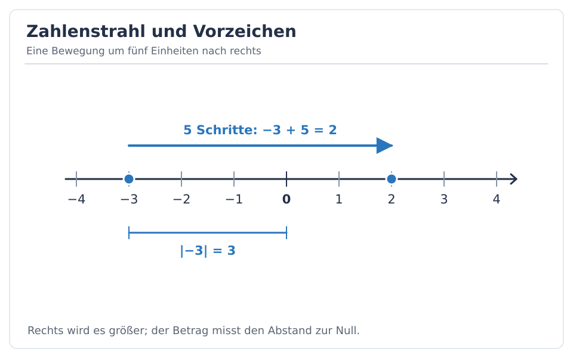

# M1-L1 – Zahlenarten, negative Zahlen, Variablen und erste Gleichungen {#L1}

**Kursbereich:** M1 – Sekundarstufe I

**Niveau:** Sekundarstufe I

**Vorwissen:** Keine festen Voraussetzungen angegeben.

**Einordnung:** Sekundarstufe I, didaktisch ungefähr Klasse 7 · Format: zügige Auffrischung

## Worum geht es? {#S1}

Mit Zahlen zählen wir Dinge, vergleichen Größen und beschreiben Veränderungen. Für Anteile, Schulden oder Messwerte reichen positive ganze Zahlen allein nicht aus. Eine andere grundlegende Idee ist, statt bestimmter Zahlen Platzhalter zu verwenden. Dadurch entstehen allgemeine Aussagen und Gleichungen, mit denen wir unbekannte Werte berechnen können.

## Zahlenarten und ihre Zeichen {#S2}

Die Buchstaben stehen als Kurzbezeichnungen für **Mengen** von Zahlen. Eine Menge ist hier eine Zusammenfassung von Zahlen mit gemeinsamen Eigenschaften.

  Zeichen      Gesprochener Name   Bedeutung                                                             Beispiele / Besonderheit
  ------------ ------------------- --------------------------------------------------------------------- ------------------------------------------------------
  $\mathbb N$  natürliche Zahlen   Zählzahlen                                                            1, 2, 3, …; die 0 wird je nach Konvention mitgezählt
  $\mathbb Z$  ganze Zahlen        Positive, negative und Null                                           …, −2, −1, 0, 1, 2, …
  $\mathbb Q$  rationale Zahlen    Als Bruch zweier ganzer Zahlen mit Nenner ungleich null darstellbar   $\frac12,-\frac34,2{,}5$
  $\mathbb R$  reelle Zahlen       Rationale und irrationale Zahlen zusammen                             $-2,0,\sqrt2,\pi$

Diese Arten sind ineinander enthalten: Jede natürliche Zahl ist auch ganz, jede ganze Zahl rational, jede rationale Zahl reell. Es gibt außerdem reelle Zahlen, die sich nicht als Bruch zweier ganzer Zahlen ausdrücken lassen, zum Beispiel $\sqrt2$ und $\pi$. Die Zeichen √ und π werden in späteren Lektionen vertieft: √ bedeutet Quadratwurzel, π („Pi“) bezeichnet die Kreiszahl.

## Negative Zahlen auf dem Zahlenstrahl {#S3}

Die **0** ist der Bezugspunkt. Rechts liegen größere, links kleinere Werte. Das Vorzeichen **−** bezeichnet eine negative Zahl; zwischen zwei Zahlen kann es eine Subtraktion bedeuten.

Zahlenstrahl: $-3+5=2$. Der Betrag $|-3|$ ist der Abstand zur Null.

**Mini-Beispiel – Formel:**

$-3+5=2$

**Laut gelesen:** „Minus drei plus fünf ist gleich zwei.“

Ausgehend von $-3$ gehen wir fünf Schritte nach rechts und landen bei 2. Dasselbe Prinzip kann etwa eine Temperaturveränderung oder eine Kontobewegung beschreiben.

## Variablen und Gleichungen {#S4}

Eine **Variable** ist ein Buchstabe, der einen Wert bezeichnet. Das Zeichen $x$ („iks“) ist kein besonderer Zahlentyp: Sein Sinn kommt aus dem Problem. Zwischen Zahl und Variable kann das Malzeichen wegfallen; $2x$ heißt „zwei mal x“.

**Formel:**

$2x+3=11$

**Laut gelesen:** „Zwei mal x plus drei ist gleich elf.“

Gesucht ist ein Wert, dessen Doppeltes, vermehrt um drei, elf ergibt. Die Lösung ist $x=4$, denn $2\cdot4+3=11$. Das Symbol `·` spricht man als „mal“ und `=` als „ist gleich“.

## Zeichenlesehilfe {#S5}

  Zeichen                                    Aussprache                                    Bedeutung hier                             Anderer möglicher Gebrauch
  ------------------------------------------ --------------------------------------------- ------------------------------------------ -------------------------------------------------
  $\mathbb N,\mathbb Z,\mathbb Q,\mathbb R$  natürliche, ganze, rationale, reelle Zahlen   Zahlenmengen                               In höherer Mathematik definierte Mengen
  $x$                                        iks                                           Unbekannter Zahlenwert                     Koordinate, Eingabegröße
  −                                          minus                                         Negativ oder Subtraktion                   Vorzeichen eines Terms
  \+                                         plus                                          Addition                                   Auch Verknüpfung anderer mathematischer Objekte
  =                                          ist gleich                                    Identischer Zahlenwert auf beiden Seiten   In Programmiersprachen teils Zuweisung
  $2x$                                       zwei mal iks                                  Multiplikation ohne `·`                    Auch bei anderen Variablen üblich

## Wofür nützlich? {#S6}

Zahlenarten definieren, was ein Programm als Eingabe sinnvoll zulassen darf: Eine Anzahl bearbeiteter Aufgaben ist typischerweise eine nichtnegative ganze Zahl, eine Position kann negativ sein, und ein Messwert kann gebrochen sein. Variablen und Gleichungen helfen, Kosten, Ressourcen, Laufzeiten oder physikalische Größen allgemein zu modellieren.

## Annahmen und Grenzen {#S7}

Die gesuchte Größe muss zum Sachverhalt passen: Wenn $x$ eine Stückzahl ist, wäre $x=4{,}5$ in der Regel keine sinnvolle Lösung. Bei realer Software unterscheiden sich theoretische Zahlenmengen außerdem von begrenzt großen Datentypen und Gleitkommazahlen.

## Verbindung zu M1-L2 {#S8}

Brüche und Prozente machen aus bloßen Anzahlen **Anteile und Beziehungen zwischen Größen**.

## Quellen {#S9}

In dieser Lektion sind keine Einzelquellen gesondert verzeichnet.
