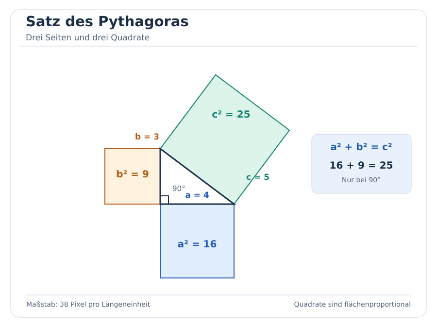

# M1-L10 – Satz des Pythagoras, Abstände und Längen {#L10}

**Kursbereich:** M1 – Sekundarstufe I

**Niveau:** Sekundarstufe I

**Vorwissen:** Keine festen Voraussetzungen angegeben.

**Einordnung:** Sekundarstufe I, didaktisch ungefähr Klasse 8 · Format: zügige Auffrischung

## Worum geht es? {#S1}

Wie lang ist eine diagonale Strecke, wenn wir nur waagerechte und senkrechte Entfernungen kennen? Der Satz des Pythagoras löst genau diese Frage bei rechtwinkligen Dreiecken. Er verbindet drei Seitenlängen miteinander, ohne dass wir die Diagonale direkt messen müssen. Dieselbe Idee hilft später beim Berechnen von Abständen zwischen Koordinatenpunkten, von Bildschirmdiagonalen und von Wegen eines Roboters.

## Grundidee und Anschauung {#S2}

Stelle dir ein rechtwinkliges Dreieck vor: Eine Seite verläuft waagerecht, eine senkrecht, die dritte ist die schräge Verbindung. Der Winkel zwischen den beiden zuerst genannten Seiten beträgt genau 90 Grad, also einen rechten Winkel. Die beiden Seiten am rechten Winkel heißen **Katheten**; die längste, gegenüberliegende Seite heißt **Hypotenuse**. Die Quadrate über den Katheten haben zusammen denselben Flächeninhalt wie das Quadrat über der Hypotenuse. Daraus entsteht die berühmte Längenformel.

{alt="Rechtwinkliges 3-4-5-Dreieck mit Quadratflächen 9, 16 und 25 über den drei Seiten. Die Kathetenquadrate zusammen ergeben das Hypotenusenquadrat."}

Eigene Konstruktion im 3-4-5-Verhältnis: $3^2+4^2=5^2$, also $9+16=25$.

Eine rein textuelle Skizze, die in jedem Markdown-Leser funktioniert:

Formel, Skizze oder Rechenschema · Originalnotation

    C  *
       |\
     b | \ c   (schräge Hypotenuse)
       |  \
       |___\
    A  * a * B

    Rechter Winkel bei A; Katheten a und b, Hypotenuse c.

## Neue Zeichen vor der ersten Formel {#S3}

  Zeichen                 Aussprache                 Bedeutung hier                                                Anderer möglicher Gebrauch
  ----------------------- -------------------------- ------------------------------------------------------------- ----------------------------------------------------------------
  $a$, $b$                a und be                   Längen der beiden Katheten                                    Beliebige Variablen; $b$ war in M1-L8 der Achsenabschnitt
  $c$                     ce                         Länge der Hypotenuse                                          Häufig auch eine beliebige Konstante
  `²`                     hoch zwei, zum Quadrat     Multiplikation einer Länge mit sich selbst                    Bei Flächeneinheiten: Quadratzentimeter oder Quadratmeter
  `+` / `=`               plus / ist gleich          Addition bzw. gleiche Flächeninhalte                          Allgemeine Rechenoperationen
  `√`                     Quadratwurzel              Nichtnegative Zahl, deren Quadrat den gegebenen Wert ergibt   Wurzeln anderer Ordnung werden später unterschieden
  $d$                     de                         Gesuchte Entfernung                                           Kann auch für Durchmesser oder Differentialschreibweise stehen
  $\Delta x$, $\Delta y$  Delta iks, Delta ypsilon   Differenz der x- bzw. y-Koordinate                            Delta als Veränderung, bereits in M1-L8 erläutert
  $P$, $Q$                pe und ku                  Namen zweier Punkte                                           $P$ bezeichnet ab M1-L12 auch Wahrscheinlichkeit
  `⊥`                     steht senkrecht auf        Symbol für einen rechten Winkel zwischen Geraden/Strecken     Senkrechtbeziehung von Vektoren in späteren Lektionen

## Wichtigste Formel 1: Der Satz des Pythagoras {#S4}

$$
a^2+b^2=c^2
$$

**Laut gelesen:** „a zum Quadrat plus b zum Quadrat ist gleich c zum Quadrat.“ Gemeint sind die **Quadrate der Seitenlängen**, nicht einfach die drei Längen selbst. $a$ und $b$ sind die Katheten; $c$ ist die Hypotenuse. Der Satz gilt für **rechtwinklige Dreiecke** in der gewöhnlichen euklidischen Ebene. **Alle drei Seitenlängen eines echten Dreiecks sind strikt positiv.** Eine Länge von null beschreibt nur einen entarteten Grenzfall, kein gewöhnliches Dreieck; negative Seitenlängen sind ausgeschlossen.

Wenn die Hypotenuse gesucht ist, nehmen wir die nichtnegative Quadratwurzel:

$$
c=\sqrt{a^2+b^2}
$$

**Laut gelesen:** „c ist die Quadratwurzel aus der Summe von a zum Quadrat und b zum Quadrat.“ Der Ausdruck innerhalb der Wurzel wird zuerst berechnet. Die Wurzel liefert die positive oder im Grenzfall null betragende Länge, nicht zusätzlich eine negative Lösung.

### Mini-Beispiel: eine Diagonale ohne Maßband {#abschnitt-5}

Ein rechteckiger Bildschirmbereich hat eine Breite von 30 Zentimetern und eine Höhe von 40 Zentimetern. Die Diagonale ist die Hypotenuse des rechtwinkligen Dreiecks:

$$
\begin{aligned}
a&=30\,\mathrm{cm}\\b&=40\,\mathrm{cm}\\
c^2&={(30\,\mathrm{cm})}^2+{(40\,\mathrm{cm})}^2\\
&=900\,\mathrm{cm}^2+1600\,\mathrm{cm}^2=2500\,\mathrm{cm}^2\\
c&=\sqrt{2500\,\mathrm{cm}^2}=50\,\mathrm{cm}
\end{aligned}
$$

**Laut gelesen:** „Dreißig Zentimeter zum Quadrat plus vierzig Zentimeter zum Quadrat ergeben zweitausendfünfhundert Quadratzentimeter. Die Quadratwurzel daraus ergibt fünfzig Zentimeter.“ Die Diagonale ist also 50 Zentimeter lang. Die **Einheiten werden mitquadriert**: ${(30\,\mathrm{cm})}^2$ bedeutet $900\,\mathrm{cm}^2$, nicht $900\,\mathrm{cm}$. Nach dem Wurzelziehen erhalten wir wieder eine Länge in Zentimetern.

### Was ist die zugrunde liegende Beweisidee? {#abschnitt-6}

Man kann vier gleiche rechtwinklige Dreiecke auf zwei Arten in ein großes Quadrat legen. Die jeweils übrige Fläche muss in beiden Anordnungen gleich groß sein. Einmal lässt sie sich als Quadrat über der Hypotenuse, einmal als Summe der Quadrate über den Katheten lesen. Das ist ein anschaulicher Grund, weshalb die Formel funktioniert; für einen formalen Beweis müsste die Flächenzerlegung exakt beschrieben werden.

## Wichtigste Formel 2: Abstand zweier Punkte {#S5}

Ein Punkt hat wie in M1-L4 ein geordnetes Koordinatenpaar. $P(x_1;y_1)$ bezeichnet einen ersten Punkt mit den Koordinaten „iks eins“ und „ypsilon eins“, $Q(x_2;y_2)$ einen zweiten. Die tiefgestellten Zahlen **1 und 2** unterscheiden die beiden Punkte; sie sind keine Exponenten.

Die waagerechte Koordinatendifferenz ist $\Delta x=x_2-x_1$, die senkrechte $\Delta y=y_2-y_1$. Diese beiden Strecken bilden die Katheten eines rechtwinkligen Dreiecks. Die direkte Entfernung ist daher:

$$
d=\sqrt{{(x_2-x_1)}^2+{(y_2-y_1)}^2}
$$

**Laut gelesen:** „Die Entfernung de ist die Quadratwurzel aus: Differenz der zweiten und ersten iks-Koordinate zum Quadrat plus Differenz der zweiten und ersten ypsilon-Koordinate zum Quadrat.“ Beide Differenzen werden quadriert, sodass ihre möglicherweise negativen Vorzeichen für den Abstand keine Rolle spielen. Die Koordinaten müssen sich auf dieselbe Einheit und dasselbe **orthogonale Koordinatensystem mit gleicher Längenskalierung** beziehen. Sind die Achseneinheiten verschieden (etwa Meter auf der einen und Sekunden auf der anderen Achse), lässt sich die gezeigte Entfernung nicht unmittelbar als physikalische Länge deuten.

### Mini-Beispiel: zwei Positionen auf einer Karte {#abschnitt-8}

$$
\begin{aligned}
P(1;2),\quad Q(4;6)\\
\Delta x&=4-1=3\\
\Delta y&=6-2=4\\
d&=\sqrt{3^2+4^2}=\sqrt{9+16}=5
\end{aligned}
$$

**Gesprochen:** „P liegt bei eins, zwei; Q liegt bei vier, sechs. Der horizontale Unterschied ist drei, der vertikale vier. Der direkte Abstand beträgt fünf Längeneinheiten.“ Das ist die bekannte **3–4–5-Konstellation**.

Der Abstand ist die **Luftlinie** im mathematischen Modell. Er ist nicht automatisch der Weg entlang von Straßen, Hindernissen oder vorgegebenen Roboter-Fahrspuren.

## Kurzer Ausblick: drei Raumrichtungen {#S6}

In einem dreidimensionalen, rechtwinkligen Koordinatensystem gibt es zusätzlich eine dritte Achse, üblicherweise $z$ („zett“). Für die Koordinatendifferenzen $\Delta x$, $\Delta y$ und $\Delta z$ ergibt sich durch wiederholte Anwendung des Satzes:

$$
d=\sqrt{{(\Delta x)}^2+{(\Delta y)}^2+{(\Delta z)}^2}
$$

**Laut gelesen:** „Abstand ist die Quadratwurzel aus Delta iks zum Quadrat plus Delta ypsilon zum Quadrat plus Delta zett zum Quadrat.“ Die Formel ist hier nur ein geometrischer Ausblick; räumliche Koordinaten werden in M1-L21 und Vektoren in M2-L11 systematisch vertieft.

## Wofür nützlich? {#S7}

In einer Grafik- oder CAD-Anwendung berechnet man damit Diagonalen und direkte Abstände von Bildpunkten oder geometrischen Objekten. In einer Simulation kann ein Agent feststellen, wie weit zwei Positionen in einem ebenen Koordinatensystem auseinanderliegen; in der Robotik wird daraus später ein Abstand zwischen Positionen im Raum. Auch bei der Bildverarbeitung und in der linearen Algebra taucht die zugrunde liegende Idee der **euklidischen Länge** immer wieder auf.

## Annahmen und Grenzen {#S8}

- Der Grundsatz $a^2+b^2=c^2$ gilt nur im **rechtwinkligen** Dreieck. Bei anderen Winkeln brauchen wir später beispielsweise den Kosinussatz.
- Gleiche Einheiten verwenden: Zentimeter und Meter nicht ohne Umrechnung miteinander kombinieren.
- Die Distanzformel beschreibt die **geradlinige Entfernung** im euklidischen Koordinatensystem. Auf einer Straßenkarte, entlang gekrümmter Oberflächen oder bei eingeschränkten Bewegungsrichtungen kann ein anderes Distanzmodell sinnvoll sein.
- In Software kann das Quadrieren extrem großer Zahlen zu einem Überlauf führen. Für robuste numerische Verfahren gibt es dafür geeignete Implementierungen, etwa eine hypot-Funktion.

## Verbindung zu M1-L11 {#S9}

Pythagoras verbindet rechtwinklige Strecken. In **M1-L11** vergleichen wir geometrische Figuren gleicher Form in verschiedenen Größen: **Ähnlichkeit, Strahlensätze und Maßstab**.

## Quellen {#S10}

In dieser Lektion sind keine Einzelquellen gesondert verzeichnet.
