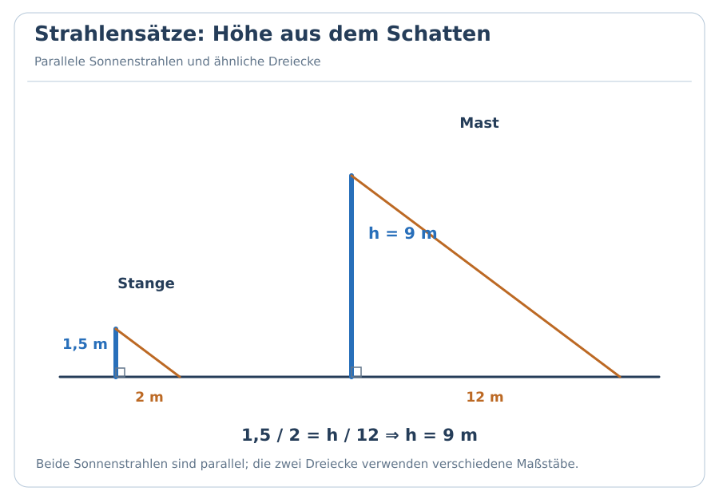

# M1-L11 – Ähnlichkeit, Strahlensätze und Maßstab {#L11}

**Kursbereich:** M1 – Sekundarstufe I

**Niveau:** Sekundarstufe I

**Vorwissen:** Keine festen Voraussetzungen angegeben.

**Einordnung:** Sekundarstufe I, didaktisch ungefähr Klasse 8 · Format: zügige Auffrischung

## Worum geht es? {#S1}

Ein Foto kann vergrößert werden, ohne dass Menschen darauf plötzlich andere Proportionen haben. Zwei Dreiecke können unterschiedlich groß sein und trotzdem dieselbe Form besitzen. Für solche Situationen benutzen wir den Begriff **Ähnlichkeit**: Die entsprechenden Winkel stimmen überein und die entsprechenden Seiten stehen in einem einheitlichen Größenverhältnis. Strahlensätze helfen anschließend, nicht direkt messbare Strecken aus bekannten Strecken zu bestimmen. Der Maßstab überträgt dasselbe Prinzip auf Karten, Baupläne und Modelle.

## Grundidee und Anschauung {#S2}

Stelle dir ein kleines Dreieck vor, das du gleichmäßig vergrößerst. Jede Seitenlänge wächst mit demselben Faktor, alle Winkel bleiben unverändert. Ist der Faktor zwei, werden alle Seiten doppelt so lang. Die Form bleibt erhalten. Das ist etwas anderes als eine beliebige Streckung nur in der Breite: Dabei könnten sich Winkel und Seitenverhältnisse ändern.

Bei **Dreiecken** genügt bereits, dass zwei Paare entsprechender Winkel übereinstimmen (das **Winkel-Winkel-Kriterium**, kurz WW). Dann ist auch der dritte Winkel gleich und alle entsprechenden Seiten stehen im selben Verhältnis. Bei beliebigen Vierecken reichen gleiche Winkel allein dagegen nicht für Ähnlichkeit. Besonders anschaulich ist der Fall, in dem ein kleineres Dreieck innerhalb eines größeren liegt und die einander entsprechenden Querstrecken parallel verlaufen.

## Neue Zeichen vor der ersten Formel {#S3}

  Zeichen         Aussprache             Bedeutung hier                                                   Anderer möglicher Gebrauch
  --------------- ---------------------- ---------------------------------------------------------------- ------------------------------------------------------------------------------
  $a$, $b$        a, be                  Seitenlängen einer Ausgangsfigur                                 Beliebige Variablen
  $a'$, $b'$      a Strich, be Strich    Zugehörige Seiten einer ähnlich vergrößerten Figur               Strich markiert in der Analysis später auch Ableitungen, dort bei Funktionen
  $k$             ka                     Gemeinsamer positiver Vergrößerungs- oder Verkleinerungsfaktor   In M1-L2 allgemeiner Proportionalitätsfaktor
  `/`             durch, geteilt durch   Verhältnis zweier gleichartiger Längen                           Division allgemein
  `∼`             ist ähnlich zu         Zwei Figuren haben gleiche Form, aber ggf. andere Größe          Ähnlichkeitsrelationen auch in anderen mathematischen Kontexten
  `∥`             ist parallel zu        Geraden bzw. Strecken verlaufen parallel                         In höherer Mathematik können doppelte Striche auch Normen kennzeichnen
  $S$, $A$, $B$   ess, a, be             Bezeichnungen geometrischer Punkte                               Große Buchstaben können auch Mengen bezeichnen
  $SA$            Strecke ess–a          Länge der Strecke zwischen den Punkten S und A                   Ohne Kontext gelegentlich die Strecke als Objekt selbst
  `:`             zu                     Maßstabsverhältnis                                               Auch Division, vgl. M1-L2

## Wichtigste Formel 1: Gemeinsamer Streckfaktor {#S4}

Sind zwei Figuren ähnlich, dann haben je zwei **einander entsprechende** Seiten dasselbe Längenverhältnis:

$$
\frac{a'}{a}=\frac{b'}{b}=k
$$

**Laut gelesen:** „a Strich geteilt durch a ist gleich be Strich geteilt durch be und gleich ka.“ $a$ und $b$ bezeichnen Seiten der ursprünglichen Figur, $a'$ und $b'$ deren passende Seiten in der neuen Figur. Der positive Faktor $k$ beschreibt, wie stark die Längen skaliert werden. Bei $k=2$ werden alle Längen verdoppelt; bei $k=0{,}5$ halbiert. Ausgangslängen müssen größer als null sein, damit die gezeigten Quotienten definiert sind.

### Mini-Beispiel: ein Dreieck wird vergrößert {#abschnitt-5}

Ein Dreieck hat zwei Seiten von 3 und 4 Zentimetern. Eine geometrisch ähnliche Kopie wird mit dem Faktor zwei erstellt. Die entsprechenden Seiten sind danach 6 und 8 Zentimeter lang. Die Zahlenverhältnisse $\frac63$ und $\frac84$ sind beide zwei; die Winkel bleiben unverändert. So lässt sich auch die dritte Seite mit demselben Faktor vergrößern, ohne jedes Detail neu zu konstruieren.

**Hinweis zur Fläche:** Bei doppelten Seitenlängen wird die Fläche **viermal** so groß, nicht nur zweimal. Allgemein wächst eine Fläche mit dem Quadrat des Längenfaktors; das Volumen eines räumlich ähnlich vergrößerten Körpers mit der dritten Potenz. Dieses einfache Prinzip ist für technische Größenabschätzungen wichtig.

## Wichtigste Formel 2: Der Strahlensatz {#S5}

Von einem gemeinsamen Ausgangspunkt $S$ gehen zwei Strahlen aus. Der erste trifft eine nahe Querstrecke im Punkt $A$ und eine weiter entfernte im Punkt $A'$. Der zweite trifft dieselben Querstrecken in $B$ und $B'$. Wenn die Querstrecken $AB$ und $A'B'$ parallel zueinander sind und die genannten Punkte jeweils auf denselben Strahlen in der angegebenen Reihenfolge liegen, entstehen zwei ähnliche, nicht entartete Dreiecke. Der gemeinsame Ausgangspunkt $S$ liegt nicht auf einer der Querstrecken; alle Streckenlängen in den folgenden Nennern sind positiv.

Formel, Skizze oder Rechenschema · Originalnotation

    Strahl 1: S → A → A′
    Strahl 2: S → B → B′

    A und B sind die näheren Punkte; A′ und B′ liegen weiter außen.
    Die Querstrecken AB und A′B′ sind parallel: AB ∥ A′B′.

Für die entsprechenden Strecken gilt:

$$
\frac{SA}{SA'}=\frac{SB}{SB'}=\frac{AB}{A'B'}
$$

**Laut gelesen:** „Die Entfernung von S nach A geteilt durch die Entfernung von S nach A Strich ist gleich der Entfernung von S nach B geteilt durch die Entfernung von S nach B Strich und gleich der kleinen Querstrecke A–B geteilt durch die großen Querstrecke A Strich–B Strich.“ Alle drei Quotienten vergleichen die näher am Ausgangspunkt liegende mit der weiter entfernten entsprechenden Strecke; unter der beschriebenen Reihenfolge sind die Zähler kürzer als die Nenner. Man darf die Richtung der Brüche auch überall gleichzeitig umkehren, aber nicht willkürlich nur in einem einzelnen Bruch. **Eine Drehung oder Spiegelung ähnlicher Figuren ändert weder das gemeinsame Längenverhältnis noch die Winkelgrößen**; ähnlich bedeutet also nicht zwingend „gleich ausgerichtet“.

### Mini-Beispiel: unbekannte Höhe aus einem Schatten {#abschnitt-7}

Eine senkrechte Stange von 1,5 Metern Länge wirft bei Sonnenschein einen 2 Meter langen Schatten. Gleichzeitig wirft ein senkrechter Mast einen 12 Meter langen Schatten. Bei annähernd parallelen Sonnenstrahlen und ebenem Boden sind die beiden entstehenden rechtwinkligen Dreiecke ähnlich.

Strahlensätze: Gleiche Höhen-Schatten-Verhältnisse ergeben $h=9\,\mathrm m$.

$$
\begin{aligned}
\frac{\text{Stangenhöhe}}{\text{Stangenschatten}}&=\frac{\text{Masthöhe}}{\text{Mastschatten}}\\
\frac{1{,}5\,\mathrm{m}}{2\,\mathrm{m}}&=\frac{\text{Masthöhe}}{12\,\mathrm{m}}\\
\text{Masthöhe}&=\frac{1{,}5}{2}\cdot12\,\mathrm{m}=9\,\mathrm{m}
\end{aligned}
$$

**Laut gelesen:** „Das Verhältnis der Stangenhöhe zu ihrer Schattenlänge ist gleich dem Verhältnis der Masthöhe zu deren Schattenlänge.“ Der Mast ist unter den genannten Annahmen 9 Meter hoch. Das Ergebnis hängt insbesondere davon ab, dass Schatten und Objekte zur selben Zeit und in vergleichbarer Geländegeometrie betrachtet werden.

## Maßstab: dieselbe Idee auf Plänen {#S6}

Ein **Maßstab** beschreibt das Verhältnis einer Darstellung zur entsprechenden Wirklichkeit. $1:50\,000$ wird „eins zu fünfzigtausend“ gelesen. Es bedeutet: Eine Längeneinheit auf der Karte entspricht fünfzigtausend **derselben** Einheiten in der Realität.

### Mini-Beispiel: Entfernung auf einer Karte {#abschnitt-9}

Bei Maßstab $1:50\,000$ entspricht ein Zentimeter auf der Karte 50 000 Zentimetern, also 500 Metern in Wirklichkeit. Zwei Zentimeter entsprechen somit einem Kilometer. Die Umrechnung erfolgt entlang der Längen; daraus folgt nicht, dass zwei Quadratzentimeter auf der Karte direkt einem Quadratkilometer entsprechen. Für Flächen muss der Maßstabsfaktor quadriert werden.

## Geometrische Konstruktion als Grundidee {#S7}

Ähnliche Dreiecke lassen sich beispielsweise mit einem Lineal und einem Zirkel systematisch konstruieren. Man zeichnet eine Ausgangsstrecke, trägt auf einem von ihrem Endpunkt ausgehenden Hilfsstrahl gleich große Teilstücke ab und zieht geeignete Parallelen. So entstehen proportionale Strecken ohne Dezimalrechnung. Dieser Ansatz verbindet die klassische Konstruktion mit dem Strahlensatz.

## Wofür nützlich? {#S8}

In CAD- und Grafikprogrammen helfen Skalierungen, Objekte in verschiedenen Größen darzustellen, ohne ihre Form zu verzerren. Beim Umgang mit Karten und technischen Plänen lassen sich aus gemessenen Bildstrecken reale Längen abschätzen. In der Kamerageometrie und Bildverarbeitung wirken ähnliche Dreiecke bei einfachen Perspektivmodellen mit; komplexere reale Kameras benötigen allerdings zusätzliche Kalibrierung.

## Annahmen und Grenzen {#S9}

- **Entsprechende Seiten** müssen richtig zugeordnet sein. Zwei beliebige Seitenverhältnisse zu vergleichen ist noch kein Ähnlichkeitsbeweis.
- Bei den klassischen Strahlensätzen ist die **Parallelität der Querstrecken** entscheidend. Ohne sie gilt die gezeigte Verhältnisgleichheit im Allgemeinen nicht.
- Die Schattenmethode setzt unter anderem gleichzeitige Messung, annähernd paralleles Licht und passende senkrechte Objekte voraus.
- Eine technische Vergrößerung kann Längen proportional skalieren und trotzdem durch Pixelrundung, Perspektive oder Verformung Abweichungen erzeugen.

## Verbindung zu M1-L12 {#S10}

In M1-L11 gingen wir von proportionalen Strecken aus. In **M1-L12** betrachten wir nun die Anzahl möglicher Anordnungen und die Frage, wie **wahrscheinlich** einzelne Ergebnisse sind.

## Quellen {#S11}

In dieser Lektion sind keine Einzelquellen gesondert verzeichnet.
