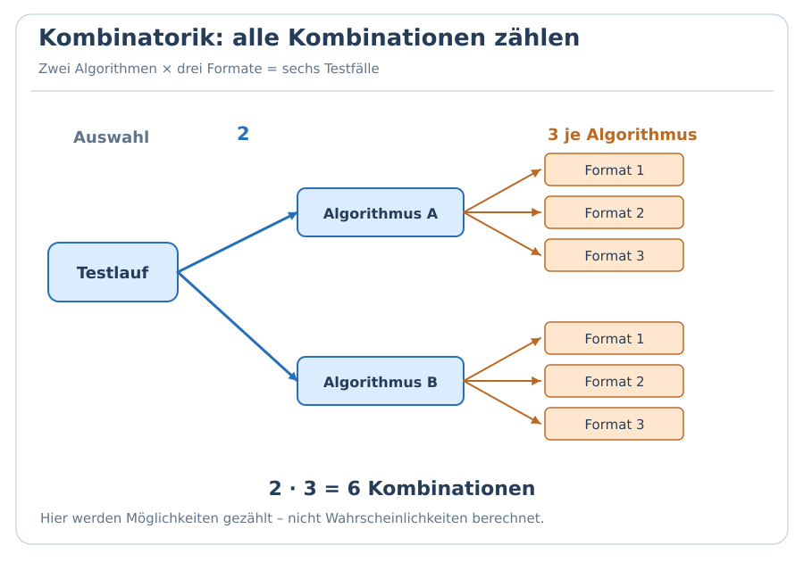

# M1-L12 – Kombinatorik und einfache Wahrscheinlichkeiten {#L12}

**Kursbereich:** M1 – Sekundarstufe I

**Niveau:** Sekundarstufe I

**Vorwissen:** Keine festen Voraussetzungen angegeben.

**Einordnung:** Sekundarstufe I, didaktisch ungefähr Klasse 8 · Format: zügige Auffrischung

## Worum geht es? {#S1}

Wie viele unterschiedliche Möglichkeiten entstehen, wenn mehrere Entscheidungen nacheinander getroffen werden? Und wie groß ist die Chance, dass ein bestimmtes Ergebnis eintritt? Die **Kombinatorik** zählt mögliche Anordnungen und Auswahlen. Die **Wahrscheinlichkeitsrechnung** ordnet möglichen Ergebnissen Zahlen zwischen null und eins zu. Beide Gebiete sind für Zufallsexperimente nützlich, aber nicht dasselbe: Möglichkeiten zählen reicht nur unter bestimmten Bedingungen, um Wahrscheinlichkeiten zu berechnen.

## Grundidee und Anschauung {#S2}

Stelle dir vor, ein Testprogramm kann für die erste Einstellung zwei Varianten und für die zweite Einstellung drei Varianten wählen. Für jede erste Variante gibt es drei zweite Varianten. Insgesamt entstehen deshalb sechs Kombinationen. Bei einem Münzwurf können Ergebnisse hingegen ungewiss sein. Wir fragen dann zusätzlich nach der Wahrscheinlichkeit eines bestimmten Ereignisses, etwa „beide Würfe sind Kopf“.

Ein **Ergebnis** ist ein einzelner möglicher Ausgang eines Experiments. Ein **Ereignis** fasst eines oder mehrere Ergebnisse zusammen, die uns interessieren. Für die Berechnung muss klar sein, welche Ergebnisse möglich sind und wie ihre Wahrscheinlichkeiten zustande kommen.

## Neue Zeichen vor der ersten Formel {#S3}

  Zeichen       Aussprache                                 Bedeutung hier                                                        Anderer möglicher Gebrauch
  ------------- ------------------------------------------ --------------------------------------------------------------------- ------------------------------------------------------------------------------------------------
  $n$, $m$      en und em                                  Anzahl der Möglichkeiten zweier aufeinanderfolgender Entscheidungen   Frei gewählte Variablen; $m$ war in M1-L8 die Steigung
  `·`           mal                                        Multiplikation von Anzahlen oder Wahrscheinlichkeiten                 Weitere Produkte in höherer Mathematik
  `!`           Fakultät, z. B. drei Fakultät              Produkt aller positiven ganzen Zahlen bis zur genannten Zahl          In vielen Programmiersprachen ist `!` die logische Negation
  $P(A)$        Wahrscheinlichkeit von A, „pe von a“       Wahrscheinlichkeit des Ereignisses A                                  $P$ war in M1-L4/M1-L10 auch ein Punktname
  $A$           Ereignis a                                 Eine Menge interessierender Ergebnisse                                In M1-L5 bezeichnet $A$ auch einen Flächeninhalt
  $\Omega$      großes Omega                               Menge aller möglichen elementaren Ergebnisse                          Andere Verwendung in Physik und theoretischer Informatik
  $|\Omega|$    Anzahl der Elemente von Omega              Wie viele verschiedene Ergebnisse in $\Omega$ stehen                  Senkrechte Striche bezeichnen bei Zahlen auch den Betrag; später den Betrag einer Determinante
  $0\le p\le1$  p ist mindestens null und höchstens eins   Zulässiger Zahlenbereich einer Wahrscheinlichkeit p                   Allgemeine Ungleichungsschreibweise
  $K$, $Z$      ka und zett                                Kopf beziehungsweise Zahl beim Münzwurf                               In anderen Kontexten nur gewöhnliche Variablennamen

Das Zeichen `≤` heißt „kleiner oder gleich“. Die Schreibweise $0\le p\le1$ besagt: Eine Wahrscheinlichkeit ist niemals negativ und niemals größer als eins. Multipliziert man sie mit hundert, erhält man eine Prozentangabe.

## Wichtigste Idee 1: Möglichkeiten multiplizieren {#S4}

Wenn eine erste Entscheidung **n** Möglichkeiten und jede davon bei einer zweiten Entscheidung **m** Möglichkeiten zulässt, gilt das **Produktprinzip**:

$$
\text{Anzahl der vollständigen Kombinationen}=n\cdot m
$$

**Laut gelesen:** „Die Anzahl der vollständigen Kombinationen ist en mal em.“ Dabei wird vorausgesetzt, dass die zweite Stufe tatsächlich bei **jeder** ersten Wahl gleich viele Möglichkeiten bietet. Bei unterschiedlich vielen Fortsetzungen muss man die einzelnen Zweige auszählen und addieren.

### Mini-Beispiel: Testkonfigurationen {#abschnitt-5}

Ein Programm kann zwischen zwei Algorithmen und drei Dateiformaten wählen. Jede Algorithmuswahl lässt sich mit jedem der drei Formate kombinieren. Das sind $2\cdot3=6$ Testkonfigurationen.

{alt="Baumdiagramm mit zwei Algorithmen und je drei Dateiformaten, zusammen sechs Kombinationen."}

Kombinatorik: Zwei mal drei Wahlmöglichkeiten ergeben sechs Konfigurationen.

Formel, Skizze oder Rechenschema · Originalnotation

                      ┌─ Format 1
    Algorithmus A ────├─ Format 2
                      └─ Format 3
                      ┌─ Format 1
    Algorithmus B ────├─ Format 2
                      └─ Format 3

**Laut gelesen:** „Zwei Algorithmen mal drei Formate ergeben sechs mögliche Paare.“ In komplexeren Programmen wächst die Anzahl der Testfälle mit weiteren unabhängigen Einstellungsdimensionen schnell an – ein Grund für gezielte Testauswahl.

## Wichtigste Idee 2: Reihenfolgen ohne Wiederholung {#S5}

Wenn drei **verschiedene** Objekte alle hintereinander angeordnet werden, gibt es für den ersten Platz drei Möglichkeiten, für den zweiten danach noch zwei und für den dritten nur noch eine. Die Zahl ist also $3\cdot2\cdot1=6$.

Für das Produkt aller positiven ganzen Zahlen von 1 bis zu einer positiven ganzen Zahl $n$ verwenden wir die Schreibweise **n Fakultät**, also $n!$:

$$
3!=3\cdot2\cdot1=6
$$

**Laut gelesen:** „Drei Fakultät ist drei mal zwei mal eins, also sechs.“ Die spezielle Vereinbarung $0!=1$ wird in der Kombinatorik ebenfalls verwendet. Fakultäten zählen hier **Anordnungen unterscheidbarer Objekte**, wenn jedes genau einmal vorkommt. Bei gleichen Objekten oder wenn die Reihenfolge keine Rolle spielt, gelten andere Zählregeln; diese vertiefen wir später.

## Wichtigste Idee 3: Wahrscheinlichkeit bei gleich wahrscheinlichen Ergebnissen {#S6}

Die Zahl möglicher Ergebnisse allein sagt noch nicht, wie wahrscheinlich jedes ist. Bei einer **fairen Münze** nehmen wir an, dass Kopf und Zahl gleich wahrscheinlich sind. Bei zwei unabhängigen Würfen einer solchen Münze entstehen vier gleich wahrscheinliche Folgen:

Formel, Skizze oder Rechenschema · Originalnotation

    Start
    ├─ K (1/2)
    │  ├─ K (1/2)  → KK
    │  └─ Z (1/2)  → KZ
    └─ Z (1/2)
       ├─ K (1/2)  → ZK
       └─ Z (1/2)  → ZZ

Das Baumdiagramm ist schematisch: Es zeigt die verschiedenen Pfade. Jeder einzelne Wurf hat unter der Fairnessannahme Wahrscheinlichkeit $\frac12$. Eine vollständige Folge hat deshalb Wahrscheinlichkeit $\frac12\cdot\frac12=\frac14$.

Für eine **endliche, nicht leere Ergebnismenge** mit **gleich wahrscheinlichen** elementaren Ergebnissen können wir die Wahrscheinlichkeit eines Ereignisses mit der Laplace-Formel berechnen:

$$
P(A)=\frac{\text{günstige Ergebnisse}}{\text{alle möglichen Ergebnisse}}
$$

**Laut gelesen:** „Die Wahrscheinlichkeit des Ereignisses a ist die Anzahl der günstigen Ergebnisse geteilt durch die Gesamtzahl aller möglichen Ergebnisse.“ Das Wort „günstig“ bedeutet dabei nur „zum Ereignis gehörend“, nicht „gut“ oder „wünschenswert“. Mathematisch ist der Nenner $|\Omega|$, also die Anzahl aller Ergebnisse der Ergebnismenge Omega; hier muss $|\Omega|$ größer als null sein. Bei nicht gleich wahrscheinlichen Ergebnissen ist stattdessen die Summe ihrer einzelnen Wahrscheinlichkeiten maßgeblich.

### Mini-Beispiel: zweimal Kopf {#abschnitt-8}

Das Ereignis $A$ lautet „Bei zwei Münzwürfen erscheint zweimal Kopf.“ Von den vier gleich wahrscheinlichen Folgen `KK`, `KZ`, `ZK` und `ZZ` passt nur `KK`.

$$
P(A)=\frac14=0{,}25=25\,\%
$$

**Laut gelesen:** „Die Wahrscheinlichkeit für zweimal Kopf beträgt ein Viertel, also null Komma zwei fünf oder fünfundzwanzig Prozent.“ Das ist eine Modellwahrscheinlichkeit, keine Garantie, dass bei vier Versuchen tatsächlich einmal zweimal Kopf fällt.

## Baumdiagramm mit veränderten Wahrscheinlichkeiten {#S7}

Ein Baumdiagramm kann auch **ungleiche** Wahrscheinlichkeiten darstellen. In einem Beutel liegen zwei rote und eine blaue Kugel. Wenn nacheinander zwei Kugeln **ohne Zurücklegen** gezogen werden, verändert die erste Ziehung die Zusammensetzung vor der zweiten. Die Wahrscheinlichkeit, zuerst Rot zu ziehen, beträgt $\frac23$. Nach einer roten Kugel bleibt unter den zwei übrigen Kugeln nur noch eine rote. Die Wahrscheinlichkeit für eine zweite rote Kugel **unter dieser Voraussetzung** beträgt $\frac12$.

Für den vollständigen Pfad „Rot, dann Rot“ gilt daher:

$$
P(\text{zweimal Rot})=\frac23\cdot\frac12=\frac13
$$

**Laut gelesen:** „Die Wahrscheinlichkeit für zweimal Rot ist zwei Drittel mal ein Halb, also ein Drittel.“ Hier wird mit einer Wahrscheinlichkeit multipliziert, die ausdrücklich von der ersten Ziehung abhängt. Die **Pfadregel gilt auch bei abhängigen Ziehungen**: Zuerst wird die Wahrscheinlichkeit für Rot verwendet, dann die Wahrscheinlichkeit für Rot **unter der Bedingung**, dass zuvor Rot gezogen wurde. Die beiden Ziehungen sind ohne Zurücklegen **nicht unabhängig**. Erst in M1-L22 betrachten wir die formale Schreibweise für bedingte Wahrscheinlichkeiten.

## Wofür nützlich? {#S8}

Kombinatorik hilft, die Anzahl möglicher Systemzustände, Testkonfigurationen und möglicher Aktionsfolgen von Software-Agenten abzuschätzen. Wahrscheinlichkeiten erscheinen in Simulationen, Fehleranalysen und später im maschinellen Lernen. Für die KI sind vor allem sauber definierte Zufallsmodelle wichtig: Ein realer Prozess muss nicht dieselben Wahrscheinlichkeiten besitzen wie ein idealisierter Münzwurf.

## Annahmen und Grenzen {#S9}

- Die einfache Formel „günstige durch alle“ gilt nur, wenn die elementaren Ergebnisse **gleich wahrscheinlich** sind. Die bloße Zahl der Möglichkeiten reicht sonst nicht.
- Bei Entscheidungen mit ungleich vielen Fortsetzungen hilft das Produktprinzip in seiner einfachen Form nicht ohne Weiteres; dann müssen die einzelnen Fälle gesondert erfasst werden.
- **Mit Zurücklegen** und **ohne Zurücklegen** erzeugen unterschiedliche Wahrscheinlichkeitspfade.
- Wahrscheinlichkeiten sind Aussagen über ein Modell. Eine relative Häufigkeit aus wenigen Messungen ist nicht automatisch die wahre Wahrscheinlichkeit eines Vorgangs.
- Bei technischen Simulationen kann die Qualität des Zufallszahlengenerators eine Rolle spielen; mathematisches Modell und konkrete Implementierung sind zu unterscheiden.

## Verbindung zu M1-L13 {#S10}

Mit M1-L12 endet unsere didaktische Auffrischung der ungefähr Klasse 8 zugeordneten Grundlagen. In **M1-L13** beginnen die **quadratischen Funktionen und Gleichungen**: Parabeln, Scheitelpunkte und Nullstellen.

## Quellen {#S11}

In dieser Lektion sind keine Einzelquellen gesondert verzeichnet.
