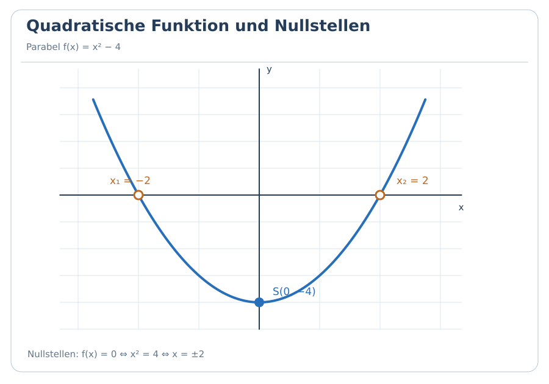

# M1-L13 – Quadratische Funktionen und Gleichungen {#L13}

**Kursbereich:** M1 – Sekundarstufe I

**Niveau:** Sekundarstufe I

**Vorwissen:** Keine festen Voraussetzungen angegeben.

**Einordnung:** Sekundarstufe I, didaktisch ungefähr Klasse 9 · Format: zügige Auffrischung

## Worum geht es? {#S1}

Bisher haben wir Beziehungen kennengelernt, deren Graph eine Gerade ist. Manche Vorgänge verändern sich jedoch nicht mit einer konstanten Steigung. Wenn eine Größe von einer Zahl abhängt, die mit sich selbst multipliziert wird, entsteht häufig eine gekrümmte Kurve: eine **Parabel**. Quadratische Funktionen beschreiben beispielsweise Wurfbewegungen in vereinfachten physikalischen Modellen, den Flächeninhalt eines Quadrats oder bestimmte Kostenverläufe. Mit quadratischen Gleichungen bestimmen wir dann, bei welchen Eingaben eine solche Funktion einen gesuchten Wert erreicht.

## Grundidee und Anschauung {#S2}

Bei einer linearen Funktion wächst der Funktionswert bei gleichen Eingabeschritten immer um denselben Betrag. Bei einer quadratischen Funktion verändern sich die Zuwächse selbst: Die Kurve wird steiler oder flacher. Eine nach oben geöffnete Parabel besitzt einen tiefsten Punkt, eine nach unten geöffnete einen höchsten Punkt. Dieser besondere Punkt heißt **Scheitelpunkt**. Dort wechselt die Richtung der Kurve – ein erster Vorgriff auf die Optimierung in der Analysis.

Parabelbeispiel: $f(x)=x^2-4$ mit Nullstellen $x=-2$ und $x=2$.

Formel, Skizze oder Rechenschema · Originalnotation

            y
            ↑      *       *
            |       *     *
            |        *   *
            |         * *
            |          S       S = Scheitelpunkt
            +----------------→ x

    Schematische nach oben geöffnete Parabel; nicht maßstäblich.

## Neue Zeichen vor der ersten Formel {#S3}

  Zeichen         Aussprache                                              Bedeutung hier                                                       Anderer möglicher Gebrauch
  --------------- ------------------------------------------------------- -------------------------------------------------------------------- ----------------------------------------------------------------
  $f(x)$          „eff von iks“                                           Ergebnis einer Funktion bei Eingabe x                                f ist ein frei wählbarer Funktionsname
  $x^2$           „iks zum Quadrat“                                       x mal x                                                              Flächenberechnung bei Seitenlänge x
  $a$, $b$, $c$   „a“, „be“, „ce“                                         Feste Zahlen, die die Form der Parabel bestimmen                     In M1-L10 waren a, b und c Seitenlängen
  $a\ne0$         „a ist ungleich null“                                   Voraussetzung für eine echte quadratische Funktion                   Allgemeine Ungleichheit
  $S(x_s;y_s)$    „Scheitelpunkt S mit iks Index S und ypsilon Index S“   Koordinaten des Scheitelpunkts                                       Indizes kennzeichnen auch Messwerte oder Listenelemente
  $x_1$, $x_2$    „iks eins“, „iks zwei“                                  Mögliche Lösungen einer Gleichung                                    Nummerierte Messwerte
  `±`             „plus oder minus“                                       Zwei Fälle: einmal plus, einmal minus                                Kurznotation für zwei Vorzeichenfälle
  `√`             „Quadratwurzel aus“                                     Nichtnegative Quadratwurzel einer nichtnegativen Zahl                Andere Wurzelordnungen haben eigene Schreibweisen
  $D$             „großes de“                                             Hier die Diskriminante: Zahl unter der Wurzel in der Lösungsformel   Kann in anderen Kapiteln eine andere Größe bezeichnen
  $p$, $q$        „pe“, „ku“                                              Zwei frei gewählte Zahlen in binomischen Formeln                     In anderen Kapiteln andere Variablen oder Wahrscheinlichkeiten
  $|a|$           „Betrag von a“                                          Größe von a ohne Vorzeichen                                          Senkrechte Striche können auch andere Bedeutungen haben
  `≥`             „größer oder gleich“                                    Vergleich, zum Beispiel D ist mindestens null                        Allgemeine Ungleichung
  $\mathbb R$     „Menge der reellen Zahlen“                              Alle zugelassenen reellen Eingabewerte einer vollständigen Parabel   Auch in M1-L14 und in der universitären Analysis

## Wichtigste Idee 1: Die allgemeine quadratische Funktion {#S4}

Eine quadratische Funktion besitzt einen Term mit einem Quadrat der Eingabe:

$$
f(x)=a\cdot x^2+b\cdot x+c\qquad\text{mit }a\neq0
$$

**Laut gelesen:** „Eff von iks ist gleich a mal iks zum Quadrat plus be mal iks plus ce; dabei ist a ungleich null.“ Das Quadrat $x^2$ ist der entscheidende Unterschied zur Geradengleichung $f(x)=m\cdot x+b$ aus M1-L8.

- **a** bestimmt unter anderem die Öffnungsrichtung: bei positivem a öffnet die Parabel nach oben, bei negativem a nach unten. Größeres $|a|$ bewirkt bei gleicher Achsenskalierung eine schmalere Form.
- **b** beeinflusst zusammen mit a die horizontale Lage der Parabel.
- **c** ist der Funktionswert bei $x=0$, also der Schnittpunkt mit der senkrechten Achse.

Eine quadratische Funktion ist **nicht direkt proportional**: Selbst bei $c=0$ ist der Zusammenhang im Allgemeinen nicht linear.

### Mini-Beispiel: Werte und Parabelform {#abschnitt-5}

$$
\begin{aligned}
f(x)&=x^2\\
&\begin{array}{c|rrrrr}x&-2&-1&0&1&2\\f(x)&4&1&0&1&4\end{array}
\end{aligned}
$$

**Laut gelesen:** „Eff von iks ist iks zum Quadrat.“ Sowohl minus zwei als auch plus zwei liefern den Wert vier, weil das Quadrat beider Zahlen vier ist. Die gleich weit von null entfernten Eingaben haben denselben Funktionswert. Deshalb ist diese Parabel zur senkrechten Achse symmetrisch.

## Wichtigste Idee 2: Scheitelpunkt und Scheitelpunktform {#S5}

Ist die Parabel nach oben geöffnet, liefert der Scheitelpunkt den kleinsten Funktionswert. Eine häufig besonders anschauliche Schreibweise ist:

$$
f(x)=a\cdot{(x-x_s)}^2+y_s
$$

**Laut gelesen:** „Eff von iks ist gleich a mal der Klammer iks minus iks Index S zum Quadrat, plus ypsilon Index S.“ Das Wertepaar $S(x_s;y_s)$ benennt den Scheitelpunkt. Weil ein Quadrat niemals negativ ist, liegt bei $a>0$ das **globale Minimum über allen reellen Eingaben** an der Stelle $x=x_s$; bei $a<0$ entsteht dort das globale Maximum. **Achtung bei Modellen:** Ist nur ein Teil des Zahlenstrahls als Definitionsbereich zugelassen (etwa nur Zeiten ab null), kann der Scheitelpunkt außerhalb dieses Bereichs liegen. Dann müssen auch die erlaubten Randwerte betrachtet werden.

### Mini-Beispiel: Den Tiefpunkt direkt erkennen {#abschnitt-7}

$$
\begin{aligned}
f(x)&={(x-2)}^2-3\\
S(2;-3)
\end{aligned}
$$

**Laut gelesen:** „Eff von iks ist gleich iks minus zwei in Klammern zum Quadrat, minus drei. Der Scheitelpunkt liegt bei iks gleich zwei und ypsilon gleich minus drei.“ Setzt man für x die Zwei ein, verschwindet der quadrierte Klammerausdruck. Kleinere Funktionswerte als minus drei sind hier nicht möglich.

## Wichtigste Idee 3: Binomische Formeln und Faktorisierung {#S6}

Binomische Formeln helfen, Klammern mit zwei Summanden zu öffnen oder Quadratterme wieder als Klammern zu erkennen. Für zwei beliebige reelle Zahlen p und q gilt beispielsweise:

$$
\begin{aligned}
{(p+q)}^2&=p^2+2\cdot p\cdot q+q^2\\
{(p-q)}^2&=p^2-2\cdot p\cdot q+q^2\\
(p+q)(p-q)&=p^2-q^2
\end{aligned}
$$

**Laut gelesen, mit eindeutigen Klammern:** „Die **gesamte Summe** aus pe und ku wird quadriert; das ist pe Quadrat plus zweimal pe mal ku plus ku Quadrat.“ Die **zweite Formel** liest man: „Die **gesamte Differenz** aus pe und ku wird quadriert; das ergibt pe Quadrat minus zweimal pe mal ku plus ku Quadrat.“ Die **dritte Formel** liest man: „Die Klammer pe plus ku mal die Klammer pe minus ku ist pe Quadrat minus ku Quadrat.“ Sie heißt *Differenz zweier Quadrate*: Die Summe und die Differenz derselben beiden Zahlen ergeben als Produkt die Differenz ihrer Quadrate.

**Mini-Beispiel:** ${(x-3)}^2=x^2-6x+9$. Die mittlere Zahl entsteht aus $-2\cdot x\cdot3$; man darf sie beim Ausmultiplizieren nicht vergessen. Rückwärts gelesen liefert $x^2-6x+9={(x-3)}^2$ eine **Faktorisierung**.

## Wichtigste Idee 4: Nullstellen und quadratische Gleichungen {#S7}

Eine **Nullstelle** ist eine Eingabe, bei der der Funktionswert null wird. Grafisch sind Nullstellen die Schnittpunkte der Parabel mit der waagerechten Achse.

$$
\begin{aligned}
x^2-5x+6&=0\\
(x-2)\cdot(x-3)&=0\\
x_1&=2\quad\text{oder}\quad x_2=3
\end{aligned}
$$

**Laut gelesen:** „Iks zum Quadrat minus fünfmal iks plus sechs ist null. Das lässt sich als Produkt aus iks minus zwei und iks minus drei schreiben. Ein Produkt ist null, wenn mindestens einer seiner Faktoren null ist. Daher sind zwei und drei die Lösungen.“

Die Gleichung hat hier **zwei** reelle Lösungen. Je nach Form kann eine Parabel auch genau eine reelle Nullstelle (Berührung der Achse) oder keine reelle Nullstelle haben.

Für den allgemeinen Fall $a\cdot x^2+b\cdot x+c=0$, mit $a\ne0$, verwendet man die **Mitternachtsformel**. Der Ausdruck $D=b^2-4ac$ heißt Diskriminante.

$$
\begin{aligned}
D&=b^2-4ac\\
x_{1,2}&=\frac{-b\pm\sqrt D}{2a}
\end{aligned}
$$

**Laut gelesen:** „De ist be Quadrat minus viermal a mal ce. Für iks eins beziehungsweise iks zwei bildet man **den gesamten Zähler** minus be plus oder minus die Quadratwurzel aus de und teilt **diesen gesamten Zähler** durch zweimal a.“ Die Klammerung $\frac{-b\pm\sqrt D}{2\cdot a}$ ist entscheidend: Nicht nur die Wurzel wird durch $2a$ geteilt. Das Zeichen `±` steht für **zwei getrennte Berechnungen**. Ist D positiv, gibt es zwei verschiedene reelle Nullstellen; bei D gleich null **eine einzige unterschiedliche reelle Nullstelle** (algebraisch eine doppelte Nullstelle); bei negativem D keine reelle Nullstelle. Komplexe Lösungen behandeln wir später.

### Mini-Beispiel: Probe einer Lösung {#abschnitt-10}

Für $x^2-5x+6=0$ haben wir $a=1$, $b=-5$, $c=6$. Die Diskriminante ist $D=25-24=1$. Damit liefert die Formel $\frac{5\pm1}{2}$ genau die Werte $3$ und $2$. Zur Probe: $2^2-5\cdot2+6=0$ und $3^2-5\cdot3+6=0$.

## Wofür nützlich? {#S8}

Quadratische Modelle tauchen bei Flächen, vereinfachten Bewegungsbahnen und Optimierungsproblemen auf. In einer grafischen Anwendung hilft die Parabelform beim Verständnis gekrümmter Bewegung; bei einer Kostenfunktion kann der Scheitelpunkt auf ein Minimum oder Maximum hinweisen. In der Softwareentwicklung ist die Suche nach Nullstellen ein Beispiel für das Lösen nichtlinearer Gleichungen und bereitet numerische Verfahren vor. Die Zahl der Rechenschritte eines Algorithmus wächst bei manchen Verfahren auch quadratisch mit der Eingabegröße; das ist eine **andere Anwendung** des Quadrats, aber keine Aussage darüber, dass jeder quadratische Term eine Parabel als physikalischen Verlauf beschreibt.

## Annahmen und Grenzen {#S9}

Die Gleichungen gelten über den reellen Zahlen, sofern nichts anderes gesagt wird. Die allgemeine quadratische Funktion verlangt $a\ne0$; andernfalls bleibt nur eine lineare oder konstante Funktion. Die Wurzel in der Mitternachtsformel ist für reelle Lösungen nur bei $D\ge0$ definiert. Die Aussage über ein globales Minimum oder Maximum am Scheitelpunkt bezieht sich auf die vollständige Parabel mit Definitionsbereich $\mathbb R$; in einem eingeschränkten Sachmodell können zulässige Randpunkte entscheidend sein. Ein realer Wurf wird nur unter bestimmten Annahmen, etwa ohne Luftwiderstand, durch eine quadratische Höhenfunktion der Zeit beschrieben. In Computerprogrammen sind außerdem Rundungsfehler möglich; bei fast gleichen Werten kann die direkte Lösungsformel numerisch ungenau sein.

## Verbindung zur nächsten Lektion {#S10}

Mit Quadraten und Quadratwurzeln können wir nun genauer unterscheiden, welche Zahlen sich als Bruch darstellen lassen und warum ein Computer viele Ergebnisse nur annäherungsweise speichern kann. Das ist Thema **M1-L14 – irrationale und reelle Zahlen, Näherungen**.

## Quellen {#S11}

In dieser Lektion sind keine Einzelquellen gesondert verzeichnet.
