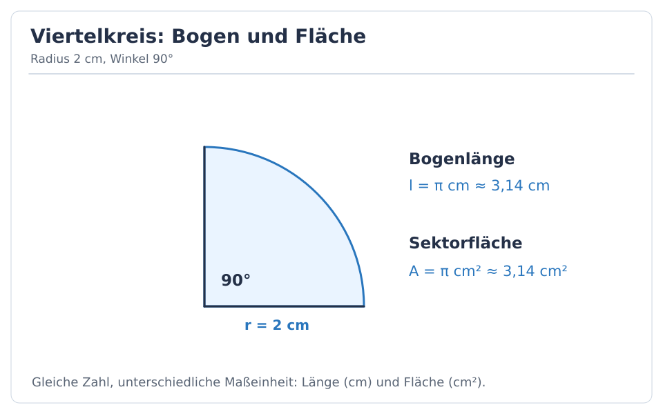

# M1-L15 – Kreis, Kreisbogen und geometrische Körper {#L15}

**Kursbereich:** M1 – Sekundarstufe I

**Niveau:** Sekundarstufe I

**Vorwissen:** Keine festen Voraussetzungen angegeben.

**Einordnung:** Sekundarstufe I, didaktisch ungefähr Klasse 9 · Format: zügige Auffrischung

## Worum geht es? {#S1}

Die **Kreislinie** besteht aus allen Punkten einer Ebene, die vom Mittelpunkt genau den Radiusabstand besitzen. Die **Kreisscheibe** enthält zusätzlich alle Punkte innerhalb dieser Linie, deren Abstand höchstens dem Radius entspricht. In dieser Lektion meint „Kreisfläche“ den Inhalt der Kreisscheibe; der Umfang misst dagegen nur die Länge der Kreislinie. Sobald wir diesen Abstand kennen, können wir seinen Umfang und seine Fläche berechnen. Betrachten wir nur einen Teil des Randes, entsteht ein **Kreisbogen**; ein Anteil der Kreisfläche heißt **Kreissektor**. Im Raum begegnen uns Körper wie Zylinder, Kegel und Kugel. Dort müssen wir **Oberflächeninhalt** und **Volumen** unterscheiden: einmal die umhüllende Fläche, einmal den enthaltenen Rauminhalt.

## Grundidee und Anschauung {#S2}

Der **Radius** ist die Strecke vom Mittelpunkt zum Kreisrand. Der **Durchmesser** verbindet zwei gegenüberliegende Randpunkte durch den Mittelpunkt und ist doppelt so lang wie der Radius. Das Verhältnis von Kreisumfang zu Durchmesser ist für jeden Kreis gleich: die Zahl Pi. Größere Kreise besitzen einen Umfang proportional zum Radius, aber eine **Fläche proportional zum Quadrat** des Radius. Verdoppeln wir den Radius, verdoppelt sich der Umfang, während sich die Fläche vervierfacht.

Formel, Skizze oder Rechenschema · Originalnotation

                 Kreis von oben
                     .----.
                 .-'   |    '-.
                /      | r     \
               |       M--------|  Rand
                \              /
                 '-.        .-'
                    '------'

    M = Mittelpunkt; r = Radius. Zeichnung schematisch.

## Neue Zeichen vor der ersten Formel {#S3}

  Zeichen   Aussprache                            Bedeutung hier                                              Anderer möglicher Gebrauch
  --------- ------------------------------------- ----------------------------------------------------------- ------------------------------------------
  $r$       „er“                                  Radius eines Kreises oder einer kreisförmigen Grundfläche   Beliebige Variable
  $d$       „de“                                  Durchmesser, doppelte Radiuslänge                           In M1-L10 stand d für einen Abstand
  $\pi$     „Pi“                                  Exaktes, irrationales Kreisverhältnis, ungefähr 3,14159     Auch in Trigonometrie und Analysis
  $U$       „großes u“                            Umfang einer ebenen Figur                                   In anderen Fächern andere Größe
  $U_s$     „Sektorumfang“ oder „u mit Index s“   Gesamter Rand eines Kreissektors: Bogen plus beide Radien   Index s bezeichnet hier den Sektor
  $A$       „großes a“                            Flächeninhalt, insbesondere der Kreisfläche                 In M1-L12 bezeichnete A ein Ereignis
  $\alpha$  „Alpha“                               Hier Winkel eines Kreisbogens oder Kreissektors in Grad     Oft ein frei wählbarer Winkel
  `°`       „Grad“                                Winkelmaß; Vollkreis hat 360 Grad                           Auch bei Temperatur verwendet
  $l$       „ell“                                 Länge eines Kreisbogens                                     In anderen Formeln etwa eine Strecke
  $h$       „ha“                                  Höhe eines geraden Zylinders oder Kegels                    Auch Dreieckshöhe, siehe M1-L5
  $V$       „fau“                                 Rauminhalt beziehungsweise Volumen                          Variable oder andere physikalische Größe
  $O$       „großes o“                            Gesamter Oberflächeninhalt eines Körpers                    In der Informatik später auch O-Notation

## Wichtigste Idee 1: Umfang und Fläche des Kreises {#S4}

$$
\begin{aligned}
d&=2r\\
U&=2\pi r=\pi d\\
A&=\pi r^2
\end{aligned}
$$

**Laut gelesen:** „Der Durchmesser ist zweimal der Radius. Der Umfang ist zweimal Pi mal Radius, also Pi mal Durchmesser. Die Kreisfläche ist Pi mal Radius zum Quadrat.“ Der Umfang besitzt eine **Längeneinheit**, zum Beispiel Meter. Die Fläche besitzt eine **quadratische Einheit**, beispielsweise Quadratmeter.

### Mini-Beispiel: Ein runder Tisch {#abschnitt-5}

Ein runder Tisch hat Radius $r=0{,}5\,\mathrm{m}$. Sein Durchmesser beträgt $1\,\mathrm{m}$. Sein Umfang ist exakt $\pi\,\mathrm{m}$, also ungefähr $3{,}14\,\mathrm{m}$. Seine Fläche ist $\pi\cdot{(0{,}5)}^2\,\mathrm{m}^2=0{,}25\pi\,\mathrm{m}^2$, also ungefähr $0{,}785\,\mathrm{m}^2$.

Wichtig: $0{,}25\pi$ ist **exakt**, wenn der Radius exakt $0{,}5\,\mathrm{m}$ ist. Die ausgeschriebene Zahl $0{,}785$ ist bereits **gerundet**.

## Wichtigste Idee 2: Kreisbogen und Kreissektor {#S5}

Ein **Kreisbogen** ist ein Teil des Kreisrandes. Ein **Kreissektor** ist die dazugehörige keilförmige Fläche zwischen zwei Radien und dem Kreisbogen. Bei einem Winkel $\alpha$ (Alpha) von 90 Grad erhalten wir ein Viertel eines Vollkreises; bei 180 Grad einen Halbkreis.

Für einen Mittelpunktswinkel zwischen null und 360 Grad gilt:

$$
\begin{aligned}
\text{Bogenlänge }l&=\frac{\alpha}{360^{\text{°}}}\,2\pi r\\
\text{Sektorfläche}&=\frac{\alpha}{360^{\text{°}}}\,\pi r^2
\end{aligned}
$$

**Laut gelesen:** „Die Bogenlänge ell ist der Anteil Alpha durch dreihundertsechzig Grad vom vollständigen Kreisumfang. Die Fläche des Sektors ist derselbe Winkelanteil mal die gesamte Kreisfläche.“ Hier müssen **Alpha und 360 Grad dieselbe Winkeleinheit** verwenden; der Quotient ist dann eine reine Zahl.

### Mini-Beispiel: Viertelkreis {#abschnitt-7}

Ein Kreis besitzt Radius $2\,\mathrm{cm}$. Wir betrachten einen Winkel von $90^{\text{°}}$, also ein Viertel des Kreises. Der ganze Umfang beträgt $4\pi\,\mathrm{cm}$; die **Bogenlänge** ist daher $\pi\,\mathrm{cm}\approx3{,}14\,\mathrm{cm}$. Der ganze Flächeninhalt beträgt $4\pi\,\mathrm{cm}^2$; die **Sektorfläche** ist $\pi\,\mathrm{cm}^2\approx3{,}14\,\mathrm{cm}^2$.

{alt="Viertelkreissektor mit Radius 2 Zentimeter, Mittelpunktswinkel 90 Grad, Bogenlänge Pi Zentimeter und Fläche Pi Quadratzentimeter."}

Für $r=2\,\mathrm{cm}$ und $90^{\text{°}}$ sind Bogenlänge und Sektorfläche zahlenmäßig $\pi$, jedoch mit verschiedenen Einheiten.

Die numerischen Werte sind hier zufällig ähnlich, die Größen aber unterschiedlich: $\mathrm{cm}$ beschreibt eine Länge, $\mathrm{cm}^2$ eine Fläche. Der **Umfang des Kreissektors** ist übrigens nicht nur der Bogen: Er enthält zusätzlich die beiden Radien. Beim beschriebenen Viertelkreissektor mit $r=2\,\mathrm{cm}$ beträgt er deshalb $U_s=\pi\,\mathrm{cm}+2\cdot2\,\mathrm{cm}=(\pi+4)\,\mathrm{cm}\approx7{,}14\,\mathrm{cm}$. Seine Einheit ist eine Länge, keine Fläche.

## Wichtigste Idee 3: Zylinder – gerader Körper mit zwei Kreisflächen {#S6}

Ein **gerader Kreiszylinder** besitzt oben und unten je einen kongruenten Kreis mit Radius r. Seine Höhe h steht senkrecht auf diesen Kreisflächen. Sein Volumen berechnet sich aus Grundfläche mal Höhe; die Oberfläche besteht aus zwei Kreisflächen und dem aufgerollt rechteckigen Mantel.

$$
\begin{aligned}
V&=\pi r^2h\\
O&=2\pi r^2+2\pi rh
\end{aligned}
$$

**Laut gelesen:** „Das Volumen fau ist Pi mal Radius zum Quadrat mal Höhe. Die Oberfläche großes o ist zweimal Pi mal Radius zum Quadrat plus zweimal Pi mal Radius mal Höhe.“ Der zweite Summand ist die **Mantelfläche**; sie entspricht Kreisumfang mal Höhe.

### Mini-Beispiel: Zylindrischer Behälter {#abschnitt-9}

Ein idealer Zylinder hat $r=2\,\mathrm{cm}$ und $h=5\,\mathrm{cm}$. Sein Volumen beträgt $\pi\cdot4\cdot5=20\pi\,\mathrm{cm}^3$, also ungefähr $62{,}83\,\mathrm{cm}^3$. Seine geschlossene Oberfläche beträgt $2\pi\cdot4+2\pi\cdot2\cdot5=28\pi\,\mathrm{cm}^2$, also ungefähr $87{,}96\,\mathrm{cm}^2$. Ist der Behälter oben offen, entfällt in der Materialfläche die obere Kreisfläche – dann gilt diese Oberflächenformel nicht unverändert.

## Wichtigste Idee 4: Kegel und Kugel {#S7}

Ein **gerader Kreiskegel** hat eine kreisförmige Grundfläche, die sich zu einer Spitze verjüngt. Eine **Kugel** enthält alle Punkte im Raum, deren Abstand vom Mittelpunkt höchstens r beträgt; ihre Oberfläche besteht aus den Punkten mit Abstand genau r.

$$
\begin{aligned}
\text{Volumen des geraden Kreiskegels: }V&=\frac13\pi r^2h\\
\text{Volumen der Kugel: }V&=\frac43\pi r^3\\
\text{Oberfläche der Kugel: }O&=4\pi r^2
\end{aligned}
$$

**Laut gelesen:** „Das Kegelvolumen ist ein Drittel mal Pi mal Radius zum Quadrat mal Höhe. Das Kugelvolumen ist vier Drittel mal Pi mal Radius hoch drei. Die Kugeloberfläche ist viermal Pi mal Radius zum Quadrat.“ Der Kegel besitzt bei gleichem Grundkreis und gleicher Höhe nur **ein Drittel** des Volumens eines geraden Kreiszylinders. Bei der Kugel führt die dritte Potenz dazu, dass eine Verdopplung des Radius das Volumen auf das Achtfache vergrößert.

### Mini-Beispiel: Größenänderung bei Kugeln {#abschnitt-11}

Eine Kugel mit Radius $1\,\mathrm{cm}$ hat das Volumen $\frac43\pi\,\mathrm{cm}^3\approx4{,}19\,\mathrm{cm}^3$. Bei Radius $2\,\mathrm{cm}$ sind es $\frac{32}{3}\pi\,\mathrm{cm}^3\approx33{,}51\,\mathrm{cm}^3$. Der Radius wird verdoppelt, das Volumen **verachtfacht** sich. Die Oberfläche vervierfacht sich dagegen lediglich.

## Wofür nützlich? {#S8}

Kreisformeln braucht man bei der Bildschirm- und Vektorgrafik, wenn Kreise, Bögen oder Messradien dargestellt werden. Bogenlängen sind für Räder, Drehscheiben und die Wege von Robotergelenken nützlich; später beschreiben wir dieselben Winkel häufig im **Bogenmaß** statt in Grad. Körpervolumina helfen bei der Modellierung von Behältern, 3D-Objekten, Materialbedarf und geometrischen Kollisionsmodellen. In einer Softwareanwendung sollte die Einheit der Ein- und Ausgaben ausdrücklich mitgeführt werden.

## Annahmen und Grenzen {#S9}

Die Formeln setzen **idealisierte geometrische Formen** voraus. Für die hier behandelten nicht entarteten Kreise und Körper nehmen wir $r>0$ sowie bei Zylinder und Kegel $h>0$ an. Die Kreislinie wird vom Inneren der Kreisscheibe unterschieden; eine Oberflächenformel gilt nur für die jeweils benannte geschlossene Idealform. Reale Gegenstände können Wandstärken, Krümmungen, Verformungen oder Öffnungen besitzen. Beim Zylinder ist ausdrücklich ein **gerader Kreiszylinder** gemeint, beim Kegel ein **gerader Kreiskegel**; andere Körperformen benötigen angepasste Modelle. Kreissektorformeln mit $\frac{\alpha}{360^{\text{°}}}$ setzen voraus, dass Alpha als Gradwinkel eingesetzt wird. Näherungswerte von Pi führen zu gerundeten Ergebnissen, während Formeln mit dem Symbol $\pi$ exakte Werte angeben.

## Verbindung zur nächsten Lektion {#S10}

Die Kreisbogenrechnung bereitet die Winkelbeschreibung im Kreis vor. Davor betrachten wir in **M1-L16** Sinus, Kosinus und Tangens im rechtwinkligen Dreieck – wichtige Werkzeuge für Winkel, Richtungen und spätere Robotik.

## Quellen {#S11}

In dieser Lektion sind keine Einzelquellen gesondert verzeichnet.
