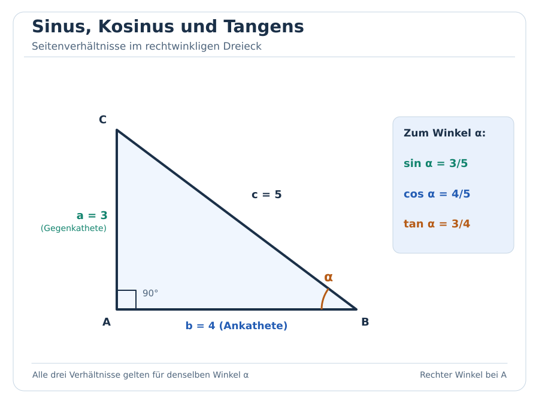

# M1-L16 – Trigonometrische Grundbegriffe: Sinus, Kosinus und Tangens {#L16}

**Kursbereich:** M1 – Sekundarstufe I

**Niveau:** Sekundarstufe I

**Vorwissen:** Keine festen Voraussetzungen angegeben.

**Einordnung:** Sekundarstufe I, didaktisch ungefähr Klasse 9 · Format: zügige Auffrischung

## Worum geht es? {#S1}

Bislang konnten wir mit dem Satz des Pythagoras Längen in einem rechtwinkligen Dreieck bestimmen, wenn bereits zwei Seiten bekannt waren. Die **Trigonometrie** ergänzt einen anderen Zugang: Sie verknüpft **Winkel** mit den **Verhältnissen der Seitenlängen**. Das ist nützlich, wenn etwa eine Richtung und eine Entfernung bekannt sind, aber eine Höhe oder horizontale Strecke fehlt. Die drei grundlegenden Funktionen heißen **Sinus, Kosinus und Tangens**. Zunächst betrachten wir sie ausschließlich in rechtwinkligen Dreiecken; die Erweiterung auf andere Winkel folgt in M1-L20 am Einheitskreis.

## Grundidee und Anschauung {#S2}

In jedem rechtwinkligen Dreieck gibt es eine Seite gegenüber dem rechten Winkel: die **Hypotenuse**. Sie ist stets die längste Seite. Die beiden übrigen Seiten sind die **Katheten**. Bezogen auf einen ausgewählten **spitzen Winkel** heißt eine Kathete **Gegenkathete**, die andere **Ankathete**. Welche Kathete welchen Namen trägt, hängt also davon ab, welchen der beiden spitzen Winkel wir betrachten.

{alt="Rechtwinkliges Dreieck, rechter Winkel bei A, Winkel Alpha bei B. Gegenkathete 3, Ankathete 4, Hypotenuse 5; Sinus 3/5, Kosinus 4/5 und Tangens 3/4."}

Im konstruierten Beispiel zum Winkel $\alpha$: $\sin(\alpha)=\frac35$; $\cos(\alpha)=\frac45$; $\tan(\alpha)=\frac34$.

Formel, Skizze oder Rechenschema · Originalnotation

           C
           |\
           | \
         a |  \ c
           |   \
           |    \
           A-----B
              b   α (am Punkt B)

    Rechter Winkel bei A.
    α (Alpha) ist der spitze Winkel am Punkt B.
    a = Gegenkathete zu α, b = Ankathete zu α,
    c = Hypotenuse (gegenüber dem rechten Winkel).

Alle ähnlich geformten rechtwinkligen Dreiecke mit demselben Winkel Alpha haben **dieselben Seitenverhältnisse**, selbst wenn sie ganz unterschiedlich groß sind. Genau diese unveränderlichen Verhältnisse sind die trigonometrischen Funktionen.

## Neue Zeichen vor der ersten Formel {#S3}

  Zeichen             Aussprache                                     Bedeutung hier                                                                           Anderer möglicher Gebrauch
  ------------------- ---------------------------------------------- ---------------------------------------------------------------------------------------- -------------------------------------------------------------------
  $\alpha$            „Alpha“                                        Der gewählte spitze Winkel bei B                                                         Allgemeiner Winkel oder Parameter, bereits in M1-L15 für Kreisbögen
  $a$, $b$, $c$       „a“, „be“, „ce“                                Gegenkathete, Ankathete, Hypotenuse bezogen auf Alpha                                    In anderen Dreiecken andere Seitenzuordnung; allgemein Variablen
  $\sin$              „Sinus“                                        Verhältnis Gegenkathete zu Hypotenuse                                                    Später Sinusfunktion für beliebige reelle Winkel
  $\cos$              „Kosinus“                                      Verhältnis Ankathete zu Hypotenuse                                                       Später Kosinusfunktion für beliebige reelle Winkel
  $\tan$              „Tangens“                                      Verhältnis Gegenkathete zu Ankathete                                                     Später Tangensfunktion; an manchen Rechnern `tg`
  `arctan`, `tan⁻¹`   „Arkustangens“, „Umkehrfunktion des Tangens“   Liefert den spitzen Winkel zu einem positiven Tangenswert, wenn in Grad gerechnet wird   `tan⁻¹` ist hier keine Potenz eines Zahlenwerts
  `/`                 „geteilt durch“                                Quotient zweier Längen                                                                   Allgemeine Division, bereits M1-L2
  `°`                 „Grad“                                         Winkelmaß; voller Kreis hat 360 Grad                                                     Temperaturangaben, andere Grad-Skalen
  `≈`                 „ist ungefähr gleich“                          Gerundete Zahl statt exaktem Verhältnis                                                  Näherungswerte, bereits M1-L14

## Wichtigste Idee 1: Drei Seitenverhältnisse {#S4}

Für das gezeichnete Dreieck mit rechtem Winkel bei A und spitzem Winkel Alpha bei B gelten:

$$
\begin{aligned}
\sin(\alpha)&=\frac ac\\
\cos(\alpha)&=\frac bc\\
\tan(\alpha)&=\frac ab
\end{aligned}
$$

**Laut gelesen:** „Der Sinus von Alpha ist die Länge der Gegenkathete geteilt durch die Länge der Hypotenuse. Der Kosinus von Alpha ist die Länge der Ankathete geteilt durch die Länge der Hypotenuse. Der Tangens von Alpha ist die Länge der Gegenkathete geteilt durch die Länge der Ankathete.“

**Zeichen einzeln:** $\sin$, $\cos$ und $\tan$ bezeichnen Funktionen; die runden Klammern enthalten ihren Eingabewinkel $\alpha$. `=` bedeutet Wertegleichheit, der Schrägstrich `/` Division. Die Seiten $a$, $b$ und $c$ sind hier Längen in **derselben Einheit**. Deshalb besitzen die Quotienten **keine Längeneinheit**. Für den Tangens darf $b$ nicht null sein; bei einem nicht entarteten rechtwinkligen Dreieck mit **spitzem Winkel $0^{\text{°}}<\alpha<90^{\text{°}}$** sind alle drei Seitenlängen positiv und damit insbesondere $b>0$. Diese Seitenverhältnisse allein beschreiben hier keine stumpfen Winkel; deren trigonometrische Werte erklären wir erst in M1-L20.

### Mini-Beispiel: Das 3-4-5-Dreieck {#abschnitt-5}

Eine senkrechte Seite ist $a=3\,\mathrm{m}$, eine waagerechte Seite $b=4\,\mathrm{m}$, die Hypotenuse ist $c=5\,\mathrm{m}$. Dass der rechte Winkel möglich ist, bestätigt M1-L10: $3^2+4^2=5^2$, denn $9+16=25$.

$$
\begin{aligned}
\sin(\alpha)&=\frac35=0{,}6\\
\cos(\alpha)&=\frac45=0{,}8\\
\tan(\alpha)&=\frac34=0{,}75
\end{aligned}
$$

**Laut gelesen:** „Sinus Alpha ist drei Fünftel gleich null Komma sechs; Kosinus Alpha ist vier Fünftel gleich null Komma acht; Tangens Alpha ist drei Viertel gleich null Komma sieben fünf.“ Der Winkel bei B beträgt ungefähr **36,87 Grad**. Dies folgt aus dem Arkustangens von $\frac34$ im Gradmodus; die beiden anderen spitzen Dreieckswinkel ergänzen sich zu $90^{\text{°}}$. Bei einem doppelt so großen, ähnlich geformten Dreieck mit Seiten 6, 8 und 10 Metern bleiben die drei Verhältnisse identisch.

## Wichtigste Idee 2: Aus Winkel und Länge eine Strecke bestimmen {#S5}

Sind eine **Hypotenusenlänge** und ein **spitzer Winkel** bekannt, können wir die zugehörigen Katheten berechnen. Das bedeutet geometrisch, eine schräge Strecke auf eine vertikale und eine horizontale Richtung aufzuteilen.

$$
\begin{aligned}
a&=c\sin(\alpha)\\
b&=c\cos(\alpha)
\end{aligned}
$$

**Laut gelesen:** „Die Gegenkathete a ist die Hypotenuse c mal Sinus Alpha. Die Ankathete b ist die Hypotenuse c mal Kosinus Alpha.“ Die neuen Formeln entstehen durch Multiplikation der obigen Verhältnisformeln mit $c$. Das Malzeichen `·` wurde bereits in M1-L1 eingeführt.

### Mini-Beispiel: Ein schräger Sensorausleger {#abschnitt-7}

Ein Ausleger ist $10\,\mathrm{m}$ lang und steht im Winkel $30^{\text{°}}$ **über der Horizontalen**. Er bildet die Hypotenuse. Weil $\sin(30^{\text{°}})=0{,}5$ gilt, beträgt sein vertikaler Höhenanteil $10\,\mathrm{m}\cdot0{,}5=5\,\mathrm{m}$. Der horizontale Anteil ist $10\,\mathrm{m}\cdot\cos(30^{\text{°}})$, also ungefähr $8{,}66\,\mathrm{m}$, denn $\cos(30^{\text{°}})\approx0{,}866$.

Die Werte beschreiben die **Anteile der Auslegerlänge**, nicht die zusätzliche Höhe eines eventuell bereits erhöhten Befestigungspunkts. Dessen Ausgangshöhe müsste separat addiert werden.

## Wichtigste Idee 3: Einen Winkel aus Seitenlängen rekonstruieren {#S6}

Manchmal sind beide Katheten bekannt und wir suchen den Winkel. Dazu verwenden Taschenrechner die **Umkehrfunktion des Tangens**, häufig mit `arctan`, `atan` oder `tan⁻¹` beschriftet. Die Schreibweise mit hochgestelltem `−1` bezeichnet hier eine **Umkehrfunktion**, nicht den Kehrwert einer Zahl; dieses Prinzip behandeln wir ausführlicher in M1-L18.

$$
\alpha=\arctan\left(\frac ab\right)
$$

**Laut gelesen:** „Alpha ist der Arkustangens des Quotienten aus Gegenkathete a und Ankathete b.“ Das Zeichen `arctan` bedeutet: „Welcher Winkel besitzt diesen Tangenswert?“ Für das 3-4-5-Dreieck ist das $\arctan\left(\frac34\right)\approx36{,}87^{\text{°}}$.

**Winkelmodus:** Wenn ein Rechner auf **Grad** eingestellt ist, liefert er den Winkel in Grad. Steht er auf **Radiant/Bogenmaß**, erhält man einen anderen Zahlenwert für denselben Winkel. `arctan` liefert standardmäßig seinen Hauptwert; weil $\frac ab$ in unserem nicht entarteten Dreieck positiv ist, liegt dieser eindeutig zwischen $0^{\text{°}}$ und $90^{\text{°}}$. Das Bogenmaß erklären wir in M1-L20.

## Wofür nützlich? {#S7}

In 2D-Grafikprogrammen zerlegen Sinus und Kosinus eine Richtung samt Entfernung in horizontale und vertikale Bewegungsanteile. In der Robotik helfen diese Anteile, die Endposition eines drehbaren Gelenks oder Werkzeugarms näherungsweise zu bestimmen. In Vermessung und einfacher Sensorik können aus Blickwinkel und bekannter Strecke Höhen oder Abstände rekonstruiert werden. Später verwenden wir dieselben Funktionen bei Kreisbewegungen, Wellen und rotierenden Koordinatensystemen.

## Annahmen und Grenzen {#S8}

Die drei anfänglichen Quotienten gelten in dieser Form für **rechtwinklige Dreiecke** und einen **spitzen Bezugswinkel**. Die Seitenbenennung ist nicht absolut: Wird der andere spitze Winkel gewählt, tauschen Gegen- und Ankathete ihre Rollen. Bei realen Messungen verursachen Winkel- und Längenfehler entsprechende Ergebnisfehler; besonders in der Nähe von $90^{\text{°}}$ wird der Tangens sehr groß und die Berechnung empfindlich. Die Seitenverhältnisse müssen auf **dieselben Längeneinheiten** bezogen sein. Die **Sinus- und Kosinuswerte** eines spitzen Winkels liegen zwischen null und eins, der Tangens kann dagegen auch größer als eins sein. $\tan(\alpha)$ ist außerdem **nicht** dasselbe wie $\sin(\alpha)+\cos(\alpha)$.

## Verbindung zur nächsten Lektion {#S9}

M1-L17 beschreibt **Wachstum und Zerfall**. Während ein Winkel hier festlegt, wie Längen aufgeteilt werden, legt dort ein konstanter **Faktor pro Zeitschritt** fest, wie sich eine Größe wiederholt verändert. Die trigonometrischen Funktionen greifen wir in M1-L20 am Kreis erneut auf.

## Quellen {#S10}

In dieser Lektion sind keine Einzelquellen gesondert verzeichnet.
