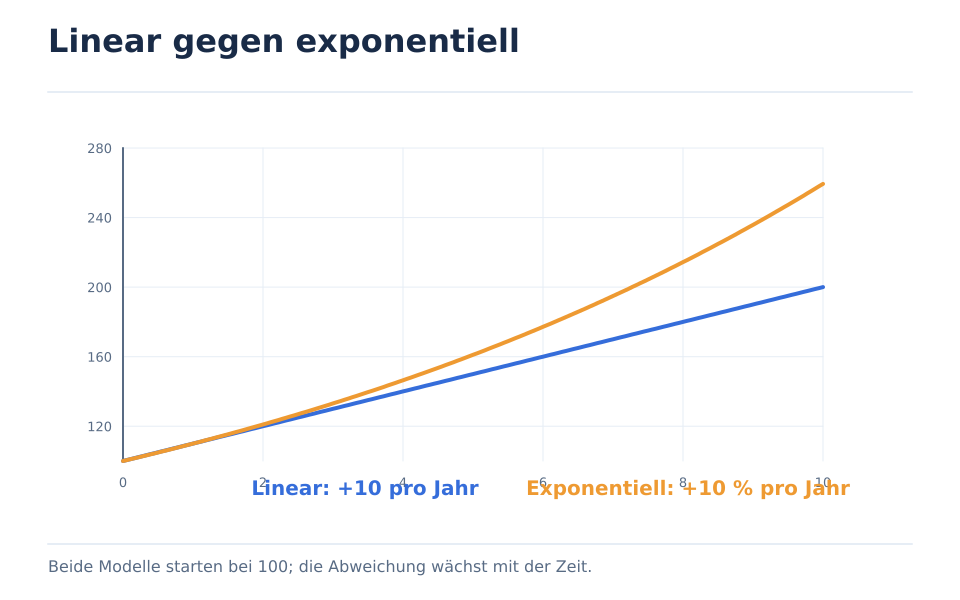

# M1-L17 – Wachstum, Prozentmodelle und Zinseszins {#L17}

**Kursbereich:** M1 – Sekundarstufe I

**Niveau:** Sekundarstufe I

**Vorwissen:** Keine festen Voraussetzungen angegeben.

**Einordnung:** Sekundarstufe I, didaktisch ungefähr Klasse 9 · Format: zügige Auffrischung

## Worum geht es? {#S1}

Manche Größen verändern sich in jedem Zeitabschnitt um einen festen **Betrag**. Andere verändern sich um einen festen **Prozentsatz des jeweils aktuellen Werts vor der Änderung**. Diese beiden Situationen führen zu unterschiedlichen Modellen. Eine dauerhaft feste prozentuale Änderung bewirkt **exponentielles Wachstum** beziehungsweise **exponentiellen Zerfall**. Der klassische Fall ist der Zinseszins: Bereits angefallene Zinsen werden in der nächsten Runde selbst mitverzinst.

## Grundidee und Anschauung {#S2}

Bei einem **linearen Modell** kommen in jedem Schritt beispielsweise zehn neue Elemente hinzu: 100, 110, 120, 130. Bei einem **exponentiellen Modell mit zehn Prozent Zuwachs** werden dagegen immer zehn Prozent des **aktuellen** Bestands hinzugefügt: 100, 110, 121, 133,1. Anfangs sehen die Reihen ähnlich aus. Doch die Zuwächse von 10, dann 11, dann 12,1 Einheiten werden beim exponentiellen Verlauf immer größer. Bei einem Rückgang um einen festen Prozentsatz nimmt der Bestand dagegen in jedem Schritt um denselben *Faktor* ab, nicht um denselben absoluten Betrag.

## Neue Zeichen vor der ersten Formel {#S3}

  Zeichen         Aussprache                                          Bedeutung hier                                                                        Anderer möglicher Gebrauch
  --------------- --------------------------------------------------- ------------------------------------------------------------------------------------- ---------------------------------------------------------------
  $S_0$           „ess Index null“                                    Anfangsbestand vor dem ersten Schritt                                                 Anfangswert einer Messreihe oder eines Zustands
  $S_n$           „ess Index en“                                      Bestand nach $n$ Schritten                                                            Allgemeiner Folgenglied-Index
  $n$             „en“                                                Anzahl gleich langer Schritte; zunächst ganze Zahl ab null                            Stichprobengröße oder Laufindex
  $p$             „pe“                                                Prozentänderung als **Dezimalzahl**, z. B. 5 % als 0,05                               Allgemeiner Parameter; in M1-L13 binomische Variable
  $q$             „ku“                                                Faktor pro Schritt: größer als eins bei Zuwachs, zwischen null und eins bei Abnahme   Allgemeiner Parameter
  `^n`, `ⁿ`       „hoch en“                                           Wiederholte Multiplikation mit gleichem Faktor                                        Beliebige Potenz, bereits M1-L7
  `·`             „mal“                                               Multiplikation                                                                        Skalarprodukt in späterer Vektorrechnung
  `%`             „Prozent“                                           Anteil von hundert, bereits M1-L2                                                     In Programmiersprachen häufig Restoperator
  `≈`             „ungefähr gleich“                                   Gerundete Geld- oder Messwerte                                                        Näherungsangabe
  `>`, `<`, `≥`   „größer als“, „kleiner als“, „größer oder gleich“   Bedingungen für Bestand und Wachstumsfaktor                                           Allgemeine Vergleiche, bereits aus früheren Lektionen bekannt

## Wichtigste Idee 1: Vom Prozentsatz zum Faktor {#S4}

Werden in jedem Schritt fünf Prozent hinzugefügt, bleibt der ganze bisherige Bestand erhalten (**100 Prozent**) und zusätzlich kommen fünf Prozent hinzu: zusammen **105 Prozent** des bisherigen Werts. Der zugehörige Faktor ist $1{,}05$. Bei zehn Prozent Abnahme bleiben neunzig Prozent übrig, also Faktor $0{,}90$.

$$
\begin{aligned}
q&=1+p\\
S_n&=S_0q^n
\end{aligned}
$$

**Laut gelesen:** „Der Schritt-Faktor ku ist eins plus der prozentualen Änderung pe in Dezimalschreibweise. Der Bestand ess Index en ist der Anfangsbestand ess Index null mal ku hoch en.“ `+` bedeutet Addition; `=` Wertegleichheit; die tiefgestellte Null kennzeichnet den **Startwert**, nicht etwa eine Multiplikation mit null. $q^n$ multipliziert den Faktor $q$ bei ganzzahligem $n$ genau $n$-mal mit sich selbst. Für $n=0$ ist $q^0=1$, sofern $q$ positiv ist: Vor dem ersten Schritt ist der Bestand gleich dem Anfangsbestand. Für gewöhnliche positive Bestandsmodelle gilt $p>-1$, damit $q=1+p>0$ ist. Bei einem vollständigen Verlust von 100 % ($p=-1$, $q=0$) bleibt nach dem ersten Schritt null; den Anfangsbestand behandeln wir dann ausdrücklich als Sonderfall, statt unbestimmt $0^0$ auszuwerten.

### Mini-Beispiel: Fünf Prozent jährlicher Zinseszins {#abschnitt-5}

Ein Guthaben startet mit $S_0=1\,000\,\mathrm{€}$, die jährliche Verzinsung beträgt **5 %** und die Zinsen werden jährlich gutgeschrieben. Damit ist $p=0{,}05$ und $q=1{,}05$. Nach drei **vollen Jahren** gilt:

$$
\begin{aligned}
S_3&=1\,000\,\mathrm{€}\cdot\left(1{,}05\right)^3\\
&=1\,157{,}625\,\mathrm{€}\\
&\approx1\,157{,}63\,\mathrm{€}
\end{aligned}
$$

**Laut gelesen:** „Ess Index drei ist eintausend Euro mal eins Komma null fünf hoch drei, also eintausendeinhundertsiebenundfünfzig Euro und zweiundsechzig Komma fünf Cent vor der Cent-Rundung.“ Bei kaufmännischer Rundung **auf volle Cent am Ende** ergibt das $1\,157{,}63\,\mathrm{€}$. In einer realen Bankabrechnung können Zwischenrundungen, Steuern, Gebühren und der genaue Verzinsungstermin das Ergebnis verändern. Das Modell veranschaulicht das mathematische Grundprinzip, nicht konkrete Kontokonditionen.

## Wichtigste Idee 2: Exponentieller Zerfall {#S5}

Eine Verringerung um **$10\,\%$** pro Schritt bedeutet nicht jedes Mal „minus zehn ursprüngliche Einheiten“. Es bleiben nach jedem Schritt **$90\,\%$ des gerade vorhandenen Bestands** übrig. Das ist derselbe Mechanismus wie beim Wachstum, nur mit einem Faktor kleiner als eins.

$$
S_n=S_0\cdot0{,}9^n
$$

**Laut gelesen:** „Ess Index en ist der Anfangsbestand mal null Komma neun hoch en.“ Hier ist $0{,}9$ der verbleibende Anteil pro Schritt, also der Faktor für **zehn Prozent Verlust**. Die Hochzahl $n$ zählt wieder die Schritte.

### Mini-Beispiel: Nachlassende Speichermenge {#abschnitt-7}

Ein Bestand wird in jeder Wartungsrunde um zehn Prozent **des aktuellen Bestands** reduziert. Aus $100\,\mathrm{GB}$ werden nach Runde eins $90\,\mathrm{GB}$. Nach Runde zwei bleiben $90\,\mathrm{GB}\cdot0{,}9=81\,\mathrm{GB}$. Der Gesamtverlust beträgt also $19\,\mathrm{GB}$, entsprechend **19 %** des ursprünglichen Werts und nicht 20 %. Wenn man einfach zweimal zehn Prozent des **Anfangsbestands** abziehen würde, wäre das ein anderes, lineares Modell.

## Wichtigste Idee 3: Linearer Zuwachs oder prozentualer Zuwachs? {#S6}

Für die Modellwahl ist die entscheidende Frage, **was pro Schritt konstant bleibt**. Eine konstante **Differenz** ist ein lineares Muster, ein konstanter **Quotient aufeinanderfolgender positiver Werte** ein exponentielles Muster.

$$
\begin{aligned}
\text{Linear:}\quad S_n&=S_0+nd\\
\text{Exponentiell:}\quad S_n&=S_0q^n
\end{aligned}
$$

**Laut gelesen:** „Beim linearen Modell ist der Bestand nach en Schritten gleich dem Startbestand plus en mal de. Beim exponentiellen Modell ist er gleich Startbestand mal Faktor ku hoch en.“ Das neue Zeichen $d$ (gesprochen „de“) steht hier für die **konstante absolute Änderung pro Schritt**; in M1-L10 stand $d$ für einen Abstand, in M1-L15 für einen Durchmesser. Eine gleiche Buchstabenform ist also **keine** gleiche Bedeutung.

  Schritt $n$   Konstant +10   Konstant +10 %
  ------------- -------------- ----------------
  0             100            100
  1             110            110
  2             120            121
  3             130            $133{,}1$

Die Tabelle zeigt den Unterschied ohne zusätzliche Herleitung. **Ein prozentualer Zuwachs von zehn Prozent des Anfangswerts** wäre hingegen linear: in jeder Runde plus zehn, solange der Anfangswert 100 bleibt.

## Wofür nützlich? {#S7}

Wachstumsmodelle helfen, eine angenommene Steigerung der Nutzerzahlen, Datenmengen oder Speicherkosten über mehrere Perioden abzuschätzen. In der Informatik tritt exponentielles Anwachsen auch bei Kombinationsräumen auf; dort stammt der Faktor allerdings aus einem anderen Sachverhalt als aus Guthabenzinsen. Zerfallsmodelle sind für abnehmende Bestände, Signalabschwächung oder vereinfachte Modelle zur Lebensdauer von Systemzuständen nützlich. Gerade bei KI-Infrastrukturen lohnt sich die Unterscheidung zwischen „jeden Monat 100 zusätzliche Anfragen“ und „jeden Monat zehn Prozent mehr Anfragen“.

## Annahmen und Grenzen {#S8}

Der Faktor $q$ ist in dieser Einführung **pro Zeitintervall konstant**, und die Intervalle sind gleich lang. Für die üblichen Bestandsmodelle nehmen wir $S_0\ge0$ und $q>0$ an. Bei $S_0=0$ bleibt der Modellbestand null; bei $0<q<1$ liegt exponentieller Zerfall vor, bei $q=1$ eine konstante Folge und bei $q>1$ Wachstum. Ein negatives $q$ wäre für einen normalen Bestand in diesem Modell nicht sinnvoll. Eine reale Population, Nutzerzahl oder Datenmenge kann nicht unbegrenzt mit konstanter Rate wachsen: Kapazitäten, Sättigung, saisonale Schwankungen und geänderte Bedingungen verändern das Modell. Gemessene Zahlen beweisen auch nicht allein, dass ein Prozess exponentiell ist. Bei Prozentangaben muss die **Bezugsgröße** stets geklärt sein: Fünf Prozent Wachstum und anschließend fünf Prozent Rückgang führen nicht zum Ausgangswert zurück. Der Faktor ist $1{,}05\cdot0{,}95=0{,}9975$, also verbleiben $99{,}75\,\%$ des Anfangswerts – ein Nettoverlust von $0{,}25\,\%$. Diese Rechnung setzt voraus, dass sich die zweite Änderung auf den **neuen** Bestand bezieht.

## Verbindung zur nächsten Lektion {#S9}

In M1-L18 betrachten wir **Funktionen als allgemeines Konzept**. Damit können wir lineare, quadratische und exponentielle Zusammenhänge als verschiedene Regeln zwischen Eingabe und Ausgabe einordnen. M1-L19 vertieft anschließend Exponential- und Logarithmusfunktionen.

## Quellen {#S10}

In dieser Lektion sind keine Einzelquellen gesondert verzeichnet.
