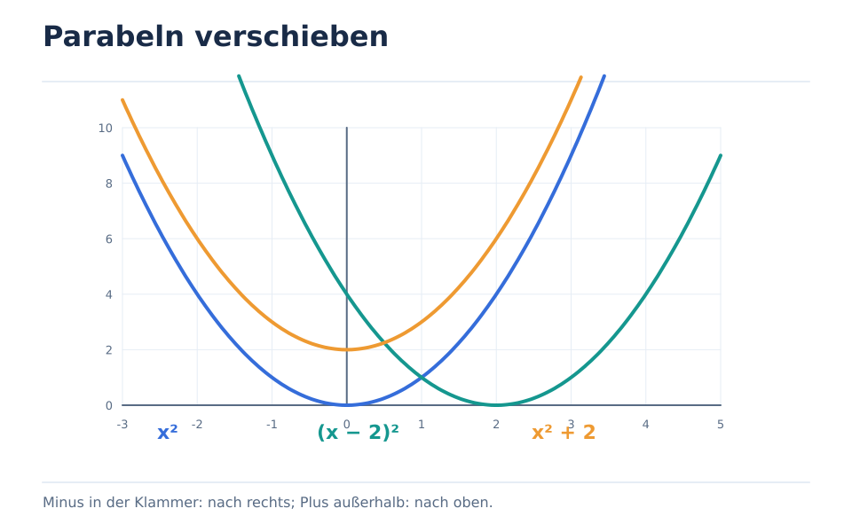

# M1-L18 – Funktionen: Definitionsbereich, Transformation und Umkehrung {#L18}

**Kursbereich:** M1 – Sekundarstufe I

**Niveau:** Sekundarstufe I

**Vorwissen:** Keine festen Voraussetzungen angegeben.

**Einordnung:** Sekundarstufe I, Oberstufenvorbereitung / didaktisch ungefähr Klasse 10 · Format: zügige Auffrischung

## Worum geht es? {#S1}

Wir haben bereits lineare und quadratische Funktionen kennengelernt und mit einem Wachstumsmodell gerechnet. Nun betrachten wir, **was eine Funktion allgemein ausmacht**: Sie ordnet jedem erlaubten Eingabewert **genau einen** Ausgabewert zu. Dabei muss feststehen, welche Eingaben überhaupt zulässig sind und welche Werte tatsächlich entstehen können. Funktionen lassen sich in Diagrammen darstellen, verschieben, strecken oder spiegeln. Manche lassen sich sogar **umkehren**, sodass man aus einer Ausgabe wieder die ursprüngliche Eingabe bestimmt.

## Grundidee und Anschauung {#S2}

Stell dir eine Funktion wie eine eindeutig arbeitende Software-Schnittstelle vor: Für denselben zulässigen Eingabewert liefert sie stets denselben Ausgabewert. Unterschiedliche Eingaben **dürfen** dieselbe Ausgabe besitzen, aber ein einzelner Eingabewert darf unter derselben Funktion nicht mehrere verschiedene Ergebnisse zugleich haben. Eine Wertetabelle zeigt nur ausgewählte Fälle; eine Funktionsregel kann unendlich viele Eingaben beschreiben. Ein Funktionsgraph macht sichtbar, wie sich Eingabe und Ausgabe gemeinsam verändern.

## Neue Zeichen vor der ersten Formel {#S3}

  Zeichen      Aussprache                                            Bedeutung hier                                               Anderer möglicher Gebrauch
  ------------ ----------------------------------------------------- ------------------------------------------------------------ --------------------------------------------------------------
  $f$, $g$     „eff“, „ge“                                           Namen zweier Funktionen                                      Frei benannte Größen oder Abbildungen
  $f(x)$       „eff von iks“                                         Wert der Funktion $f$ bei Eingabe $x$                        Kein Produkt aus Buchstaben f und x
  $x$, $y$     „iks“, „ypsilon“                                      Eingabe, Ausgabe                                             Koordinaten oder beliebige Variablen
  $D$          „großes de“                                           **Definitionsbereich**: Menge zulässiger Eingaben            Diskriminante in M1-L13, beliebige Variable
  $Z$          „zett“                                                **Zielmenge**: vorab festgelegte mögliche Ausgabemenge       Andere Mengen oder Variablen
  $W$          „großes we“                                           **Wertebereich/Bildmenge**: tatsächlich erreichte Ausgaben   In anderen Büchern andere Bezeichnung
  `→`          „wird abgebildet auf“, „nach“                         Zuordnung von Eingabemenge zu Zielmenge                      Pfeil in Logik oder Grenzwertnotation
  `∈`          „ist Element von“                                     Ein Wert gehört zu einer Menge                               Allgemeine Mengenbeziehung
  $\mathbb R$  „Menge der reellen Zahlen“                            Zahlenbereich der gesamten reellen Zahlengeraden             Bereits M1-L1 eingeführt
  $h$, $k$     „ha“, „ka“                                            Verschiebung in x- beziehungsweise y-Richtung                In anderen Formeln beliebige Parameter
  $f^{-1}$     „eff hoch minus eins“ oder „Umkehrfunktion von eff“   Umkehrung einer umkehrbaren Funktion                         **Nicht** automatisch Kehrwert von $f(x)$
  `⊆`          „ist Teilmenge von“                                   Jeder tatsächlich erreichte Wert gehört zur Zielmenge        Allgemeine Mengenbeziehung; wird in Universität M1-L1 vertieft

## Wichtigste Idee 1: Definitionsbereich und Wertebereich {#S4}

Ein **Definitionsbereich** $D$ legt fest, welche Eingaben erlaubt sind. Die **Zielmenge** $Z$ ist die Menge, in der mögliche Ausgaben liegen sollen. Die **Bildmenge**, hier $W$ genannt, umfasst nur die Ausgaben, die von der Funktion **tatsächlich angenommen werden**. Deshalb gilt $W\subseteq Z$: Die Bildmenge liegt innerhalb der Zielmenge, muss aber nicht mit ihr identisch sein. Das Zeichen `⊆` liest man „ist Teilmenge von“ und es erlaubt auch, dass beide Mengen gleich sind. In Schulbüchern werden die Begriffe „Wertebereich“ und „Wertemenge“ teils unterschiedlich verwendet – hier bedeutet $W$ stets die tatsächlich erreichte Bildmenge.

$$
\begin{aligned}
f&\colon D\to Z\\
x&\mapsto f(x)
\end{aligned}
$$

**Laut gelesen:** „Die Funktion eff bildet vom Definitionsbereich de in die Zielmenge zett ab. Jedem zulässigen x wird der Funktionswert eff von x zugeordnet.“ Der Doppelpunkt `:` folgt auf den **Funktionsnamen** und leitet seine Bereichsangabe ein; der Pfeil `→` bezeichnet eine Zuordnung. Das sind **keine** Rechenoperationen. Die Einzelzeichen $D$ und $Z$ bezeichnen hier Mengen, keine konkreten Zahlen.

### Mini-Beispiel: Das Quadrat einer Zahl {#abschnitt-5}

Die Funktion $f(x)=x^2$ nimmt einen reellen Eingabewert und multipliziert ihn mit sich selbst. Wenn alle reellen Zahlen als Eingabe erlaubt sind, ist $D=\mathbb R$. Auch $Z=\mathbb R$ kann als Zielmenge gewählt werden. Tatsächlich entstehen aber **nur nichtnegative Ausgaben**, weil das Quadrat einer reellen Zahl nie negativ ist. Die Bildmenge $W$ umfasst deshalb null und alle positiven reellen Zahlen.

$$
\begin{aligned}
f(-2)&=4\\
f(2)&=4
\end{aligned}
$$

**Laut gelesen:** „Eff von minus zwei ist vier; eff von zwei ist ebenfalls vier.“ Zwei unterschiedliche Eingaben haben hier **dieselbe** Ausgabe. Das ist für eine Funktion völlig zulässig. Für eine Umkehrfunktion auf dem gesamten reellen Definitionsbereich wird diese Eigenschaft allerdings zum Hindernis.

## Wichtigste Idee 2: Funktionen verschieben oder strecken {#S5}

Eine **Transformation** verändert den Graphen einer bekannten Funktion systematisch. Wir können sämtliche Ausgaben erhöhen, Eingaben verschieben oder Ausgaben mit einem Faktor multiplizieren.

$$
g(x)=f(x-h)+k
$$

**Laut gelesen:** „Ge von iks ist eff von iks minus ha, anschließend plus ka.“ Die neue Funktion $g$ entsteht aus $f$, indem ihr Graph **bei positivem h um h nach rechts** und **bei positivem k um k nach oben** verschoben wird. Die Eingabe $x$ ist dabei genau dann zulässig, wenn $x-h$ zum Definitionsbereich von $f$ gehört; eine Verschiebung verschiebt also auch den Definitionsbereich. Steht vor $h$ ein Minuszeichen **innerhalb** der Funktionsklammer, bedeutet das also eine Verschiebung nach **rechts** – ein häufiger Stolperstein.

### Mini-Beispiel: Eine Parabel wandert {#abschnitt-7}

Die Grundfunktion ist $f(x)=x^2$. Wir setzen $h=2$ und $k=3$:

$$
g(x)={(x-2)}^2+3
$$

**Laut gelesen:** „Ge von iks ist die Klammer aus iks minus zwei zum Quadrat, plus drei.“ Der Scheitelpunkt der ursprünglichen Parabel liegt bei $(0;0)$ und wandert nach $(2;3)$. Für $x=2$ ist der Klammerausdruck null und damit $g(2)=3$. Die Parabel behält ihre Form und ihre Öffnungsrichtung.

Eine **vertikale Streckung** hat eine andere Wirkung:

$$
g(x)=2\cdot f(x)
$$

**Laut gelesen:** „Ge von iks ist zweimal eff von iks.“ Jeder Funktionswert wird verdoppelt, während die Eingabewerte unverändert bleiben. Wenn stattdessen $g(x)=f(2x)$ steht, werden die Eingaben vor der Verarbeitung verdoppelt; für den Graphen bedeutet das bei einer nichtkonstanten Funktion eine **horizontale Stauchung auf die halbe Breite**. Diese Unterscheidung ist besonders beim Lesen unbekannter Funktionsformeln wichtig. Beispielsweise ist die Quadratwurzel-Funktion nur für $x\ge0$ reell definiert. Ihr nach rechts verschobener Graph $g(x)=\sqrt{x-2}$ ist daher erst für $x\ge2$ definiert; für $g(x)=f(2x)$ wären nur solche $x$ zulässig, für die $2x$ im ursprünglichen Definitionsbereich liegt.

## Wichtigste Idee 3: Umkehrfunktionen {#S6}

Eine **Umkehrfunktion** beantwortet die Gegenfrage: „Welche Eingabe hat diese Ausgabe erzeugt?“ Das gelingt nur dann eindeutig, wenn unterschiedliche Eingaben im betrachteten Bereich **unterschiedliche Ausgaben** liefern. Man sagt dann, die Funktion ist **injektiv**; der Begriff wird in Universitätsmathematik M1-L1 formal vertieft. Eine solche Funktion lässt sich **auf ihrer tatsächlich erreichten Bildmenge $W$** eindeutig umkehren: Die Umkehrfunktion nimmt Werte aus $W$ als Eingaben und liefert die zugehörigen ursprünglichen Werte aus $D$. Für eine Umkehrfunktion auf der **gesamten ursprünglich gewählten Zielmenge $Z$** müsste die Funktion darüber hinaus jeden Wert aus $Z$ treffen, also surjektiv sein. Nur dann ist sie von $D$ nach $Z$ bijektiv.

$$
\begin{aligned}
f(x)&=2x+3\\
f^{-1}(y)&=\frac{y-3}{2}
\end{aligned}
$$

**Laut gelesen:** „Eff von iks ist zweimal iks plus drei. Die Umkehrfunktion von eff nimmt eine Ausgabe ypsilon, zieht drei ab und teilt das Ergebnis durch zwei.“ Hier wurde $f$ für alle reellen Eingaben und reellen Ausgaben gewählt: $D=Z=W=\mathbb R$. Deshalb hat auch die Umkehrfunktion alle reellen Zahlen als Definitionsbereich. Das hochgestellte $-1$ direkt am Funktionsnamen kennzeichnet **die Umkehrabbildung**, nicht die Potenz minus eins eines Funktionswerts. Der Schrägstrich bedeutet Division. Die Klammern bestimmen, dass der **gesamte Ausdruck** $y-3$ durch zwei geteilt wird.

### Mini-Beispiel: Einen Eingabewert wiederfinden {#abschnitt-9}

Für $x=4$ ergibt die Ausgangsfunktion $f(4)=2\cdot4+3=11$. Die Umkehrfunktion nimmt $11$ und liefert $\frac{11-3}{2}=4$. Die Eingabe wurde wiedergewonnen. Das Prinzip entspricht einem Messgerät, das einen Rohwert nach einer **eindeutig umkehrbaren linearen Kalibrierung** umrechnet und bei Bedarf die Gegenrechnung ermöglicht.

**Warum geht das bei jeder Parabel nicht?** Für $f(x)=x^2$ führen $-2$ und $2$ beide zur Ausgabe $4$. Aus der Ausgabe allein ist die ursprüngliche Eingabe daher nicht eindeutig bestimmbar. Schränken wir den Definitionsbereich beispielsweise auf die nichtnegativen reellen Zahlen ein, erhalten wir eine umkehrbare Funktion mit der **Quadratwurzel** als Umkehrung. Eine Inverse hängt also auch vom gewählten Bereich ab.

## Wofür nützlich? {#S7}

Beim Programmieren sind Funktionen natürliche Modelle für deterministische Berechnungen, Kalibrierungen und Datenumwandlungen. Definitionsbereiche helfen, ungültige Eingaben früh zu erkennen und Sonderfälle wie Division durch null oder Quadratwurzeln negativer reeller Zahlen auszuschließen. Transformationen sind in Grafiksoftware, Bildkoordinaten, Signalbearbeitung und Funktionsvisualisierung nützlich. Umkehrfunktionen braucht man, wenn aus einem Zielwert die notwendige Eingabe bestimmt werden soll, zum Beispiel bei einer rückwärts gerechneten Skalierung.

## Annahmen und Grenzen {#S8}

Eine mathematische Funktion ist nicht mit jeder gleichnamigen **Programmfunktion** identisch: Solche Programme können Zufall, versteckten Zustand oder Nebeneffekte besitzen und bei gleicher Eingabe unterschiedliche Ergebnisse liefern. Bei einer mathematischen Funktionsregel müssen Eingaben, Zielmenge und tatsächliche Bildmenge unterschieden werden. Nicht jede Funktion ist auf ihrem ganzen Definitionsbereich umkehrbar. Auch darf die Kehrwertfunktion $\frac1{f(x)}$ **nicht** mit der Umkehrfunktion $f^{-1}(x)$ verwechselt werden; nur unter besonderen Umständen fallen Ergebnisse zusammen. Nach einer Transformation kann sich der zulässige Definitionsbereich ändern, zum Beispiel bei verschobenen Wurzel- oder Bruchfunktionen. **Injektivität reicht für eine Umkehrung auf der Bildmenge**, nicht automatisch auf einer größeren Zielmenge: Eine Umkehrfunktion benötigt für jede ihrer zulässigen Eingaben genau einen Ausgangswert.

## Verbindung zur nächsten Lektion {#S9}

In **M1-L19** lernen wir Potenz-, Wurzel-, Exponential- und Logarithmusfunktionen als weitere Funktionsklassen kennen. Dort zeigt sich der Nutzen der eben besprochenen Umkehrung besonders deutlich: Der **Logarithmus** ist die Umkehrfunktion einer geeigneten Exponentialfunktion.

## Quellen {#S10}

In dieser Lektion sind keine Einzelquellen gesondert verzeichnet.
