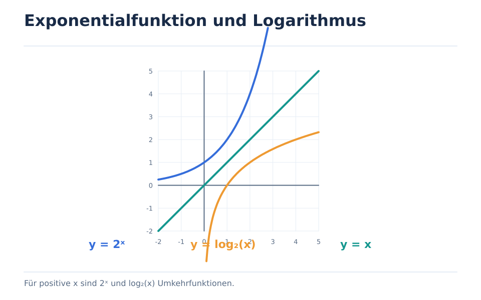

# M1-L19 – Potenz-, Wurzel-, Exponentialfunktionen und Logarithmen {#L19}

**Kursbereich:** M1 – Sekundarstufe I

**Niveau:** Sekundarstufe I

**Vorwissen:** Keine festen Voraussetzungen angegeben.

**Einordnung:** Sekundarstufe I, Oberstufenvorbereitung / didaktisch ungefähr Klasse 10 · Format: zügige Auffrischung

## Worum geht es? {#S1}

In M1-L17 haben wir gesehen, wie ein Bestand von Schritt zu Schritt um denselben Prozentsatz wachsen kann. Jetzt unterscheiden wir verschiedene **Funktionsfamilien**: Bei einer Potenzfunktion wird eine veränderliche Zahl potenziert; bei einer Exponentialfunktion steht die Veränderliche dagegen **im Exponenten**. Wurzelfunktionen machen bestimmte Potenzierungen rückgängig. Logarithmen beantworten schließlich die Frage, **welcher Exponent benötigt wird**, um eine bestimmte Zahl zu erreichen. Mit diesen Ideen lassen sich Wachstumsprozesse beschreiben und Gleichungen nach unbekannten Zeitpunkten oder Faktoren auflösen.

## Grundidee und Anschauung {#S2}

Vergleiche zwei Fragen: „Was ergibt das Quadrat einer beliebigen Eingabe?“ und „Wie groß ist ein Anfangswert nach einer unbekannten Anzahl von Verdoppelungen?“ Im ersten Fall wird $x$ mit sich selbst multipliziert: $x^2$. Im zweiten Fall ist $x$ die Anzahl der Verdoppelungsschritte: $2^x$. Diese Funktionen können bei einigen Eingaben ähnliche Ergebnisse liefern, folgen aber grundverschiedenen Regeln. Eine Wurzel sucht beispielsweise die nichtnegative Zahl, deren Quadrat einen vorgegebenen Wert ergibt; ein Logarithmus sucht dagegen den benötigten **Hochzahlwert**.

## Neue Zeichen vor der ersten Formel {#S3}

  Zeichen                 Aussprache                                                         Bedeutung hier                                                      Anderer möglicher Gebrauch
  ----------------------- ------------------------------------------------------------------ ------------------------------------------------------------------- -------------------------------------------------------------------------------
  $x$                     „iks“                                                              Eingabe, manchmal gesuchter Exponent                                Koordinate, freie Variable
  $f(x)$                  „eff von iks“                                                      Ausgabe einer Funktion für Eingabe x                                Bereits seit M1-L4 eingeführt
  `xⁿ`, `x^n`             „iks hoch en“                                                      Potenzfunktion: Eingabe x wird mit festem Exponenten n potenziert   `^` in Programmiersprachen oft kein Potenzoperator
  `aˣ`, `a^x`             „a hoch iks“                                                       Exponentialfunktion mit fester Basis a                              a kann sonst eine beliebige Konstante sein
  $\sqrt{x}$              „Quadratwurzel aus iks“                                            Nichtnegative Zahl, deren Quadrat x ergibt                          Wurzel anderer Ordnung benötigt einen Index
  `logₐ(b)`, `log_a(b)`   „Logarithmus von be zur Basis a“                                   Exponent, mit dem a potenziert werden muss, um b zu erhalten        `log` ohne Basisangabe kann je nach Fach oder Software etwas anderes bedeuten
  $\ln(x)$                „natürlicher Logarithmus von iks“                                  Logarithmus zur Basis der Eulerschen Zahl e                         In Programmiersprachen oft `log(x)`
  $e$                     „Eulersche Zahl“                                                   Ungefähr 2,71828; besonders wichtige Exponentialbasis               Nicht das Formelzeichen für eine beliebige Variable
  `<`, `>`, `≤`, `≥`      „kleiner“, „größer“, „kleiner oder gleich“, „größer oder gleich“   Ungleichungen und erlaubte Werte                                    Vergleiche in der Logik und Programmierung
  `⇔`                     „genau dann, wenn“ bzw. „ist äquivalent zu“                        Beide Aussagen gelten unter denselben Voraussetzungen               Schon in M1-L3 bei Umformungen
  $\infty$                „unendlich“                                                        Unbegrenztes Wachstum oder Grenzverhalten                           Keine gewöhnliche reelle Zahl

**Notation für Offline-Leser:** In Formeln stehen Hochzahlen teils als Unicode (`x²`, `2ˣ`), allgemeine Potenzen als `x^n`. Beides meint dieselbe mathematische Hochstellung. Die Klartextschreibweise funktioniert ohne Internet und ohne Formelbibliothek.

## Potenzfunktionen: Die Eingabe wird potenziert {#S4}

Eine **Potenzfunktion** hat einen festen Exponenten und eine veränderliche Basis. Ein einfaches Beispiel ist das Quadrat $f(x)=x^2$: Für $x=3$ erhalten wir 9; für $x=-3$ ebenfalls 9. Die gerade Hochzahl macht hier das Vorzeichen unsichtbar. Bei $f(x)=x^3$ bleibt es dagegen erkennbar, weil $-3$ hoch drei $-27$ ergibt.

$$
f(x)=x^n
$$

**Laut gelesen:** „Eff von iks ist gleich iks hoch en.“ $f$ ist der Funktionsname; die Klammern enthalten die Eingabe $x$; `=` verbindet die beiden Seiten; $x$ ist die Basis; $n$ ist ein **fest gewählter Exponent**. Für ganze positive $n$ steht die Potenz für $n$ wiederholte Faktoren. Für negative **ganzzahlige** Exponenten gelten Kehrwerte, solange die Basis nicht null ist: $x^{-1}=\frac1x$ nur für $x\ne0$. Bei gebrochenen Exponenten braucht man zusätzliche Bereichsbedingungen: Beispielsweise ist $x^{1/2}=\sqrt{x}$ im Reellen nur für $x\ge0$ definiert, während eine Kubikwurzel auch eine negative Zahl als Argument haben kann. Diese Fälle darf man nicht durch eine einzige pauschale Potenzregel ersetzen.

### Mini-Beispiel: Flächen wachsen quadratisch {#abschnitt-5}

Ein Quadrat mit Seitenlänge 2 Zentimetern besitzt eine Fläche von 4 Quadratzentimetern. Wird die Seitenlänge auf 4 Zentimeter verdoppelt, steigt die Fläche auf 16 Quadratzentimeter, also auf das **Vierfache**. Die Fläche ist eine Potenzfunktion der Seitenlänge. Das ist nicht dasselbe wie ein exponentielles Wachstum im Verlauf der Zeit.

## Wurzelfunktionen: Quadrieren umkehren {#S5}

Die Quadratwurzel sucht die nichtnegative Ausgangszahl zu einem gegebenen Quadrat. Beispielsweise gilt $\sqrt{25}=5$. Deshalb ist die einfache Wurzelfunktion $f(x)=\sqrt{x}$ nur für Eingaben **ab null** als reellwertige Funktion definiert. Sie steigt, aber immer langsamer: Um den Funktionswert von 2 auf 4 zu verdoppeln, muss die Eingabe von 4 auf 16 vervierfacht werden.

**Laut gelesen:** „Eff von iks ist die Quadratwurzel aus iks.“ `√` bezeichnet die **nichtnegative Hauptwurzel**; $x$ ist die Zahl unter dem Wurzelzeichen. Es ist wichtig, zwei Aussagen nicht zu vermischen: $\sqrt9=3$ hat nur den nichtnegativen Wert 3, aber die Gleichung $x^2=9$ hat die **zwei** Lösungen $x=3$ und $x=-3$.

### Mini-Beispiel: Länge aus Fläche {#abschnitt-7}

Ein quadratisches Symbol besitzt eine Fläche von 49 Quadratpixeln. Seine Seitenlänge ist $\sqrt{49}=7$ Pixel. Der Wurzelwert ist hier eine Länge und deshalb nichtnegativ. Bei realen Bilddaten muss außerdem geklärt werden, ob die Pixel als quadratische Flächeneinheiten modelliert werden dürfen.

## Exponentialfunktionen: Die Eingabe ist der Exponent {#S6}

Eine Exponentialfunktion besitzt eine **feste positive Basis** und einen **veränderlichen Exponenten**. Für $f(x)=2^x$ bedeuten die Eingaben 0, 1, 2, 3 und 4 die Ausgaben 1, 2, 4, 8 und 16. Jeder Schritt von $x$ nach $x+1$ multipliziert das Ergebnis wieder mit 2.

$$
f(x)=a^x\qquad(a>0,\ a\neq1)
$$

**Laut gelesen:** „Eff von iks ist a hoch iks; die Basis a ist größer null und ungleich eins.“ $a$ ist ein **konstanter Wachstums- oder Zerfallsfaktor**; $x$ steht im Exponenten. Für $a>1$ wächst die Funktion mit $x$. Liegt $a$ zwischen 0 und 1, fällt sie mit wachsendem $x$. Die Auswahl $a=1$ würde nur die konstante Funktion 1 ergeben und wird deshalb in der üblichen Definition einer nichttrivialen Exponentialfunktion ausgeschlossen. Für jede reelle Eingabe $x$ und jede zulässige Basis ist $a^x>0$; die Exponentialfunktion erreicht **weder null noch negative Werte**. Erst so lässt sich ihre reelle Umkehrfunktion auf positiven Eingaben erklären.

### Mini-Beispiel: Wiederholte Verdoppelung {#abschnitt-9}

Ein simuliertes Datenvolumen beginnt bei einer Einheit und verdoppelt sich in jedem Schritt. Nach fünf Schritten liegen $2^5=32$ Einheiten vor. Nach zehn Schritten sind es $2^{10}=1024$ Einheiten. Anders als bei $x^2$ wächst hier die Anzahl der **Multiplikationsschritte**. Das Modell gilt nur, solange der Faktor 2 tatsächlich konstant bleibt und keine Kapazitätsgrenzen eingreifen.

## Logarithmen: Die fehlende Hochzahl finden {#S7}

Der Logarithmus ist die Umkehrung der Exponentialfunktion **bei derselben Basis**. Er beantwortet die Frage: „Wie oft muss ich a als Faktor verwenden, um b zu erhalten?“ Damit wird ein unbekannter Exponent zu einer gewöhnlichen gesuchten Zahl.

$$
\begin{aligned}
\log_a(b)=x&\iff a^x=b\\
&\quad(a>0,\ a\neq1,\ b>0)
\end{aligned}
$$

**Laut gelesen:** „Der Logarithmus von be zur Basis a ist x genau dann, wenn a hoch x gleich be ist.“ `log` bezeichnet die Logarithmusfunktion; das tiefgestellte $a$ benennt ihre **Basis**; das Argument $b$ ist die positive Zielzahl; $x$ ist der gesuchte Exponent. `⇔` bedeutet, dass beide Aussagen mathematisch gleichwertig sind. Die Bedingungen in Klammern sichern die übliche reelle Logarithmusfunktion ab.

### Mini-Beispiel: Wie viele Verdoppelungen? {#abschnitt-11}

Gesucht ist die Anzahl der Verdoppelungen von 1 auf 32. Weil $2^5=32$, gilt $\log_2(32)=5$. Gesprochen: „Der Logarithmus von zweiunddreißig zur Basis zwei ist fünf.“ In anderer Schreibweise kann man `log_2(32) = 5` schreiben. Für 64 lautet das Ergebnis 6, weil eine weitere Verdoppelung hinzukommt. Bei einem zusammengesetzten Logarithmus muss **das ganze Argument positiv** sein: $\log_2(x-3)$ ist nur für $x>3$ definiert. Die Logarithmengesetze $\log_a(u\cdot v)=\log_a(u)+\log_a(v)$ und $\log_a\left(\frac uv\right)=\log_a(u)-\log_a(v)$ gelten hier für $u>0$, $v>0$, $a>0$ und $a\ne1$. **Laut gelesen:** „Logarithmus eines Produkts ist Summe der Logarithmen“, beziehungsweise „Logarithmus eines Quotienten ist ihre Differenz“. Es gibt dagegen **kein** allgemeines Gesetz $\log_a(u+v)=\log_a(u)+\log_a(v)$. Beispielsweise ist $\log_2(2+8)=\log_2(10)$ ungefähr 3,322, aber $\log_2(2)+\log_2(8)=1+3=4$.

Zwei häufige Spezialfälle sind $\log_{10}(x)$ (Zehnerlogarithmus) und $\ln(x)$ (natürlicher Logarithmus zur Basis $e$). Bei `log(x)` **ohne Basis** muss der Kontext geklärt werden: Schulbuch, Taschenrechner und Programmiersprache verwenden nicht immer dieselbe Konvention.

## Gleichungen und Ungleichungen richtig lesen {#S8}

Bei Gleichungen sucht man Werte, für die beide Seiten gleich sind. Beispielsweise hat $2^x=32$ genau die Lösung $x=5$. Bei einer **Ungleichung** geht es hingegen um einen ganzen Wertebereich: $2^x\ge32$ gilt für alle reellen $x\ge5$, weil $2^x$ streng wächst.

Wird eine Ungleichung mit einer **negativen Zahl** multipliziert oder durch sie dividiert, dreht sich das Vergleichszeichen um. Das ist keine Besonderheit von Potenzfunktionen, sondern eine allgemeine algebraische Regel. Bei einem Logarithmus zur Basis zwischen null und eins ist die Funktion **fallend**; beim Anwenden einer solchen Funktion auf beide Seiten einer Ungleichung dreht sich die Reihenfolge ebenfalls um, **wenn beide Seiten positive zulässige Argumente sind**. Zum Beispiel gilt $4<8$, aber $\log_{1/2}(4)=-2>-3=\log_{1/2}(8)$. Der tiefgestellte Ausdruck $\frac12$ bezeichnet die Logarithmusbasis ein Halb; der Wert wird kleiner, wenn das positive Argument größer wird. Außerdem dürfen Logarithmen im reellen Bereich nur auf positive Argumente angewandt werden.

### Mini-Beispiel: Eine technische Schwelle {#abschnitt-13}

Ein idealisiertes System startet mit einer Einheit und verdoppelt sich pro Schritt. Eine Kapazität von 32 Einheiten wird nach fünf Schritten erreicht. Bei $x>5$ liegt das modellierte Volumen über dieser Schwelle. Wenn nur **ganze** Verarbeitungsschritte zugelassen sind, ist der erste Schritt *über* der Schwelle also Schritt 6; bei einer kontinuierlichen Zeitachse sind auch Zwischenwerte möglich.

## Wofür nützlich? {#S9}

Potenzfunktionen beschreiben beispielsweise Flächen- und Volumenskalierung, Polynommodelle oder quadratische Fehlerterme. Exponentialmodelle tauchen bei Wachstum, Zerfall und einigen kontinuierlichen Dynamiken auf; Logarithmen helfen bei der Bestimmung benötigter Schritte und bei Größenordnungen, etwa in der Analyse von Suchalgorithmen. In der KI wird der natürliche Logarithmus unter anderem in Verlustfunktionen und Wahrscheinlichkeitsmodellen verwendet. Die konkrete Formel hängt jeweils von den Voraussetzungen des Modells ab.

## Annahmen und Grenzen {#S10}

Die Unterscheidung $x^2$ versus $2^x$ ist entscheidend: Das eine ist eine Potenzfunktion, das andere eine Exponentialfunktion. $\sqrt{x}$ ist im Bereich der reellen Zahlen nur für $x\ge0$ zulässig; $\log_a(x)$ nur für $x>0$ bei $a>0$ und $a\ne1$. Negative Zahlen können in der **komplexen Mathematik** anders behandelt werden, aber das ist noch nicht Gegenstand dieser Lektion. Unbegrenztes exponentielles Wachstum ist in realen Systemen meist nur eine Näherung über einen beschränkten Zeitraum.

## Verbindung zur nächsten Einheit {#S11}

In M1-L20 benutzen wir die bereits bekannten trigonometrischen Verhältnisse nicht mehr nur für Dreiecke, sondern für **Positionen auf einem Kreis und periodische Abläufe**. Dort begegnen uns wieder Funktionen, aber mit einem ganz anderen Verlauf: wiederkehrend statt dauerhaft wachsend.

## Vertiefung (optional) {#S12}

Später in der Analysis untersuchen wir, wie schnell Potenz-, Exponential- und Logarithmusfunktionen wachsen und wie ihre Ableitungen aussehen. In der Informatik kann zusätzlich der Zusammenhang zwischen Logarithmen, Binärbäumen und der Komplexität von Algorithmen vertieft werden.

## Quellen {#S13}

In dieser Lektion sind keine Einzelquellen gesondert verzeichnet.
