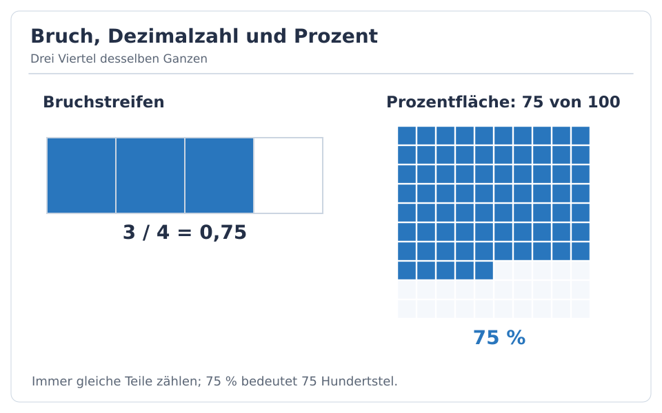

# M1-L2 – Brüche, Prozentrechnung, Verhältnisse und Proportionalität {#L2}

**Kursbereich:** M1 – Sekundarstufe I

**Niveau:** Sekundarstufe I

**Vorwissen:** Keine festen Voraussetzungen angegeben.

**Einordnung:** Sekundarstufe I, didaktisch ungefähr Klasse 7 · Format: zügige Auffrischung

## Worum geht es? {#S1}

Brüche beschreiben Anteile und können eine Division darstellen. Prozentzahlen stellen einen Anteil auf einer Skala von hundert dar. Verhältnisse vergleichen zwei Größen. Proportionalität beschreibt einen Spezialfall: Wenn sich die eine Größe um einen Faktor verändert, verändert sich die andere genau vorhersagbar. Solche Modelle sind in der Datenanalyse und Informatik häufig, gelten in der Praxis aber nur unter passenden Annahmen.

## Brüche und Dezimalzahlen {#S2}

Ein **Bruch** besteht aus einem **Zähler** über einem **Nenner**. Allgemein ist $\frac ab$ der Quotient „a geteilt durch b“, wobei $b\ne0$ gelten muss. Bei einem Anteil eines Ganzen, etwa $\frac34$, bezeichnet der Zähler die betrachteten gleich großen Teile und der positive Nenner, in wie viele gleich große Teile das Ganze zerlegt ist. **Nicht jeder Bruch ist ein Anteil zwischen null und eins**: $\frac54$ ist größer als ein Ganzes, und $-\frac12$ ist negativ.

{alt="Bruchstreifen zeigt drei von vier Teilen, daneben ein Hundertfeld mit 75 gefärbten Zellen. Drei Viertel entsprechen 0,75 beziehungsweise 75 Prozent."}

Drei Viertel, $0{,}75$ und $75\,\%$ sind verschiedene Schreibweisen desselben Anteils.

**Formel:** $\frac34=0{,}75$

**Laut gelesen:** „Drei Viertel ist gleich null Komma sieben fünf.“ Die allgemeine Schreibweise $\frac ab$ liest man „a durch b“; $b\ne0$ heißt „b ist ungleich null“.

Denke an vier gleich große Stücke, von denen drei vorhanden sind. Ein Nenner darf **nicht null** sein, da Division durch null nicht definiert ist.

## Prozente {#S3}

Das Zeichen `%` spricht man als „Prozent“ und bedeutet **von hundert**.

**Formel:** $20\,\%=\frac{20}{100}=0{,}2$

**Laut gelesen:** „Zwanzig Prozent entsprechen zwanzig Hundertsteln beziehungsweise null Komma zwei.“

**Mini-Beispiel:** Von 80 Dateien sind $20\,\%$ fertig. $80\cdot0{,}2=16$ Dateien sind abgeschlossen. Das Zeichen `·` wird „mal“ gesprochen.

**Prozentpunkte sind etwas anderes als Prozent Veränderung:** Steigt eine Quote von $20\,\%$ auf $25\,\%$, ist sie um **5 Prozentpunkte** gestiegen. Bezogen auf den ursprünglichen Wert $20\,\%$ beträgt der relative Anstieg aber **$25\,\%$**.

## Verhältnisse und Dreisatz {#S4}

Ein Verhältnis $2:3$ („zwei zu drei“) vergleicht zwei Mengen. Erledigt Agent A zwei Aufgaben und Agent B drei, stehen ihre Arbeitsergebnisse im Verhältnis 2 zu 3. Von den zusammen fünf Aufgaben hat A **$\frac25$** und B **$\frac35$** erledigt; $2:3$ bedeutet also gerade nicht „zwei Drittel des Ganzen“.

Der **Dreisatz** rechnet über einen bekannten Wert auf einen gesuchten Wert hoch oder herunter. Beispiel: Zwei identische Programme verarbeiten in derselben Zeit gemeinsam 100 unabhängige Dateien. Unter idealen Bedingungen würden vier identische Programme 200 Dateien verarbeiten. Ob das wirklich gilt, hängt von Engpässen ab.

## Direkte Proportionalität {#S5}

Ein **Proportionalitätsfaktor** ist eine feste Zahl $k$ („ka“), mit der ein Eingabewert multipliziert wird. $x$ ist die Eingabe, $y$ das Ergebnis.

**Formel:** $y=k\cdot x$

**Laut gelesen:** „Ypsilon ist gleich k mal x.“

**Mini-Beispiel:** Ein Programm schafft fünf Dateien je Stunde: $k=5$ Dateien/Stunde. Bei $x=4$ Stunden sind $y=20$ Dateien fertig.

  Stunden $x$  Bearbeitete Dateien $y$
  ------------ ------------------------
  1            5
  2            10
  4            20
  8            40

Bei direkter Proportionalität entsteht in einem passenden Koordinatensystem eine Gerade durch den Ursprung.

**Umgekehrte Proportionalität:** Wenn die Gesamtarbeit fest ist und sich ideal verteilen lässt, halbiert eine Verdoppelung der gleich schnellen Arbeiter die benötigte Zeit. Dafür bleibt das **Produkt** aus Arbeiterzahl und Zeit konstant, nicht der Quotient. In realen Programmen stören Kommunikation, Sperren und I/O-Engpässe diese Idealannahme.

## Zeichenlesehilfe {#S6}

  Zeichen     Aussprache              Bedeutung hier         Anderer möglicher Gebrauch
  ----------- ----------------------- ---------------------- ---------------------------------------------
  $\frac ab$  a durch b               Bruch oder Division    Quotient anderer Größen
  \%          Prozent                 Anteil von 100         Auch Modulo-Operator in Programmiersprachen
  :           zu oder geteilt durch   Verhältnis             Division
  $x,y$       iks, ypsilon            Eingabe und Ergebnis   Koordinaten, Unbekannte
  $k$         ka                      Konstanter Faktor      Allgemeiner Parameter
  ·           mal                     Multiplikation         Skalarprodukt bei Vektoren

## Wofür nützlich? {#S7}

Brüche und Prozente dienen für Wahrscheinlichkeiten, Fortschrittsanzeigen und Auslastung. Verhältnisse helfen bei der Ressourcenverteilung. Proportionale Modelle sind erste Schätzungen für Laufzeit und Kosten; sie müssen auf ihre Annahmen geprüft werden.

## Annahmen und Grenzen {#S8}

Eine Verdoppelung des Speicherverbrauchs, der Nutzerzahl oder der Prozessanzahl führt **nicht automatisch** zu einer Verdoppelung der Rechenzeit oder Leistung. Direkte Proportionalität setzt einen konstanten Faktor und einen passenden Gültigkeitsbereich voraus.

## Verbindung zu M1-L3 {#S9}

Mit Rechengesetzen können wir solche Beziehungen vereinfachen und **Gleichungen gezielt umstellen**.

## Quellen {#S10}

In dieser Lektion sind keine Einzelquellen gesondert verzeichnet.
