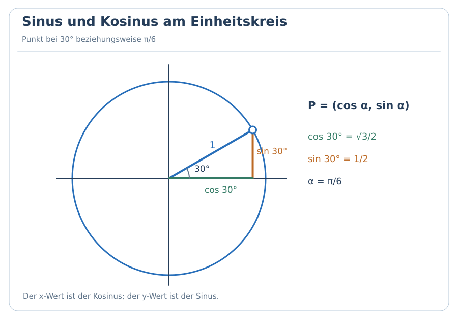

# M1-L20 – Trigonometrie am Einheitskreis und periodische Vorgänge {#L20}

**Kursbereich:** M1 – Sekundarstufe I

**Niveau:** Sekundarstufe I

**Vorwissen:** Keine festen Voraussetzungen angegeben.

**Einordnung:** Sekundarstufe I, Oberstufenvorbereitung / didaktisch ungefähr Klasse 10 · Format: zügige Auffrischung

## Worum geht es? {#S1}

In M1-L16 haben wir Sinus, Kosinus und Tangens an rechtwinkligen Dreiecken kennengelernt. Auf dem **Einheitskreis** werden diese Verhältnisse zu Funktionen, die wir auch bei Winkeln außerhalb eines rechtwinkligen Dreiecks verwenden können. Bei einer vollständigen Drehung kehren die gleichen Werte wieder: Das führt zu **periodischen Funktionen**. Solche Funktionen beschreiben Kreisbewegungen, Wellen, Schwingungen und regelmäßig wiederkehrende Vorgänge. Eine wichtige neue Schreibweise ist das **Bogenmaß**, das Winkel über die Länge eines Kreisbogens beschreibt.

## Grundidee und Anschauung {#S2}

Stell dir einen Zeiger vor, der sich um einen festen Mittelpunkt dreht. Seine Spitze bewegt sich auf einem Kreis mit Radius eins. Während der Zeiger rotiert, bewegt sich die Spitze abwechselnd nach rechts, oben, links und unten. Der **Kosinus** beschreibt dabei die waagerechte Koordinate; der **Sinus** die senkrechte Koordinate. Zeichnen wir nur die Höhe der Spitze gegen die Zeit, erhalten wir die typische wellenförmige Sinuskurve. Ein und dieselbe Kreisbewegung lässt sich dadurch als wiederkehrende Höhenänderung verstehen.

Für $\alpha=30^{\text{°}}$ gilt: $\cos(\alpha)=\frac{\sqrt3}{2}$ und $\sin(\alpha)=\frac12$.

## Neue Zeichen vor der ersten Formel {#S3}

  Zeichen         Aussprache                 Bedeutung hier                                                              Anderer möglicher Gebrauch
  --------------- -------------------------- --------------------------------------------------------------------------- -------------------------------------------------
  $\theta$        „Theta“                    Drehwinkel des Zeigers                                                      Allgemeiner Winkel oder Modellparameter
  $\alpha$        „Alpha“                    Ebenfalls mögliche Winkelbezeichnung, schon aus M1-L15/M1-L16 bekannt       Winkel oder Parameter
  $\sin(\theta)$  „Sinus von Theta“          Senkrechte Koordinate am Einheitskreis                                      In M1-L16 Verhältnis Gegenkathete/Hypotenuse
  $\cos(\theta)$  „Kosinus von Theta“        Waagerechte Koordinate am Einheitskreis                                     In M1-L16 Verhältnis Ankathete/Hypotenuse
  $\tan(\theta)$  „Tangens von Theta“        Verhältnis Sinus durch Kosinus, sofern Kosinus nicht null ist               Auch Steigung einer Geraden mit Winkel θ
  $\pi$           „Pi“                       Kreiszahl, etwa 3,14159                                                     Bereits beim Kreisumfang verwendet
  $\mathrm{rad}$  „Radiant“, „im Bogenmaß“   Einheit des Winkelmaßes; Verhältnis zweier Längen und daher dimensionslos   In Software auch Bezeichnung des Winkelmodus
  `°`             „Grad“                     Klassisches Winkelmaß, Vollkreis = 360°                                     Auch als Zeichen für Temperaturgrad
  $T$             „großes te“                Periodendauer: Zeit für eine Wiederholung                                   Sonst beliebige Zeit oder Temperatur
  $f$             „eff“                      Hier Frequenz: Wiederholungen pro Sekunde                                   Auch Name einer Funktion, etwa $f(x)$
  $\omega$        „Omega klein“              Kreisfrequenz / Winkelgeschwindigkeit bei gleichförmiger Phase              Winkelgeschwindigkeit eines rotierenden Körpers
  $t$             „te“                       Zeitvariable                                                                Beliebiger Parameter
  $A$             „großes a“                 Amplitude: maximale Auslenkung vom Mittelwert                               In M1-L5 Flächeninhalt, in M1-L12 Ereignisname
  $\varphi$       „Phi“                      Anfangsphase: horizontale Phasenverschiebung als Winkel                     Auch andere Winkelgrößen
  $c$             „ce“                       Vertikale Verschiebung / Mittelwertlinie                                    In der Geometrie eine Strecke
  $\mathrm{Hz}$   „Hertz“                    Einheit der Frequenz: eine Wiederholung pro Sekunde                         Keine Winkeleinheit

**Hinweis zur Darstellung:** Die Formeln stehen auch hier als Unicode-/Klartextausdrücke. Für das Lesen des Offline-Archivs sind weder MathJax noch Internetzugriff nötig.

## Einheitskreis: Winkel werden zu Koordinaten {#S4}

Ein **Einheitskreis** ist ein Kreis mit Mittelpunkt im Koordinatenursprung und Radius genau eins. Der Winkel wird üblicherweise von der positiven waagerechten Achse aus gemessen: Gegen den Uhrzeigersinn ist die positive Drehrichtung. Die Position der Zeigerspitze lässt sich durch zwei Koordinaten angeben.

$$
P(\theta)=(\cos(\theta);\,\sin(\theta))
$$

**Laut gelesen:** „Der Punkt pe zum Winkel Theta hat als erste Koordinate Kosinus von Theta und als zweite Koordinate Sinus von Theta.“ $P$ bezeichnet einen Punkt; `( … ; … )` ist ein geordnetes Koordinatenpaar; der erste Eintrag ist die x-Koordinate, der zweite die y-Koordinate. $\cos$ und $\sin$ sind Namen der beiden trigonometrischen Funktionen; $\theta$ ist der Winkel.

### Mini-Beispiel: Vierteldrehung {#abschnitt-5}

Startet der Zeiger nach rechts, hat er bei $\theta=0^{\text{°}}$ die Koordinaten $(1;0)$. Nach einer positiven Vierteldrehung um 90° zeigt er nach oben. Dann gilt $\cos(90^{\text{°}})=0$ und $\sin(90^{\text{°}})=1$, der Punkt liegt bei $(0;1)$. Nach 180° zeigt der Zeiger nach links und liegt bei $(-1;0)$; nach 360° ist er wieder bei $(1;0)$.

Damit verstehen wir auch negative Sinus- und Kosinuswerte: Im linken Halbkreis ist die waagerechte Koordinate negativ, im unteren Halbkreis die senkrechte. Die Funktionen sind also **nicht** auf positive Seitenlängenverhältnisse aus dem rechtwinkligen Dreieck beschränkt.

Der Tangens wird am Kreis über $\tan(\theta)=\frac{\sin(\theta)}{\cos(\theta)}$ beschrieben. **Laut gelesen:** „Tangens von Theta ist Sinus von Theta geteilt durch Kosinus von Theta.“ Das Zeichen `/` bedeutet Division. Bei 90° und 270° ist der Kosinus null; der Tangens ist an diesen Stellen **nicht definiert**.

## Bogenmaß: Winkel als Anteil des Kreisumfangs {#S5}

Ein Vollkreis entspricht 360 Grad. Derselbe Vollkreis hat im **Bogenmaß** den Winkel $2\pi\,\mathrm{rad}$; ein Halbkreis $\pi\,\mathrm{rad}$; eine Vierteldrehung $\frac{\pi}{2}\,\mathrm{rad}$. Das kommt daher, dass der Umfang eines Kreises mit Radius eins $2\pi$ beträgt. Das Bogenmaß eines Winkels ist die aufgespannte Kreisbogenlänge **geteilt durch den Kreisradius**.

$$
\begin{aligned}
180^{\text{°}}&=\pi\,\mathrm{rad}\\
360^{\text{°}}&=2\pi\,\mathrm{rad}
\end{aligned}
$$

**Laut gelesen:** „Einhundertachtzig Grad entsprechen Pi Radiant; dreihundertsechzig Grad entsprechen zwei Pi Radiant.“ `°` steht für Grad; $\pi$ ist die Kreiszahl; $\mathrm{rad}$ macht deutlich, dass der Winkel im Bogenmaß angegeben ist. Das Gleichheitszeichen steht hier für **denselben Winkel in unterschiedlichen Einheiten**, nicht für dieselbe nackte Zahl.

### Mini-Beispiel: 90 Grad umrechnen {#abschnitt-7}

Eine Vierteldrehung hat 90° und damit im Bogenmaß $\frac{\pi}{2}\,\mathrm{rad}$, ungefähr 1,5708 Radiant. Ein Drehwinkel von $2\pi\,\mathrm{rad}$ beschreibt eine volle Umdrehung. Programmierfunktionen wie $\sin$ und $\cos$ erwarten in vielen Sprachen **Radiant** und nicht Grad; wer versehentlich $\sin(90)$ statt $\sin\left(\frac{\pi}{2}\right)$ eingibt, erhält deshalb meist nicht den erwarteten Wert 1.

Die Umrechnungsregel lautet in Worten: **Gradwert mal Pi, anschließend durch 180 teilen**. Umgekehrt multipliziert man einen Radiantwert mit 180 und teilt durch Pi.

## Periodische Funktionen: Nach einer Runde beginnt das Muster erneut {#S6}

Sinus und Kosinus wiederholen sich nach jeder vollen Umdrehung. Zwei Winkel, die sich um $2\pi$ Radiant unterscheiden, führen zu denselben Koordinaten am Kreis. In den folgenden Periodenformeln ist $\theta$ ausdrücklich **im Bogenmaß** angegeben. Sinus und Kosinus haben als kleinste positive Periode $2\pi$, während der Tangens, wo er definiert ist, schon nach $\pi$ seine Werte wiederholt.

$$
\begin{aligned}
\sin(\theta+2\pi)&=\sin(\theta)\\
\cos(\theta+2\pi)&=\cos(\theta)
\end{aligned}
$$

**Laut gelesen:** „Sinus von Theta plus zwei Pi ist gleich Sinus von Theta; Kosinus von Theta plus zwei Pi ist gleich Kosinus von Theta.“ Die Klammern zeigen an, dass zuerst der gesamte Winkel $\theta+2\pi$ als Eingabe betrachtet wird. Die Wiederholung erfolgt nach einer **ganzen Drehung**. Dass sich die Funktionswerte wiederholen, bedeutet nicht, dass Zeiger und Zeit insgesamt unverändert geblieben sind.

Eine periodische Bewegung hat eine **Periodendauer** $T$: So viele Sekunden vergehen bis zur nächsten gleichen Phase. Die **Frequenz** $f=\frac1T$ gibt an, wie viele Wiederholungen pro Sekunde stattfinden. $\frac1T$ wird „eins durch te“ gelesen; $T$ muss positiv sein. Bei einer Periodendauer von zwei Sekunden beträgt die Frequenz 0,5 Hertz. Diese Beschreibung setzt $T>0$ voraus und eine **wirklich nichtkonstante periodische Bewegung**. Ist die Auslenkung konstant, lässt sich keine eindeutige Grundperiode aus dem Signal ablesen.

## Eine Welle als mathematische Funktion {#S7}

Eine einfache Sinusschwingung kann um einen Mittelwert herum verlaufen, eine bestimmte Höhe besitzen und schneller oder langsamer schwingen.

$$
\begin{aligned}
y(t)&=A\sin(\omega t+\varphi)+c\\
\omega&=\frac{2\pi}{T}=2\pi f
\end{aligned}
$$

**Laut gelesen, erste Zeile:** „Ypsilon von te ist gleich die Amplitude a mal Sinus von Omega mal te plus Phi, danach plus ce.“ $y(t)$ bezeichnet den Wert der Schwingung zum Zeitpunkt $t$; $A$ ist ihre Amplitude; `·` bedeutet Multiplikation; $\omega t+\varphi$ ist der aktuelle Winkel beziehungsweise die **Phase** im Bogenmaß; $\varphi$ legt die Anfangsphase als **Winkel im Bogenmaß** fest; $c$ verschiebt die gesamte Schwingung vertikal. Wir wählen die Amplitude $A$ positiv; $A$ und $c$ tragen dieselbe Einheit wie die Ausgabe $y$, während der Sinuswert einheitslos ist. Das gesamte Argument $\omega t+\varphi$ muss eine dimensionslose Winkelangabe im Bogenmaß ergeben.

**Laut gelesen, zweite Zeile:** „Omega ist gleich zwei Pi geteilt durch die Periodendauer te, gleich zwei Pi mal Frequenz eff.“ $\omega$ ist hier die **positive** Kreisfrequenz in Radiant pro Sekunde, $T>0$ die Periodendauer in Sekunden und $f>0$ die gewöhnliche Frequenz in Hertz. Die angegebenen Gleichungen setzen $\omega>0$ und $A>0$ voraus. Bei negativem $\omega$ kehrt sich die Phasenlaufrichtung um, und die gewöhnliche Frequenz wäre $\frac{|\omega|}{2\pi}$; bei $A=0$ wäre das Signal konstant und hätte keine ausgezeichnete Grundperiode. Das Zeichen $|\omega|$ bedeutet den nichtnegativen Betrag von Omega. Hier wird das Symbol $f$ **nicht** als Funktionsname verwendet: Dasselbe Zeichen kann je nach Kontext eine andere Rolle besitzen.

### Mini-Beispiel: Eine Schwingung mit zwei Sekunden Dauer {#abschnitt-10}

Wir wählen Amplitude $A=1$, Anfangsphase $\varphi=0$, Mittellinie $c=0$ und Periodendauer $T=2\,\mathrm{s}$. Damit ist $\omega=\pi\,\mathrm{rad}/\mathrm{s}$. Als **Zahlenwertformel**, wenn $t$ in Sekunden eingesetzt wird, vereinfacht sich die Regel zu $y(t)=\sin(\pi t)$; gesprochen „Ypsilon von te ist der Sinus von Pi mal te“. **Mit Einheiten** ist das Argument des Sinus $(\pi\,\mathrm{rad}/\mathrm{s})\cdot t$ (zuzüglich der hier auf null gesetzten Anfangsphase), also ein Winkel und keine Zeit in Sekunden. Man darf eine physikalische Zeit nicht ohne den passenden Faktor direkt als Sinusargument behandeln. Zum Zeitpunkt $t=0\,\mathrm{s}$ ist der Wert 0. Nach $t=0{,}5\,\mathrm{s}$ beträgt die Phase $\frac{\pi}{2}$ und der Wert ist 1. Bei $t=1\,\mathrm{s}$ ist der Wert wieder 0. Bei $t=2\,\mathrm{s}$ beginnt der Zyklus erneut.

Die Sinusschwingung ist ein **Modell für ideal regelmäßige Vorgänge**. Nicht jedes reale Signal ist so glatt oder besteht nur aus einer Frequenz; verrauschte oder zusammengesetzte Signale werden später in der Fourier-Analyse untersucht.

## Wofür nützlich? {#S8}

Einheitskreis und Bogenmaß sind Grundlage für Rotationsberechnungen in 2D-Grafik, 3D-Engines und Robotik. Sinusfunktionen modellieren regelmäßige Sensordaten, Wechselspannungen, Schwingungen oder einfache periodische Steuerbewegungen. Frequenz und Phase sind zentrale Größen bei Audioverarbeitung und zeitlicher Synchronisation von Systemen. Bei der Auswertung realer Daten muss man zusätzlich Abtastrate, Rauschen und mögliche Frequenzüberlagerungen berücksichtigen.

## Annahmen und Grenzen {#S9}

Die Winkelkonvention (Startachse und Drehrichtung) muss in jeder Anwendung feststehen. Viele Programmiersprachen erwarten Bogenmaß; Gradwerte müssen vor der Auswertung umgerechnet werden. Ein periodisches Modell setzt voraus, dass sich der Vorgang ausreichend regelmäßig wiederholt. $\tan(\theta)$ ist bei $\cos(\theta)=0$ nicht definiert. Eine Kreisfrequenz in Radiant pro Sekunde ist **nicht** dasselbe wie eine Frequenz in Hertz, auch wenn beide mit der zeitlichen Wiederholung zusammenhängen.

## Verbindung zur nächsten Einheit {#S10}

In M1-L21 bewegen wir uns von der Kreisposition in der Ebene zu **Punkten, Richtungen und Abständen in drei Dimensionen**. Diese Sprache bildet später die Grundlage für Vektorrechnung, lineare Algebra und die Steuerung von Robotern.

## Vertiefung (optional) {#S11}

Später können wir komplexe Zahlen als elegantes Werkzeug zur Darstellung von Drehungen und periodischen Signalen verwenden. Außerdem wird die Ableitung zeigen, warum sich Sinus und Kosinus beim Differenzieren gegenseitig ablösen.

## Quellen {#S12}

In dieser Lektion sind keine Einzelquellen gesondert verzeichnet.
