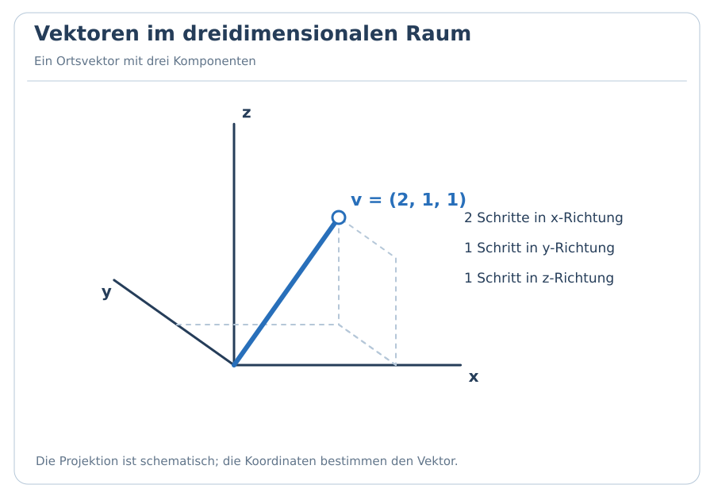

# M1-L21 – Räumliche Geometrie, Koordinaten und erste Vektoren {#L21}

**Kursbereich:** M1 – Sekundarstufe I

**Niveau:** Sekundarstufe I

**Vorwissen:** Keine festen Voraussetzungen angegeben.

**Einordnung:** Sekundarstufe I, Oberstufenvorbereitung / didaktisch ungefähr Klasse 10 · Format: zügige Auffrischung

## Worum geht es? {#S1}

Bisher haben wir Punkte überwiegend auf einer Ebene beschrieben: Eine waagerechte und eine senkrechte Koordinate genügen. Im Raum brauchen wir eine **dritte Koordinate**, zum Beispiel für Höhe, Tiefe oder Abstand zu einer Bildebene. Für Bewegungen ist außerdem die Unterscheidung zwischen einem **Ort** und einer **Verschiebung** wichtig. Genau diese Verschiebungen werden durch **Vektoren** beschrieben. Sie verbinden Schulgeometrie mit späterer analytischer Geometrie, linearer Algebra und Robotik.

## Grundidee und Anschauung {#S2}

Stell dir einen kleinen Roboter im Raum vor. Ein Punkt sagt, **wo** sich seine Greiferspitze befindet. Eine Verschiebung sagt, **wie weit und in welche Richtung** sie sich von dort bewegen soll. Die beiden Informationen werden ähnlich notiert, sind aber begrifflich verschieden: Ein Punkt ist ein Ort in einem festgelegten Koordinatensystem; ein Vektor ist eine gerichtete Änderung, die man grundsätzlich von verschiedenen Startpunkten aus anwenden kann. Drei Koordinaten erlauben die Beschreibung von Bewegung nach rechts/links, vor/zurück und oben/unten.

Die drei Vektorkomponenten bestimmen eine Position im Raum.

## Neue Zeichen vor der ersten Formel {#S3}

  Zeichen                      Aussprache                                        Bedeutung hier                                                   Anderer möglicher Gebrauch
  ---------------------------- ------------------------------------------------- ---------------------------------------------------------------- -------------------------------------------------------------------------------
  $x$, $y$, $z$                „iks“, „ypsilon“, „zett“                          Drei Koordinatenachsen                                           Beliebige Variablen, Funktionswerte
  $P$, $Q$                     „pe“, „ku“                                        Zwei Punkte im Raum                                              $P(A)$ bezeichnet in M1-L12 eine Wahrscheinlichkeit
  $P(1;2;3)$                   „Punkt pe mit den Koordinaten eins, zwei, drei“   Ort mit drei geordneten Zahlen                                   Klammern können auch Funktionsargumente enthalten
  `v⃗` oder $v$                 „Vektor fau“                                      Gerichtete Verschiebung                                          Ohne Kennzeichnung kann $v$ eine gewöhnliche Zahl sein
  $u$                          „Vektor u“                                        Name eines weiteren Vektors                                      Der gleiche Buchstabe kann eine gewöhnliche Variable sein
  `overrightarrow{PQ}`         „Vektor von pe nach ku“                           Übliche Formelnotation: Pfeil steht **über** den Buchstaben PQ   Der gewöhnliche Pfeil `→` allein bezeichnet auch eine Zuordnung
  $v_x$, $v_y$, $v_z$          „fau Index iks / ypsilon / zett“                  Drei Komponenten eines Vektors                                   Tiefstellungen können auch Nummern von Messwerten bezeichnen
  $(a;b;c)$                    „geordnetes Tripel a, b, c“                       Drei Komponenten, geordnet nach Achsen                           Kann auch einen Punkt statt eines Vektors bezeichnen
  $k\cdot v$                   „ka mal Vektor fau“                               Multiplikation eines Vektors mit einem Zahlenfaktor              $k$ war in M1-L2 ein Proportionalitätsfaktor
  $|v|$ oder $\lVert v\rVert$  „Länge von Vektor fau“, „Norm von fau“            Betrag bzw. Länge eines Vektors                                  Senkrechte Striche auch Zahlenbetrag; doppelte Striche später allgemeine Norm
  `√`                          „Quadratwurzel“                                   Nichtnegative Länge aus quadrierten Komponenten                  Bereits in M1-L7 und M1-L10 eingeführt
  $\Delta$                     „Delta“                                           Differenz zwischen Ausgangs- und Endwert                         Bereits in M1-L8 bei Steigungen verwendet
  $\vec{0}$                    „Nullvektor“                                      Verschiebung um null in jeder Achsenrichtung                     Zahl null ohne Pfeil ist kein Vektor

**Schreibkonvention:** Vektoren werden je nach Lehrbuch fett (`**v**`), mit Pfeil (`v⃗`) oder als Spalte dargestellt. Die Klartextschreibweise $(3;4;0)$ ist hier ein geordnetes Tripel von Komponenten; aus dem Kontext wird deutlich, ob Punkt oder Verschiebung gemeint ist. Die Semikolons vermeiden Verwechslungen mit deutschen Dezimalkommas.

## Drei Achsen beschreiben einen Punkt {#S4}

In einer Ebene reichen x- und y-Koordinate. Ein Punkt im Raum hat zusätzlich eine z-Koordinate. Wir legen beispielsweise fest: $x$ beschreibt rechts/links, $y$ vor/zurück und $z$ oben/unten. Die Achsen sollen senkrecht aufeinander stehen und dieselbe Längeneinheit verwenden; das ergibt ein **kartesisches Koordinatensystem**.

$$
P=(1;\,2;\,3)
$$

**Laut gelesen:** „Punkt pe liegt bei eins auf der x-Achse, zwei auf der y-Achse und drei auf der z-Achse.“ $P$ ist ein Punktname; `=` ordnet ihm die Koordinaten zu; die Klammern gruppieren die drei **geordneten** Einträge. Vertauschen wir die Reihenfolge, erhalten wir in der Regel einen anderen Ort.

### Mini-Beispiel: Die Position eines Werkzeugs {#abschnitt-5}

Eine Roboter-Greiferspitze befindet sich relativ zum festgelegten Ursprung bei $(1;2;3)$ Metern. Das heißt: eine Einheit in x-Richtung, zwei in y-Richtung und drei in z-Richtung. Ohne die Festlegung von Ursprung, Achsenrichtung und Einheit sind die drei Zahlen allein noch keine vollständige räumliche Beschreibung.

## Vektoren beschreiben Verschiebungen {#S5}

Ein **Vektor** besteht in diesem Zusammenhang aus mehreren Komponenten, die gemeinsam eine Richtung und eine Länge festlegen. Haben wir zwei Punkte $P$ und $Q$, dann ergibt die Differenz „Endpunkt minus Startpunkt“ den Verbindungsvektor von P nach Q. Die Schreibweise $Q-P$ ist dabei die **komponentenweise Differenz zweier Punktkoordinaten im selben Bezugssystem**, nicht eine beliebige Rechenoperation mit Orten. Bei unterschiedlichen Sensor- oder Kamera-Koordinatensystemen muss zunächst ein gemeinsames Bezugssystem hergestellt werden.

$$
\begin{aligned}
P&=(1;2;3)\\
Q&=(4;6;3)\\
\overrightarrow{PQ}&=Q-P=(4-1;6-2;3-3)=(3;4;0)
\end{aligned}
$$

**Laut gelesen:** „Der Vektor von pe nach ku ist gleich Endpunkt ku minus Startpunkt pe. Er besitzt die drei Komponenten drei, vier und null.“ Der in `\overrightarrow{PQ}` als LaTeX-Klartext beschriebene Pfeil steht in üblichem Formelsatz **über PQ** und kennzeichnet den **Verbindungsvektor**, nicht einen Funktionspfeil. Im Offline-Leser wird diese Schreibanweisung ausdrücklich als Text gezeigt. Das Minuszeichen bedeutet: Entsprechende Koordinaten werden voneinander abgezogen. Der Vektor $v=(3;4;0)$ beschreibt eine Verschiebung um drei Einheiten in x-Richtung, vier Einheiten in y-Richtung und null Einheiten in z-Richtung.

### Mini-Beispiel: Dieselbe Verschiebung an einem anderen Ort {#abschnitt-7}

Wenden wir den Vektor $(3;4;0)$ nicht auf $P$, sondern auf den Ursprung $(0;0;0)$ an, gelangen wir nach $(3;4;0)$. Richtung und Länge der Verschiebung bleiben gleich, obwohl der Anfangsort ein anderer ist. Das ist einer der Gründe, warum Vektoren als eigenständige mathematische Objekte nützlich sind.

## Vektoren addieren und skalieren {#S6}

Vektoren werden **komponentenweise** addiert: x zu x, y zu y und z zu z. Dadurch lassen sich aufeinanderfolgende Verschiebungen zu einer gesamten Bewegung zusammensetzen. Bei der Multiplikation mit einer Zahl wird jede Komponente mit demselben Faktor multipliziert.

$$
\begin{aligned}
u&=(1;2;0),\quad v=(3;4;0)\\
u+v&=(4;6;0)\\
2v&=(6;8;0)
\end{aligned}
$$

**Laut gelesen:** „Vektor u plus Vektor fau ist der Vektor mit den Komponenten vier, sechs und null. Zweimal Vektor fau ist der Vektor sechs, acht, null.“ $u$ und $v$ sind hier Vektornamen, `+` bezeichnet die Summe zweier Vektoren, $2$ den **Skalar** (eine gewöhnliche Zahl) und `·` die Multiplikation jedes Vektoreintrags mit diesem Skalar.

Bei einem negativen Skalar kehrt sich außerdem die Vektorrichtung um. Der Nullvektor $(0;0;0)$ beschreibt keine Verschiebung und besitzt keine eindeutige Richtung.

## Die Länge eines Vektors mit Pythagoras {#S7}

Aus M1-L10 wissen wir, wie man die Diagonale eines rechtwinkligen Dreiecks bestimmt. Dieselbe Idee funktioniert mit drei zueinander senkrechten Komponenten: Wir quadrieren jede Komponente, addieren die Quadrate und ziehen die nichtnegative Quadratwurzel.

$$
\begin{aligned}
v&=(v_x;v_y;v_z)\\
|v|&=\sqrt{v_x^2+v_y^2+v_z^2}
\end{aligned}
$$

**Laut gelesen:** „Die Länge von Vektor fau ist die Quadratwurzel aus der Summe der Quadrate seiner x-, y- und z-Komponente.“ $|v|$ bezeichnet hier die **Länge** des Vektors; `√` zieht die nichtnegative Quadratwurzel; die hochgestellte Zwei bezeichnet das Quadrat; `+` addiert die drei quadrierten Beiträge.

### Mini-Beispiel: Geradliniger Abstand im Raum {#abschnitt-10}

Unser Verbindungsvektor $(3;4;0)$ besitzt die Länge $\sqrt{3^2+4^2+0^2}=\sqrt{25}=5$. Der Abstand zwischen $P=(1;2;3)$ und $Q=(4;6;3)$ beträgt also fünf Längeneinheiten. Wenn die Punktkoordinaten in Metern angegeben sind, besitzt jede Komponente des Verbindungsvektors die Einheit Meter, und die Formel ergibt ausdrücklich $5\,\mathrm{m}$: Unter der Wurzel werden ${(3\,\mathrm{m})}^2+{(4\,\mathrm{m})}^2+{(0\,\mathrm{m})}^2=25\,\mathrm{m}^2$ addiert; damit folgt $\sqrt{25\,\mathrm{m}^2}=5\,\mathrm{m}$. Man darf dort keine unvereinbaren Längen- und Zeitwerte addieren. Die dritte Koordinate bleibt gleich; deshalb entspricht das Ergebnis hier dem bekannten 3-4-5-Dreieck aus M1-L10.

Diese Länge ist der **geradlinige euklidische Abstand**. Muss ein Roboter um ein Hindernis fahren, kann der tatsächlich nötige Weg deutlich länger ausfallen.

## Punkte, Vektoren und Bewegung nicht verwechseln {#S8}

Ein Punkt steht für einen Ort; ein Vektor für eine gerichtete Verschiebung. In einem festgelegten Koordinatensystem können wir einem Punkt $P$ einen Verschiebungsvektor $v$ hinzufügen und erhalten einen neuen Punkt $Q$: $Q=P+v$. **Laut gelesen:** „Punkt ku ist Punkt pe plus Verschiebungsvektor fau.“ Bei $P=(1;2;3)$ und $v=(3;4;0)$ ist $Q=(4;6;3)$; alle Komponenten beziehen sich dabei auf **dasselbe kartesische Koordinatensystem und dieselbe Längeneinheit**. Zwei Punkte können voneinander subtrahiert werden, um ihre Verbindung als Vektor zu beschreiben. Aber zwei Orte zu addieren ist **nicht** ohne eine weitere, ausdrücklich festgelegte Interpretation dasselbe wie das Addieren von Bewegungen.

Das ist auch beim Programmieren wichtig: Eine Datenstruktur mit drei Zahlen kann formal gleich aussehen, aber je nach Bedeutung `Position3D`, `Direction3D` oder `Velocity3D` repräsentieren. Wer diese Typen nicht unterscheidet, erzeugt leicht Fehler in Simulationen, Kamerasteuerung oder Robotik.

## Wofür nützlich? {#S9}

Vektoren beschreiben Positionen und Bewegungsrichtungen in 3D-Grafik, Computerspielen, CAD-Systemen und Robotik. In autonomen Systemen lassen sich Wegpunkte, Verschiebungen und Sensordaten in gemeinsamen Koordinatensystemen darstellen. In KI-Verfahren werden später auch Datenmerkmale und sogenannte Embeddings als Vektoren modelliert; dort sind die Dimensionen häufig keine räumlichen Richtungen, sondern abstrakte Eigenschaften. Die grundlegenden Rechenideen bleiben ähnlich, ihre Interpretation ändert sich jedoch.

## Annahmen und Grenzen {#S10}

Unsere Längenformel gilt in einem **orthonormalen kartesischen Koordinatensystem**, also bei zueinander senkrechten Achsen mit gleich skalierten Längeneinheiten. Bei anders skalierten oder gekrümmten Koordinatenräumen reicht das bloße Quadrieren der Koordinaten nicht immer aus. Die Richtung „oben“ oder „vorne“ hängt von der festgelegten Achsenkonvention ab. Ob ein Vektor eine Länge, eine Geschwindigkeit oder eine andere Größe beschreibt, hängt außerdem von seinen **Einheiten** ab. Ein Geschwindigkeitsvektor hat beispielsweise Komponenten in $\mathrm{m}/\mathrm{s}$, ein Verschiebungsvektor in $\mathrm{m}$. Ihre Zahlenpaare dürfen ähnlich aussehen, müssen aber durch die richtigen Größen und Bezugssysteme interpretiert werden.

## Verbindung zur nächsten Einheit {#S11}

In M1-L22 verbinden wir einfache Wahrscheinlichkeitsmodelle mit **bedingten Ereignissen und Unabhängigkeit**. Danach folgt mit M1-L23 ein geometrisches Extra zu regelmäßigen Vielecken und den fünf platonischen Körpern – damit ist die Sekundarstufe-I-Landkarte vollständig.

## Vertiefung (optional) {#S12}

In der Oberstufe werden Vektoren als mathematische Objekte mit Skalarprodukt, Geraden und Ebenen behandelt. Die universitäre lineare Algebra erweitert den Gedanken schließlich auf Vektoren mit beliebig vielen Komponenten und auf lineare Transformationen durch Matrizen.

## Quellen {#S13}

In dieser Lektion sind keine Einzelquellen gesondert verzeichnet.
