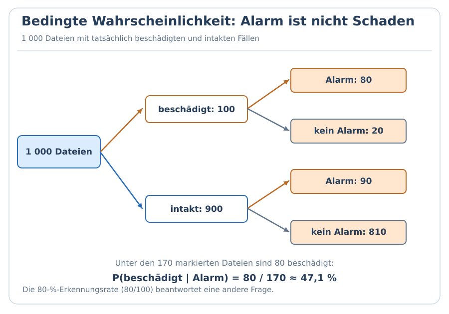

# M1-L22 – Bedingte Wahrscheinlichkeit, Unabhängigkeit und Modellkritik {#L22}

**Kursbereich:** M1 – Sekundarstufe I

**Niveau:** Sekundarstufe I

**Vorwissen:** Keine festen Voraussetzungen angegeben.

**Einordnung:** Sekundarstufe I, Oberstufenvorbereitung / didaktisch ungefähr Klasse 10 · Format: zügige Auffrischung

## Worum geht es? {#S1}

Manchmal interessiert uns nicht, wie häufig ein Ereignis insgesamt eintritt, sondern wie wahrscheinlich es **unter einer zusätzlichen Voraussetzung** ist. Wenn ein Filter beispielsweise eine Datei als auffällig markiert, stellt sich die Frage: Wie oft ist eine tatsächlich fehlerhafte Datei *unter den markierten Dateien*? Das ist eine andere Frage als die Trefferwahrscheinlichkeit des Filters *unter den fehlerhaften Dateien*. Der Unterschied ist zentral für Tests, Diagnosesysteme, Klassifikatoren und KI-Anwendungen.

## Grundidee und Anschauung {#S2}

Eine Wahrscheinlichkeit beschreibt immer ein **Modell von Möglichkeiten**, keine eingebaute Eigenschaft einer einzelnen Zukunft. Bei einer bedingten Wahrscheinlichkeit verkleinern wir unsere betrachtete Grundgesamtheit: Wir zählen nur noch Fälle, in denen die genannte Bedingung erfüllt ist. Aus dieser Teilgruppe bestimmen wir dann den Anteil, der zusätzlich das interessierende Ereignis zeigt.

Beispiel: Unter allen Dateien eines Archivs mögen nur wenige defekt sein. Unter den Dateien, die ein Prüfprogramm als verdächtig ausgibt, kann der Defektanteil deutlich höher sein. Ob dieser Anteil tatsächlich hoch ist, hängt jedoch **auch von der ursprünglichen Fehlerhäufigkeit** und den Fehlalarmen des Programms ab.

## Neue Zeichen vor der ersten Formel {#S3}

  Zeichen       Aussprache                                             Bedeutung hier                                    Anderer möglicher Gebrauch
  ------------- ------------------------------------------------------ ------------------------------------------------- ------------------------------------------------------------------
  $A$, $B$      „Ereignis a“, „Ereignis be“                            Mengen möglicher Ergebnisse                       In der Geometrie auch Punkte, sonst allgemeine Variablen
  $P(A)$        „pe von a“ / „Wahrscheinlichkeit von a“                Wahrscheinlichkeit eines Ereignisses A            $P$ kann in M1-L21 einen Punkt bezeichnen
  $A\cap B$     „a geschnitten be“                                     Beide Ereignisse treten ein                       `∩` steht auch allgemein für den Schnitt zweier Mengen
  $P(A\mid B)$  „Wahrscheinlichkeit von a unter der Bedingung be“      A-Anteil **innerhalb** aller B-Fälle              Der senkrechte Strich `|` kann auch Betrag oder „teilt“ bedeuten
  `≠`           „ungleich“                                             Eine Größe ist nicht gleich einer anderen         Allgemeines Vergleichszeichen
  $0<P(B)$      „null ist kleiner als die Wahrscheinlichkeit von be“   Bedingung B besitzt positive Wahrscheinlichkeit   `<` ist allgemein „kleiner als“
  `·`           „mal“                                                  Multiplikation von Wahrscheinlichkeiten           Bereits aus M1-L2/M1-L3 bekannt
  `≈`           „ungefähr gleich“                                      Gerundeter Wert                                   Bereits aus früheren Lektionen bekannt

## Bedingte Wahrscheinlichkeit: Der Nenner bestimmt die Frage {#S4}

Wir betrachten zwei Ereignisse: $A$ bedeutet „Datei ist fehlerhaft“, $B$ bedeutet „Datei wurde vom Prüfer markiert“. Die Frage „Wie wahrscheinlich ist A, **wenn B bereits bekannt ist**?“ schreibt man so:

$$
P(A\mid B)=\frac{P(A\cap B)}{P(B)}\qquad\text{mit }P(B)>0
$$

**Laut gelesen:** „Die Wahrscheinlichkeit von a unter der Bedingung be ist gleich der Wahrscheinlichkeit, dass a und be zugleich eintreten, geteilt durch die Wahrscheinlichkeit von be.“ Der Strich zwischen $A$ und $B$ liest sich **nicht** als Division, sondern als „unter der Bedingung“. Der Schrägstrich `/` rechts ist die Division. `∩` bezeichnet die Schnittmenge, also die gemeinsamen Fälle. $P(B)>0$ ist Voraussetzung: Ohne mögliche B-Fälle kann dieser Quotient nicht gebildet werden.

Das Gegenstück $P(B\mid A)$ stellt eine **andere Frage**: „Wie häufig markiert der Prüfer eine tatsächlich defekte Datei?“ Diese beiden Wahrscheinlichkeiten sind im Allgemeinen **nicht gleich**.

## Mini-Beispiel: Ein Dateiprüfer meldet Alarm {#S5}

Wir nehmen eine Sammlung von **1.000 Dateien** an. Davon sind **100 tatsächlich beschädigt**, **900 intakt**. Der Prüfer erkennt **80** der 100 beschädigten Dateien und erzeugt zusätzlich bei **90** intakten Dateien einen Fehlalarm. Für die folgenden Wahrscheinlichkeiten wählen wir **eine der 1.000 Dateien gleichwahrscheinlich zufällig** aus. Nur unter dieser ausdrücklichen Auswahlannahme entsprechen die folgenden Brüche unmittelbar den Modellwahrscheinlichkeiten.

{alt="Dateiprüfung bei 1 000 Fällen: 80 beschädigte und 90 intakte Dateien markiert; unter 170 Alarmen sind 80 tatsächlich beschädigt."}

Bedingte Wahrscheinlichkeit: 80 von 170 markierten Dateien sind beschädigt, also etwa $47{,}1\,\%$.

  Tatsächlicher Zustand   Als auffällig markiert   Nicht markiert   Insgesamt
  ----------------------- ------------------------ ---------------- -----------
  Beschädigt              80                       20               100
  Intakt                  90                       810              900
  **Insgesamt**           **170**                  **830**          **1.000**

Aus Sicht des Prüfers beträgt die Erkennungsrate $\frac{80}{100}=80\,\%$. Aber bei **einem bereits markierten** Fall betrachten wir nur noch die 170 markierten Dateien, von denen 80 tatsächlich beschädigt sind:

$$
P(\text{beschädigt}\mid\text{markiert})=\frac{80}{170}\approx0{,}4706\approx47{,}1\,\%
$$

**Laut gelesen:** „Die Wahrscheinlichkeit für beschädigt unter der Bedingung markiert ist achtzig geteilt durch einhundertsiebzig; das sind ungefähr siebenundvierzig Komma eins Prozent.“ Die erste Zahl zählt die **richtigen Alarmmeldungen**. Der Nenner zählt **alle Alarmmeldungen**, also auch Fehlalarme.

Die **Erkennungsrate** beträgt $P(\text{markiert}\mid\text{beschädigt})=\frac{80}{100}=80\,\%$, während die **Fehlalarmrate unter intakten Dateien** $P(\text{markiert}\mid\text{intakt})=\frac{90}{900}=10\,\%$ beträgt. Die **Grundhäufigkeit** beschädigter Dateien ist $\frac{100}{1\,000}=10\,\%$. Mit diesen drei Werten lässt sich der Anteil echter Schäden unter den Meldungen nachvollziehen; man darf Erkennungsrate und Zuverlässigkeit eines positiven Alarms nicht gleichsetzen.

Daraus folgt: Ein System kann 80 Prozent der tatsächlichen Fehler erkennen und trotzdem liegen **unter seinen Alarmen weniger als 50 Prozent echte Defekte**. Grund dafür sind die noch häufigeren intakten Dateien und die Fehlalarme. Die genauen Zahlen gelten nur für dieses ausdrücklich angenommene Modell.

## Unabhängigkeit: Information ändert die Chance nicht {#S6}

Zwei Ereignisse sind **unabhängig**, wenn das Wissen über das eine die Wahrscheinlichkeit des anderen nicht verändert. Wenn $P(B)>0$, lässt sich diese Eigenschaft so ausdrücken:

$$
P(A\mid B)=P(A)
$$

**Laut gelesen:** „Die Wahrscheinlichkeit von a unter der Bedingung be ist genauso groß wie die Wahrscheinlichkeit von a ohne diese Bedingung.“ $A$ und $B$ sind Ereignisse; $P$ gibt jeweils ihre Wahrscheinlichkeit an; der senkrechte Strich stellt die Zusatzinformation dar.

Eine gleichwertige und auch bei Ereignissen mit Wahrscheinlichkeit null verwendbare Definition lautet:

$$
P(A\cap B)=P(A)\cdot P(B)
$$

**Laut gelesen:** „Die Wahrscheinlichkeit, dass a und be gemeinsam eintreten, ist gleich dem Produkt ihrer Einzelwahrscheinlichkeiten.“ Diese Produktregel darf man bei beliebigen Ereignissen **nicht ungeprüft** anwenden. Im Dateibeispiel sind Defekt und Markierung **nicht unabhängig**: $P(A\cap B)=\frac{80}{1\,000}=0{,}08$, aber $P(A)\cdot P(B)=\left(\frac{100}{1\,000}\right)\cdot\left(\frac{170}{1\,000}\right)=0{,}017$. Die Werte sind verschieden.

Beispiel für mögliche Unabhängigkeit: Zwei voneinander unabhängig und fair erzeugte Münzwürfe. Das erste Ergebnis verrät nichts über das zweite. Bei Ziehungen **ohne Zurücklegen** aus einer kleinen Urne ändern sich dagegen die Zusammensetzung und damit meist die Chancen beim zweiten Zug.

## Modellkritik: Vier besonders häufige Fehler {#S7}

1.  **Bedingung vertauscht.** $P(A\mid B)$ ist nicht automatisch $P(B\mid A)$ – das ist die zentrale Falle in Klassifikationssystemen.
2.  **Gleichverteilung unterstellt.** Eine einfache Anzahl günstiger Fälle geteilt durch alle Fälle liefert nur dann die Wahrscheinlichkeit, wenn die betrachteten Ergebnisse tatsächlich gleich wahrscheinlich sind.
3.  **Unabhängigkeit unterstellt.** Mehrere aufeinanderfolgende Ereignisse oder Messungen können gemeinsame Ursachen haben. Dann sind einfache Produktrechnungen falsch.
4.  **Modell und Wirklichkeit verwechselt.** Ein aus historischen Dateien abgeleitetes Fehlerrisiko kann bei neuer Hardware, veränderten Nutzern oder geänderten Prüfregeln anders ausfallen.

**Gegenprobe:** Bei unserem Beispiel sind 170 Dateien markiert, also $17\,\%$ aller Dateien. Die 80 echten Defekte unter 170 markierten Dateien ergeben deshalb rund $47{,}1\,\%$, nicht $80\,\%$. Der Nenner beantwortet die jeweilige Frage.

## Wofür nützlich? {#S8}

Für **Spamfilter, Malware-Scanner und KI-Klassifikatoren** muss man unterscheiden, wie viele relevante Objekte gefunden werden und wie verlässlich eine einzelne positive Meldung ist. Bei **Agentensystemen** kann ein Alarm eine Nachprüfung auslösen, doch der Alarm allein ist keine Gewissheit. Beim **A/B-Testen** und bei Datenauswertungen müssen wir prüfen, ob die beobachteten Gruppen überhaupt vergleichbar sind.

## Annahmen und Grenzen {#S9}

Die Rechnungen gelten innerhalb eines eindeutig festgelegten Zufallsmodells. Zählwerte in einer Stichprobe liefern **empirische Anteile**; daraus wird nicht automatisch eine exakte, dauerhaft gültige Wahrscheinlichkeit für jede künftige Datei. Auch das mathematische Wort „unabhängig“ meint eine bestimmte Wahrscheinlichkeitsbeziehung, nicht bloß „technisch getrennt“ oder „gefühlt ohne Einfluss“.

## Verbindung zur nächsten Einheit {#S10}

Mit M1-L23 schließen wir die Sekundarstufe I durch ein geometrisches Extra über regelmäßige Vielecke, räumliche Körper und Symmetrien ab. Danach beginnt die Oberstufen-Analysis.

## Quellen {#S11}

In dieser Lektion sind keine Einzelquellen gesondert verzeichnet.
