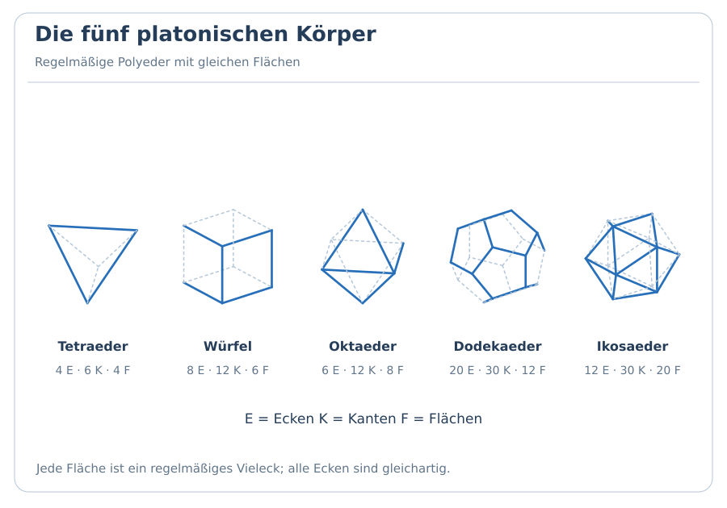

# M1-L23 – Regelmäßige Vielecke und die fünf platonischen Körper {#L23}

**Kursbereich:** M1 – Sekundarstufe I

**Niveau:** Sekundarstufe I

**Vorwissen:** Keine festen Voraussetzungen angegeben.

**Einordnung:** Sekundarstufe I, optionales geometrisches Extra / Oberstufenvorbereitung · Format: anschauliche Auffrischung

## Worum geht es? {#S1}

Ein Vieleck ist eine **ebene** Figur mit geraden Seiten, beispielsweise ein Dreieck oder ein Fünfeck. Ein Polyeder dagegen ist ein **räumlicher** Körper, dessen Oberfläche aus ebenen Vielecken besteht. Manche Vielecke und Körper sind besonders symmetrisch. Bei den sogenannten **platonischen Körpern** sind alle Flächen kongruente regelmäßige Vielecke, und an jeder Ecke treffen gleich viele Flächen in derselben Anordnung zusammen. Überraschenderweise gibt es davon im dreidimensionalen euklidischen Raum genau **fünf** konvexe Typen.

## Grundidee und Anschauung {#S2}

Ein quadratisches Blatt ist zweidimensional; ein Würfel besitzt dagegen sechs quadratische Flächen, die eine räumliche Form begrenzen. Entscheidend ist die **Art der Zusammenfügung**: Aus gleichen Flächen können verschiedene dreidimensionale Körper entstehen. Wenn jede Ecke gleich aussieht und alle Flächen exakt gleich geformt sind, ist das eine sehr starke Symmetriebedingung. Diese Formen begegnen uns in 3D-Grafik, Geometrie-Software, Netzen und Modellierung.

Regelmäßige Körper: Jeder besitzt gleichartige Ecken und kongruente regelmäßige Vielecke als Flächen.

## Neue Zeichen vor der ersten Formel {#S3}

  Zeichen   Aussprache                        Bedeutung hier                                    Anderer möglicher Gebrauch
  --------- --------------------------------- ------------------------------------------------- ---------------------------------------------------------
  $n$       „en“                              Anzahl der Ecken eines ebenen Vielecks            Allgemein eine ganze Anzahl, etwa von Messungen
  `°`       „Grad“                            Winkelmaß                                         Winkel sind auch im Bogenmaß möglich (M1-L20)
  $\alpha$  „Alpha“                           Innenwinkel eines regelmäßigen Vielecks           Griechischer Buchstabe, kann anderen Größen Namen geben
  $V$       „Vau“ oder „Anzahl der Ecken“     Zahl der Polyederecken, von englisch *vertices*   $V$ steht technisch oft auch für Volumen oder Volt
  $E$       „e“ oder „Anzahl der Kanten“      Zahl der Polyederkanten, von englisch *edges*     Später kann $E[X]$ einen Erwartungswert meinen
  $F$       „eff“ oder „Anzahl der Flächen“   Zahl der Polyederflächen, von englisch *faces*    $F$ kann auch für eine Funktion oder Kraft stehen
  `−`       „minus“                           Subtraktion                                       Bei Zahlen auch negatives Vorzeichen
  `=`       „gleich“                          Identische Zahlenwerte                            In Programmen manchmal Zuweisung

## Regelmäßige Vielecke: Alle Seiten und Winkel gleich {#S4}

Ein **regelmäßiges** Vieleck besitzt gleich lange Seiten und gleich große Innenwinkel. Drei Beispiele: gleichseitiges Dreieck (3 Seiten), Quadrat (4 Seiten) und regelmäßiges Sechseck (6 Seiten). Die Summe der Innenwinkel eines einfachen, nicht selbstüberschneidenden n-Ecks beträgt $(n-2)\cdot180^{\text{°}}$. Hier ist $n$ eine **ganze Zahl ab drei**. Die dargestellte Formel für den einzelnen Winkel setzt außerdem voraus, dass das Vieleck regelmäßig ist; selbstüberschneidende Sternpolygone sind damit nicht gemeint.

$$
\alpha=\frac{(n-2)\cdot180^{\text{°}}}{n}\qquad\text{für }n\geq3
$$

**Laut gelesen:** „Alpha ist gleich en minus zwei, mal einhundertachtzig Grad, geteilt durch en.“ $\alpha$ ist der **eine** Innenwinkel; $n$ ist die Anzahl der Ecken; `≥` bedeutet „größer oder gleich“. Die Formel funktioniert für ein regelmäßiges einfaches Vieleck, weil sich seine Innenwinkelsumme gleichmäßig auf alle n Ecken verteilt.

### Mini-Beispiel: Das regelmäßige Sechseck {#abschnitt-5}

Setzen wir $n=6$, ergibt die Innenwinkelsumme $(6-2)\cdot180^{\text{°}}=720^{\text{°}}$. Jeder Innenwinkel beträgt dann $\frac{720^{\text{°}}}{6}=120^{\text{°}}$. Ein Sechseck besitzt also sechs gleich große Innenwinkel von jeweils 120 Grad. Das ist ein typischer Baustein geometrischer Kachelungen, beispielsweise in Wabenmustern.

## Ebene oder Raum? Die Begriffe sauber trennen {#S5}

  Begriff                  Dimension                         Was ist gemeint?                             Beispiel
  ------------------------ --------------------------------- -------------------------------------------- --------------------------------
  Vieleck / Polygon        2D                                Von Strecken begrenzte ebene Figur           Quadrat
  Polyeder                 3D                                Körper mit polygonalen ebenen Flächen        Würfel
  Fläche eines Polyeders   2D als Teil einer 3D-Oberfläche   Einzelnes Polygon auf dem Körper             eine Quadratfläche des Würfels
  Polyedernetz             2D-Darstellung                    Flächen lassen sich zu einem Körper falten   Würfelnetz aus sechs Quadraten

Der Begriff **regelmäßig** allein reicht noch nicht, um beliebige räumliche Körper als platonisch zu bezeichnen. Beim platonischen Körper müssen zusätzlich die **Ecken gleichartig** sein und der Körper **konvex** sein – er besitzt also keine nach innen eingedrückten Teile.

## Die fünf platonischen Körper {#S6}

  Name                    Form der Flächen         Flächen F   Kanten E   Ecken V   Flächen je Ecke
  ----------------------- ------------------------ ----------- ---------- --------- -----------------
  **Tetraeder**           gleichseitige Dreiecke   4           6          4         3
  **Hexaeder / Würfel**   Quadrate                 6           12         8         3
  **Oktaeder**            gleichseitige Dreiecke   8           12         6         4
  **Dodekaeder**          regelmäßige Fünfecke     12          30         20        3
  **Ikosaeder**           gleichseitige Dreiecke   20          30         12        5

Die Bezeichnungen beziehen sich auf die **Anzahl der Flächen**: „tetra“ vier, „hexa“ sechs, „okta“ acht, „dodeka“ zwölf, „ikosa“ zwanzig.

### Warum sind es nur fünf? {#abschnitt-8}

An jeder konvexen Ecke muss die Summe der zusammentreffenden **Flächenwinkel** kleiner als 360 Grad sein. Bei gleichseitigen Dreiecken (60 Grad) können drei, vier oder fünf zusammenkommen; sechs würden eine ebene Fläche bilden. Bei Quadraten (90 Grad) passen nur drei, bei regelmäßigen Fünfecken (108 Grad) ebenfalls nur drei. Bei regelmäßigen Sechsecken ist bereits dreimal 120 Grad gleich 360 Grad. Polygone mit noch mehr Seiten haben größere Innenwinkel und passen ebenfalls nicht an eine solche Ecke. Damit bleiben **höchstens fünf** Kombinationen aus Flächenform und Eckbelegung übrig. Da sich alle fünf Kombinationen als die in der Tabelle genannten konvexen Körper tatsächlich verwirklichen lassen, sind es **genau fünf**. Die Winkelsummenbedingung allein wäre noch kein Existenzbeweis.

## Eine wichtige Kontrollformel: Die Euler-Beziehung {#S7}

Bei einem **konvexen Polyeder** gilt:

$$
V-E+F=2
$$

**Laut gelesen:** „Anzahl der Ecken minus Anzahl der Kanten plus Anzahl der Flächen ist gleich zwei.“ $V$ zählt die Polyederecken, $E$ die Kanten, $F$ die Flächen. Diese Buchstaben bezeichnen hier **ganze Anzahlen**, keine Längen oder Flächeninhalte.

### Mini-Beispiel: Würfel {#abschnitt-10}

Beim Würfel sind acht Ecken, zwölf Kanten und sechs Flächen vorhanden. Daraus folgt $8-12+6=2$. Beim Tetraeder gilt zusätzlich $4-6+4=2$, beim Ikosaeder $12-30+20=2$. Dasselbe lässt sich für die übrigen zwei platonischen Körper prüfen. Die Beziehung gilt nicht ohne Anpassung für jede beliebige Oberfläche, etwa bei Körpern mit durchgehenden Löchern.

## Symmetrie, Dualität und Computergeometrie {#S8}

Tauscht man bei bestimmten regelmäßigen Körpern gedanklich **Flächenmittelpunkte und Ecken**, erhält man einen **dualen** Körper. Würfel und Oktaeder sind zueinander dual; Dodekaeder und Ikosaeder ebenfalls; der Tetraeder ist zu einem weiteren Tetraeder dual. Daran erkennt man ein tiefes Muster räumlicher Symmetrie.

Ein geometrischer Mesh in 3D-Software speichert meist **Punkte (Vertices)** und **Flächen**, oft als Dreiecke. Die regelmäßigen Körper sind dafür übersichtliche Testmodelle. Ein Ikosaeder lässt sich durch wiederholte Dreiecksunterteilungen zu einer feineren Annäherung an eine Kugel verarbeiten. Solche Netze erscheinen unter anderem in Computergrafik, Simulationen und räumlichen Berechnungen.

## Wofür nützlich? {#S9}

In **3D-Grafik und CAD** dienen regelmäßige Körper als geometrische Grundformen und Testfälle für Kanten- und Flächenalgorithmen. In der **Robotik** und bei räumlichen Sensoren helfen Symmetrie und geordnete Punktmengen, Ausrichtungen und Abstände systematisch zu betrachten. Die Euler-Beziehung ist außerdem ein schneller Plausibilitätscheck für bestimmte geschlossene Polygonnetze.

## Annahmen und Grenzen {#S10}

Die Aussage „genau fünf“ bezieht sich auf **konvexe regelmäßige Polyeder im gewöhnlichen dreidimensionalen euklidischen Raum**. Bei nichtkonvexen Sternpolyedern, gekrümmten Flächen oder anderen Räumen gelten andere Einordnungen. Die Euler-Formel ist eine topologische Strukturbeziehung und ersetzt keine vollständige Prüfung, ob ein Mesh geometrisch korrekt oder fehlerfrei ist.

## Verbindung zur nächsten Einheit {#S11}

Mit dieser optionalen Vertiefung ist das Grundlagenmodul M1 abgeschlossen. In M2-L1 beginnt die Oberstufen-Analysis mit der systematischen Unterscheidung verschiedener Funktionsfamilien.

## Quellen {#S12}

In dieser Lektion sind keine Einzelquellen gesondert verzeichnet.
