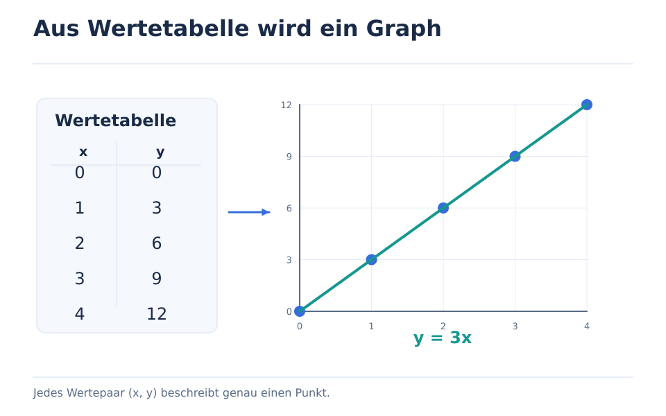

# M1-L4 – Koordinatensysteme, Zuordnungen, Tabellen und Diagramme {#L4}

**Kursbereich:** M1 – Sekundarstufe I

**Niveau:** Sekundarstufe I

**Vorwissen:** Keine festen Voraussetzungen angegeben.

**Einordnung:** Sekundarstufe I, didaktisch ungefähr Klasse 7 · Format: zügige Auffrischung

## Worum geht es? {#S1}

Ein Zahlenwert kann etwa eine Zeit, eine Temperatur oder eine Position bezeichnen. Oft ist aber gerade die **Beziehung zwischen zwei Größen** interessant: Wie viele Dateien sind nach einer bestimmten Zeit verarbeitet? Wie verändert sich die Temperatur? Tabellen ordnen Messwerte, Diagramme machen Muster sichtbar, und Koordinatensysteme beschreiben Positionen eindeutig. Funktionen bilden daraus eine präzise Sprache für Abhängigkeiten.

## Grundidee: Ein Punkt benötigt zwei Angaben {#S2}

Ein **kartesisches Koordinatensystem** besitzt zwei Achsen. Die waagerechte heißt **x-Achse** („iks-Achse“), die senkrechte **y-Achse** („üpsilon-Achse“). Die Achsen schneiden sich im **Ursprung**, also bei null auf beiden Achsen. Üblicherweise wächst x nach rechts und y nach oben. Andere Ausrichtungen sind möglich und müssen in technischen Systemen ausdrücklich angegeben werden.

Ein Punkt wird mit einem geordneten Zahlenpaar beschrieben, etwa $P(2\mid3)$. Dies liest man: „Punkt P mit x-Koordinate zwei und y-Koordinate drei“. Die erste Angabe gehört zur waagerechten, die zweite zur senkrechten Achse. Der senkrechte Strich `|` dient **hier nur als Koordinatentrenner**. Er steht an anderen Stellen der Mathematik für etwas anderes.

**Textskizze – Lage des Punktes P(2\|3):**

Formel, Skizze oder Rechenschema · Originalnotation

        y
      4 |
      3 |       P · (2|3)
      2 |
      1 |
      0 +---+---+---+---→ x
          0   1   2   3

Die Skizze ist schematisch. Ein echter maßstäblicher Plot würde den Punkt exakt über $x=2$ und auf Höhe $y=3$ platzieren.

**Zeichen vor der ersten Formel:** $x$ ist die Eingabekoordinate beziehungsweise horizontale Größe; $y$ die vertikale Ergebnisgröße. $P$ ist nur der frei gewählte **Name eines Punktes**, kein Rechenzeichen. Ein geordnetes Zahlenpaar wird auch als $(2;3)$ geschrieben; für den Kurs verwenden wir bei Punktnamen vorerst $P(2\mid3)$.

## Von der Tabelle zum Zusammenhang {#S3}

Eine Beispielsoftware verarbeitet gleichmäßig **drei Dateien pro Minute**. Die Tabelle enthält passende Wertepaare:

  Zeit $x$ (Minuten)  Bearbeitete Dateien $y$
  ------------------- ------------------------
  0                   0
  1                   3
  2                   6
  3                   9
  4                   12

Liest man diese Paare als Punkte, erhält man unter anderem $(0\mid0)$, $(1\mid3)$ und $(2\mid6)$. Die Tabelle zeigt: Erhöht sich die Zeit um eine Minute, kommen jedes Mal drei Dateien hinzu.

Bevor wir diesen Zusammenhang als Formel schreiben, brauchen wir ein weiteres Zeichen: $f$ („eff“) ist der Name einer **Funktion**. $f(x)$ liest man „eff von iks“ und meint den **zu x gehörenden Ausgabewert**. Die Klammern bedeuten hier *Funktionsargument*, nicht Multiplikation. Die Zahl $3$ in $3x$ ist der konstante Verarbeitungsfaktor; das Malzeichen zwischen Zahl und Variable wird weggelassen.

**Formel 1:**

$f(x)=3x$

**Laut gelesen:** „Eff von iks ist gleich drei mal iks.“ Die Funktion nimmt die Zeit $x$ in Minuten und liefert die Anzahl der in dieser Zeit bearbeiteten Dateien. Beispielsweise gilt $f(4)=12$: „Eff von vier ist gleich zwölf.“ Für das Modell sind nur **nichtnegative Zeiten** sinnvoll. **Wichtig ist der Unterschied zwischen Durchsatzmodell und tatsächlicher Zählung:** Die ideale Gerade würde etwa bei $x=0{,}5$ den Wert $f(0{,}5)=1{,}5$ liefern. Tatsächlich kann die Anzahl **vollständig abgeschlossener Dateien** nur ganzzahlig sein. Für genau beobachtete Abschlusszahlen ist daher eine Stufenfunktion oder eine auf ganze Zeitpunkte beschränkte Tabelle oft geeigneter; die Gerade beschreibt einen gemittelten oder idealisierten Durchsatz.

## Was macht eine Zuordnung zur Funktion? {#S4}

Eine **Zuordnung** verbindet Eingaben mit Ergebnissen. Eine **Funktion** ordnet jeder zulässigen Eingabe **genau einen** Ausgabewert zu. Verschiedene Eingaben dürfen durchaus dasselbe Ergebnis liefern.

- **Funktion:** Einer bestimmten Minute wird die bis dahin verarbeitete Dateizahl zugeordnet (unter der Annahme eines festgelegten Verarbeitungslaufs).
- **Keine Funktion in dieser Richtung:** Einem einzelnen Menschen werden *alle* Sprachen zugeordnet, die er spricht. Eine Person kann mehrere Ausgabewerte besitzen. Man könnte stattdessen zum Beispiel die **Anzahl** seiner Sprachen als eindeutigen Funktionswert wählen.

Eine mathematische Funktion muss nicht auf dem Computer ausgeführt werden. Sie kann eine beobachtete Naturbeziehung, eine geometrische Regel oder eine idealisierte Beschreibung sein.

## Lineare Zusammenhänge und Diagramme {#S5}

Bei der eben beschriebenen Verarbeitung wächst der Ausgabewert pro zusätzlicher Minute stets um dieselbe Menge. Im Diagramm liegen die Punkte deshalb auf einer Geraden; im idealisierten Modell verläuft sie durch den Ursprung. Das ist die **direkte Proportionalität** aus M1-L2.

Ein Programm kann aber zu Beginn bereits zwei Dateien als fertig markieren, etwa durch wiederverwendete Ergebnisse. Dafür benötigen wir noch eine feste Startmenge. Das Pluszeichen addiert diesen Startwert:

**Formel 2:**

$y=3x+2$

**Laut gelesen:** „Üpsilon ist gleich drei mal iks plus zwei.“ Der Graph ist wieder eine Gerade, beginnt bei $x=0$ aber bei $y=2$. Dieser Zusammenhang ist **nicht direkt proportional**, obwohl er eine konstante Steigung besitzt. Im Schulgebrauch wird auch diese Form häufig „linear“ genannt; streng genommen bezeichnet man sie oft als **affine Funktion**. Die Unterscheidung wird in M1-L8 genauer erklärt.

### Welche Darstellung eignet sich wofür? {#abschnitt-6}

  Darstellung      Besonders nützlich für                                         Worauf achten?
  ---------------- -------------------------------------------------------------- ----------------------------------------------------------------
  Tabelle          Exakte Einzelwerte und Zeitpunkte                              Einheit und fehlende Werte nennen
  Punktdiagramm    Einzelne Messpaare, Streuung                                   Eine Verbindungslinie ist nicht immer gerechtfertigt
  Liniendiagramm   Verlauf einer sinnvoll zusammenhängenden Größe über die Zeit   Zwischenwerte können unbekannt sein
  Säulendiagramm   Vergleich getrennter Kategorien                                Nicht ohne Weiteres einen kontinuierlichen Verlauf hineinlesen

## Vollständig erläutertes Mini-Beispiel {#S6}

Ein Protokoll enthält nach zwei Minuten sechs erledigte Dateien. Auf der horizontalen Achse tragen wir **2 Minuten**, auf der vertikalen Achse **6 Dateien** ein. Der Messpunkt heißt dann beispielsweise $P(2\mid6)$. In der Tabelle finden wir dasselbe Wertepaar. Mit $f(x)=3x$ erhalten wir $f(2)=3\cdot2=6$. Diese Übereinstimmung zeigt nur, dass der betrachtete Messpunkt zum einfachen Modell passt — nicht, dass der Prozess unter allen Bedingungen gleich schnell bleibt.

## Zeichenlesehilfe {#S7}

  Zeichen   Name und Aussprache   Bedeutung hier                                    Anderswo möglich
  --------- --------------------- ------------------------------------------------- -------------------------------------------------
  x-Achse   iks-Achse             Waagerechte Koordinatenrichtung                   x kann jede Eingabegröße sein
  y-Achse   üpsilon-Achse         Senkrechte Koordinatenrichtung                    y kann jede Ausgabegröße sein
  $P$       „Punkt pe“            Name eines Punktes, z. B. P mit $x=2$ und $y=3$   P kann auch ein Wahrscheinlichkeitszeichen sein
  $f(x)$    „eff von iks“         Wert der Funktion f an der Eingabe x              f kann frei benannt werden
  $3x$      „drei mal iks“        Faktor drei mal Eingabe x                         x kann auch eine geometrische Koordinate sein
  `→`       „Pfeil nach rechts“   In der Skizze positive Achsenrichtung             Später auch Abbildung oder Grenzübergang

## Wofür nützlich? {#S8}

Ein Koordinatensystem kann Mauspositionen, Bildpixel, Kartenpositionen oder Messdaten abbilden. Funktionen beschreiben in Software den Zusammenhang zwischen Eingaben und Ergebnissen, etwa bei Kosten, Geschwindigkeit oder einem Ressourcenmodell. Bei KI-Systemen lassen sich Laufzeit, Speicherbedarf und Durchsatz tabellarisch vergleichen. Die Darstellung entscheidet mit darüber, ob Trends und Ausreißer überhaupt auffallen.

## Annahmen und Grenzen {#S9}

Eine Gerade ist nur dann ein sinnvolles Modell, wenn der Zuwachs im betrachteten Bereich tatsächlich ungefähr konstant ist. Einzelne Messpunkte auf einer Geraden beweisen keinen stetigen Verlauf dazwischen; insbesondere bei diskreten Zählvorgängen ist die Verbindung durch eine durchgehende Linie eine Modellannahme. Startkosten, Wartezeiten, Parallelverarbeitung und Überlastung können einen realen Verlauf verändern. **Achsenskalierung** und abgeschnittene Achsen können visuell stark täuschen. Zeitwerte und Dateianzahlen besitzen außerdem unterschiedliche Einheiten — ohne Beschriftung wäre das Diagramm nicht eindeutig.

## Verbindung zu M1-L5 {#S10}

Koordinaten zeigen Positionen und Beziehungen. Im nächsten Schritt betrachten wir die geometrischen Figuren selbst, ihre Abmessungen und die passenden Maßeinheiten.

## Quellen {#S11}

In dieser Lektion sind keine Einzelquellen gesondert verzeichnet.
