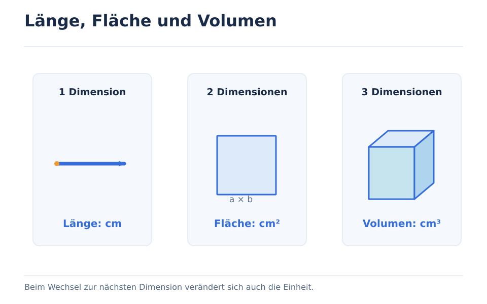

# M1-L5 – Geometrische Grundformen und Größen {#L5}

**Kursbereich:** M1 – Sekundarstufe I

**Niveau:** Sekundarstufe I

**Vorwissen:** Keine festen Voraussetzungen angegeben.

**Einordnung:** Sekundarstufe I, didaktisch ungefähr Klasse 7 · Format: zügige Auffrischung

## Worum geht es? {#S1}

Geometrie beschäftigt sich mit Formen, Positionen, Abständen und Ausdehnungen. Ein Strich auf dem Bildschirm ist eindimensional, eine Fläche zweidimensional und ein Körper dreidimensional. Mit wenigen Begriffen können wir beschreiben, wie eine Figur aufgebaut ist, wie viel Rand sie hat oder wie viel Raum sie einnimmt. Gerade bei Grafiken, räumlichen Daten und später der Robotik muss man diese Größen sauber unterscheiden.

## Grundidee: Linie, Fläche und Körper {#S2}

- **Punkt:** Beschreibt eine Position ohne eigene Ausdehnung. In Zeichnungen ist ein Punkt sichtbar markiert, mathematisch aber ohne Größe.
- **Strecke:** Endlicher gerader Abschnitt zwischen zwei Punkten. Eine **Gerade** dagegen setzt sich in beide Richtungen unbegrenzt fort.
- **Winkel:** Beschreibt, wie zwei Strahlen mit gemeinsamem Anfangspunkt zueinander stehen. Seine Größe kann in **Grad** gemessen werden: $90^{\text{°}}$ spricht man „neunzig Grad“ und nennt ihn rechten Winkel.
- **Dreieck:** Ebene Figur mit drei geraden Seiten. Im gewöhnlichen ebenen, euklidischen Raum beträgt die Summe der Innenwinkel $180^{\text{°}}$ („einhundertachtzig Grad“).
- **Viereck:** Ebene Figur mit vier geraden Seiten. Rechtecke besitzen vier rechte Winkel; beim Quadrat sind zusätzlich alle vier Seiten gleich lang.
- **Kreislinie:** Menge aller Punkte einer Ebene, die von einem Mittelpunkt denselben Abstand besitzen. Dieser Abstand heißt **Radius**; die doppelte Radiuslänge ist der **Durchmesser**. Die ausgefüllte Fläche innerhalb der Kreislinie heißt **Kreisscheibe**.
- **Körper:** Dreidimensionale Figur, etwa Würfel, Quader, Zylinder oder Kugel. Ein Würfel hat sechs quadratische Flächen; ein Quader sechs rechteckige Flächen.

Ein Bild oder eine Zeichnung kann einem dreidimensionalen Körper nur eine **zweidimensionale Ansicht** geben. Das ist für die Interpretation von technischen Darstellungen wichtig.

## Maßeinheiten: Länge, Fläche und Volumen {#S3}

Die **Länge** einer Strecke wird beispielsweise in Metern ($\mathrm m$) angegeben. Der **Umfang** ist die Gesamtlänge des Randes einer ebenen Figur und besitzt ebenfalls eine Längeneinheit. Ein **Flächeninhalt** beschreibt das zweidimensionale Innere, also etwa Quadratmeter ($\mathrm m^2$, gesprochen „Quadratmeter“). Ein **Volumen** beschreibt dreidimensionalen Raum, etwa Kubikmeter ($\mathrm m^3$, gesprochen „Kubikmeter“).

{alt="Linie, Fläche und Körper mit passenden Maßeinheiten"}

  Größe     Beispiel           Bedeutung
  --------- ------------------ ------------------------------
  Länge     $3\,\mathrm m$     Drei Meter in einer Richtung
  Fläche    $6\,\mathrm m^2$   Sechs Quadratmeter Fläche
  Volumen   $12\,\mathrm m^3$  Zwölf Kubikmeter Raum

**Vorsicht bei Einheitenumrechnungen:** Aus $1\,\mathrm m=100\,\mathrm{cm}$ folgt **nicht** $1\,\mathrm m^2=100\,\mathrm{cm}^2$, sondern $1\,\mathrm m^2=10\,000\,\mathrm{cm}^2$. Bei Volumen ist $1\,\mathrm m^3=1\,000\,000\,\mathrm{cm}^3$. Der Umrechnungsfaktor wird für jede räumliche Dimension erneut angewendet.

## Die drei wichtigsten Flächen- und Volumenformeln {#S4}

Bevor die Formeln erscheinen, legen wir ihre Buchstaben fest:

- $A$ („großes a“) bedeutet in dieser Lektion **Flächeninhalt**.
- $V$ („fau“) bedeutet **Volumen**.
- $a$, $b$ und $c$ („a“, „be“, „ce“) stehen für **Seitenlängen** beziehungsweise Kantenlängen; welche Seite gemeint ist, hängt von der Skizze ab. Bei den hier beschriebenen echten Rechtecken und Quadern sind diese Längen **positiv**.
- $g$ („ge“) ist die **Grundseite** eines Dreiecks und $h$ („ha“) seine **zugehörige Höhe**, also der senkrechte Abstand vom gegenüberliegenden Eckpunkt zur Geraden der Grundseite.
- Der Punkt `·` heißt „mal“, der Schrägstrich `/` „geteilt durch“. Hochgestellte `²` und `³` im Einheitennamen stehen für „zum Quadrat“ beziehungsweise „hoch drei“.

### Fläche eines Rechtecks {#abschnitt-5}

$A=a\cdot b$

**Laut gelesen:** „Der Flächeninhalt A ist gleich die Seitenlänge a mal die Seitenlänge b.“ Ein Rechteck von zwei Metern Breite und drei Metern Länge besitzt $2\,\mathrm m\cdot3\,\mathrm m=6\,\mathrm m^2$ Fläche. Die Längeneinheiten werden ebenfalls miteinander multipliziert: Meter mal Meter ergibt Quadratmeter. Bei einem Quadrat sind beide Seiten gleich lang.

### Fläche eines Dreiecks {#abschnitt-6}

$A=\frac{g\cdot h}{2}$

**Laut gelesen:** „Der Flächeninhalt A ist gleich Grundseite g mal zugehörige Höhe h, anschließend geteilt durch zwei.“ Ein Dreieck mit vier Zentimetern Grundseite und drei Zentimetern zugehöriger Höhe hat $\frac{4\,\mathrm{cm}\cdot3\,\mathrm{cm}}2=6\,\mathrm{cm}^2$ Fläche. Die Höhe muss zur gewählten Grundseite gehören und **senkrecht** auf ihr stehen; sie kann bei stumpfwinkligen Dreiecken außerhalb des Dreiecks liegen.

### Volumen eines Quaders {#abschnitt-7}

$V=a\cdot b\cdot c$

**Laut gelesen:** „Das Volumen V ist gleich Länge a mal Breite b mal Höhe c.“ Ein Quader mit den Kantenlängen zwei, drei und vier Metern enthält $2\,\mathrm m\cdot3\,\mathrm m\cdot4\,\mathrm m=24\,\mathrm m^3$ Rauminhalt. Die Formel gilt für einen Quader mit rechtwinklig aufeinanderstehenden Kanten.

## Symmetrie: Eine Form bleibt unter einer Veränderung gleich {#S5}

Eine Figur ist **achsensymmetrisch**, wenn sie durch Spiegelung an einer bestimmten Geraden unverändert erscheint. Ein Quadrat besitzt vier solche Spiegelachsen. Bei **Drehsymmetrie** bleibt die Figur nach einer geeigneten Drehung um einen Mittelpunkt unverändert; ein Quadrat etwa nach einer Vierteldrehung.

Diese Idee wird später verallgemeinert: Symmetrien können als mathematische **Transformationen** beschrieben werden. Damit lassen sich in Grafiksoftware Objekte spiegeln, drehen und ausrichten.

## Vollständig erläutertes Mini-Beispiel {#S6}

Eine rechteckige Bildschirmfläche hat modellhaft eine Breite von $0{,}6\,\mathrm m$ und eine Höhe von $0{,}4\,\mathrm m$. Für die Vorderfläche verwenden wir die Rechteckformel: $A=0{,}6\,\mathrm m\cdot0{,}4\,\mathrm m=0{,}24\,\mathrm m^2$. Wir berechnen damit den **Flächeninhalt** der Vorderseite, nicht das Volumen des Geräts. Für ein Volumen bräuchten wir zusätzlich eine dritte Abmessung und eine dazu passende geometrische Körperannahme.

## Zeichenlesehilfe {#S7}

  Zeichen                         Aussprache                        Bedeutung hier                   Anderswo möglich
  ------------------------------- --------------------------------- -------------------------------- ----------------------------------------
  `°`                             Grad                              Maßeinheit eines Winkels         Auch Temperaturgrad bei °C
  $\mathrm m$, $\mathrm{cm}$      Meter, Zentimeter                 Längeneinheiten                  Buchstaben können sonst Variablen sein
  $\mathrm m^2$, $\mathrm{cm}^2$  Quadratmeter, Quadratzentimeter   Flächeneinheiten                 Hochgestellte 2 bei Zahlen auch Potenz
  $\mathrm m^3$, $\mathrm{cm}^3$  Kubikmeter, Kubikzentimeter       Volumeneinheiten                 Hochgestellte 3 bei Zahlen auch Potenz
  $A$                             großes a                          Flächeninhalt                    Später auch Ereignis, Matrix, Menge
  $V$                             fau                               Volumen                          Später auch Vektorraum oder Spannung
  $g$, $h$                        ge, ha                            Grundseite und senkrechte Höhe   Kontextabhängige Variablen
  `·`, `/`                        mal, geteilt durch                Rechenoperationen                `/` in Software auch Pfadtrennung

## Wofür nützlich? {#S8}

Flächenberechnungen helfen bei Bildschirm- und Drucklayouts, Texturgrößen sowie Materialbedarf. Volumenmodelle dienen etwa der Abschätzung von Platzbedarf, Verpackung oder dreidimensionalen Szenen. Winkel und Symmetrien spielen bei Computerspielen, CAD und später bei Robotik und 3D-Transformationen eine zentrale Rolle.

## Annahmen und Grenzen {#S9}

Die Formeln gelten für die jeweils beschriebenen **idealen geometrischen Formen**. Ein unregelmäßiger Raum ist nicht automatisch ein Quader, und eine perspektivische Bildschirmansicht liefert keine unverzerrten Längen. Das hier verwendete Dreieckswinkelgesetz gilt für ebene euklidische Geometrie; auf gekrümmten Flächen können andere Verhältnisse auftreten. Bei realen Messdaten kommt außerdem Messunsicherheit hinzu.

## Verbindung zu M1-L6 {#S10}

Nachdem wir Größen beschrieben und berechnet haben, betrachten wir als Nächstes mehrere Messwerte zusammen: Häufigkeiten, Durchschnittswerte und die Frage, welche Aussage eine Statistik tatsächlich erlaubt.

## Quellen (extern) {#S11}

Keine externen Quellen angegeben.
