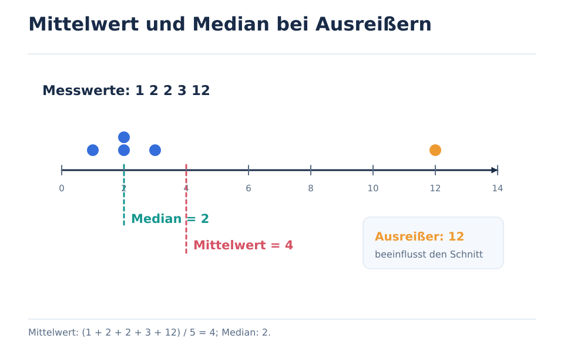

# M1-L6 – Statistik: Häufigkeit, Mittelwert, Median und Streuung {#L6}

**Kursbereich:** M1 – Sekundarstufe I

**Niveau:** Sekundarstufe I

**Vorwissen:** Keine festen Voraussetzungen angegeben.

**Einordnung:** Sekundarstufe I, didaktisch ungefähr Klasse 7 · Format: zügige Auffrischung

## Worum geht es? {#S1}

Statistik hilft, aus vielen einzelnen Beobachtungen eine verständliche Beschreibung zu gewinnen. Statt jeden Messwert einzeln aufzuzählen, können wir typische Werte, Häufigkeiten und Unterschiede bestimmen. Besonders nützlich ist dabei die Unterscheidung zwischen einem Durchschnitt und einem Wert, der für die meisten Beobachtungen repräsentativ ist. Ein einzelner stark abweichender Wert kann nämlich eine gesamte Zusammenfassung verzerren.

## Grundidee: Fünf Messungen, mehrere Blickwinkel {#S2}

Ein Programm benötigt für fünf nacheinander ausgeführte Vorgänge folgende Zeiten in **Sekunden**:

$1,2,2,3,12$

Wir haben die Zahlen bereits aufsteigend sortiert. Von den fünf Vorgängen dauert einer besonders lange. An diesem kleinen Datensatz lassen sich mehrere statistische Begriffe erklären.

### Absolute und relative Häufigkeit {#abschnitt-3}

Die **absolute Häufigkeit** sagt, wie oft ein bestimmter Wert vorkommt. Die Zeit $2\,\text{Sekunden}$ tritt **zweimal** auf.

Die **relative Häufigkeit** gibt den Anteil an allen Beobachtungen an. Wir nennen diesen Anteil $h$ (gesprochen „ha“); der Buchstabe kann in anderen Zusammenhängen zum Beispiel eine geometrische Höhe bezeichnen. Der Schrägstrich `/` bedeutet „geteilt durch“, und `%` heißt „Prozent“ oder „von hundert“.

**Formel 1:**

$h=\frac25=0{,}4=40\,\%$

**Laut gelesen:** „Die relative Häufigkeit ha ist gleich zwei durch fünf, also null Komma vier beziehungsweise vierzig Prozent.“ **Zwei von fünf** Vorgängen dauern genau zwei Sekunden. Den Nenner bildet hier die Zahl aller fünf Beobachtungen — nicht die Summe ihrer Zeiten.

## Mittelwert: Alle Beobachtungen gehen ein {#S3}

Der **arithmetische Mittelwert** ist die Summe aller Werte, geteilt durch ihre Anzahl. Als Kurzname verwenden wir hier $M$ („großes em“). Das Pluszeichen steht für Addition, die Klammern grenzen die Summe ab.

**Formel 2:**

$M=\frac{1+2+2+3+12}{5}=4$

**Laut gelesen:** „Der Mittelwert M ist gleich der Summe aus eins, zwei, zwei, drei und zwölf, geteilt durch fünf; das ergibt vier.“ Die mittlere Dauer beträgt also **vier Sekunden**. In der Liste dauert allerdings **kein** Vorgang genau vier Sekunden. Ein Mittelwert muss nicht selbst als Messwert vorkommen.

## Median und Modalwert: Was liegt in der Mitte oder kommt häufig vor? {#S4}

Der **Median** ist der mittlere Wert der **sortierten** Liste. Bei fünf Werten liegt er an der dritten Stelle: **2 Sekunden**. Bei einer geraden Anzahl von Zahlenwerten verwendet man üblicherweise das arithmetische Mittel der beiden mittleren Zahlen. Beispiel: Für $1,2,3,12$ sind die mittleren Werte zwei und drei; der Median beträgt $\frac{2+3}{2}=2{,}5\,\text{Sekunden}$. Er muss also selbst kein beobachteter Messwert sein.

{alt="Datensatz mit Ausreißer und Vergleich von Mittelwert und Median"}

Der **Modalwert** (auch Modus) ist der am häufigsten vorkommende Wert. In unserem Beispiel ist das ebenfalls **2 Sekunden**, weil nur dieser Wert zweimal vorkommt. Es kann mehrere gleich häufige Modalwerte geben.

**Einordnung:** Der Mittelwert von vier Sekunden liegt deutlich über dem Median von zwei Sekunden. Ursache ist vor allem der Vorgang mit zwölf Sekunden. Der Median ist gegenüber einzelnen extremen Werten **robuster**, erzählt aber nicht die gesamte Geschichte.

## Streuung: Wie unterschiedlich sind die Werte? {#S5}

Zwei Messreihen können denselben Mittelwert besitzen und dennoch ganz unterschiedlich sein: Bei der einen liegen alle Werte eng beieinander, bei der anderen schwanken sie stark.

Ein sehr einfaches Streuungsmaß ist die **Spannweite**: größter Wert minus kleinster Wert. In unserem Beispiel also $12-1=11\,\text{Sekunden}$. Das Zeichen `−` heißt „minus“ und steht hier für die Subtraktion. Eine Spannweite hängt nur von zwei extremen Beobachtungen ab; sie sagt nicht, wie die übrigen Werte verteilt sind.

Später betrachten wir präzisere Streuungsmaße wie **Varianz** und **Standardabweichung**. Dafür benötigen wir die Idee, Abstände aller Werte von einem typischen Mittelpunkt zu berücksichtigen.

## Welches Diagramm zeigt was? {#S6}

  Diagrammtyp                   Welche Frage beantwortet es?                              Typischer Fehler
  ----------------------------- --------------------------------------------------------- -------------------------------------------------------------------------------------------------
  Säulen- oder Balkendiagramm   Wie oft tritt jeder Wert oder jede Kategorie auf?         Gestauchte oder abgeschnittene Achse täuscht Größenunterschiede vor
  Liniendiagramm                Wie verändert sich ein Wert im zeitlichen Verlauf?        Zwischenpunkte als gemessen ausgeben, obwohl sie es nicht sind
  Histogramm                    Wie verteilen sich viele Zahlenwerte auf Wertebereiche?   Bei unterschiedlich breiten Klassen die Säulenhöhen statt ihrer Flächen als Häufigkeiten deuten

Bei einem **Histogramm mit unterschiedlich breiten Klassen** ist für den Vergleich die **Fläche** der jeweiligen Säule maßgeblich. Die Höhe zeigt dann eine Häufigkeitsdichte (Häufigkeit geteilt durch Klassenbreite), nicht unmittelbar die Häufigkeit. Für unseren kleinen Datensatz genügt zunächst eine **Häufigkeitstabelle**:

  Laufzeit      Häufigkeit
  ------------- ------------
  1 Sekunde     1
  2 Sekunden    2
  3 Sekunden    1
  12 Sekunden   1

Das ist nicht dasselbe wie ein Zeitverlauf: Ohne die **ursprüngliche Reihenfolge** der Messungen wissen wir nicht, ob der besonders langsame Vorgang am Anfang oder am Ende auftrat.

## Vollständig erläutertes Mini-Beispiel {#S7}

Wir möchten die typische Dauer einer Softwareoperation beschreiben. Der Mittelwert beträgt vier Sekunden, der Median zwei Sekunden, und der Modalwert ebenfalls zwei Sekunden. Eine Aussage wie „Die typische Operation dauert vier Sekunden“ könnte deshalb einen falschen Eindruck erwecken. Aussagekräftiger ist: „Der Median beträgt zwei Sekunden; ein auffälliger langsamer Vorgang hebt den Mittelwert auf vier Sekunden.“ Für eine belastbare Aussage über das System wären mehr Messungen und Informationen über die Testbedingungen nötig.

## Zeichenlesehilfe {#S8}

  Zeichen   Aussprache             Bedeutung hier                                Anderswo möglich
  --------- ---------------------- --------------------------------------------- ---------------------------------------------------
  $h$       ha                     Relative Häufigkeit eines Wertes              In M1-L5 Höhe einer Figur
  $M$       großes em              Arithmetischer Mittelwert in diesem Kapitel   Andere Formeln können andere Buchstaben verwenden
  `/`       durch, geteilt durch   Anteil beziehungsweise Mittelwertdivision     Datei-/Pfadtrenner in Code
  `%`       Prozent                Anteil bezogen auf hundert                    In einigen Programmiersprachen Restoperator
  `−`       minus                  Differenz, hier Maximum minus Minimum         Negatives Vorzeichen

## Wofür nützlich? {#S9}

Bei Programmen kann Statistik typische Antwortzeiten, Speicherverbrauch und Fehlerhäufigkeiten beschreiben. In der Datenanalyse lässt sich erkennen, ob ein Durchschnitt durch Ausreißer verzerrt wird. Bei KI-Systemen betrachtet man beispielsweise die Verteilung von Inferenzzeiten statt ausschließlich eines einzigen Durchschnittswerts. Auch die Qualität eines Modells sollte nicht nur anhand eines unkommentierten Mittelwerts beurteilt werden.

## Annahmen und Grenzen {#S10}

Unser Datensatz enthält nur fünf Messungen und ist **kein Nachweis** für die allgemeine Leistung des Programms. Eine statistische Kennzahl hängt davon ab, *was* gemessen wurde, *welche* Fälle ausgewählt wurden und ob alle Einheiten gleich sind. Ein auffälliger Wert kann ein Messfehler oder ein reales, technisch wichtiges Problem sein; man darf ihn nicht ohne Begründung löschen. Aus einer beobachteten Korrelation folgt außerdem noch keine Ursache-Wirkungs-Beziehung.

## Verbindung zu M1-L7 {#S11}

In M1-L7 wiederholen wir Potenzen, Zehnerpotenzen und Wurzeln. Sie vereinfachen sehr große oder sehr kleine Zahlen und bereiten unter anderem die späteren statistischen Streuungsmaße vor.

## Quellen {#S12}

In dieser Lektion sind keine Einzelquellen gesondert verzeichnet.
