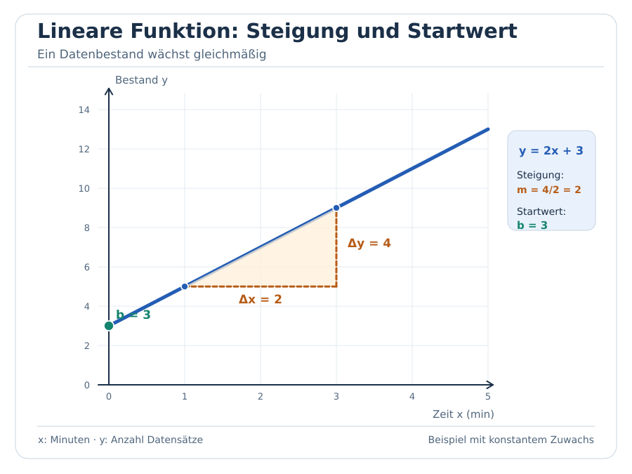

# M1-L8 – Lineare Funktionen: Steigung und Achsenabschnitt {#L8}

**Kursbereich:** M1 – Sekundarstufe I

**Niveau:** Sekundarstufe I

**Vorwissen:** Keine festen Voraussetzungen angegeben.

**Einordnung:** Sekundarstufe I, didaktisch ungefähr Klasse 8 · Format: zügige Auffrischung

## Worum geht es? {#S1}

Eine Funktion ordnet einer Eingabe einen eindeutigen Ausgabewert zu. Bei **linearen Funktionen** nimmt der Ausgabewert bei gleich großen Eingabeschritten um einen konstanten Betrag zu, ab oder bleibt unverändert. Der vollständige Graph einer solchen auf allen reellen Zahlen definierten Funktion ist eine Gerade; auf einen kleineren Eingabebereich beschränkt sehen wir nur den entsprechenden Teil der Geraden. Deshalb sind lineare Funktionen ein besonders gutes erstes Modell für Kosten, Mengen, Entfernungen und technische Messwerte.

## Grundidee und Anschauung {#S2}

Stell dir einen Dienst vor, der mit einem festen Anfangsbestand von drei fertigen Datensätzen startet und danach pro Minute zwei neue Datensätze erstellt. Nach jeder weiteren Minute kommen genau zwei hinzu. Es gibt somit einen **Startwert** und eine **konstante Änderungsrate**. Eine Gerade kann diese beiden Informationen vollständig abbilden.

{alt="Gerade y = 2x + 3 mit Startwert b = 3. Ein Steigungsdreieck zeigt eine waagerechte Änderung um 2 und eine senkrechte um 4, also Steigung 2."}

Eigene Modellzeichnung: Anfangsbestand 3, Zuwachs 2 Datensätze je Minute; $\frac{\Delta y}{\Delta x}=\frac42=2$.

Die schulische **Geradenfunktion** mit konstanter Steigung und möglicherweise vorhandenem Startwert heißt in der höheren Mathematik **affine Funktion** – auch wenn der Startwert null ist. In der linearen Algebra bezeichnet eine **lineare Abbildung** etwas Engeres: Sie muss insbesondere den Ursprung auf den Ursprung abbilden, also keinen zusätzlichen Startwert besitzen. Wir behalten zunächst die in der Schule gebräuchliche Bezeichnung „lineare Funktion“ bei. Die zugehörigen Formelzeichen werden gleich eingeführt.

## Neue Zeichen vor der ersten Formel {#S3}

  Zeichen                          Aussprache                               Bedeutung hier                                                                       Anderer möglicher Gebrauch
  -------------------------------- ---------------------------------------- ------------------------------------------------------------------------------------ ---------------------------------------------------
  $f$                              eff                                      Name einer Funktion                                                                  Beliebiger Funktionsname
  $f(x)$                           eff von iks                              Ausgabewert der Funktion zur Eingabe x                                               Allgemeines Funktionsargument
  $x$                              iks                                      Eingabe; hier vergangene Minuten                                                     Horizontale Koordinate, beliebige Variable
  $y$                              ypsilon                                  Ausgabewert, der auch $f(x)$ heißen kann                                             Vertikale Koordinate
  $m$                              em                                       **Steigung**: Änderung des Ausgabewerts pro Eingabeeinheit                           Masse, Meter oder Parameter
  $b$                              be                                       **Achsenabschnitt**: Ausgabewert bei x gleich null                                   Beliebige Konstante
  $\Delta$                         großes Delta                             **Änderung** oder Differenz zweier Werte                                             In anderen Bereichen etwa ein spezieller Operator
  $\frac{\Delta y}{\Delta x}$      Delta y durch Delta x                    Änderung der Ausgabe geteilt durch Änderung der Eingabe                              Allgemeine mittlere Änderungsrate
  $x_1$, $x_2$ sowie $y_1$, $y_2$  iks eins, iks zwei; ypsilon eins, zwei   Eingabe- und Ausgabewerte von zwei Punkten; tiefgestellte Ziffern sind **Indizes**   In Datenreihen auch Nummerierung von Messungen
  $(x;y)$                          Punkt mit Koordinaten iks und ypsilon    Geordnetes Koordinatenpaar (deutscher Trenner Semikolon)                             Klammern können sonst auch Gruppierung bedeuten
  `≥`                              größer als oder gleich                   $x\ge0$ bedeutet: die Zeit ist nicht negativ                                         Allgemeiner Größenvergleich

## Wichtigste Formeln {#S4}

**Formel 1 – Geradengleichung:** $f(x)=m\cdot x+b$.

**Laut gelesen:** „eff von iks ist gleich em mal iks plus be.“ Die Funktion heißt $f$. Der Eingabewert ist $x$. Die **Steigung m** sagt, um wie viel der Ausgabewert pro zusätzlicher Einheit $x$ zunimmt oder abnimmt. Der **Achsenabschnitt b** ist der Wert bei $x=0$ und liegt dort, wo die Gerade die vertikale Achse schneidet. Die Schreibweise $mx$ ohne Malzeichen bedeutet dasselbe wie $m\cdot x$.

**Formel 2 – Steigung aus zwei Punkten:** $m=\frac{\Delta y}{\Delta x}=\frac{y_2-y_1}{x_2-x_1}$.

**Laut gelesen:** „Die Steigung em ist die Änderung von ypsilon geteilt durch die Änderung von iks; also ypsilon zwei minus ypsilon eins geteilt durch iks zwei minus iks eins.“ Beide Punkte liegen auf der **gleichen** Geraden. Der Nenner darf nicht null sein. Haben zwei **verschiedene** Punkte dieselbe x-Koordinate, liegt ihre Verbindungsgerade senkrecht und ist nicht der Graph einer Funktion $y=f(x)$. Sind die beiden Punkte **identisch**, lässt sich aus ihnen allein keine eindeutige Gerade und damit auch keine Steigung bestimmen.

## Vollständig erläutertes Mini-Beispiel {#S5}

Für unseren Beispieldienst gilt: Anfangs sind drei Datensätze vorhanden, anschließend werden pro Minute zwei neue erstellt.

$f(x)=2x+3$.

**Gesprochen:** „eff von iks ist gleich zwei mal iks plus drei.“ Hier bedeutet $m=2$ genau **zwei Datensätze je Minute**; $b=3$ bedeutet **drei Datensätze zum Startzeitpunkt**. Nach vier Minuten ist der modellierte Wert $f(4)=2\cdot4+3=11$ Datensätze.

So entsteht eine kleine Wertetabelle:

  Zeit $x$ (Minuten)  Ausgabewert $f(x)$ (Datensätze)  Punkt im Koordinatensystem
  ------------------- -------------------------------- ----------------------------
  0                   3                                $(0;3)$
  1                   5                                $(1;5)$
  2                   7                                $(2;7)$
  4                   11                               $(4;11)$

Die Punkte liegen auf derselben Geraden. Bei $x=0$ beginnt der **für das Modell relevante Graph** auf der Höhe drei, und pro Schritt nach rechts steigt er um zwei Einheiten. Wenn $x$ die seit dem Start verstrichene Zeit bezeichnet, ist als sachlicher Definitionsbereich $x\ge0$ sinnvoll; die Gerade wird dann nur als nach rechts laufender Teil betrachtet. Die Datensatzzahl ist dabei eine idealisierte kontinuierliche Modellgröße, obwohl reale Datensätze ganzzahlig gezählt werden.

Aus den Punkten $(1;5)$ und $(4;11)$ können wir die Steigung zur Kontrolle berechnen: $\Delta y=11-5=6$, $\Delta x=4-1=3$; daher $m=\frac63=2$ Datensätze je Minute. Die **Einheit der Steigung** ist immer die Einheit der Ausgabe **pro** Eingabeeinheit.

## Wichtige Sonderfälle und Deutungen {#S6}

- **Positive Steigung:** Bei $m>0$ verläuft die Gerade nach rechts ansteigend. Das Zeichen `>` liest sich „größer als“.
- **Negative Steigung:** Bei $m<0$ fällt sie nach rechts. Das Zeichen `<` bedeutet „kleiner als“.
- **Steigung null:** Bei $m=0$ ist der Ausgabewert konstant; der Graph liegt waagerecht.
- **Direkte Proportionalität (M1-L2):** Bei $b=0$ verläuft die Gerade durch den Ursprung. Dann ist die Funktion $f(x)=m\cdot x$ direkt proportional. Mit einem Startwert ungleich null ist sie weiterhin eine Gerade, aber nicht direkt proportional.

Die horizontale Achse heißt meist **x-Achse**, die vertikale **y-Achse**. Eine Gerade beschreibt auch Zwischenwerte. In unserem Beispiel können aber nur **ganze** Datensätze tatsächlich existieren, und in einer Minute entstehen die Datensätze möglicherweise nicht gleichmäßig. Das stetige Gerade-Modell ist daher eine nützliche Idealisierung.

## Wofür nützlich? {#S7}

Lineare Funktionen dienen als einfache Kostenmodelle, etwa „monatliche Grundgebühr plus Preis je Nutzung“. Sie sind auch für Sensor-Kalibrierung, für Umrechnungen zwischen Maßeinheiten und für grobe Laufzeitprognosen geeignet. In der Datenanalyse kann man eine Gerade an Messwerte anpassen; das nennt man später **lineare Regression**. Der mathematische Kern ist stets derselbe: Startwert plus konstante Änderung.

## Annahmen und Grenzen {#S8}

Die Gerade setzt eine konstante Steigung voraus. Reale Rechenzeiten, Netzwerklasten und Produktionsraten können jedoch schwanken, Schwellen erreichen oder sich sprunghaft ändern. Zwei Punkte reichen aus, um **eine** Gerade festzulegen, aber nicht, um nachzuweisen, dass ein reales System dauerhaft linear funktioniert. Eine aus Daten geschätzte Gerade ist ein **Modell**, kein Naturgesetz; außerhalb des beobachteten Bereichs können Vorhersagen unzuverlässig werden.

## Verbindung zu M1-L9 {#S9}

Bisher haben wir jeweils **eine** lineare Beziehung betrachtet. In M1-L9 stellen wir zwei solche Beziehungen gleichzeitig auf und bestimmen, bei welchen Werten **beide** erfüllt sind.

## Quellen (extern) {#S10}

Keine externen Quellen angegeben.
