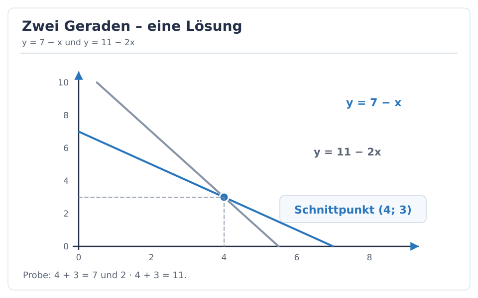

# M1-L9 – Lineare Gleichungssysteme und Lösungsverfahren {#L9}

**Kursbereich:** M1 – Sekundarstufe I

**Niveau:** Sekundarstufe I

**Vorwissen:** Keine festen Voraussetzungen angegeben.

**Einordnung:** Sekundarstufe I, didaktisch ungefähr Klasse 8 · Format: zügige Auffrischung

## Worum geht es? {#S1}

Manchmal kennen wir zwei Bedingungen, aber zwei Werte sind unbekannt. Eine einzelne Gleichung reicht dann meistens nicht aus, beide Werte eindeutig festzulegen. Ein **Gleichungssystem** besteht aus mehreren Gleichungen, die **gleichzeitig** erfüllt sein müssen. Wir können die Unbekannten durch geschicktes Umformen bestimmen oder das Problem als Schnittpunkt zweier Geraden betrachten.

## Grundidee und Anschauung {#S2}

Denke an zwei verschiedene Abrechnungsregeln für dieselben Größen. Wenn beide Regeln im selben Fall stimmen sollen, müssen wir Werte finden, die **beide** Aussagen gleichzeitig erfüllen. Mathematisch suchen wir die gemeinsamen Lösungen der Gleichungen. Für zwei lineare Gleichungen in zwei Unbekannten und **reellwertige Lösungen** können das genau ein Wertepaar, gar kein Wertepaar oder unendlich viele Wertepaare sein. Legt man zusätzlich nur ganze oder nichtnegative Werte fest, kann sich die Anzahl zulässiger Lösungen ändern.

## Neue Zeichen vor der ersten Formel {#S3}

  Zeichen                      Aussprache                               Bedeutung hier                                               Anderer möglicher Gebrauch
  ---------------------------- ---------------------------------------- ------------------------------------------------------------ -----------------------------------------------------------
  $x$, $y$                     iks und ypsilon                          Zwei gesuchte Zahlen                                         Koordinaten zweier Achsen, Eingabe/Ausgabe einer Funktion
  $2x$                         zwei mal iks                             Das Doppelte von x, Multiplikationszeichen weggelassen       Allgemeine algebraische Schreibweise
  `=`                          ist gleich                               Gleichheitsbedingung, die gelten muss                        In Programmcode ggf. Zuweisung
  `{` (vor zwei Gleichungen)   geschweifte Klammer, „zusammengehörig“   Kennzeichnet ein System gleichzeitig geltender Gleichungen   In der Mengenlehre Mengenklammer
  `⇔`                          ist äquivalent zu                        Zwei Schritte haben dieselbe Lösungsmenge                    In der Logik „genau dann, wenn“
  $(x;y)$                      Wertepaar iks und ypsilon                Gemeinsame Lösung beider Gleichungen                         Allgemein auch Koordinatenpunkt
  `−`                          minus                                    Subtrahieren, um eine Unbekannte zu entfernen                Negatives Vorzeichen

## Wichtigste Darstellung {#S4}

Wir betrachten die beiden Bedingungen:

$$
\begin{aligned}
\begin{cases}x+y=7\\2x+y=11\end{cases}
\end{aligned}
$$

**Laut gelesen:** „Gesucht sind zwei Zahlen iks und ypsilon. Ihre Summe ist sieben; gleichzeitig ist das Doppelte von iks plus ypsilon gleich elf.“ Die linke geschweifte Klammer zeigt nur, dass **beide Zeilen zusammen** gelten. Die Zahlen 7 und 11 sind bekannte Werte; $x$ und $y$ sind unbekannt. In der ersten Zeile hat $x$ den Faktor eins, in der zweiten den Faktor zwei.

### Verfahren 1: Additions- beziehungsweise Eliminationsverfahren {#abschnitt-5}

Bei diesem Verfahren addieren oder subtrahieren wir Gleichungen so, dass eine Variable verschwindet. Im Beispiel kommt $y$ in beiden Gleichungen mit demselben Faktor eins vor. Wenn wir die erste Gleichung **von der zweiten abziehen**, subtrahieren wir die linken **und** die rechten Seiten jeweils voneinander; dann fällt $y-y$ weg. Solche Umformungen erhalten die gemeinsame Lösungsmenge.

$$
\begin{aligned}
2x+y &= 11\\
x+y &= 7\\
(2x+y)-(x+y) &= 11-7\\
x &= 4
\end{aligned}
$$

**Laut gelesen:** „Zwei iks plus ypsilon minus die Summe aus iks und ypsilon ist gleich elf minus sieben; übrig bleibt iks gleich vier.“ Nun setzen wir den gefundenen Wert in $x+y=7$ ein. Das ergibt $4+y=7$, also $y=3$.

**Ergebnis:** $(x;y)=(4;3)$.

Gesprochen: „Das gemeinsame Wertepaar besteht aus iks gleich vier und ypsilon gleich drei.“ Die **Probe** bestätigt es: $4+3=7$ und $2\cdot4+3=11$. Damit erfüllen die Werte tatsächlich beide ursprünglichen Gleichungen.

### Verfahren 2: Einsetzungsverfahren {#abschnitt-6}

Hier stellen wir eine Gleichung zuerst nach einer Unbekannten um. Aus der ersten Gleichung wird $y=7-x$. Diese Darstellung setzen wir in die zweite Bedingung ein:

$2x+(7-x)=11$.

**Gesprochen:** „Zwei mal iks plus sieben minus iks ist gleich elf.“ Zusammenfassen ergibt $x+7=11$, somit $x=4$. Danach folgt wieder $y=3$. Das Verfahren heißt *Einsetzen*, weil ein gleichwertiger Ausdruck für eine Variable eingesetzt wird.

### Verfahren 3: Gleichsetzungsverfahren {#abschnitt-7}

Wir stellen **beide** Gleichungen nach derselben Unbekannten um:

$y=7-x$ und $y=11-2x$.

**Gesprochen:** „Ypsilon ist sieben minus iks; zugleich ist ypsilon elf minus zwei mal iks.“ Weil beide rechten Seiten denselben Wert $y$ beschreiben, setzen wir sie gleich: $7-x=11-2x$. Durch Addieren von $2x$ und Subtrahieren von sieben erhalten wir $x=4$, anschließend $y=3$.

**Drei Wege, dieselbe Antwort:** Die Methoden unterscheiden sich nur darin, wie sie eine Unbekannte beseitigen. Im konkreten Problem wählt man das Verfahren, das am wenigsten umständlich erscheint.

## Geometrische Bedeutung: Schnittpunkt zweier Geraden {#S5}

Jede der beiden Gleichungen kann als Gerade im Koordinatensystem aufgefasst werden. Aus ihnen entstehen $y=7-x$ und $y=11-2x$. Am Punkt $(4;3)$ treffen sich beide Geraden. Es ist deshalb die gemeinsame Lösung des Systems.

{alt="Koordinatensystem mit den Geraden y gleich 7 minus x und y gleich 11 minus 2x. Beide schneiden sich bei x gleich 4 und y gleich 3."}

Die gemeinsame Lösung der Gleichungen liegt am Schnittpunkt (4; 3).

Daraus ergeben sich drei grundsätzlich verschiedene Fälle:

  Fall                       Geometrische Situation                          Anzahl gemeinsamer Lösungen
  -------------------------- ----------------------------------------------- -----------------------------
  Eindeutige Lösung          Zwei Geraden schneiden sich in einem Punkt      genau eine
  Keine Lösung               Verschiedene parallele Geraden                  keine
  Unendlich viele Lösungen   Beide Gleichungen beschreiben dieselbe Gerade   unendlich viele

Beispiel **ohne** Lösung: $x+y=4$ und $x+y=7$ können niemals für dasselbe Wertepaar gleichzeitig gelten. Subtrahieren ergibt den Widerspruch $0=3$. Beispiel mit **unendlich vielen** reellen Lösungen: $x+y=5$ und $2x+2y=10$ sind dieselbe Beziehung, nur unterschiedlich geschrieben; die zweite Gleichung ist das Doppelte der ersten. Daraus folgt $0=0$, also **keine neue Einschränkung**. Zum Beispiel erfüllen $(x;y)=(0;5)$, $(1;4)$ und $(-1;6)$ beide Gleichungen. Eine unbeschränkte Lösungsmenge ist nicht automatisch erlaubt, wenn ein Anwendungsproblem nur ganze, positive oder anderweitig beschränkte Werte zulässt.

## Wofür nützlich? {#S6}

Lineare Gleichungssysteme werden für die Verteilung begrenzter Ressourcen, zum Zusammenführen mehrerer Messbedingungen und zur Berechnung technischer Parameter eingesetzt. Beispielsweise lässt sich ein Mischungs- oder Kostenproblem formulieren, wenn zwei unbekannte Anteile durch zwei unabhängige Bedingungen festgelegt sind. In Grafikprogrammen berechnet man Schnittpunkte; bei großen Datenproblemen werden umfangreiche lineare Gleichungssysteme gelöst. In der Universität führt uns dieses Thema unmittelbar zu **Matrizen** und numerischer linearer Algebra.

## Annahmen und Grenzen {#S7}

Mehr Gleichungen bedeuten nicht automatisch eine eindeutige Lösung: Entscheidend ist, ob die Bedingungen unabhängig und miteinander vereinbar sind. Die Beispiele hier sind **linear**; Produkte wie $x\cdot y$ oder Potenzen wie $x^2$ können zu nichtlinearen Problemen führen. In echten Messdaten passen Gleichungen häufig nicht exakt zusammen, etwa wegen Rundung oder Messfehlern. Dann benötigt man später Näherungsverfahren wie Ausgleichsrechnung statt einer angeblich exakten Lösung.

## Verbindung zu M1-L10 {#S8}

Die nächsten Lektionen verbinden die Algebra stärker mit dem Raum. In M1-L10 betrachten wir den Satz des Pythagoras und lernen, **Längen und Abstände** mit Gleichungen zu berechnen.

## Quellen (extern) {#S9}

Keine externen Quellen angegeben.
