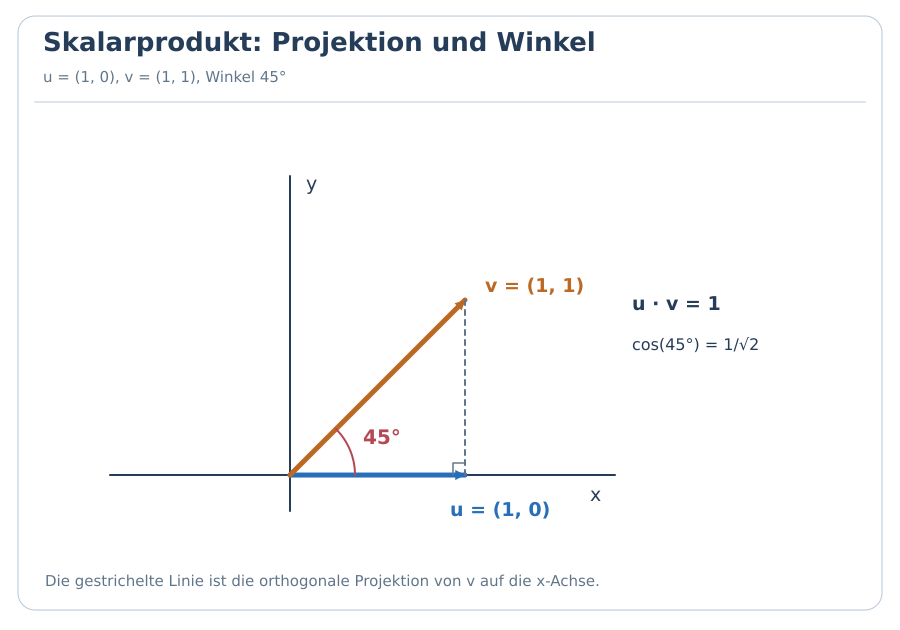

# M2-L11 – Vektoren, Skalarprodukt und Winkel {#L11}

**Kursbereich:** M2 – Oberstufe / Abitur

**Niveau:** Oberstufe / Abitur

**Vorwissen:** Keine festen Voraussetzungen angegeben.

**Einordnung:** Gymnasiale Oberstufe · analytische Geometrie

## Worum geht es? {#S1}

Ein Punkt beschreibt einen Ort, ein Vektor dagegen eine Verschiebung oder Richtung mit einer bestimmten Länge. Mit Vektoren lassen sich Bewegungen, Kräfte und räumliche Abstände unabhängig von einer Zeichnung präzise behandeln. Anders als eine einfache Zahl besitzt ein Vektor mehrere Komponenten, zum Beispiel für die drei Raumrichtungen. Das **Skalarprodukt** verbindet zwei Vektoren mit einer einzigen Zahl und macht damit Aussagen über deren Winkel und Ausrichtung möglich.

## Grundidee und Anschauung {#S2}

Stell dir einen Roboter in einem dreidimensionalen Raum vor: Eine Position ist ein Ort, die Anweisung „zwei Meter nach rechts, einen Meter nach vorn, drei Meter nach oben“ ist eine Verschiebung. Mehrere Verschiebungen können addiert werden; ihre Länge und gegenseitige Richtung können wir berechnen. Entscheidend ist die Trennung von **Ort (Punkt)**, **Verschiebung (Vektor)** und **Zahl (Skalar)**.

## Neue Zeichen vor der ersten Formel {#S3}

  Zeichen                                    Aussprache                                            Bedeutung hier                                                   Möglicher anderer Gebrauch
  ------------------------------------------ ----------------------------------------------------- ---------------------------------------------------------------- ------------------------------------------------------------------------
  $P(1;2;3)$                                 „P mit den Koordinaten eins, zwei, drei“              Punkt mit x-, y- und z-Koordinate                                P kann in der Stochastik eine Wahrscheinlichkeit bezeichnen
  `vec v` oder $\vec{v}$                     „Vektor v“                                            Gerichtete Verschiebung                                          In Texten auch fett als **v** geschrieben
  $(2;-1;3)$                                 „Vektor mit den Komponenten zwei, minus eins, drei“   Ein Vektor in drei Dimensionen; Semikolons trennen Komponenten   Als Punkt gelesen nur mit entsprechendem Kontext
  `overrightarrow{AB}`                       „Vektor von A nach B“                                 Verschiebung vom Punkt A zum Punkt B                             Ein Pfeil über Buchstaben kann auch allgemein Richtung kennzeichnen
  $\lambda$                                  „Lambda“                                              Beliebiger reeller Multiplikationsfaktor                         Später oft Parameter oder Eigenwert
  `lVert v⃗rVert` oder $\lVert\vec{v}\rVert$  „Norm von v“, „Länge des Vektors v“                   Nichtnegative Vektorlänge                                        Andere Normen in der Universität möglich
  $\vec{v}\cdot\vec{w}$                      „v Skalarprodukt w“                                   Eine Zahl aus zwei Vektoren                                      Derselbe Mittelpunkt kennzeichnet sonst oft gewöhnliche Multiplikation
  $\theta$                                   „Theta“                                               Winkel zwischen zwei Vektoren                                    Beliebige Winkelvariable oder Modellparameter
  $\cos(\theta)$                             „Kosinus von Theta“                                   Kosinus des eingeschlossenen Winkels                             Auch allgemeine periodische Funktion
  `perp` oder $\perp$                        „steht senkrecht auf“                                 Vektoren im rechten Winkel                                       Orthogonalität allgemeiner Objekte

Die Schreibweise mit umgebenden Klammern und Semikolons ist eine kompakte **Textdarstellung**. In Schulbüchern stehen die drei Komponenten oft als Spalte untereinander. Beide Varianten meinen hier dasselbe. Die hochgestellten Pfeile sind nicht Teil der Zahlen, sondern kennzeichnen den mathematischen Objekttyp.

## Vom Punkt zum Vektor {#S4}

Zwei Punkte definieren eine Verschiebung. Beispiel: $A(1;2;0)$ und $B(4;6;0)$ liegen im Raum. Um von A nach B zu gelangen, nehmen wir die Koordinatendifferenz **Ziel minus Start**.

$$
\overrightarrow{AB}=B-A=(4-1;\,6-2;\,0-0)=(3;4;0)
$$

**Vollständig gelesen:** „Der Vektor von A nach B ist der Punkt B minus der Punkt A, also der Vektor drei, vier, null.“ Genau genommen ist $B-A$ eine Kurzschreibweise für die Subtraktion der jeweiligen Ortskoordinaten. Die Komponenten geben die Verschiebung an: drei Einheiten in x-Richtung, vier in y-Richtung, keine in z-Richtung.

**Wichtiger Unterschied:** Ein Punkt $A(1;2;0)$ ist nicht automatisch derselbe Gegenstand wie der Vektor $(1;2;0)$. In einem festgelegten Koordinatensystem kann man den **Ortsvektor vom Ursprung zu A** mit diesen Komponenten bilden. Diese Beziehung ist nützlich, ersetzt aber nicht die begriffliche Unterscheidung.

## Vektoren addieren und skalieren {#S5}

Bei einer Addition werden jeweils die Komponenten derselben Richtung addiert. Bei einer **Skalierung** wird jede Komponente mit derselben Zahl multipliziert.

$$
\begin{aligned}
\vec{u}&=(2;-1;3),\quad\vec{v}=(1;4;-2)\\
\vec{u}+\vec{v}&=(3;3;1)\\
2\vec{u}&=(4;-2;6)
\end{aligned}
$$

**Gesprochen:** „Vektor u plus Vektor v ist der Vektor drei, drei, eins; zweimal Vektor u ist der Vektor vier, minus zwei, sechs.“ Die erste Zeile gibt zwei Eingabevektoren an. Das Ergebnis $(3;3;1)$ entsteht aus den drei Summen $2+1$, $-1+4$ und $3-2$. Die Multiplikation mit zwei verdoppelt die Länge des Vektors u und erhält seine Richtung, sofern u kein Nullvektor ist.

Multipliziert man stattdessen einen von null verschiedenen Vektor mit einer **negativen** Zahl, dreht sich seine Richtung um. Der Faktor $-2$ verdoppelt also die Länge und kehrt die Richtung um. Allgemein gilt für jede reelle Zahl $\lambda$:

$$
\lVert\lambda\vec{u}\rVert=\lvert\lambda\rvert\,\lVert\vec{u}\rVert
$$

**Gesprochen:** „Die Länge von Lambda mal u ist der Betrag von Lambda mal die Länge von u.“ Der **Betrag** $|\lambda|$ ist nie negativ. Beim Faktor null entsteht der **Nullvektor**, dessen sämtliche Komponenten null sind. Dieser besitzt Länge null, aber keine eindeutige Richtung.

## Länge und Abstand {#S6}

Die Länge eines Vektors ist eine Fortsetzung des Satzes von Pythagoras auf mehrere Dimensionen. In einem rechtwinkligen kartesischen Koordinatensystem gilt für drei Komponenten:

$$
\lVert\vec{v}\rVert=\sqrt{v_1^2+v_2^2+v_3^2}
$$

**Gesprochen:** „Die Länge von Vektor v ist die Quadratwurzel aus dem Quadrat seiner ersten Komponente plus dem Quadrat seiner zweiten Komponente plus dem Quadrat seiner dritten Komponente.“ Die tiefgestellten Zahlen `₁`, `₂`, `₃` sind **Komponentenindizes**, keine Potenzen; `²` bezeichnet dagegen das Quadrat.

Für unseren Verbindungsvektor $(3;4;0)$ ist die Länge $\sqrt{9+16+0}=5$. Damit beträgt der Abstand zwischen den Punkten A und B fünf Längeneinheiten. Die Länge ist immer nichtnegativ und nur beim Nullvektor gleich null.

**Grenze:** Diese einfache Formel setzt gleiche, senkrecht aufeinanderstehende Koordinatenachsen voraus. Bei anderen Koordinatensystemen oder anderen Abstandsbegriffen gelten angepasste Formeln.

## Das Skalarprodukt: Wie ähnlich sind zwei Richtungen? {#S7}

Das Wort **Skalar** bezeichnet hier eine einzelne Zahl. Das Skalarprodukt zweier Vektoren ergibt also **keinen dritten Vektor**, sondern eine Zahl. In kartesischen Koordinaten multiplizieren wir die passenden Komponenten und addieren sie:

$$
\vec{u}\cdot\vec{v}=u_1v_1+u_2v_2+u_3v_3
$$

**Gesprochen:** „Vektor u Skalarprodukt Vektor v ist u eins mal v eins plus u zwei mal v zwei plus u drei mal v drei.“ Jeder Index bestimmt die jeweilige Raumrichtung. Für zwei **von null verschiedene Vektoren** bedeutet ein positives Ergebnis einen spitzen Winkel, ein negatives Ergebnis einen stumpfen Winkel und das Ergebnis null einen rechten Winkel. Ist mindestens einer der Vektoren null, ist sein Skalarprodukt mit jedem Vektor zwar null; ein Winkel ist dann jedoch **nicht definiert**.

Beispiel:

$$
\begin{aligned}
\vec{u}&=(3;4;0),\quad\vec{v}=(-4;3;0)\\
\vec{u}\cdot\vec{v}&=3(-4)+4\cdot3+0\cdot0=0
\end{aligned}
$$

**Gesprochen:** „Drei mal minus vier plus vier mal drei plus null mal null ergibt null.“ Weil beide Vektoren von null verschieden sind, ist der Winkel zwischen ihnen genau 90 Grad: Sie sind **orthogonal**, also senkrecht zueinander.

## Den Winkel mit dem Skalarprodukt berechnen {#S8}

Das Skalarprodukt kann auch geometrisch über die beiden Längen und den eingeschlossenen Winkel beschrieben werden. Für **zwei von null verschiedene Vektoren** gilt:

Skalarprodukt: Zwischen $u=(1,0)$ und $v=(1,1)$ liegt ein Winkel von $45^{\text{°}}$.

$$
\cos(\theta)=\frac{\vec{u}\cdot\vec{v}}{\lVert\vec{u}\rVert\,\lVert\vec{v}\rVert}
$$

**Gesprochen:** „Der Kosinus von Theta ist das Skalarprodukt von u und v geteilt durch das Produkt aus der Länge von u und der Länge von v.“ $\theta$ ist hier der Winkel zwischen den Vektoren, zwischen null und 180 Grad. Der Nenner ist nur dann ungleich null, wenn keiner der beiden Vektoren der Nullvektor ist.

**Vollständig erläutertes Mini-Beispiel:**

$$
\begin{aligned}
\vec{u}&=(1;0;0),\quad\vec{v}=(1;1;0)\\
\vec{u}\cdot\vec{v}&=1\\
\lVert\vec{u}\rVert&=1,\quad\lVert\vec{v}\rVert=\sqrt2\\
\cos(\theta)&=\frac1{\sqrt2},\quad\theta=45^{\text{°}}
\end{aligned}
$$

Gesprochen: „Der Kosinus des Winkels ist eins durch Wurzel zwei; der Winkel beträgt 45 Grad.“ Der inverse Kosinus (aus M1-L16 bekannt; häufig `arccos` geschrieben) liefert aus dem Kosinuswert den Winkel. Ein Taschenrechner muss für dieses Ergebnis auf **Grad** statt Bogenmaß gestellt sein, wenn er nicht bereits in Grad rechnet.

**Kontrolle der Grenzfälle:** Für $\vec{u}=(1;0;0)$ und $\vec{w}=(-2;0;0)$ gilt $\vec{u}\cdot\vec{w}=-2$ und $\lVert\vec{u}\rVert\cdot\lVert\vec{w}\rVert=2$, also $\cos(\theta)=-1$ und $\theta=180^{\text{°}}$. Für gleichgerichtete, von null verschiedene Vektoren ist der Kosinus $+1$; bei rechtwinkligen $0$. Damit liegt der Quotient mathematisch zwischen **−1 und +1**. In Software kann Rundung ihn minimal außerhalb dieses Bereichs liefern. Erst nachdem die Nennerbedingung geprüft wurde, kann man so ein Rundungsergebnis vor `arccos` auf $[-1;1]$ begrenzen.

## Wofür nützlich? – Software und Robotik {#S9}

In einer 3D-Engine bestimmen Vektoren Blickrichtungen, Kamerabewegungen und Lichtberechnungen. Ein Skalarprodukt zeigt zum Beispiel, ob eine Fläche eher zur Lichtquelle zeigt und wie stark ihre Ausrichtung mit der Lichtrichtung übereinstimmt. Bei KI-Embeddings dient die durch **beide Vektorlängen geteilte** Variante, die **Kosinus-Ähnlichkeit**, als Richtungsmaß für nicht verschwindende Datenvektoren; gleichgerichtete Vektoren erhalten den Wert eins, entgegengesetzte den Wert minus eins. Das bedeutet allerdings nicht automatisch semantische Gleichheit oder inhaltliche Wahrheit.

Für Roboter beschreibt ein Vektor beispielsweise ein gewünschtes Bewegungsziel relativ zu seiner aktuellen Position. Bei physikalischen Kräften und Geschwindigkeiten muss zusätzlich auf kompatible Einheiten und das verwendete Bezugssystem geachtet werden.

## Annahmen und Grenzen {#S10}

- Die hier verwendeten Formeln gelten für gewöhnliche euklidische Vektoren in einem orthonormalen kartesischen Koordinatensystem.
- **Punkt und Vektor sind nicht dasselbe**; man darf eine Positionskoordinate nicht unbesehen als Verschiebung behandeln.
- Die Länge eines Nullvektors ist null. Einen Winkel zwischen dem Nullvektor und einem anderen Vektor kann man mit der obigen Formel nicht bestimmen.
- Das Skalarprodukt kann negative Werte liefern. Es ist keine Entfernung und keine Wahrscheinlichkeit.
- In der numerischen Softwarepraxis können Rundungsfehler auftreten: Ein theoretisch senkrechtes Paar liefert möglicherweise einen sehr kleinen Wert statt exakt null. Für Vergleichstests ist eine zur Größenskala passende Toleranz sinnvoll.
- Vektoren unterschiedlicher physikalischer Einheiten (z. B. Meter und Sekunden) dürfen nicht als gleichartige Verschiebungsvektoren addiert werden.

## Verbindung zur nächsten Lektion {#S11}

**M2-L12 – Geraden und Ebenen in Parameterform** verwendet einen Startpunkt und einen oder mehrere Richtungsvektoren, um unendlich viele räumliche Punkte kompakt zu beschreiben.

## Quellen {#S12}

In dieser Lektion sind keine Einzelquellen gesondert verzeichnet.
