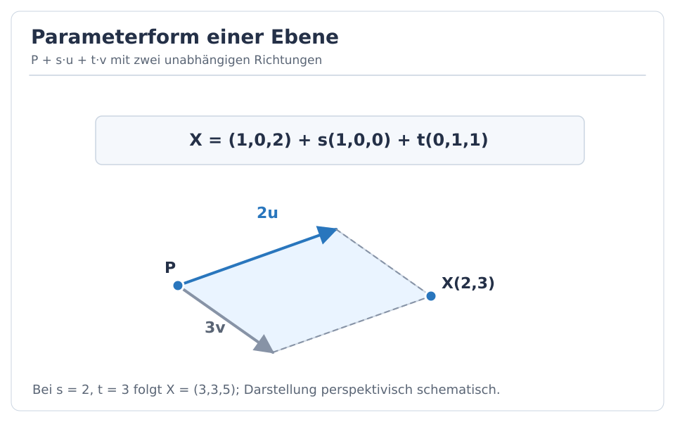

# M2-L12 – Geraden und Ebenen in Parameterform {#L12}

**Kursbereich:** M2 – Oberstufe / Abitur

**Niveau:** Oberstufe / Abitur

**Vorwissen:** Keine festen Voraussetzungen angegeben.

**Einordnung:** Gymnasiale Oberstufe · analytische Geometrie

## Worum geht es? {#S1}

Eine Gerade ist eine unendlich lange Linie ohne Dicke. Eine Ebene ist eine unendlich ausgedehnte, flache Fläche ohne Dicke. In einem dreidimensionalen Raum können wir beide mit Vektoren beschreiben. Statt jeden Punkt einzeln aufzuzählen, verwenden wir einen bekannten Punkt und eine oder zwei Richtungen. Verändert man die zugehörigen **Parameter**, erhält man sämtliche Punkte der Geraden oder der Ebene.

## Grundidee und Anschauung {#S2}

Eine Gerade lässt sich als **Startpunkt plus beliebig viel Bewegung in genau einer Richtung** verstehen. Eine Ebene braucht **zwei linear unabhängige Richtungen**: Keine darf ein Vielfaches der anderen sein; insbesondere darf keiner der beiden Richtungsvektoren null sein. Denk an eine gerade Schiene im Raum oder eine idealisierte, unendlich ausgedehnte Tischplatte. Die Parameterform ist eine kompakte mathematische Anweisung, die zugleich als Generator für Punkte auf solchen Objekten dienen kann.

## Neue Zeichen vor der ersten Formel {#S3}

  Zeichen                  Aussprache                            Bedeutung hier                                 Anderer möglicher Gebrauch
  ------------------------ ------------------------------------- ---------------------------------------------- -----------------------------------------------------------------------------------
  $g$, $E$                 „Gerade ge“, „Ebene E“                Namen für Gerade und Ebene                     Buchstaben sind frei wählbar
  $X$                      „Punkt iks“                           Variabler Punkt auf einer Gerade oder Ebene    x kann sonst eine Zahl oder Koordinate sein
  $\vec{p}$                „Vektor pe“                           Ortsvektor eines bekannten Stützpunkts         p kann für Wahrscheinlichkeit stehen
  $\vec{u}$, $\vec{v}$     „Vektor u“, „Vektor v“                Richtungsvektoren                              Allgemeine Verschiebungen, Geschwindigkeiten
  $t$, $s$                 „te“, „ess“                           Frei wählbare Parameter                        Zeitvariablen in Bewegungsmodellen
  `∈`                      „ist Element von“                     Zugehörigkeit zu einer Zahlenmenge             Auch bei Punkten und anderen Mengen
  $\mathbb{R}$             „reelle Zahlen“                       Parameter dürfen alle reellen Werte annehmen   Bereits seit M1-L1 bekannt
  $t\in\mathbb{R}$         „te ist Element der reellen Zahlen“   Parameterbereich ohne Einschränkung            Bei einer Strecke wäre der Bereich beschränkt
  $\vec{n}$                „Normalenvektor en“                   Vektor senkrecht zu einer Ebene                n kann sonst eine Anzahl oder ein Index sein
  $\vec{n}\cdot\vec{u}=0$  „n Skalarprodukt u ist null“          Senkrechte Richtungen gemäß M2-L11             Nullwert des Skalarprodukts allein reicht bei Nullvektoren nicht für einen Winkel

**Ortsvektor** heißt der Vektor vom Koordinatenursprung zu einem Punkt. Ein **Stützpunkt** ist ein bekannter Punkt, durch den unsere Gerade oder Ebene verläuft. Die Parameternamen haben keine feste Bedeutung: Man kann statt $s$ und $t$ auch andere Buchstaben verwenden, solange die Rollen klar sind.

## Die Gerade als Punktgenerator {#S4}

Die Parameterform einer Geraden im Raum lautet in Textschreibweise:

$$
g:\ X=\vec{p}+t\vec{u}\qquad(t\in\mathbb{R},\ \vec{u}\neq\vec{0})
$$

**Vollständig gesprochen:** „Die Gerade ge besteht aus Punkten iks mit Ortsvektor pe plus te mal u. Der Parameter te darf jede reelle Zahl sein; u ist nicht der Nullvektor.“ $\vec{p}$ zeigt zum Ausgangspunkt; $\vec{u}$ bestimmt die Richtung. Für $t=0$ erhält man den Stützpunkt, für positive oder negative Werte bewegt man sich entlang der Geraden in beide Richtungen.

**Mini-Beispiel – eine Schiene im dreidimensionalen Raum:**

$$
\begin{aligned}
\vec p&=(1;2;0),\quad\vec u=(2;-1;3)\\
X(t)&=(1;2;0)+t\cdot(2;-1;3)
\end{aligned}
$$

**Gesprochen:** „Der Punkt iks von te ist eins, zwei, null plus te mal den Vektor zwei, minus eins, drei.“ Setzen wir $t=2$, erhalten wir komponentenweise:

$$
X(2)=(1+2\cdot2;\,2+2\cdot(-1);\,0+2\cdot3)=(5;0;6)
$$

Der Punkt $(5;0;6)$ liegt also auf der Geraden. Für $t=-1$ würden wir stattdessen den Punkt $(-1;3;-3)$ erhalten. Weil sämtliche reellen Parameter erlaubt sind, beschreibt diese Gleichung eine **Gerade**, keine auf zwei Endpunkte begrenzte Strecke.

## Wann gehört ein Punkt zur Geraden? {#S5}

Um zu prüfen, ob der Punkt $Q(3;1;3)$ auf der Beispielgeraden liegt, suchen wir einen **einzigen gemeinsamen Parameterwert**, der alle drei Koordinatenbedingungen erfüllt.

$$
\begin{aligned}
1+2t&=3\\
2-t&=1\\
3t&=3
\end{aligned}
$$

**Gesprochen:** „Eins plus zweimal te soll drei sein, zwei minus te soll eins sein und dreimal te soll drei sein.“ Alle Gleichungen liefern $t=1$. Deshalb liegt der Punkt Q auf der Geraden.

Ein anderer Punkt kann zwei der drei Gleichungen erfüllen und die dritte verletzen; dann liegt er **nicht** auf der Geraden. Das macht deutlich, warum man Parameterwerte nicht für jede Komponente getrennt festlegen darf.

## Eine Ebene benötigt zwei unabhängige Richtungen {#S6}

Für eine Ebene verwenden wir neben dem Stützpunkt zwei Richtungsvektoren. Die zwei Parameter dürfen unabhängig voneinander variieren:

{alt="Schematische Parameterdarstellung einer Ebene durch einen Stützpunkt P und zwei linear unabhängige Richtungen u und v. Zielpunkt ist P plus 2u plus 3v."}

Zwei unabhängige Parameter erzeugen Punkte einer Ebene; die Skizze ist eine Projektion.

$$
E:\ X=\vec{p}+s\vec{u}+t\vec{v}\qquad(s,t\in\mathbb{R})
$$

**Gesprochen:** „Die Ebene E besteht aus allen Punkten iks mit Ortsvektor pe plus ess mal u plus te mal v; ess und te dürfen beliebige reelle Zahlen sein.“ Im Unterschied zur Geraden gibt es jetzt **zwei Freiheitsgrade**. Die Richtungsvektoren müssen **linear unabhängig** sein. Das bedeutet hier, dass keiner ein skalares Vielfaches des anderen ist; insbesondere darf keiner null sein. Andernfalls entsteht höchstens eine Gerade oder ein einzelner Punkt statt einer Ebene.

**Mini-Beispiel – eine geneigte Ebene:**

$$
\begin{aligned}
\vec p&=(1;0;2),\quad\vec u=(1;0;0),\quad\vec v=(0;1;1)\\
E:\quad X(s,t)&=(1;0;2)+s\cdot(1;0;0)+t\cdot(0;1;1)
\end{aligned}
$$

Für $s=2$ und $t=3$ ergibt die komponentenweise Addition den Punkt:

$$
X(2,3)=(1+2;\,0+3;\,2+3)=(3;3;5)
$$

Die zwei Richtungen sind linear unabhängig: Mit $\vec{u}$ verändern wir nur die erste Koordinate, mit $\vec{v}$ zugleich die zweite und dritte. Daher beschreiben sie tatsächlich eine zweidimensionale Ebene.

**Gegenbeispiel zur Voraussetzung:** Ersetzten wir $\vec{v}$ durch $(2;0;0)$, wäre $\vec{v}=2\vec{u}$. Dann ließe sich $s\vec{u}+t\vec{v}=(s+2t)\vec{u}$ schreiben. Trotz zweier Parameternamen entstünde nur die Gerade durch den Stützpunkt in Richtung $\vec{u}$, **keine Ebene**.

## Eine alternative Darstellung: die Normalenform {#S7}

Zu einer Ebene lässt sich ein **von null verschiedener** Vektor angeben, der **senkrecht zu jeder Richtung innerhalb dieser Ebene** steht. Er heißt **Normalenvektor**. Für eine Ebene mit linear unabhängigen Richtungsvektoren u und v muss also $\vec{n}\cdot\vec{u}=0$ und $\vec{n}\cdot\vec{v}=0$ gelten. Die Normalenform ist für viele Abstands- und Schnittfragen praktisch.

$$
\vec{n}\cdot(X-\vec{p})=0
$$

**Gesprochen:** „Der Normalenvektor en im Skalarprodukt mit dem Vektor vom Stützpunkt pe zum variablen Punkt iks ist null.“ Die Differenz $X-\vec{p}$ ist hier als Differenz von Ortsvektoren gemeint. Weil das Skalarprodukt null ist, liegt die Differenzrichtung senkrecht zu dem von null verschiedenen $\vec{n}$ und somit in der durch den Stützpunkt festgelegten Ebene. Auch beim Stützpunkt selbst erfüllt der Null-Differenzvektor die Gleichung; ein Winkel zum Nullvektor muss dazu nicht definiert sein.

Für unsere Beispielebene kann man einen Normalenvektor direkt überprüfen: $\vec{n}=(0;-1;1)$ erfüllt sowohl $\vec{n}\cdot\vec{u}=0$ als auch $\vec{n}\cdot\vec{v}=0$.

Damit wird aus der Parameterbeschreibung die sogenannte **Koordinatenform**:

$$
z-y=2
$$

**Gesprochen:** „Zett minus ypsilon ist zwei.“ Diese Gleichung gilt für sämtliche Punkte der Ebene. Beispielsweise ergibt der zuvor berechnete Punkt $(3;3;5)$ die Rechnung $5-3=2$. Der Gegenpunkt $Q(3;3;4)$ liegt dagegen **nicht** in der Ebene: $4-3=1$ statt $2$. Der Buchstabe $z$ steht für die dritte Raumkoordinate, $y$ für die zweite.

**Wichtig:** Der Normalenvektor ist nicht eindeutig. Auch das Doppelte oder Minus desselben Vektors steht senkrecht zur Ebene.

## Was ist mit Strecken, Strahlen und begrenzten Flächen? {#S8}

Die Parameterform stellt normalerweise unendliche geometrische Objekte dar. Bei einer **Strecke** vom Stützpunkt mit Ortsvektor $\vec{p}$ bis zum Punkt mit Ortsvektor $\vec{p}+\vec{u}$ wird der Parameter in $X(t)=\vec{p}+t\vec{u}$ auf das Intervall $0\leq t\leq 1$ beschränkt. Für einen **Strahl** vom Stützpunkt aus in Richtung $\vec{u}$ gilt $t\geq 0$. Eine andere Parametrisierung kann für dieselbe Strecke andere Parametergrenzen verwenden. Diese Einschränkungen sind wichtig für echte Bewegungswege, Bauteile oder Bildschirmsegmente.

Ebenso ist eine physikalische Tischplatte nur ein begrenztes Stück einer mathematisch unendlichen Ebene. Ihre Grenzen müssen zusätzlich angegeben werden, beispielsweise durch Parameterintervalle oder einen polygonalen Rand.

## Wofür nützlich? {#S9}

Eine 3D-Anwendung kann eine Kamerablickrichtung als Gerade auffassen und untersuchen, wo sie eine Objektfläche trifft. In einer Robotiksimulation werden mögliche Bewegungsrichtungen und Hindernisflächen durch Vektorformen beschrieben. Für CAD und technische Konstruktion sind Geraden und Ebenen zentrale Grundobjekte. In Computerspielen und Raytracing wird häufig zusätzlich nur ein **Strahl** statt der vollständigen Geraden betrachtet; dadurch zählen Treffer hinter der Kamera nicht als sichtbare Objekte.

## Annahmen und Grenzen {#S10}

- Ein Geraden-Richtungsvektor muss ungleich null sein; zwei Ebenen-Richtungsvektoren müssen linear unabhängig sein.
- Eine **Parameterform** beschreibt alle Punkte, die durch denselben gemeinsamen Parametersatz entstehen. Man darf nicht für jede Koordinate unabhängig ein neues $t$ wählen.
- Bei zwei unabhängigen Richtungsvektoren gehören zu jedem Punkt dieser Ebene eindeutig bestimmte Parameterwerte. Bei abhängigen Richtungen ist die Darstellung **keine echte Ebenenparametrisierung**; verschiedene Parameterpaare können denselben Punkt einer Geraden oder sogar den Stützpunkt beschreiben.
- Unsere anschaulichen Modelle setzen geradlinige, euklidische Geometrie voraus. Gekrümmte Oberflächen benötigen andere Beschreibungen.
- Ob eine reale Bewegung dieselbe Gerade über die gesamte Zeit verfolgt, ist eine Modellannahme; Zeit ist nicht automatisch identisch mit dem Parameter.

## Verbindung zur nächsten Lektion {#S11}

**M2-L13 – Abstände, Gleichungssysteme und Matrizen-Ausblick** untersucht, wann räumliche Objekte sich treffen, parallel oder windschief sind und wie ihr Abstand berechnet wird.

## Quellen (extern) {#S12}

Keine externen Quellen angegeben.
