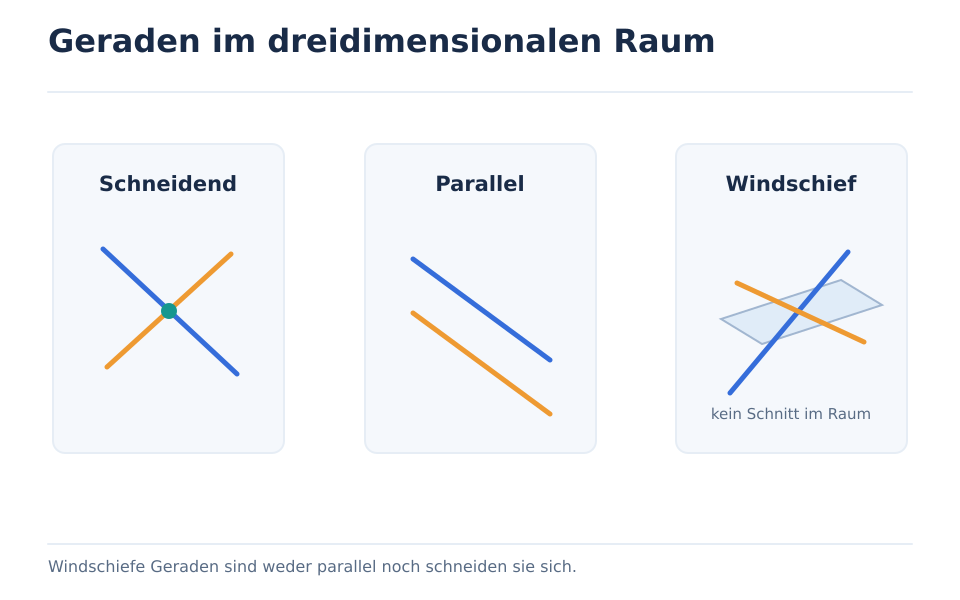

# M2-L13 – Abstände, Lagebeziehungen und Gleichungssysteme {#L13}

**Kursbereich:** M2 – Oberstufe / Abitur

**Niveau:** Oberstufe / Abitur

**Vorwissen:** Keine festen Voraussetzungen angegeben.

**Einordnung:** Gymnasiale Oberstufe · analytische Geometrie

## Worum geht es? {#S1}

Nachdem wir Geraden und Ebenen als Punktmengen formuliert haben, stellt sich eine praktische Frage: Treffen sich diese Objekte, liegen sie parallel oder schneiden sie sich gar nicht? Im Raum können zwei Geraden sogar verschieden und nicht parallel sein, ohne einander zu schneiden. Außerdem wollen wir wissen, wie weit ein Punkt von einer Geraden oder Ebene entfernt ist. Für diese Fragen verbinden wir geometrische Anschauung mit linearen Gleichungssystemen. Eine Matrix ist später nur eine besonders übersichtliche Schreib- und Rechenform für solche Systeme.

## Grundidee und Anschauung {#S2}

Ein Schnittpunkt muss **gleichzeitig** auf allen beteiligten Objekten liegen. Wir setzen deshalb ihre Punktbeschreibungen gleich und suchen gemeinsame Parameterwerte. Beim Abstand geht es um die **kürzeste Verbindung**, also um die Richtung, die senkrecht zum jeweiligen Objekt verläuft. Die Algebra beantwortet die räumliche Frage, und die Geometrie hilft uns dabei, die algebraische Lösung richtig zu interpretieren.

## Neue Zeichen vor der ersten Formel {#S3}

  Zeichen                Aussprache                                       Bedeutung hier                                     Anderer möglicher Gebrauch
  ---------------------- ------------------------------------------------ -------------------------------------------------- --------------------------------------------------------------------------
  $g$, $h$, $E$          „Gerade ge“, „Gerade ha“, „Ebene E“              Namen der verglichenen geometrischen Objekte       Beliebige Bezeichner
  $r$, $s$, $t$          „er“, „ess“, „te“                                Je nach Gerade oder Ebene unabhängige Parameter    In physikalischen Modellen oft Weg oder Zeit
  $d(P,E)$               „Abstand von P zur Ebene E“                      Kleinster räumlicher Abstand                       $d$ bezeichnet andernorts auch Differentialnotation
  $\lVert\vec v\rVert$   „Norm, Länge von Vektor v“                       Vektorlänge aus M2-L11                             Allgemeine Normen in der höheren Mathematik
  $\vec{n}$              „Normalenvektor en“                              Senkrechte Richtung zur Ebene aus M2-L12           Name eines beliebigen anderen Vektors
  $\lvert a\rvert$       „Betrag von a“                                   Nichtnegative Größe einer reellen Zahl             Senkrechte Striche in anderen Kontexten: Mengenmächtigkeit, Determinante
  $\perp$                „steht senkrecht auf“                            Kürzeste Verbindungsrichtung zur Geraden/Ebene     Orthogonalität allgemein
  `LGS`                  „lineares Gleichungssystem“                      Mehrere lineare Gleichungen gleichzeitig           Abkürzung, kein Rechenzeichen
  $A\cdot\vec x=\vec b$  „Matrix A mal Vektor iks ist gleich Vektor be“   Kompakte Schreibweise für ein lineares System      A kann anderswo einen Flächeninhalt bezeichnen
  `[a b; c d]`           „Matrix mit zwei Zeilen und zwei Spalten“        Textdarstellung einer rechteckigen Zahlentabelle   Kein gewöhnlicher Bruch; Semikolon steht hier für neue Zeile

**Schnitt** bedeutet die Menge gemeinsamer Punkte. Zwei Geraden können sich in höchstens einem Punkt schneiden oder vollständig identisch sein; für eine Gerade und eine Ebene ist die gemeinsame Menge leer, ein Punkt oder die ganze Gerade. **Zwei Ebenen** können zusätzlich eine ganze gemeinsame Ebene besitzen (wenn sie identisch sind) oder sich in einer Geraden schneiden. Wir verwenden die Wörter „kein Schnitt“, „ein Schnittpunkt“ und „identisch“, ohne ein zusätzliches Mengensymbol vorauszusetzen.

## Zwei Geraden: schneiden, parallel, identisch oder windschief? {#S4}

Zwei Geraden im Raum können sich in einem Punkt schneiden, parallel und verschieden sein, identisch sein oder **windschief** liegen. Windschief heißt: weder parallel noch mit einem gemeinsamen Punkt. Das ist in der Ebene unmöglich, aber im dreidimensionalen Raum ganz normal.

**Mini-Beispiel für windschiefe Geraden:**

$$
\begin{aligned}
g:\quad X(t)&=(t;0;0)\\
h:\quad X(s)&=(0;s;1)
\end{aligned}
$$

**Gesprochen:** „Die Gerade ge besitzt Punkte mit den Koordinaten te, null, null; die Gerade ha besitzt Punkte mit null, ess, eins.“ Die erste Gerade ist die x-Achse in Höhe null. Die zweite verläuft parallel zur y-Achse in Höhe eins. Ihre Richtungen sind verschieden, also sind sie nicht parallel. Ein gemeinsamer Punkt wäre dennoch unmöglich, da die dritte Koordinate auf g immer null und auf h immer eins ist. Die beiden Geraden sind **windschief**.

Bei einem echten Schnitt müssen **alle drei Koordinatengleichungen mit denselben Parameterwerten** erfüllbar sein. Zwei scheinbar passende Koordinaten reichen nicht aus.

**Gegenprobe mit Schnitt und Parallelität:** Die Geraden $g:\ X(t)=(t;0;0)$ und $k:\ X(s)=(0;s;0)$ schneiden sich bei $t=s=0$ im Ursprung: Alle drei Koordinaten stimmen überein. Dagegen haben $g$ und $m:\ X(s)=(s;1;0)$ denselben Richtungsvektor bis auf einen Faktor, aber wegen der unterschiedlichen zweiten Koordinate keinen gemeinsamen Punkt: Sie sind **parallel und verschieden**, nicht windschief. Identisch wären zwei Geraden nur, wenn ihre Richtungsvektoren parallel sind **und** ein Stützpunkt der einen auf der anderen liegt.

## Gerade und Ebene: Einsetzen statt Raten {#S5}

Wenn eine Ebene bereits in Koordinatenform vorliegt, kann man die Geradenkoordinaten direkt einsetzen. Wir verwenden:

$$
\begin{aligned}
g:\quad X(t)&=(0;0;1)+t\cdot(1;1;2)\\
E:\quad z&=5
\end{aligned}
$$

**Gesprochen:** „Die Gerade ge startet bei null, null, eins und läuft in Richtung eins, eins, zwei; die Ebene E besteht aus allen Punkten mit z-Koordinate fünf.“ Die dritte Koordinate des Geradenpunkts ist $z=1+2t$. Ein Schnitt verlangt $1+2t=5$, also $t=2$. Setzen wir das in die Geradengleichung ein, erhalten wir:

$$
X(2)=(2;2;5)
$$

**Gesprochen:** „Bei te gleich zwei liegt der Geradenpunkt zwei, zwei, fünf.“ Dieser Punkt erfüllt die Ebenengleichung und liegt aufgrund seiner Konstruktion auf der Geraden. Damit haben wir den Schnittpunkt nachgewiesen.

Die möglichen Fälle sind:

- **Ein Schnittpunkt:** Die Gerade kreuzt die Ebene in genau einem Punkt.
- **Kein Schnittpunkt:** Die Gerade ist echt parallel zur Ebene.
- **Unendlich viele Schnittpunkte:** Die ganze Gerade liegt in der Ebene.

In einer Gleichung erkennt man diese Fälle oft daran, ob es für den Geradenparameter genau eine Lösung, einen Widerspruch oder eine Identität gibt.

**Allgemeiner Entscheidungstest:** Für die Gerade $X(t)=\vec p+t\cdot\vec u$ mit $\vec u\neq\vec 0$ und eine Ebene mit Stützpunkt $\vec{a}$ und Normalenvektor $\vec n\neq\vec 0$ ergibt das Einsetzen:

$$
\vec{n}\cdot(\vec{p}-\vec{a})+t\,(\vec{n}\cdot\vec{u})=0
$$

**Gesprochen:** „n Skalarprodukt p minus a plus te mal n Skalarprodukt u ist null.“ Ist $\vec n\cdot\vec u\neq0$, gibt es **genau einen** Parameterwert und damit einen Schnittpunkt. Bei $\vec n\cdot\vec u=0$ entscheidet der andere Term: Ist zusätzlich $\vec n\cdot(\vec p-\vec a)=0$, liegt die gesamte Gerade in der Ebene; andernfalls sind Gerade und Ebene **echt parallel**. Das sind die drei möglichen Fälle.

## Abstände: der kürzeste Weg {#S6}

Zwischen zwei Punkten bildet die geradlinige Verbindung den kürzesten Weg. Zwischen einem Punkt und einer Ebene ist die kürzeste Verbindung **senkrecht zur Ebene**. Das erklärt, warum wir den Normalenvektor einsetzen können.

### Punkt zu Punkt {#abschnitt-7}

Für $A(1;2;3)$ und $B(4;6;3)$ ist der Verbindungsvektor $\overrightarrow{AB}=(3;4;0)$. Wie in M2-L11 ergibt sich daraus der Abstand $\lVert\overrightarrow{AB}\rVert=5$ Längeneinheiten.

### Punkt zu Ebene {#abschnitt-8}

Eine Ebene sei durch einen Stützpunkt mit Ortsvektor $\vec{p}$ und einen von null verschiedenen Normalenvektor $\vec{n}$ gegeben. Der betrachtete Punkt habe den Ortsvektor $\vec{q}$.

$$
d(Q,E)=\frac{\lvert\vec{n}\cdot(\vec{q}-\vec{p})\rvert}{\lVert\vec{n}\rVert}
$$

**Vollständig gesprochen:** „Der Abstand vom Punkt Q zur Ebene E ist der Betrag des Skalarprodukts aus dem Normalenvektor n und dem Verbindungsvektor vom Stützpunkt p zum Punkt q, geteilt durch die Länge des Normalenvektors.“ Das Betragssymbol `|...|` sorgt dafür, dass der Abstand nicht negativ wird.

**Mini-Beispiel:** Die Ebene $E:\ z=0$ ist die waagerechte Ebene durch den Ursprung. Ihr Normalenvektor ist $(0;0;1)$. Für den Punkt $Q(1;2;3)$ ergibt das Skalarprodukt mit dem Normalenvektor den Wert drei. Seine Länge ist eins, also beträgt der Abstand **drei Längeneinheiten**. Das stimmt mit der Anschauung überein: Die Höhe des Punktes über der Ebene ist drei. Für die geneigte Ebene $z-y=2$ aus M2-L12 und $Q(1;0;0)$ gilt mit $\vec{p}=(1;0;2)$ und $\vec{n}=(0;-1;1)$ dagegen $\frac{\lvert-2\rvert}{\sqrt2}=\sqrt2$. Hier wäre die bloße Differenz der z-Koordinaten **nicht** der senkrechte Abstand.

**Wichtiger Hinweis:** Die Formel hängt nicht von der willkürlichen Länge des gewählten Normalenvektors ab. Multipliziert man $\vec{n}$ mit einem Faktor ungleich null, ändern sich Zähler und Nenner entsprechend und der Abstand bleibt gleich.

### Punkt zu Gerade – als verständlicher Ausblick {#abschnitt-9}

Bei einer Geraden ist der kürzeste Verbindungsvektor senkrecht zu ihrer Richtung. Dazu zerlegt man den Verbindungsvektor von einem Punkt auf der Geraden zu Q in einen Anteil **entlang** der Geraden und einen Anteil **quer** dazu. Der Queranteil ist die gesuchte kürzeste Verbindung.

Mit $\vec{a}$ als Ortsvektor des Geradenstützpunkts, $\vec{u}$ als Richtungsvektor ungleich null und $\vec{q}$ als Ortsvektor von Q ist die Projektion auf die Gerade:

$$
\begin{aligned}
\vec w&=\vec q-\vec a\\
\operatorname{proj}_{\vec u}(\vec w)&=\frac{\vec w\cdot\vec u}{\vec u\cdot\vec u}\cdot\vec u
\end{aligned}
$$

**Gesprochen:** „Der Vektor w ist q minus a. Die Projektion von w auf u ist das Skalarprodukt von w und u geteilt durch das Skalarprodukt von u mit sich selbst, multipliziert mit dem Vektor u.“ `proj` ist die Abkürzung für **Projektion**. Der verbleibende Vektor $\vec w-\operatorname{proj}_{\vec u}(\vec w)$ ist senkrecht zur Geraden; seine Länge ist der Punkt-Gerade-Abstand.

**Zahlenbeispiel:** Für die x-Achse mit $\vec{a}=(0;0;0)$ und $\vec{u}=(1;0;0)$ und den Punkt $Q(0;2;0)$ ist $\vec{w}=(0;2;0)$. Das Skalarprodukt mit u ist null; deshalb ist die Projektion null und der Abstand gleich **zwei**.

**Nichttriviale Projektion:** Für $\vec{a}=(0;0;0)$, $\vec{u}=(1;1;0)$ und $Q(2;0;0)$ ist $\vec{w}=(2;0;0)$. Wegen $\vec{w}\cdot \vec{u}=2$ und $\vec{u}\cdot \vec{u}=2$ ergibt sich $\operatorname{proj}_{\vec u}(\vec w)=(1;1;0)$. Der Restvektor $(1;-1;0)$ erfüllt $(1;-1;0)\cdot(1;1;0)=0$ und hat Länge $\sqrt{2}$. Somit ist $d(Q,g)=\sqrt2$ Längeneinheiten; der Fußpunkt liegt bei $(1;1;0)$.

## Lineare Gleichungssysteme hinter der Geometrie {#S7}

Schneiden wir zwei Geraden oder eine Gerade und eine Ebene, entstehen mehrere lineare Gleichungen für die unbekannten Parameter. Solche Systeme haben wir in M1-L9 bereits algebraisch gelöst. Im Raum können drei Koordinaten mehrere Bedingungen gleichzeitig liefern; manchmal widersprechen sie einander, manchmal ist eine Bedingung redundant.

**Verständliches Rechenbeispiel:**

$$
\begin{aligned}
2s+t&=5\\
s-t&=1
\end{aligned}
$$

**Gesprochen:** „Zweimal ess plus te ist fünf; ess minus te ist eins.“ Addieren wir beide Gleichungen, fällt $t$ weg und wir erhalten $3s=6$, also $s=2$. Die zweite Gleichung ergibt dann $t=1$. Beide Werte erfüllen die erste Gleichung: vier plus eins ist fünf. Solche Werte könnten Parameter eines räumlichen Schnittproblems sein.

Nicht jedes Gleichungssystem hat genau eine Lösung. Die geometrische Interpretation ist oft besonders hilfreich: kein Schnittpunkt entspricht einem unlösbaren System, eine gemeinsame Linie kann mit unendlich vielen **Parameterlösungen** einhergehen. Wie viele Lösungen möglich sind, hängt vom konkreten System ab.

## Matrizen: eine lesbare Kurzform {#S8}

Eine **Matrix** ist zunächst eine rechteckige Tabelle von Zahlen. Jede Zeile kann beispielsweise die Koeffizienten einer Gleichung enthalten, jede Spalte einen Koeffizienten einer unbekannten Variablen. Für das vorangehende Beispiel schreiben wir das System als:

$$
\begin{aligned}
A&=\begin{bmatrix}2&1\\1&-1\end{bmatrix},
\quad\vec x=(s;t),\quad\vec b=(5;1)\\
A\cdot\vec x&=\vec b
\end{aligned}
$$

**Gesprochen:** „A ist die zweizeilige Matrix mit erster Zeile zwei, eins und zweiter Zeile eins, minus eins. Vektor iks enthält ess und te. Vektor be enthält fünf und eins. Matrix A mal Vektor iks ist gleich Vektor be.“

Die Kurzschreibweise `[2 1; 1 −1]` bedeutet **zwei Zeilen**; das Semikolon trennt hier die Zeilen. Das Matrix-Vektor-Produkt bildet pro Zeile das Skalarprodukt der Koeffizienten mit dem Unbekanntenvektor. So entstehen wieder genau unsere beiden Gleichungen. Für dieses Beispiel führt das System auf $\vec{x}=(2;1)$. Die Koeffizientenmatrix hat die Determinante $2\cdot(-1)-1\cdot1=-3$. Da diese von null verschieden ist, ist die Lösung hier eindeutig. Bei Determinante null könnte ein quadratisches System dagegen **keine oder unendlich viele** Lösungen haben; die Determinante allein unterscheidet diese Fälle nicht.

**Ausblick statt Pflichtstoffbehauptung:** Matrizen werden in der Universität umfassend als lineare Abbildungen, Transformationen und Rechenobjekte behandelt. Hier dienen sie nur als Brücke von den schulischen Gleichungssystemen zur späteren linearen Algebra.

## Wofür nützlich? {#S9}

Kamerasysteme prüfen durch Gerade-Ebene-Schnitte, wo ein Sehstrahl auf eine virtuelle Oberfläche trifft. Robotik nutzt Schnitt- und Abstandsfragen für Kollisionswarnungen und Hindernisplanung. In 3D-CAD helfen Abstände zwischen Punkten, Linien und Flächen beim Konstruieren und Messen. Große lineare Systeme und Matrizen treten außerdem in Optimierung, Simulation und maschinellem Lernen auf, dort häufig mit numerischen Näherungsverfahren.

## Annahmen und Grenzen {#S10}

- Die Formeln beschreiben gerade Linien, ebene Flächen und den **euklidischen** Abstand im kartesischen Raum.
- Der Normalenvektor einer Ebene und der Richtungsvektor einer Geraden müssen jeweils **ungleich null** sein.
- In drei Dimensionen können Geraden windschief sein; „nicht parallel“ reicht allein nicht als Schnittbeweis.
- Bei Punkt-Gerade-Abständen ist die **unendliche Gerade** gemeint. Für eine begrenzte Strecke muss gegebenenfalls ein Endpunkt der nächste Punkt sein.
- Für numerische Berechnungen sollte man beinahe parallele Richtungen und Rundungsfehler berücksichtigen. Ein exakt algebraisch lösbares Problem kann mit endlicher Rechengenauigkeit instabil werden.
- Die Matrixschreibweise ist nur eine Repräsentation des Systems; sie garantiert weder eine eindeutige Lösung noch gute numerische Kondition.

## Verbindung zur nächsten Lektion {#S11}

**M2-L14 – Geometrische Zusatzthemen für Technik** vertieft das Kreuzprodukt, Determinanten und Rotationen. Danach beginnt mit M2-L15 die Stochastik der Oberstufe.

## Quellen {#S12}

In dieser Lektion sind keine Einzelquellen gesondert verzeichnet.
