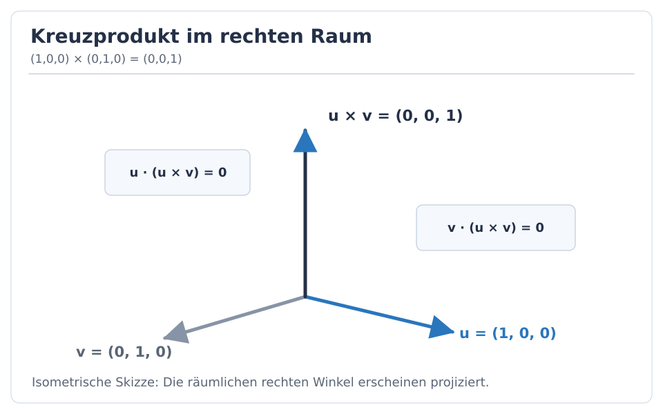

# M2-L14 – Kreuzprodukt, Determinanten und räumliche Rotation {#L14}

**Kursbereich:** M2 – Oberstufe / Abitur

**Niveau:** Oberstufe / Abitur

**Vorwissen:** Keine festen Voraussetzungen angegeben.

**Einordnung:** Oberstufe / technisches Zusatzmodul als Übergang zur Hochschule. Nicht als allgemeiner Pflichtstoff des Berliner Abiturs ausgewiesen

## Worum geht es? {#S1}

Das Skalarprodukt aus M2-L11 beantwortet die Frage, wie stark zwei Vektoren in dieselbe Richtung zeigen. Nun benötigen wir eine zweite, andersartige Vektoroperation: Sie liefert eine Richtung **senkrecht** zu zwei gegebenen Richtungen. Determinanten helfen uns, Flächen- und Volumenskalierungen sowie die Orientierung von Koordinatensystemen zu erkennen. Rotationsmatrizen wiederum beschreiben präzise, wie ein Punkt oder Vektor gedreht wird. Diese Werkzeuge werden besonders in 3D-Grafik, Kameratechnik und Robotik gebraucht.

## Grundidee und Anschauung {#S2}

Stelle dir zwei Pfeile vor, die an derselben Stelle beginnen. Wenn sie nicht parallel sind, spannen sie eine Ebene auf. Das **Kreuzprodukt** zeigt senkrecht aus dieser Ebene heraus; seine Länge entspricht dem Flächeninhalt des von den Pfeilen aufgespannten Parallelogramms. Eine **Determinante** sagt bei einer quadratischen Matrix, mit welchem orientierten Faktor Flächen oder Volumina durch die entsprechende lineare Abbildung verändert werden. Eine **Rotation** dreht die Richtung, ohne bei einer idealen Drehung die Länge zu verändern.

## Neue Zeichen vor der ersten Formel {#S3}

  Zeichen                           Name / Aussprache                        Bedeutung hier                                                       Andere Verwendungen
  --------------------------------- ---------------------------------------- -------------------------------------------------------------------- ---------------------------------------------------------------------------------
  $\vec{u}$, $\vec{v}$              „Vektor u“, „Vektor v“                   Räumliche Pfeile aus M2-L11                                          Beliebige gerichtete Größen
  $\times$                          „Kreuz“, Kreuzprodukt                    Bildet in drei Dimensionen aus zwei Vektoren einen neuen Vektor      In Alltagstexten auch Malzeichen; hier **nicht** gewöhnliche Multiplikation
  $\vec u\times\vec v$              „u Kreuz v“                              Vektor senkrecht zu u und v                                          Reihenfolge ist entscheidend
  $\det(A)$                         „Determinante von A“                     Orientierter Flächen-/Volumenfaktor einer quadratischen Matrix A     Andere Matrixeigenschaften, z. B. Spur, sind verschieden
  $\lvert A\rvert$                  „Determinante von A“ in diesem Kontext   Alternative Determinantenschreibweise                                Betrag einer Zahl oder Mächtigkeit einer Menge; daher besser $\det(A)$ verwenden
  `[a b; c d]`                      Matrix mit zwei Zeilen                   Erste Zeile a, b; zweite Zeile c, d                                  Semikolon bedeutet hier neue Zeile
  $R(\varphi)$                      „Rotationsmatrix R von Phi“              Drehung um den Winkel Phi                                            R kann sonst eine beliebige Matrix bezeichnen
  $\theta$                          „Theta“                                  Winkel zwischen zwei von null verschiedenen Vektoren                 In der Geometrie auch anderer Winkel
  $\lVert\vec{u}\rVert$             „Länge von Vektor u“                     Euklidische Vektorlänge aus M2-L11                                   Andere Normen sind möglich
  $R^{\mathrm T}$, $I$              „R transponiert“, „Einheitsmatrix I“     Vertauschte Zeilen/Spalten; Matrix, die Vektoren unverändert lässt   Allgemeine Matrixnotation
  $\varphi$                         „Phi“                                    Hier Drehwinkel                                                      Andernorts beliebiger Parameter
  $\cos(\varphi)$, $\sin(\varphi)$  „Kosinus Phi“, „Sinus Phi“               Aus M1-L16/M1-L20 bekannte Winkelfunktionen                          Immer auf Einheit des Winkelmaßes achten
  $A\cdot\vec v$                    „Matrix A mal Vektor v“                  Lineare Abbildung, hier Rotation                                     Nicht komponentenweise Multiplikation
  `−`                               „Minus“                                  Negative Komponente oder Subtraktion                                 Umkehrung der Orientierung

Die Formeln verwenden kartesische, **rechtshändig orientierte** Koordinatenachsen und dreidimensionale Vektoren, falls nichts anderes gesagt wird. Ein Winkel von 90° ist dasselbe wie ein Viertel einer vollen Umdrehung; das Bogenmaß aus M1-L20 nennt dafür $\frac\pi2$.

## Kreuzprodukt: die senkrechte Richtung {#S4}

Für zwei räumliche Vektoren mit den Komponenten $\vec u=(u_1;u_2;u_3)$ und $\vec v=(v_1;v_2;v_3)$ definieren wir:

{alt="Raumachsen mit u gleich (1,0,0), v gleich (0,1,0), Kreuzprodukt u kreuz v gleich (0,0,1) nach oben."}

Das Kreuzprodukt der x- und y-Einheitsvektoren zeigt in positive z-Richtung.

$$
\begin{aligned}
\vec u\times\vec v&=\begin{pmatrix}u_2v_3-u_3v_2\\u_3v_1-u_1v_3\\u_1v_2-u_2v_1\end{pmatrix}
\end{aligned}
$$

**Vollständig gesprochen:** „u Kreuz v ist der Vektor, dessen erste Komponente u zwei mal v drei minus u drei mal v zwei ist; dessen zweite Komponente u drei mal v eins minus u eins mal v drei ist; und dessen dritte Komponente u eins mal v zwei minus u zwei mal v eins ist.“ Die Indizes eins, zwei und drei bezeichnen hier die Komponenten in x-, y- und z-Richtung.

**Mini-Beispiel:** Es seien $\vec{u}=(1;0;0)$ und $\vec{v}=(0;1;0)$. Der erste Pfeil zeigt entlang der x-Achse, der zweite entlang der y-Achse. Einsetzen liefert:

$$
\vec{u}\times\vec{v}=(0;0;1)
$$

**Gesprochen:** „u Kreuz v ergibt den Vektor null, null, eins.“ Das Ergebnis zeigt entlang der positiven z-Achse und steht auf beiden Ausgangsvektoren senkrecht. Die Richtungswahl folgt der **Rechte-Hand-Regel**: Beim Umlauf vom ersten zum zweiten Vektor zeigt der Daumen in Richtung des Kreuzprodukts, sofern das Koordinatensystem rechtshändig ist.

### Reihenfolge und Fläche {#abschnitt-5}

Das Kreuzprodukt ist **nicht vertauschbar**: Drehen wir die Reihenfolge um, dreht sich die Ergebnisrichtung um.

$$
\vec{v}\times\vec{u}=-(\vec{u}\times\vec{v})
$$

**Gesprochen:** „v Kreuz u ist der negative Vektor von u Kreuz v.“ Bei vertauschten Vektoren folgt im Beispiel $(0;0;-1)$.

Die Länge des Kreuzprodukts verrät zugleich die Fläche des Parallelogramms:

$$
\text{Fläche}=\lVert\vec{u}\times\vec{v}\rVert
$$

**Gesprochen:** „Der Flächeninhalt ist gleich der Länge des Kreuzproduktvektors.“ Im Beispiel ist die Fläche eins. Allgemein gilt für nichtverschwindende Vektoren mit Zwischenwinkel $0^{\text{°}}\leq\theta\leq180^{\text{°}}$ außerdem $\lVert\vec u\times\vec v\rVert=\lVert\vec u\rVert\cdot\lVert\vec v\rVert\cdot\sin(\theta)$; gesprochen: „Länge u mal Länge v mal Sinus des eingeschlossenen Winkels.“ Bei 90° ist der Flächeninhalt maximal für feste Längen; bei 0° oder 180° ist er null.

**Zweites Rechenbeispiel:** $\vec{u}=(2;0;0)$ und $\vec{v}=(1;3;0)$ liefern $\vec u\times\vec v=(0;0;6)$. Das Parallelogramm hat daher Flächeninhalt $6$; das Dreieck mit denselben beiden Kanten hat Flächeninhalt $3$. Beide Werte sind nichtnegativ, auch wenn beim Vertauschen der Kanten das Kreuzprodukt sein Vorzeichen wechselt.

**Grenzen:** Das Kreuzprodukt in dieser üblichen Gestalt ist speziell für drei Dimensionen definiert. Sind die Vektoren parallel oder ist einer ein Nullvektor, ergibt das Kreuzprodukt den Nullvektor; damit lässt sich keine eindeutige senkrechte Orientierung festlegen. Für den Flächeninhalt eines Dreiecks ist die Parallelogrammfläche noch zu halbieren.

## Determinante: Orientierung und Skalierung {#S5}

Eine Matrix mit zwei Zeilen und zwei Spalten kann eine lineare Abbildung der Ebene beschreiben. Ihre **Determinante** ist eine Zahl. Für die Matrix $A=\begin{bmatrix}a&b\\c&d\end{bmatrix}$ gilt:

$$
\det(A)=a\cdot d-b\cdot c
$$

**Gesprochen:** „Die Determinante von A ist a mal d minus b mal c.“ Die Buchstaben $a$, $b$, $c$ und $d$ sind die vier Matrixeinträge. Anders als beim Kreuzprodukt ist das Ergebnis **eine Zahl**, kein Vektor.

**Mini-Beispiel einer Dehnung:**

$$
\begin{aligned}
A&=\begin{pmatrix}2&0\\0&3\end{pmatrix}\\
\det(A)&=2\cdot3-0\cdot0=6
\end{aligned}
$$

Die Abbildung streckt eine Fläche in einer Koordinatenrichtung um Faktor zwei und in der anderen um Faktor drei. Insgesamt wächst die Fläche um Faktor sechs.

Was bedeutet das Vorzeichen?

- **Positiv:** Die Orientierung bleibt bei einer nicht entarteten Abbildung erhalten.
- **Negativ:** Die Orientierung wird umgekehrt, etwa durch eine Spiegelung.
- **Null:** Die Abbildung drückt Fläche oder Volumen in eine niedrigere Dimension zusammen; sie ist nicht umkehrbar.

Der **gewöhnliche Flächenskalierungsfaktor** ist der nichtnegative Betrag $\lvert\det(A)\rvert$; die Determinante selbst ist *orientiert* und darf negativ sein.

**Kontrollfälle:** Die Spiegelung $S=\begin{bmatrix}-1&0\\0&1\end{bmatrix}$ hat $\det(S)=-1$: Flächen bleiben gleich groß, die Orientierung kehrt sich um. Die Matrix $D=\begin{bmatrix}1&2\\2&4\end{bmatrix}$ hat $\det(D)=1\cdot4-2\cdot2=0$: Sie bildet die Ebene nicht umkehrbar auf eine Gerade ab. Positive Determinanten allein beweisen wiederum keine Drehung.

### Räumliche Erweiterung: Volumen {#abschnitt-7}

In drei Dimensionen kann man drei Vektoren $\vec{u}$, $\vec{v}$ und $\vec{w}$ als Kanten eines Parallelepipeds auffassen. Dafür gilt:

$$
\begin{aligned}
\text{orientiertes Volumen}&=\vec u\cdot(\vec v\times\vec w)\\
\text{Volumen}&=\left|\vec u\cdot(\vec v\times\vec w)\right|
\end{aligned}
$$

**Gesprochen:** „Das orientierte Volumen ist das Skalarprodukt von u mit dem Kreuzprodukt aus v und w. Der gewöhnliche, nichtnegative Rauminhalt ist der Betrag davon.“ Der erste Wert entspricht der Determinante der Matrix, deren Spalten diese drei Vektoren sind. Werden die Vektoren linear abhängig, verschwindet das Volumen. Das Vorzeichen hängt von der Reihenfolge ab: Mit $\vec{u}=(2;0;0)$, $\vec{v}=(1;3;0)$ und $\vec{w}=(0;0;-2)$ beträgt das Spatprodukt $\vec u\cdot(\vec v\times\vec w)=-12$; das tatsächliche Volumen ist $12$. Beim Vertauschen zweier Kanten wechselt nur das Vorzeichen des orientierten Volumens.

## Rotation als Matrixmultiplikation {#S6}

Drehen wir Punkte um den Ursprung einer zweidimensionalen Ebene gegen den Uhrzeigersinn um den Winkel $\varphi$, dann genügt eine Rotationsmatrix:

$$
R(\varphi)=\begin{pmatrix}\cos(\varphi)&-\sin(\varphi)\\\sin(\varphi)&\cos(\varphi)\end{pmatrix}
$$

**Vollständig gesprochen:** „R von Phi ist die Matrix mit erster Zeile Kosinus von Phi und minus Sinus von Phi sowie zweiter Zeile Sinus von Phi und Kosinus von Phi.“ Eine Matrix ordnet die beiden Koordinaten einer Eingabe zu zwei neuen Koordinaten.

Ein Punkt bzw. Ortsvektor $\vec{v}$ wird durch die Multiplikation $R(\varphi)\cdot\vec v$ gedreht. **Mini-Beispiel:** Aus dem Vektor $(1;0)$ wird bei 90 Grad gegen den Uhrzeigersinn $(0;1)$, da $\cos(90^{\text{°}})=0$ und $\sin(90^{\text{°}})=1$.

$$
\begin{aligned}
R(90^{\text{°}})&=\begin{pmatrix}0&-1\\1&0\end{pmatrix}\\
R(90^{\text{°}})\begin{pmatrix}1\\0\end{pmatrix}&=\begin{pmatrix}0\\1\end{pmatrix}
\end{aligned}
$$

**Gesprochen:** „Die Rotationsmatrix für neunzig Grad macht aus dem Einheitsvektor in x-Richtung den Einheitsvektor in y-Richtung.“ Die Rechnung ist keine Verschiebung: Der Ursprung bleibt an seinem Platz.

Eine echte Rotation hat die Determinante eins und erhält Längen, Winkel und Flächen. **Die Determinante eins allein reicht aber nicht aus, um eine Matrix als Rotation zu erkennen:** Auch eine Scherung kann Determinante eins besitzen, obwohl sie Winkel und Längen verändert. Eine Rotationsmatrix muss zusätzlich orthogonal sein, also ihre Spaltenlängen und deren rechte Winkel erhalten. In Matrixsprache heißt das $R^{\mathrm T}\cdot R=I$ (gesprochen: „R transponiert mal R ist die Einheitsmatrix“). Zusammen mit $\det(R)=1$ kennzeichnet dies eine eigentliche Rotation. **Gegenbeispiel:** Die Schermatrix $H=\begin{bmatrix}1&1\\0&1\end{bmatrix}$ hat $\det(H)=1$, bildet aber $(0;1)$ auf $(1;1)$ ab: Die Länge steigt von $1$ auf $\sqrt{2}$. Eine Determinante von eins genügt also nicht. Die Drehmatrix gilt für eine **aktive Drehung der Vektoren** bei festgehaltenem Koordinatensystem. Wechselt stattdessen das Koordinatensystem, benötigt man häufig die umgekehrte Drehung. In Bildschirmkoordinaten zeigt die y-Achse zudem oft nach unten; dann wirkt eine positive Drehung visuell möglicherweise anders als im üblichen mathematischen Koordinatensystem.

## Brücke zu 3D-Grafik und Robotik {#S7}

Eine Kamera muss wissen, welche Richtung „rechts“, „oben“ und „vorwärts“ bedeutet. Aus zwei geeigneten, nicht parallelen Richtungen kann das Kreuzprodukt eine dritte, zu beiden senkrechte Richtung liefern. Die beiden ursprünglichen Richtungen sind damit aber noch nicht automatisch zueinander senkrecht; für ein **orthonormales** Kamera-Achsensystem muss man auch sie passend orthogonalisieren und alle Achsen normieren. Rotationsmatrizen beschreiben die Orientierung eines Robotergelenks oder einer Kamera. Determinanten helfen zu prüfen, ob eine Transformation Orientierung bewahrt, spiegelt oder degeneriert.

**Wichtige Unterscheidung:** Eine Rotation und eine Translation (Verschiebung) sind nicht dasselbe. Für reine Drehungen um den Ursprung reichen die hier dargestellten Matrizen. Für kombinierte Drehungen und Verschiebungen verwenden 3D-Systeme später oft **homogene Koordinaten** und größere Transformationsmatrizen. Diese Technik gehört zur späteren universitären Robotik-Vertiefung, nicht zum notwendigen Verständnis dieser Lektion.

## Wofür nützlich? {#S8}

In einem Raytracer oder einer 3D-Engine lässt sich aus zwei Kanten eines Dreiecks eine Flächennormale bestimmen. In einem CAD-Werkzeug erkennt die Determinante einer Transformation eine Spiegelung oder einen Flächenverlust. Für Robotik sind Rotationen grundlegend, um Sensordaten, Greiferpositionen und Kamerarichtungen zwischen Koordinatensystemen zu vergleichen. Bei numerischer Software muss man dabei nahezu parallele Vektoren und Rundungsfehler besonders beachten.

## Annahmen und Grenzen {#S9}

Alle Beispiele beziehen sich auf euklidische Koordinaten mit konsistenten Einheiten. Das Kreuzprodukt ist keine universelle Multiplikation beliebiger Vektoren; sein Ergebnis hängt von der Orientierung des verwendeten Raums ab. Die Determinante setzt eine **quadratische Matrix** voraus, und ein kleiner Betrag der Determinante allein beweist **keine** schlechte Kondition: Schon eine gleichmäßige Skalierung kann ihn klein machen. Bei vergleichbar skalierten Matrixspalten kann er jedoch eine Warnung vor fast linearer Abhängigkeit sein. Rotationsmatrizen werden in der Praxis häufig aus verrauschten Messdaten geschätzt; solche Matrizen können leicht von einer idealen Rotation abweichen.

## Verbindung zur nächsten Lektion {#S10}

M2-L15 wechselt von geometrischen Modellen zu **Zufallsmodellen**. Dort geht es nicht mehr um die Richtung eines Vektors, sondern um die Frage, wie wahrscheinlich verschiedene Ergebnisse unter bestimmten Voraussetzungen sind.

## Quellen {#S11}

In dieser Lektion sind keine Einzelquellen gesondert verzeichnet.
