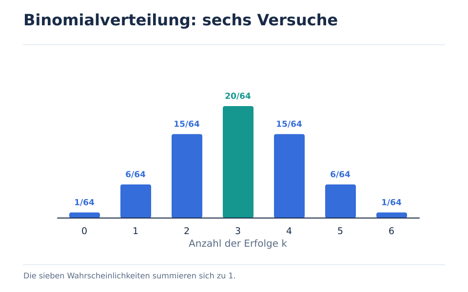

# M2-L15 – Zufall, bedingte Wahrscheinlichkeit und Binomialverteilung {#L15}

**Kursbereich:** M2 – Oberstufe / Abitur

**Niveau:** Oberstufe / Abitur

**Vorwissen:** Keine festen Voraussetzungen angegeben.

**Einordnung:** Gymnasiale Oberstufe · Stochastik

## Worum geht es? {#S1}

Bei einem Würfel, einem Qualitätstest oder der Reaktion eines KI-Klassifikators ist häufig nicht sicher, welches Ergebnis als Nächstes auftritt. Wir können aber beschreiben, welche Ergebnisse möglich sind und wie wahrscheinlich sie unter einem bestimmten Modell sind. Besonders entscheidend ist, ob Ereignisse einander beeinflussen. Die Binomialverteilung hilft schließlich dabei, die Anzahl der Erfolge in einer festgelegten Folge gleichartiger Versuche zu beschreiben. Wir verbinden dafür die Grundlagen aus M1-L12 und M1-L22 zu einer gemeinsamen Formelsprache.

## Grundidee und Anschauung {#S2}

Eine Wahrscheinlichkeit ist keine Vorhersage, die in jedem einzelnen Versuch eintreten muss. Sie beschreibt das Verhalten eines **Zufallsmodells**. Ein Baumdiagramm macht mehrere nacheinander stattfindende Ereignisse sichtbar; bei jeder Verzweigung berücksichtigt man den bisherigen Weg. Für die Binomialverteilung betrachten wir viele Wiederholungen einer einfachen Ja-Nein-Entscheidung: „Erfolg“ oder „kein Erfolg“. Die Verteilung sagt uns, wie plausibel null, ein, zwei oder mehr Erfolge sind.

## Neue Zeichen vor der ersten Formel {#S3}

  Zeichen                 Name / Aussprache                                  Bedeutung hier                                                     Anderer Gebrauch
  ----------------------- -------------------------------------------------- ------------------------------------------------------------------ ------------------------------------------------------------
  $\Omega$                „Omega“, Ergebnismenge                             Alle möglichen elementaren Versuchsergebnisse                      Auch andere Fachzeichen, z. B. Ohm
  $A$, $B$                „Ereignis A“, „Ereignis B“                         Mengen von Ergebnissen                                             Geometrische Punkte, Matrizen
  $P(A)$                  „Wahrscheinlichkeit von A“                         Zahl von null bis eins                                             $P$ kann sonst ein Punkt heißen
  $A\cap B$               „A geschnitten B“                                  Beide Ereignisse treten ein                                        Schnittmenge beliebiger Mengen
  $A\cup B$               „A vereinigt B“                                    Mindestens eines der Ereignisse tritt ein                          Vereinigung beliebiger Mengen
  $A^{\mathrm c}$         „Komplement von A“                                 A tritt nicht ein                                                  Hochgestelltes c ist hier **kein Exponent**
  $P(B\mid A)$            „Wahrscheinlichkeit von B unter der Bedingung A“   Wahrscheinlichkeit nach Kenntnis von A                             Senkrechter Strich in anderem Kontext: Betrag, Teilbarkeit
  $n$                     „en“                                               Anzahl der Wiederholungen                                          Allgemeine Zahl, Index
  $k$                     „ka“                                               Anzahl beobachteter Erfolge                                        Anderswo Proportionalitätsfaktor
  $p$                     „pe“                                               Erfolgswahrscheinlichkeit eines Versuchs                           Auch Modellparameter
  $1-p$                   „eins minus pe“                                    Wahrscheinlichkeit für Misserfolg                                  Allgemeines Gegenereignis
  $n!$                    „en Fakultät“                                      Produkt aller positiven ganzen Zahlen bis n; $0!=1$                `!` bedeutet in Programmen häufig logisches Nicht
  $C(n,k)$ / `n über k`   „n über k“, Binomialkoeffizient                    Anzahl der Möglichkeiten, k Erfolge unter n Plätzen zu verteilen   Schreibweise mit zwei übereinanderstehenden Zahlen
  $X$                     „Zufallsvariable iks“                              Zahl der Erfolge in n Versuchen                                    Anderswo Ortskoordinate oder beliebige Variable
  $P(X=k)$                „Wahrscheinlichkeit, dass X gleich k ist“          Genau k Erfolge                                                    Allgemeine Wahrscheinlichkeit einer Zufallsvariablen

Der senkrechte Strich `∣` in $P(B\mid A)$ **bedeutet hier „gegeben A“**, nicht Division. Die Notation $A^{\mathrm c}$ setzt voraus, dass die Ergebnismenge des Experiments klar festgelegt ist.

## Ereignisse und Grundregeln {#S4}

Ein **Ereignis** ist eine Zusammenfassung möglicher Ergebnisse. Beim einmaligen Würfeln mit einem fairen Würfel könnte $A$ das Ereignis „gerade Zahl“ sein. Dann gehören 2, 4 und 6 dazu und die Wahrscheinlichkeit beträgt die Hälfte.

Wichtig sind zwei Arten von Beziehungen:

- $A\cap B$: **Sowohl A als auch B** treten ein.
- $A\cup B$: **A oder B oder beide** treten ein; das „oder“ ist einschließend.

Die Gegenwahrscheinlichkeit ist:

$$
P(A^{\mathrm{c}})=1-P(A)
$$

**Gesprochen:** „Die Wahrscheinlichkeit, dass A nicht eintritt, ist eins minus die Wahrscheinlichkeit von A.“ Ist ein Test mit einer Wahrscheinlichkeit von 0,9 positiv, dann hat das Gegenereignis in demselben Modell die Wahrscheinlichkeit 0,1. Das heißt nicht automatisch, dass der Test zu 90 Prozent **richtig** ist: Was als „positiv“ und „richtig“ gilt, muss getrennt definiert werden.

## Bedingte Wahrscheinlichkeit: Was wissen wir bereits? {#S5}

Manchmal besitzen wir vor der nächsten Frage bereits zusätzliche Information. Unter allen möglichen Fällen betrachten wir dann nur noch diejenigen, in denen die bekannte Bedingung erfüllt ist.

$$
P(B\mid A)=\frac{P(A\cap B)}{P(A)}
$$

**Vollständig gesprochen:** „Die Wahrscheinlichkeit von B unter der Bedingung A ist die Wahrscheinlichkeit des gemeinsamen Eintretens von A und B, geteilt durch die Wahrscheinlichkeit von A.“ **Voraussetzung:** $P(A)>0$, also muss die Bedingung im Modell eine positive Wahrscheinlichkeit haben.

Umgestellt entsteht die **Pfadregel** für einen Wahrscheinlichkeitsbaum:

$$
P(A\cap B)=P(A)\cdot P(B\mid A)
$$

**Gesprochen:** „Die Wahrscheinlichkeit von A und B gemeinsam ist die Wahrscheinlichkeit von A mal die bedingte Wahrscheinlichkeit von B, nachdem A eingetreten ist.“ Die beiden Zahlen auf einem Baumzweig werden multipliziert; alternative, disjunkte Wege zum selben Ziel werden addiert.

**Mini-Beispiel ohne Zurücklegen:** In einer Schachtel liegen drei rote und zwei blaue Chips. Wir ziehen nacheinander zwei Chips, ohne den ersten zurückzulegen. Die Wahrscheinlichkeit für „zweimal rot“ ist:

$$
\begin{aligned}
P(\text{zuerst rot})&=\frac35\\
P(\text{danach rot}\mid\text{rot})&=\frac24\\
P(\text{zweimal rot})&=\frac35\cdot\frac24=\frac3{10}
\end{aligned}
$$

**Gesprochen:** „Die Wahrscheinlichkeit, zweimal rot zu ziehen, ist drei Fünftel mal zwei Viertel, also drei Zehntel.“ Der zweite Anteil ändert sich, weil nach dem ersten roten Chip nur zwei rote unter vier Chips bleiben.

Mit Zurücklegen wäre der zweite Anteil wieder drei Fünftel; dann ergäbe sich $9/25$. Damit ist sichtbar, warum die **Annahmen** zum Versuch entscheidend sind.

## Unabhängigkeit ist eine eigene Annahme {#S6}

Zwei Ereignisse sind unabhängig, wenn die Information über das eine die Wahrscheinlichkeit des anderen nicht verändert. Für $P(A)>0$ lässt sich das beispielsweise so ausdrücken:

$$
P(B\mid A)=P(B)
$$

**Gesprochen:** „Die Wahrscheinlichkeit von B bei gegebenem A ist dieselbe wie die Wahrscheinlichkeit von B ohne zusätzliche Bedingung.“ In diesem Fall vereinfacht sich die gemeinsame Wahrscheinlichkeit zu $P(A\cap B)=P(A)\cdot P(B)$. Diese **Produktgleichung** ist das allgemeine Unabhängigkeitskriterium, auch wenn $P(A)=0$ gilt und man die bedingte Wahrscheinlichkeit $P(B\mid A)$ deshalb nicht bilden darf.

**Kontrollbeispiel für den Unterschied zur Unvereinbarkeit:** Beim fairen Würfel seien $A=\{1\}$ und $B=\{2\}$. Beide besitzen Wahrscheinlichkeit $1/6$, aber sie können nie gleichzeitig eintreten: $P(A\cap B)=0$, während $P(A)\cdot P(B)=\frac1{36}$ ist. Die Ereignisse sind also unvereinbar **und abhängig**.

**Nicht verwechseln:** Unabhängige Ereignisse sind nicht dasselbe wie **unvereinbare** Ereignisse. Zwei Ereignisse, die nicht gemeinsam auftreten können, sind bei positiven Einzelwahrscheinlichkeiten gerade nicht unabhängig.

## Kombinatorik: In welcher Reihenfolge passieren Erfolge? {#S7}

Wollen wir unter $n$ Versuchen genau $k$ Erfolge zählen, müssen wir berücksichtigen, **an welchen Positionen** die Erfolge stehen. Diese Anzahl ist der Binomialkoeffizient:

$$
C(n,k)=\frac{n!}{k!\cdot(n-k)!}
$$

**Vollständig gesprochen:** „n über k ist n Fakultät geteilt durch das Produkt aus k Fakultät und n minus k Fakultät.“ Voraussetzungen sind ganze Zahlen $n\geq 0$ und $0\leq k\leq n$.

**Mini-Beispiel:** Bei drei Versuchen kann genau ein Erfolg an erster, zweiter oder dritter Stelle stehen. Es gibt $C(3,1)=3$ Anordnungen. Die Reihenfolge ist also wichtig für die Zählung, auch wenn bei identischen unabhängigen Einzelversuchen jede dieser drei Anordnungen die gleiche Wahrscheinlichkeit besitzt.

## Binomialverteilung: genau k Erfolge {#S8}

Eine Folge von Versuchen folgt einem **Binomialmodell**, wenn vier Bedingungen gelten: Es gibt eine feste Anzahl $n$ von Versuchen; jeder Versuch hat genau zwei mögliche Kategorien; die Versuche sind unabhängig; und die Erfolgswahrscheinlichkeit $p$ bleibt unverändert.

Für die Anzahl $X$ der Erfolge gilt dann:

$$
P(X=k)=C(n,k)\cdot p^k\cdot{(1-p)}^{n-k}
$$

**Vollständig gesprochen:** „Die Wahrscheinlichkeit für genau k Erfolge ist n über k mal p hoch k mal eins minus p hoch n minus k.“ Der Binomialkoeffizient zählt die verschiedenen Anordnungen. $p^k$ berücksichtigt die k Erfolge und ${(1-p)}^{n-k}$ die übrigen Misserfolge. Zulässig sind ganzzahlige $n\geq 0$, ganzzahlige $k$ von null bis n und $0\leq p\leq 1$. Außerhalb dieser Trefferzahlen ist $P(X=k)=0$; die Randfälle $p=0$ oder $p=1$ sind entartete Verteilungen mit sicher null beziehungsweise sicher n Erfolgen.

**Durchgerechnetes Mini-Beispiel:** Ein unabhängig wiederholter Prüfvorgang zeigt in jedem Durchlauf mit Wahrscheinlichkeit $p=0{,}2$ einen Treffer. Bei $n=3$ Durchläufen fragen wir nach **genau einem Treffer**.

$$
\begin{aligned}
\binom31&=3\\
P(X=1)&=3\cdot0{,}2\cdot{(1-0{,}2)}^2\\
&=3\cdot0{,}2\cdot0{,}64\\
&=0{,}384=38{,}4\,\%
\end{aligned}
$$

**Gesprochen:** „Die Wahrscheinlichkeit für genau einen Treffer in drei unabhängigen Versuchen beträgt achtunddreißig Komma vier Prozent.“ Das ist nicht die Wahrscheinlichkeit für **mindestens einen** Treffer: Dafür müssten auch zwei und drei Treffer berücksichtigt werden.

Eine kompakte Möglichkeit für „mindestens ein Treffer“ benutzt das Gegenereignis „kein Treffer“:

$$
P(X\geq1)=1-{(1-p)}^n
$$

**Gesprochen:** „Mindestens ein Treffer ist eins minus die Wahrscheinlichkeit, dass alle n Versuche fehlschlagen.“ Hier ist das $\geq$-Zeichen „größer oder gleich“ und schließt einen, zwei und drei Treffer ein. **Für die obigen Zahlen** $p=0{,}2$, $n=3$ ergibt sich $P(X\geq1)=1-{(0{,}8)}^3=1-0{,}512=0{,}488$, also **48,8 %**. Zur Kontrolle: Die Fälle mit genau einem, zwei und drei Treffern haben die Wahrscheinlichkeiten $0{,}384$, $0{,}096$ und $0{,}008$; ihre Summe ist ebenfalls $0{,}488$. Die Verwechslung von **genau** einem und **mindestens** einem Treffer würde hier 10,4 Prozentpunkte ausmachen.

## Wo die Modelle im Alltag scheitern können {#S9}

Ein Computer kann beliebig viele Würfelwürfe simulieren, aber nur **unter den von uns programmierten Annahmen**. Ein Klassifikator kann beispielsweise bei ähnlichen Bildern korrelierte Fehler machen: Dann sind seine Testergebnisse nicht unabhängig. Der Trefferanteil kann sich zudem bei veränderten Bildtypen, Beleuchtung oder Datenverteilungen verschieben. Solche Abweichungen verletzen das einfache Binomialmodell.

Auch eine hohe bedingte Trefferwahrscheinlichkeit darf nicht mit der **Wahrscheinlichkeit der tatsächlichen Ursache nach einem positiven Befund** verwechselt werden. Dafür benötigt man Informationen über Grundhäufigkeiten und Fehlalarmraten (siehe M1-L22; später Bayes-Formel).

## Wofür nützlich? {#S10}

Mit Baumdiagrammen lassen sich Fehlerketten in Software und technischen Anlagen strukturieren. Die Binomialverteilung erlaubt eine grobe Planung, wie viele erfolgreiche Ergebnisse bei wiederholten unabhängigen Prüfungen zu erwarten sind. In der Qualitätssicherung kann man Wahrscheinlichkeiten für seltene Fehlerereignisse berechnen. Bei KI-Systemen muss man besonders prüfen, ob Datenpunkte wirklich unabhängig und die Erfolgswahrscheinlichkeiten stabil sind.

## Annahmen und Grenzen {#S11}

Alle berechneten Wahrscheinlichkeiten beziehen sich auf die im Text ausdrücklich angegebenen Zufallsmodelle. Unbekannte Verteilungen, veränderte Trefferquoten oder abhängige Beobachtungen können die Ergebnisse verändern. Der Binomialkoeffizient zählt mögliche Anordnungen, sagt allein aber noch nichts über ihre Wahrscheinlichkeit aus. Bei echten Daten sind insbesondere Grundgesamtheit, Erfassungsmethode und Auswahlverzerrungen zu prüfen.

## Verbindung zur nächsten Lektion {#S12}

M2-L16 betrachtet nicht nur die Wahrscheinlichkeit einzelner Trefferzahlen, sondern fasst ganze Verteilungen mit **Erwartungswert, Varianz und Standardabweichung** zusammen. Danach lernen wir Normalverteilungen und die Logik statistischer Hypothesentests kennen.

## Quellen {#S13}

In dieser Lektion sind keine Einzelquellen gesondert verzeichnet.
