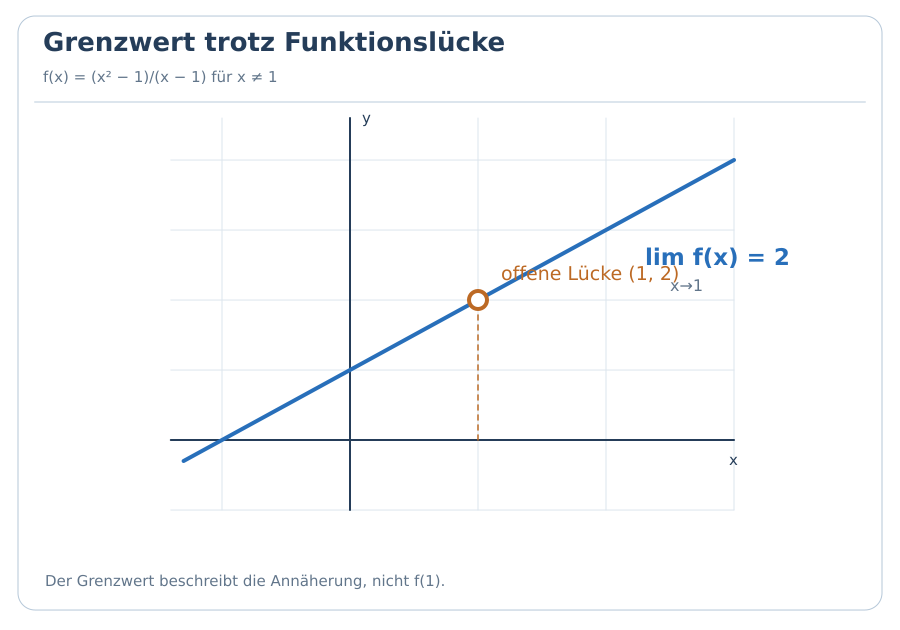

# M2-L2 – Grenzwerte, Limes und Stetigkeit {#L2}

**Kursbereich:** M2 – Oberstufe / Abitur

**Niveau:** Oberstufe / Abitur

**Vorwissen:** Keine festen Voraussetzungen angegeben.

**Einordnung:** Gymnasiale Oberstufe · Analysis

## Worum geht es? {#S1}

In der Analysis wollen wir häufig wissen, wie sich ein Funktionswert verhält, **wenn wir uns einer bestimmten Eingabe immer weiter nähern**. Wir müssen diese Eingabe dafür nicht unbedingt einsetzen können. Ein Grenzwert beschreibt den Wert, dem sich die Ausgaben annähern – nicht zwingend einen Wert, den die Funktion an der betrachteten Stelle tatsächlich annimmt. Die Stetigkeit beantwortet eine andere, damit verbundene Frage: Passt der tatsächliche Funktionswert zu dem, was man unmittelbar daneben beobachtet?

## Grundidee und Anschauung {#S2}

Stell dir vor, du zoomst in einem Graphen immer weiter an eine bestimmte Stelle heran. Werden die Funktionswerte dabei von links und rechts immer näher an dieselbe Höhe herangeführt, besitzt die Funktion dort einen **endlichen zweiseitigen Grenzwert**. Die Kurve kann trotzdem an genau dieser Stelle eine Lücke besitzen. Eine Funktion heißt dort stetig, wenn der Funktionswert existiert und mit dem Annäherungswert übereinstimmt. Die hier behandelten **zweiseitigen** Grenzwerte setzen voraus, dass man sich dem Zielwert aus beiden Richtungen mit zulässigen Eingaben nähern kann; an Randpunkten betrachtet man die erreichbare Seite.

{alt="Gerade y gleich x plus 1 mit offenem Kreis bei (1,2), die Funktion hat dort eine Lücke, der Grenzwert ist 2."}

Ein Grenzwert kann existieren, obwohl die Funktion an dieser Stelle nicht definiert ist.

Eine Annäherung funktioniert auch für große Eingaben: Man kann fragen, ob eine Größe sich langfristig einer festen Grenze nähert, unbegrenzt wächst oder schwankt. Das Zeichen für „unendlich“ bezeichnet dabei **keine gewöhnliche reelle Zahl**, die man wie drei oder fünf einsetzen dürfte.

## Neue Zeichen vor der ersten Formel {#S3}

  Zeichen                         Aussprache                                         Bedeutung hier                                                                Anderer möglicher Gebrauch
  ------------------------------- -------------------------------------------------- ----------------------------------------------------------------------------- --------------------------------------------------------------------
  $\lim$                          „Limes“, „Grenzwert“                               Grenzwert einer Funktion                                                      Auch bei Folgen und Reihen
  $x\to a$                        „iks geht gegen a“                                 Eingabewerte nähern sich dem Wert a, ohne ihn zwingend zu erreichen           Pfeil in M1-L18 auch für eine Abbildung
  $x\to a^-$                      „iks geht von links gegen a“                       Annäherung durch kleinere Eingabewerte                                        Das hochgestellte Minus ist hier *kein* negatives Vorzeichen von a
  $x\to a^+$                      „iks geht von rechts gegen a“                      Annäherung durch größere Eingabewerte                                         Das Plus ist hier eine Richtungsmarkierung
  $\infty$, $+\infty$, $-\infty$  „unendlich“, „plus unendlich“, „minus unendlich“   Unbeschränktes Anwachsen oder Fallen beziehungsweise immer größere Eingaben   Keine gewöhnlichen reellen Zahlenwerte
  $f(x)$                          „eff von iks“                                      Funktionswert an der Eingabe x                                                Bekannt aus M1-L4/M2-L1
  $a$ / $L$                       „a“ / „ell“                                        a: Ziel der Eingaben; L: möglicher Annäherungswert                            Buchstaben sind keine festgelegten mathematischen Konstanten
  `≠`                             „ist ungleich“                                     Werte sind nicht gleich                                                       Allgemeiner Vergleich
  `≈`                             „ist ungefähr gleich“                              Numerische Näherung                                                           Nicht als exakte Gleichung lesen

## Grenzwerte in Alltagssprache lesen {#S4}

Ein klassisches Beispiel ist eine einfache Gerade:

$$
\begin{aligned}
f(x)&=2x+1\\
\lim_{x\to3}f(x)&=7
\end{aligned}
$$

**Laut gelesen, erste Zeile:** „Eff von iks ist gleich zwei mal iks plus eins.“ $f$ ist der Funktionsname, $x$ die Eingabe; $2x$ bedeutet zwei mal x; $+1$ ist ein fester Zuschlag.

**Laut gelesen, zweite Zeile:** „Der Limes von eff von iks für iks gegen drei ist gleich sieben.“ $\lim$ fragt nach dem Annäherungswert; $x\to3$ beschreibt die Annäherung der Eingabe an drei; $f(x)$ ist der beobachtete Funktionswert; $7$ ist der Grenzwert. Hier darf man direkt einsetzen, weil die Gerade bei drei stetig ist: zweimal drei plus eins ergibt sieben.

Bei komplizierteren Funktionen lässt sich die Grenzwertfrage nicht immer durch Einsetzen beantworten. Genau das macht das Konzept nützlich.

## Ein Grenzwert trotz Lücke: Vollständig erklärtes Beispiel {#S5}

Betrachten wir eine Funktion, die bei x gleich eins **nicht definiert** ist:

$$
\begin{aligned}
f(x)&=\frac{x^2-1}{x-1}\quad\text{(nur für }x\ne1\text{)}
\end{aligned}
$$

**Laut gelesen:** „Eff von iks ist gleich iks zum Quadrat minus eins, geteilt durch iks minus eins. Iks darf nicht eins sein.“ Der waagerechte Strich ist der Bruchstrich, $x^2$ heißt x mal x und `≠` heißt ungleich. Bei $x=1$ würden Zähler und Nenner null; **die ursprüngliche Division ist dort undefiniert**. Die Schreibweise $\frac00$ ist in der Grenzwertrechnung eine *unbestimmte Form*, die nicht selbst einen Zahlenwert liefert.

Der Zähler lässt sich mit der aus M1-L13 bekannten **Differenz zweier Quadrate** zerlegen. Für alle zulässigen Eingaben vereinfacht sich der Ausdruck zu:

$$
\frac{x^2-1}{x-1}=\frac{(x-1)(x+1)}{x-1}=x+1\qquad(x\neq1)
$$

**Laut gelesen:** „Iks Quadrat minus eins durch iks minus eins ist, sofern iks nicht eins ist, gleich iks plus eins.“ Das Kürzen setzt ausdrücklich einen **von null verschiedenen** Faktor $x-1$ voraus. Wir haben die Funktion **nicht** an der verbotenen Stelle definiert, sondern nur für alle anderen Eingaben umgeschrieben.

  Eingabe $x$  Ausgabe $f(x)$
  ------------ ---------------
  $0{,}9$      $1{,}9$
  $0{,}99$     $1{,}99$
  $1{,}01$     $2{,}01$
  $1{,}1$      $2{,}1$

Von beiden Seiten nähern sich die Werte der Zahl zwei. In der Grenzwertschreibweise:

$$
\lim_{x\to1}\frac{x^2-1}{x-1}=2
$$

**Laut gelesen:** „Der Limes von iks Quadrat minus eins durch iks minus eins für iks gegen eins ist gleich zwei.“ Die Zwei ist der Wert, **dem sich die Funktionswerte annähern**; sie ist nicht automatisch der Funktionswert $f(1)$. In diesem Beispiel existiert $f(1)$ nicht. Ergänzt man ausdrücklich $f(1)=2$, wird die bisherige Lücke geschlossen. Würde man hingegen $f(1)=5$ festlegen, **bliebe der Grenzwert 2**, aber die neue Funktion wäre bei eins nicht stetig. Der Grenzwert hängt nicht vom einzelnen Funktionswert an der Zielstelle ab.

## Von links und von rechts: Einseitige Grenzwerte {#S6}

Eine Funktion kann sich von zwei Seiten unterschiedlich verhalten. Das erkennt man an einem Sprung. Wir betrachten folgendes stückweise definiertes Modell:

$$
f(x)=\begin{cases}0&\text{für }x<0\\1&\text{für }x\geq0\end{cases}
$$

**Laut gelesen:** „Eff von iks ist null für negative Eingaben und eins für Eingaben größer oder gleich null.“ Das Kleinerzeichen `<` sowie `≥` (größer oder gleich) beschränken die jeweiligen Eingabefälle.

Für die Annäherung **von links** entsteht der Grenzwert null, für die Annäherung **von rechts** der Grenzwert eins:

$$
\begin{aligned}
\lim_{x\to0^-}f(x)&=0\\
\lim_{x\to0^+}f(x)&=1
\end{aligned}
$$

**Laut gelesen:** „Limes von eff von iks für iks gegen null von links ist null; von rechts ist er eins.“ Weil beide Annäherungswerte **nicht übereinstimmen**, existiert an dieser Stelle **kein endlicher zweiseitiger Grenzwert**. Das ist eine **Sprungstelle**.

## Was bedeutet Stetigkeit? {#S7}

Eine Funktion ist an einer Stelle stetig, wenn dort ein Funktionswert existiert, wenn sich der Graph von links und rechts diesem selben Wert annähert und wenn Grenzwert und Funktionswert übereinstimmen.

$$
\lim_{x\to a}f(x)=f(a)
$$

**Laut gelesen:** „Der Limes von eff von iks für iks gegen a ist gleich eff von a.“ Links steht der Annäherungswert, rechts der **tatsächliche** Funktionswert an der Eingabe $a$. Diese Gleichung ist die Kurzform der Stetigkeitsbedingung, vorausgesetzt, $f(a)$ und der endliche zweiseitige Grenzwert sind definiert. Bei einem **inneren Punkt** des Definitionsbereichs sind die beiden Annäherungsseiten relevant. Am **Randpunkt** eines Intervalls prüft man die Stetigkeit relativ zum Definitionsbereich, also von der dort erreichbaren Seite. Beispiel: $f(x)=\sqrt{x}$ auf $x\ge0$ ist bei null rechtsseitig stetig, obwohl dort keine Annäherung von links innerhalb ihres reellen Definitionsbereichs möglich ist. An isolierten Punkten ist die übliche Grenzwertdefinition nicht wie bei Intervallpunkten anwendbar.

Man unterscheidet anschaulich eine **hebbare Lücke** (wie im Beispiel der gekürzten Bruchfunktion), einen **Sprung** (zwei unterschiedliche einseitige Grenzwerte) und ein **unbeschränktes Verhalten** nahe einer Stelle (etwa bei $\frac1x$ nahe null: von rechts wächst der Ausdruck gegen $+\infty$, von links gegen $-\infty$; daher existiert kein gemeinsamer endlicher Grenzwert). Eine Funktion, die sich zwar ohne Sprung fortsetzt, kann trotzdem einen **Knick** besitzen; Stetigkeit allein garantiert noch keine Ableitbarkeit.

## Was geschieht bei großen Eingaben? {#S8}

Betrachten wir $g(x)=\frac1x$ nur für positive Eingaben. Je größer $x$ wird, desto kleiner und positiver wird $g(x)$.

$$
\begin{aligned}
g(x)&=\frac1x\qquad(x>0)\\
\lim_{x\to\infty}g(x)&=0
\end{aligned}
$$

**Laut gelesen:** „Ge von iks ist eins geteilt durch iks, für positive Eingaben. Der Limes von ge von iks für iks gegen unendlich ist null.“ Der waagerechte Grenzwert null wird durch die Funktionswerte für endliche positive $x$ nicht erreicht. $x\to\infty$ beschreibt unbegrenzt wachsende Eingaben und ist **keine Substitution von x durch eine Zahl namens unendlich**.

## Wofür nützlich? {#S9}

Grenzwerte bereiten den Begriff der **momentanen Änderungsgeschwindigkeit** vor: In M2-L3 betrachten wir immer kleinere Zeitintervalle, um eine lokale Steigung zu bestimmen. In der **Softwareentwicklung** werden Grenzwerte bei Algorithmen, iterativen Näherungsverfahren und Stabilitätsanalysen verwendet. Stetigkeit hilft beim Verständnis von Sensor- und Regelungssignalen, wobei reale Messdaten diskret und verrauscht sind. Bei KI-Optimierung unterscheidet man außerdem zwischen gutartig glatten Zielgrößen und Modellen mit Sprüngen oder nicht definierten Bereichen.

## Annahmen, Grenzen und häufige Irrtümer {#S10}

- Ein Grenzwert ist **nicht dasselbe** wie das Einsetzen der Zielzahl. Der Funktionswert darf dort fehlen.
- Die Form $\frac00$ ist **kein Ergebnis**. Sie zeigt zunächst nur, dass direktes Einsetzen für den Grenzwert nicht genügt; die untersuchte Funktion muss in einer punktierten Umgebung der Zielstelle definiert sein.
- Von rechts und links verschiedene Werte ergeben keinen gemeinsamen endlichen Grenzwert. Auch starkes Oszillieren kann einen Grenzwert verhindern, obwohl die Funktionswerte beschränkt bleiben.
- „Geht gegen unendlich“ ist nicht dasselbe wie „hat einen besonders großen endlichen Wert“.
- Grenzwerte an einer Stelle sind lokale Aussagen. Sie bestätigen nicht automatisch, dass ein reales Modell außerhalb seines Gültigkeitsbereichs funktioniert.

## Verbindung zur nächsten Einheit {#S11}

In **M2-L3** schrumpfen wir ein Eingabeintervall gedanklich immer weiter. Der Grenzwert einer durchschnittlichen Änderung führt dann zur **Ableitung**, also zur momentanen Änderungsrate und Tangentensteigung.

## Quellen {#S12}

In dieser Lektion sind keine Einzelquellen gesondert verzeichnet.
