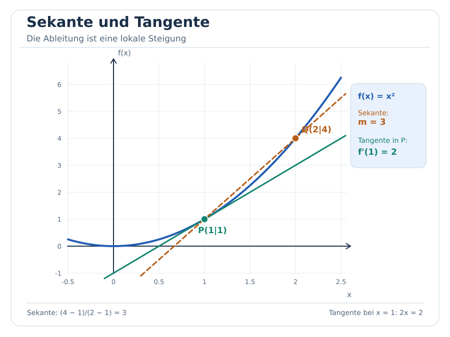

# M2-L3 – Ableitung als momentane Änderungsrate {#L3}

**Kursbereich:** M2 – Oberstufe / Abitur

**Niveau:** Oberstufe / Abitur

**Vorwissen:** Keine festen Voraussetzungen angegeben.

**Einordnung:** Gymnasiale Oberstufe · Analysis

## Worum geht es? {#S1}

Eine durchschnittliche Änderung lässt sich aus zwei Messpunkten berechnen. Interessanter ist oft, **wie schnell sich ein Wert an einem einzelnen Zeitpunkt verändert** – beispielsweise die Geschwindigkeit genau jetzt statt während der letzten Stunde. Die Analysis löst das, indem sie die Abstände zwischen den betrachteten Eingaben gedanklich immer kleiner macht. Der Grenzwert der durchschnittlichen Änderungen heißt **Ableitung**. Geometrisch beschreibt die Ableitung die Steigung der Tangente am Graphen.

## Grundidee und Anschauung {#S2}

Bei einer geraden Linie ist die Steigung überall gleich; bei einer gekrümmten Linie verändert sie sich von Punkt zu Punkt. Verbinden wir zwei nahe Punkte einer Kurve mit einer Geraden, erhalten wir eine **Sekante**. Wenn sich der zweite Punkt dem ersten annähert, nähert sich die Sekantensteigung – wo der Grenzwert existiert – der **Tangentensteigung**. Die Ableitung liefert also eine lokale Antwort auf „Wie stark ändert sich die Ausgabe bei einer winzig kleinen Änderung der Eingabe?“.

{alt="Parabel f(x) = x² mit P(1,1) und Q(2,4). Orange gestrichelte Sekante hat Steigung 3; grüne Tangente an P hat Steigung 2."}

Bei $f(x)=x^2$: Sekante durch $(1,1)$ und $(2,4)$ hat Steigung 3; $f'(1)=2$ ist die Tangentensteigung.

## Neue Zeichen vor der ersten Formel {#S3}

  Zeichen                            Aussprache                                                           Bedeutung hier                                            Anderer möglicher Gebrauch
  ---------------------------------- -------------------------------------------------------------------- --------------------------------------------------------- ----------------------------------------------------------------------------
  $\Delta$                           „Delta“                                                              Endliche Änderung, also Differenz zwischen zwei Werten    In M1-L8 schon für Steigungsunterschiede; später auch Operatorname
  $\Delta x$, $\Delta y$             „Delta iks“, „Delta ypsilon“                                         Änderung der Eingabe bzw. Ausgabe über ein Intervall      Nicht identisch mit einem Differential
  $h$                                „ha“                                                                 Kleiner Eingabeabstand zur betrachteten Stelle            In M1-L5 z. B. Höhe, hier keine Höhenangabe
  $x_0$                              „iks null“, „iks Index null“                                         Fest gewählte Eingabe, an der die Steigung gesucht wird   Index null kann einen Anfangswert kennzeichnen
  $\lim_{h\to0}$                     „Limes für ha gegen null“                                            Grenzwert bei immer kleinerem Abstand                     Grenzwertschreibweise aus M2-L2
  $f'(x)$ oder $f'(x)$               „eff Strich von iks“                                                 Erste Ableitung der Funktion f an x                       Ein Strich kann in Geometrie eine andere Figur kennzeichnen
  $\frac{\mathrm{d}y}{\mathrm{d}x}$  „de ypsilon nach de iks“ oder „Differential y nach Differential x“   Leibniz-Schreibweise für die Ableitung von y nach x       In Integralen hat $\mathrm{d}x$ eine andere Rolle; genaue Definition später
  $s(t)$                             „ess von te“                                                         Hier: zurückgelegter Weg in Abhängigkeit von der Zeit t   s kann anderswo auch eine andere Größe sein

## Durchschnittliche Änderung: der Differenzenquotient {#S4}

Betrachten wir zwei Eingaben $x_1$ und $x_2$ und die zugehörigen Ausgaben $f(x_1)$ und $f(x_2)$. Die durchschnittliche Änderung pro Eingabeeinheit lautet:

$$
\frac{\Delta y}{\Delta x}=\frac{f(x_2)-f(x_1)}{x_2-x_1}\qquad (x_2\ne x_1)
$$

**Laut gelesen:** „Delta ypsilon durch Delta iks ist gleich der Funktionswert bei iks zwei minus der Funktionswert bei iks eins, geteilt durch iks zwei minus iks eins.“ $\Delta y$ ist der gesamte Ausgabeunterschied; $\Delta x$ ist der Eingabeunterschied; `/` bedeutet Division; $x_2\ne x_1$ vermeidet einen Nullnenner. Die Größe ist die **Sekantensteigung** zwischen den beiden Punkten. Einheit und Bedeutung hängen von den Achsen ab: Bei Metern und Sekunden entsteht Meter pro Sekunde.

## Die momentane Änderung: vom Mittelwert zum Grenzwert {#S5}

Für die Ableitung behalten wir eine Eingabe $x_0$ fest und betrachten einen zweiten Punkt in einem Abstand $h$. Dann lassen wir $h$ gegen null gehen. Sofern die Funktion in einer **offenen Umgebung** von $x_0$ definiert ist und der endliche zweiseitige Grenzwert existiert, ist dies die gewöhnliche Ableitung an $x_0$:

$$
f'(x_0)=\lim_{h\to 0}\frac{f(x_0+h)-f(x_0)}{h}
$$

**Laut gelesen:** „Eff Strich von iks null ist gleich dem Limes für ha gegen null aus eff von iks null plus ha minus eff von iks null, alles geteilt durch ha.“ Der Zähler beschreibt die Änderung der Ausgabe; $h$ den Abstand der beiden Eingaben; der $\lim$-Ausdruck betrachtet beliebig kleine **nicht null** werdende Abstände. **Man setzt h niemals direkt als null in den Bruch ein.** Der gesuchte Grenzwert ist die momentane Steigung. **Beide Vorzeichen von h** müssen bei einer gewöhnlichen zweiseitigen Ableitung auf zulässige Eingaben führen. Randwerte eines Modells erfordern eine gesonderte einseitige Betrachtung.

$f'(x)$ gibt, falls für die betreffenden x definiert, eine **neue Funktion** an. Ihr Wert ist die lokale Steigung der ursprünglichen Funktion. Bei einem Graphen mit positiver Steigung ist die Ableitung positiv, bei negativer Steigung negativ. Eine Ableitung von null bedeutet eine **waagerechte Tangente** – aber noch nicht zwingend einen Hoch- oder Tiefpunkt.

## Vollständig erklärtes Mini-Beispiel: ein quadratischer Wegverlauf {#S6}

Wir nehmen als vereinfachtes Bewegungsmodell für **$t\ge0\,\mathrm{s}$** an, dass die seit dem Start zurückgelegte Weglänge bei der Zeit $t$ durch einen quadratischen Verlauf beschrieben wird. Für negative Zeiten wäre die Deutung als *seit dem Start zurückgelegte Strecke* nicht passend. Damit der **Einheitenvergleich stimmt**, schreiben wir bei $t$ in Sekunden und $s$ in Metern zunächst:

$$
\begin{aligned}
s(t)&=(1\,\mathrm{m}/\mathrm{s}^2)\cdot t^2\\
\text{Zahlenwertformel: }\quad s(t)&=t^2\\
&\quad(t\text{: Zahlenwert der Zeit in }\mathrm{s};\\
&\qquad s(t)\text{: Zahlenwert des Weges in }\mathrm{m})
\end{aligned}
$$

**Laut gelesen:** „Ess von te ist gleich ein Meter pro Sekundenquadrat mal te zum Quadrat.“ Der Faktor $1\,\mathrm{m}/\mathrm{s}^2$ sorgt dafür, dass rechts die Einheit Meter entsteht. In den folgenden kurzen Umformungen stehen $t$ und $h$ jeweils für **Zahlenwerte von Sekundenangaben**; die errechnete Wegänderung wird in Metern und die Ableitung in Metern pro Sekunde ausgegeben. Im physikalischen Modell muss für die beiden verglichenen Zeitpunkte außerdem $t\ge0$ und $t+h\ge0$ gelten. Die Schreibweise $s(t)=t^2$ allein ist also eine vereinfachte Zahlenwertformel, keine vollständige physikalische Einheitengleichung.

Zwischen den Zeitpunkten $t=2\,\mathrm{s}$ und $t=4\,\mathrm{s}$ wächst der Weg von vier auf sechzehn Meter. Die mittlere Geschwindigkeit ist deshalb:

$$
\frac{16\,\mathrm{m}-4\,\mathrm{m}}{4\,\mathrm{s}-2\,\mathrm{s}}=6\,\mathrm{m}/\mathrm{s}
$$

**Laut gelesen:** „Sechzehn Meter minus vier Meter geteilt durch vier Sekunden minus zwei Sekunden ergibt sechs Meter pro Sekunde.“ Das ist eine Durchschnittsgeschwindigkeit **über zwei Sekunden**.

Was geschieht dagegen **genau bei drei Sekunden**? Für die momentane Änderungsrate setzen wir die allgemeine Funktionsregel mit dem kleinen Abstand $h$ ein:

$$
\begin{aligned}
\frac{s(3+h)-s(3)}h&=\frac{{(3+h)}^2-9}h\\
&=\frac{6h+h^2}h\\
&=6+h\quad\text{für }h\neq0
\end{aligned}
$$

**Laut gelesen:** „Der Wegwert bei drei plus ha minus der Wegwert bei drei, geteilt durch ha, lässt sich zu sechs plus ha vereinfachen – solange ha nicht null ist.“ $h$ hat hier die Dimension Sekunden; die Zahlenkoeffizienten der vereinfachten Terme tragen im physikalischen Modell die passenden Einheiten. Je näher $h$ an null liegt, desto näher liegt der Quotient an sechs Meter pro Sekunde. Daher gilt:

$$
s'(3)=6\,\mathrm{m}/\mathrm{s}\qquad\text{(Kurzschreibweise: Ableitung bei }t=3\,\mathrm{s}\text{)}
$$

**Laut gelesen:** „Ess Strich bei drei ist gleich sechs Meter pro Sekunde.“ Die **momentane Geschwindigkeit** bei $t=3\,\mathrm{s}$ stimmt in diesem Sonderfall mit der zuvor berechneten Durchschnittsgeschwindigkeit zwischen zwei und vier Sekunden überein. Das liegt an der symmetrischen Lage des Intervalls um drei und gilt nicht für beliebige Kurven und Intervalle.

Allgemein ergibt dieselbe Rechnung für das quadratische Modell die Steigungsfunktion:

$$
\begin{aligned}
s'(t)&=(2\,\mathrm{m}/\mathrm{s}^2)\cdot t\\
\text{Zahlenwertformel: }\quad s'(t)&=2t
\quad(t\text{ in Sekunden; Geschwindigkeit in }\mathrm{m}/\mathrm{s})
\end{aligned}
$$

**Laut gelesen:** „Ess Strich von te ist gleich zwei mal te.“ Der Zahlenwert der Geschwindigkeitsfunktion wächst linear mit der Zeit; dabei muss die implizite Einheitenskala des ursprünglichen Wegmodells mitgeführt werden.

## Die beiden Schreibweisen der Ableitung {#S7}

Eine Ableitung kann in zwei gebräuchlichen Formen geschrieben werden:

$$
f'(x)=\frac{\mathrm{d}y}{\mathrm{d}x}\qquad\text{wenn }y=f(x)
$$

**Laut gelesen:** „Eff Strich von iks ist gleich de ypsilon nach de iks, wenn ypsilon gleich eff von iks ist.“ $f'(x)$ stammt aus der **Lagrange-Notation**; $\frac{\mathrm{d}y}{\mathrm{d}x}$ ist die **Leibniz-Notation**. Beide bezeichnen hier dieselbe erste Ableitung. In einer einführenden Anschauung kann man $\frac{\mathrm{d}y}{\mathrm{d}x}$ als Grenzfall von „kleine Änderung der Ausgabe pro kleine Änderung der Eingabe“ lesen; es ist jedoch **nicht einfach ein gewöhnlicher Bruch aus zwei beliebigen kleinen Zahlen**. Die formalere Bedeutung von Differentialen folgt später.

Die Leibniz-Schreibweise macht oft besonders deutlich, **welche Größe nach welcher anderen Größe abgeleitet wird**. Das wird später bei Funktionen mehrerer Variablen, in Physik und Robotik wichtig.

## Wann existiert keine Ableitung? {#S8}

Eine Funktion muss an einer Stelle nicht ableitbar sein. Bei einer **scharfen Ecke** können die Steigungen von links und rechts verschieden sein. Das einfachste Beispiel ist die Betragsfunktion $f(x)=|x|$: Links von null beträgt die Steigung minus eins, rechts plus eins. Die Funktion ist bei null **stetig**, besitzt dort aber **keine zweiseitige Ableitung**. Denn für $h\ne0$ lautet der Differenzenquotient an null $\frac{|h|-0}{h}=\frac{|h|}{h}$: Für $h<0$ ergibt er $-1$, für $h>0$ ergibt er $+1$. Der gemeinsame Grenzwert fehlt. Auch eine Sprungstelle ist nicht differenzierbar.

Bei Messwerten entsteht ein anderes Problem: Man hat nur endlich viele Zeitpunkte und keine exakte stetige Funktion. Eine numerisch berechnete „Ableitung“ aus Messdaten ist deshalb eine **Schätzung**. Sehr kleine Zeitabstände verstärken unter Umständen Rauschen oder Rundungsfehler.

## Wofür nützlich? {#S9}

Ableitungen werden in der **KI** genutzt, um zu verstehen, wie empfindlich eine Zielfunktion auf Änderungen einzelner Modellparameter reagiert – die Grundlage von Gradientenverfahren. In der **Robotik** beschreiben sie Geschwindigkeiten und später Beschleunigungen von Bewegungen. In der **Softwareanalyse** helfen sie, lokale Änderungen einer Kennzahl zu beschreiben und glatte Modelle zu optimieren. Bei echten Sensordaten muss zwischen mathematischer Ableitung eines Modells und numerisch geschätzter Änderungsrate unterschieden werden.

## Annahmen und Grenzen {#S10}

- Eine Ableitung ist eine **lokale** Information; eine hohe lokale Steigung garantiert kein dauerhaftes Wachstum.
- Der Nenner beim Differenzenquotienten darf nicht null sein; erst der Grenzübergang liefert die Ableitung.
- $f'(x)=0$ beweist noch **kein** Maximum oder Minimum.
- Stetigkeit ist für Differenzierbarkeit an **inneren Definitionspunkten** notwendig, aber nicht hinreichend; ein Knick kann stetig und nicht differenzierbar sein. Am Rand eines physikalischen Zeitintervalls kann man stattdessen eine einseitige Änderungsrate untersuchen.
- Ein physikalisches Modell braucht konsistente **Einheiten**; die Ableitung einer Wegfunktion nach der Zeit besitzt die Einheit Weg pro Zeit.

## Verbindung zur nächsten Einheit {#S11}

In **M2-L4** lernen wir praktische Regeln, mit denen sich Ableitungen zusammengesetzter Funktionen ermitteln lassen, ohne den Grenzwert für jeden Ausdruck jedes Mal neu zu berechnen.

## Quellen {#S12}

In dieser Lektion sind keine Einzelquellen gesondert verzeichnet.
