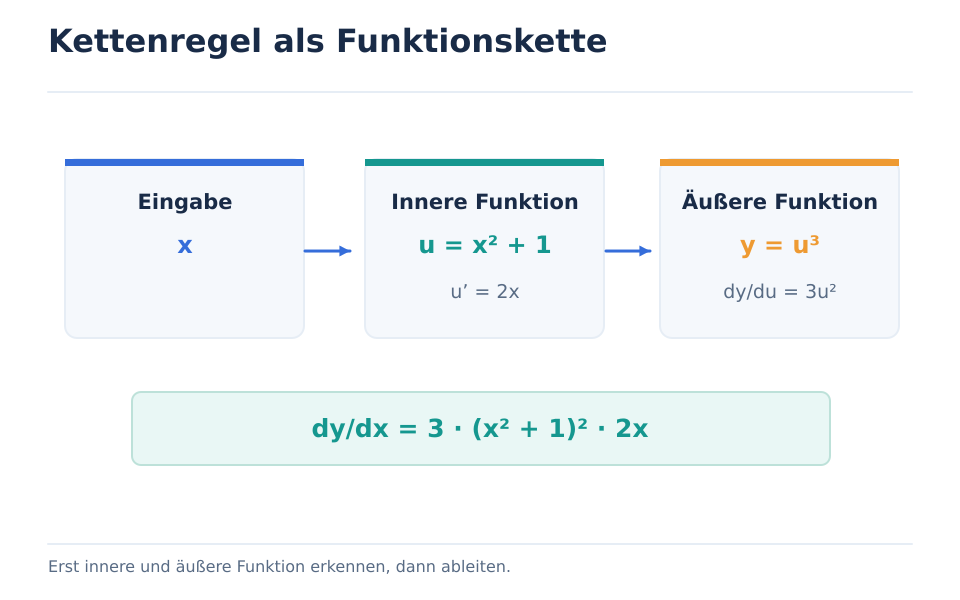

# M2-L4 – Ableitungsregeln und Funktionsverknüpfungen {#L4}

**Kursbereich:** M2 – Oberstufe / Abitur

**Niveau:** Oberstufe / Abitur

**Vorwissen:** Keine festen Voraussetzungen angegeben.

**Einordnung:** Gymnasiale Oberstufe · Analysis; einige Verknüpfungsregeln je nach Niveau vertieft

## Worum geht es? {#S1}

In M2-L3 haben wir die Ableitung als Grenzwert von immer kleineren durchschnittlichen Änderungen kennengelernt. Solche Grenzwerte einzeln auszurechnen wäre bei langen Formeln umständlich. Zum Glück folgen Ableitungen klaren **Rechenregeln**. Sie zeigen, wie sich die lokale Änderung einer Summe, eines Produkts, eines Quotienten oder einer verschachtelten Funktion aus einfacheren Ableitungen zusammensetzt. Damit wird die Differenzialrechnung zu einem praktischen Werkzeug für Modellierung, Optimierung und die Mathematik hinter neuronalen Netzen.

## Grundidee und Anschauung {#S2}

Eine zusammengesetzte Funktion ist ähnlich wie ein Programm, das mehrere Berechnungsschritte ausführt. Ändert sich die Eingabe ein wenig, kann sich das Ergebnis bei jedem Zwischenschritt unterschiedlich stark verändern. Die **Kettenregel** verfolgt eine kleine Änderung durch eine solche Folge von Operationen. Bei einem **Produkt** verändert sich im Allgemeinen jeder Faktor; bei einem **Quotienten** beeinflusst auch der Nenner die Änderung. Die Regeln behandeln diese Abhängigkeiten systematisch.

## Neue Zeichen vor der ersten Formel {#S3}

  Zeichen                     Aussprache                                                        Bedeutung hier                                                            Anderer möglicher Gebrauch
  --------------------------- ----------------------------------------------------------------- ------------------------------------------------------------------------- ---------------------------------------------------------------------
  $f$, $g$, $u$, $v$          „eff“, „ge“, „u“, „fau“                                           Namen von Funktionen einer Eingabe x                                      Dieselben Buchstaben können Zahlen, Vektoren oder Größen bezeichnen
  $f'(x)$, $g'(x)$            „eff Strich von iks“, „ge Strich von iks“                         Erste Ableitung von f bzw. g                                              Strich in Geometrie auch bei ähnlichen Figuren
  $(fg)(x)$                   „Produktfunktion eff mal ge bei iks“                              $f(x)\cdot g(x)$                                                          Klammern können sonst Argumente gruppieren
  $f(g(x))$, $f\circ g$       „eff von ge von iks“, „eff verkettet mit ge“                      Verkettung: zuerst g, danach f anwenden; `∘` ist das Verkettungszeichen   In Code oft verschachtelte Funktionsaufrufe
  $n$                         „en“                                                              Hier: fester Exponent                                                     In anderen Themen oft Anzahl oder Index
  $c$                         „ce“                                                              Hier: feste Konstante                                                     In Geometrie z. B. Hypotenuse
  `≠`                         „ungleich“                                                        Ausschluss eines Nullnenners                                              Allgemeines Vergleichszeichen
  $\mathbb R$, $\pi$, `°`     „reelle Zahlen“, „Pi“, „Grad“                                     Reeller Zahlenbereich, Kreiszahl, Winkelmaß in Grad                       Das Gradzeichen ist keine Differentiationsvariable
  $e$, $\ln$, $\sin$, $\cos$  „Eulersche Zahl“, „natürlicher Logarithmus“, „Sinus“, „Kosinus“   Bekannte Funktionen aus M1-L19/M2-L1                                      Für Winkelfunktionen verwenden Ableitungsregeln Bogenmaß

## Die einfachsten Regeln: Konstante, Summe, Potenz {#S4}

Für eine **konstante Funktion** ist die Ableitung null: Eine immer gleiche Zahl verändert sich nicht. Auch das **konstante Vielfache** $c\cdot u(x)$ wird zu $c\cdot u'(x)$; eine Summe oder Differenz darf man **gliedweise ableiten**. Und bei einer Potenz wandert der feste Exponent als Faktor nach vorne und wird um eins vermindert.

$$
\begin{aligned}
f(x)=c&\implies f^{\prime}(x)=0\\
f(x)=u(x)+v(x)&\implies f^{\prime}(x)=u^{\prime}(x)+v^{\prime}(x)\\
f(x)=cu(x)&\implies f^{\prime}(x)=cu^{\prime}(x)\\
f(x)=x^n&\implies f^{\prime}(x)=nx^{n-1}
\end{aligned}
$$

**Laut gelesen, erste Zeile:** „Ist eff von iks die Konstante ce, dann ist eff Strich von iks null.“ $c$ hängt nicht von $x$ ab.

**Zweite Zeile:** „Die Ableitung der Summe von u von iks und fau von iks ist die Summe von u Strich und fau Strich bei iks.“ $u$ und $v$ sind zwei differenzierbare Teilfunktionen.

**Dritte Zeile:** „Die Ableitung von ce mal u von iks ist ce mal u Strich von iks.“ Die Konstante wird nicht mit abgeleitet.

**Vierte Zeile:** „Die Ableitung von iks hoch en ist en mal iks hoch en minus eins.“ Der Exponent $n$ ist **fest**, nicht eine zweite Variable. Diese Potenzregel gilt für ganzzahlige **positive** Exponenten auf ganz $\mathbb R$ und für $n=0$ als konstante Funktion $1$ (auch am Punkt $x=0$ so festgelegt; daraus folgt keine allgemeine Definition des isolierten Ausdrucks $0^0$). Für **negative ganzzahlige** Exponenten muss $x\ne0$ gelten; bei allgemeinen reellen Exponenten ist der übliche reelle Bereich $x>0$ sicher. Der Exponent ist keine zweite Variable.

**Mini-Beispiel:** Für $f(x)=3x^2+2x+7$ wird aus $3x^2$ die Ableitung $6x$, aus $2x$ die konstante Ableitung $2$ und aus $7$ die Ableitung null. Somit:

$$
f'(x)=6x+2
$$

**Laut gelesen:** „Eff Strich von iks ist gleich sechs mal iks plus zwei.“ Das Ergebnis beschreibt für jede zulässige Eingabe die lokale Steigung der ursprünglichen Parabel.

## Die Produktregel – wenn beide Faktoren mitwachsen {#S5}

Bei einem Produkt von zwei Funktionen können sich **beide Faktoren** mit der Eingabe verändern. Deshalb genügt es nicht, einfach die zwei Ableitungen miteinander zu multiplizieren: ${(f\cdot g)}'$ ist im Allgemeinen **nicht** $f'\cdot g'$.

$$
{(f\cdot g)}'(x)=f'(x)\cdot g(x)+f(x)\cdot g'(x)
$$

**Laut gelesen:** „Die Ableitung des Produkts von eff und ge ist eff Strich mal ge plus eff mal ge Strich, jeweils an der Stelle iks.“ Der erste Summand berücksichtigt die Änderung von $f$ bei festgedachtem $g$, der zweite die Änderung von $g$ bei festgedachtem $f$. Für eine gewöhnliche Ableitung müssen beide Teilfunktionen an der Stelle differenzierbar sein.

**Mini-Beispiel:** Wir multiplizieren $f(x)=x^2$ mit $g(x)=x+1$:

$$
\begin{aligned}
h(x)&=x^2(x+1)\\
h^{\prime}(x)&=(2x)(x+1)+x^2\cdot1=3x^2+2x
\end{aligned}
$$

**Laut gelesen:** „Ha Strich von iks ist zwei iks mal iks plus eins plus iks Quadrat mal eins; zusammen drei iks Quadrat plus zwei iks.“ $h$ bezeichnet die neue Produktfunktion. Man kann das Ergebnis prüfen, indem man $x^2(x+1)$ zuerst zu $x^3+x^2$ ausmultipliziert und anschließend gliedweise ableitet. Etwa bei $x=2$ ergibt sich $h'(2)=3\cdot2^2+2\cdot2=16$; die fälschliche Multiplikation der Einzelableitungen ergäbe nur $2x\cdot1=4$.

## Die Quotientenregel – wenn auch der Nenner variiert {#S6}

Für einen Quotienten von Funktionen muss der Nenner ungleich null sein. Die Änderungsregel berücksichtigt, dass der Nenner selbst abhängig von der Eingabe sein kann.

$$
\left(\frac fg\right)'(x)=\frac{f'(x)\cdot g(x)-f(x)\cdot g'(x)}{{(g(x))}^2}
$$

**Laut gelesen:** „Die Ableitung von eff durch ge ist eff Strich mal ge minus eff mal ge Strich, geteilt durch ge zum Quadrat, alles an der Stelle iks.“ $f$ ist die Zählerfunktion, $g$ die Nennerfunktion; ${(g(x))}^2$ bedeutet, dass der komplette Nenner-Funktionswert quadriert wird. Vorausgesetzt sind Differenzierbarkeit beider Funktionen an der betrachteten Stelle und $g(x)\ne0$. **Nicht verwechseln:** Die Ableitung von $\frac fg$ ist im Allgemeinen nicht $\frac{f'}{g'}$.

**Mini-Beispiel:**

$$
\begin{aligned}
q(x)&=\frac{x}{x+1}\quad(x\neq-1)\\
q^{\prime}(x)&=\frac{(1)(x+1)-x(1)}{{(x+1)}^2}=\frac1{{(x+1)}^2}
\end{aligned}
$$

**Laut gelesen:** „Ku Strich von iks ist eins mal iks plus eins minus iks mal eins, geteilt durch iks plus eins zum Quadrat; das vereinfacht sich zu eins durch iks plus eins zum Quadrat.“ Der Wert $x=-1$ bleibt ausgeschlossen; auch die abgeleitete Formel darf dort nicht verwendet werden.

## Die Kettenregel – Änderung durch mehrere Rechenschritte {#S7}

Bei einer **Verkettung** berechnen wir erst die innere Funktion $g(x)$ und setzen ihr Ergebnis in die äußere Funktion $f$ ein. Die Ableitung berücksichtigt, wie stark die innere Größe verändert wird **und** wie empfindlich die äußere darauf reagiert.

{alt="Funktionskette und Ableitung einer zusammengesetzten Funktion"}

$$
{(f\circ g)}'(x)=f'(g(x))\cdot g'(x)
$$

**Laut gelesen:** „Die Ableitung der Verkettung eff nach ge ist eff Strich, ausgewertet bei ge von iks, mal ge Strich von iks.“ Das neue Zeichen `∘` heißt **Verkettungszeichen** oder „Kreis“ und bedeutet: zuerst die rechts stehende Funktion $g$, danach die links stehende Funktion $f$ anwenden. Es ist **keine gewöhnliche Multiplikation**. Für die Regel muss $g$ bei $x$ differenzierbar sein, $g(x)$ im Definitionsbereich von $f$ liegen und $f$ bei $g(x)$ differenzierbar sein.

**Vollständig erklärtes Mini-Beispiel:**

$$
\begin{aligned}
H(x)&={(3x+1)}^2\\
H^{\prime}(x)&=2(3x+1)\cdot3=6(3x+1)
\end{aligned}
$$

**Laut gelesen:** „Ha von iks ist die Klammer drei iks plus eins zum Quadrat. Ha Strich von iks ist zwei mal die Klammer drei iks plus eins mal drei, also sechs mal die Klammer drei iks plus eins.“ Die **innere Funktion** ist $g(x)=3x+1$ mit Ableitung drei. Die **äußere Funktion** quadriert ihren Eingang; ihre Ableitung ist zweimal dieser Eingang. Deshalb muss der Faktor drei aus der inneren Ableitung mitgenommen werden. Er darf nicht vergessen werden.

## Weitere häufige Ableitungen als Lesewörterbuch {#S8}

Die folgenden bekannten Funktionen besitzen besonders einfache Ableitungen. Sie werden später bei konkreten Modellen erneut gebraucht.

  Ausgangsfunktion   Erste Ableitung   In Worten und mit Gültigkeitsbereich
  ------------------ ----------------- ------------------------------------------------------------------
  $f(x)=e^x$         $f'(x)=e^x$       „E hoch iks wird wieder e hoch iks“; alle reellen x
  $f(x)=\ln(x)$      $f'(x)=\frac1x$   „Der natürliche Logarithmus wird zu eins durch iks“; x positiv
  $f(x)=\sin(x)$     $f'(x)=\cos(x)$   „Die Sinusfunktion wird zur Kosinusfunktion“; Winkel im Bogenmaß
  $f(x)=\cos(x)$     $f'(x)=-\sin(x)$  „Die Kosinusfunktion wird zu minus Sinus“; Winkel im Bogenmaß

**Zeichenerklärung:** $e$ ist die Eulersche Zahl, $\ln$ der natürliche Logarithmus, $\sin$ und $\cos$ sind Sinus und Kosinus. `−` vor $\sin$ bedeutet die Negation des Sinuswerts. Das natürliche Logarithmusmodell verlangt $x>0$. Für trigonometrische Ableitungen ist das **Bogenmaß** entscheidend: Wird eine Winkelvariable stattdessen in Grad gemessen, ändern sich die Ableitungsfaktoren. Beispiel für einen Zahlenwert $x$ in **Grad**: $g(x)=\sin\left(\frac{\pi x}{180}\right)$ hat $g'(x)=\left(\frac{\pi}{180}\right)\cdot\cos\left(\frac{\pi x}{180}\right)$. Der zusätzliche Faktor stammt aus der Kettenregel. $\pi$ bezeichnet die Kreiszahl Pi.

## Welche Regel passt zu welcher Formel? {#S9}

- Bei einer **Summe** untersuchen wir die einzelnen Summanden.
- Bei einem **Produkt** zweier variabler Faktoren verwenden wir die Produktregel.
- Bei einem **Quotienten** mit variablem Nenner verwenden wir die Quotientenregel, solange der Nenner nicht null wird.
- Bei einer **verschachtelten** Rechnung verwenden wir die Kettenregel; sie kann zusätzlich zu Produkt- oder Quotientenregel nötig sein.

Die Schreibweise entscheidet, welche Rechenwege besonders einfach sind: Manchmal ist **Ausmultiplizieren vor dem Ableiten** kürzer als die Produktregel. Es gibt nicht immer genau einen geeigneten Rechenweg.

## Wofür nützlich? {#S10}

In der **KI** ist die Kettenregel das mathematische Herzstück der Rückwärtsableitung (*Backpropagation*): Ein Fehlermaß hängt über viele Schichten von Modellparametern ab, und lokale Änderungen werden rückwärts verknüpft. In der **Robotik** bestimmen Ableitungen die Reaktion einer Bewegung auf Änderungen von Gelenkwinkeln oder Steuergrößen. In der **Software** helfen sie, Zielfunktionen zu optimieren oder Empfindlichkeiten eines Modells zu analysieren. Automatische Differentiation kann diese Regeln systematisch auf einen Rechengraphen anwenden; sie ersetzt aber nicht die Prüfung von Definitionsbereichen und Modellannahmen.

## Annahmen und Grenzen {#S11}

- Die Regeln gelten an Stellen, an denen die beteiligten Funktionen **differenzierbar** sind. Bei Verkettungen muss zusätzlich die äußere Funktion am **inneren Funktionswert** differenzierbar sein.
- Bei der Quotientenregel muss der **Nenner ungleich null** sein.
- Die Potenzregel ist nach Exponent und Definitionsbereich sachgerecht einzugrenzen; die einfache Schulformel mit $x^n$ ist kein Freibrief für beliebige komplexe Werte.
- Ergebnisse können bei diskreten oder verrauschten Daten nur näherungsweise sinnvoll sein. Mathematische Ableitbarkeit eines Modells ist nicht identisch mit physikalischer Messbarkeit.
- **Leistungskursabgrenzung:** Die Auswahl und Tiefe einzelner Verkettungen und Methoden ist hier eine fachliche Darstellung, keine amtlich verifizierte Pflichtliste für ein bestimmtes Berliner Abiturjahr.

## Verbindung zur nächsten Einheit {#S12}

In **M2-L5 – Kurvendiskussion und geometrische Eigenschaften** verwenden wir Ableitungen, um Wachstums- und Fallbereiche, waagerechte Tangenten, Hoch- und Tiefpunkte sowie Wendepunkte verständlich zu untersuchen.

## Quellen {#S13}

In dieser Lektion sind keine Einzelquellen gesondert verzeichnet.
