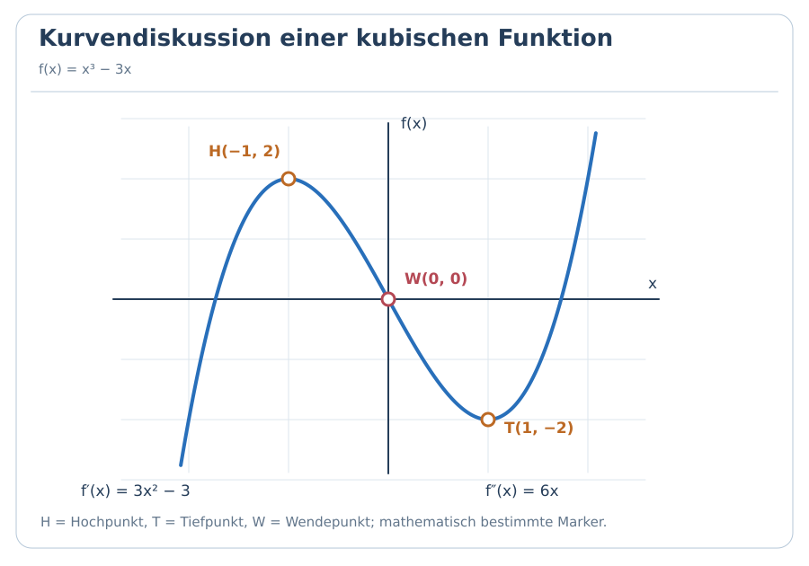

# M2-L5 – Kurvendiskussion und geometrische Eigenschaften {#L5}

**Kursbereich:** M2 – Oberstufe / Abitur

**Niveau:** Oberstufe / Abitur

**Vorwissen:** Keine festen Voraussetzungen angegeben.

**Einordnung:** Gymnasiale Oberstufe · Analysis

## Worum geht es? {#S1}

Eine Formel kann den Verlauf einer Kurve beschreiben, ohne dass man sie sofort zeichnen muss. Mit Ableitungen können wir erkennen, wo die Kurve steigt oder fällt, wo sie lokale Hoch- und Tiefpunkte besitzt und wo sie ihr Krümmungsverhalten ändert. Diese Untersuchung heißt **Kurvendiskussion**. Sie beantwortet nicht nur die Frage, wie eine Kurve aussieht, sondern auch, welche Aussagen über ein Modell tatsächlich gerechtfertigt sind. Wir knüpfen an den Ableitungsbegriff aus M2-L3 und die Rechenregeln aus M2-L4 an.

## Grundidee und Anschauung {#S2}

Stell dir eine Fahrt durch eine hügelige Landschaft vor. Die **erste Ableitung** sagt, ob die Straße an einer Stelle bergauf oder bergab verläuft. Die **zweite Ableitung** beschreibt, wie sich diese Steigung entlang der waagerechten Koordinate verändert. Ein Hochpunkt liegt häufig dort, wo die Steigung von positiv zu negativ wechselt; ein Tiefpunkt entsprechend beim Wechsel von negativ zu positiv. Eine Wendestelle markiert einen Wechsel des Krümmungsverhaltens, nicht zwingend einen Hoch- oder Tiefpunkt.

## Neue Zeichen vor der ersten Formel {#S3}

  Zeichen       Aussprache                                      Bedeutung hier                                       Anderer möglicher Gebrauch
  ------------- ----------------------------------------------- ---------------------------------------------------- ---------------------------------------------
  $f'(x)$       „eff Strich von iks“                            Erste Ableitung; lokale Steigung                     Strich kann Punkte und Objekte kennzeichnen
  $f''(x)$      „eff zwei Strich von iks“, „zweite Ableitung“   Änderungsrate der ersten Ableitung                   Zwei Striche sind keine Quadratoperation
  $f'''(x)$     „eff drei Strich von iks“, „dritte Ableitung“   Änderungsrate der zweiten Ableitung                  Kein Dreifachprodukt
  $x_0$         „iks null“                                      Stelle, an der wir eine Eigenschaft überprüfen       Anfangswert, Index oder Referenzpunkt
  `>` und `<`   „größer als“, „kleiner als“                     Vorzeichen der Ableitung                             Allgemeine Größenvergleiche
  `⇒`           „daraus folgt“                                  Eine hinreichende Bedingung führt zu einer Aussage   In Logik allgemeines Implikationszeichen
  $m$, $b$      „em“, „be“                                      Steigung und Achsenabschnitt einer Geraden           Beliebige andere Parameter
  $t(x)$        „te von iks“                                    Name einer Tangentengeraden                          $t$ bezeichnet oft auch Zeit

## Monotonie: Wo steigt oder fällt der Graph? {#S4}

Die Ableitung misst die **lokale Steigung**. Ist sie auf einem ganzen Intervall positiv, wächst der Funktionswert dort bei zunehmendem $x$ streng. Ist sie auf dem Intervall negativ, fällt der Funktionswert dort streng. Dazu betrachten wir ein **zusammenhängendes Intervall**, auf dem die Funktion stetig und im Inneren differenzierbar ist; das Vorzeichen der Ableitung muss im Inneren durchgehend die genannte Bedingung erfüllen. Eine einzelne positive Ableitung an nur einem Punkt belegt noch keine Monotonie auf einer ganzen Strecke.

$$
\begin{aligned}
f'(x)>0&\implies f\text{ steigt auf dem betrachteten Intervall.}\\
f'(x)<0&\implies f\text{ fällt auf dem betrachteten Intervall.}
\end{aligned}
$$

**Laut gelesen:** „Ist eff Strich von iks größer als null, steigt die Funktion auf dem betrachteten Intervall.“ Die zweite Zeile lautet: „Ist eff Strich von iks kleiner als null, fällt die Funktion auf dem betrachteten Intervall.“ Dabei muss die Ableitung im betreffenden Intervall existieren und das jeweilige Vorzeichen dort durchgängig gelten.

Eine überall nichtnegative Ableitung erlaubt die Aussage **monoton nicht fallend**. Auch wenn die Ableitung an einzelnen Punkten null ist, kann die Funktion insgesamt streng steigen: Die Funktion $x^3$ ist beispielsweise streng steigend, obwohl ihre Ableitung bei null verschwindet. Denn ihre Ableitung ist $3x^2$: Sie ist bei null gleich null und sonst positiv. Das zeigt gleichzeitig, warum $f'(x_0)=0$ **allein kein Extremum beweist**.

## Extrempunkte: Hoch und Tief erkennen {#S5}

Ein **lokales Maximum** ist ein Funktionswert, der mindestens so hoch ist wie die Werte in seiner unmittelbaren Umgebung. Bei einem **lokalen Minimum** ist er entsprechend höchstens so groß. Solche Punkte nennen wir Extrempunkte.

Für einen inneren lokalen Extrempunkt einer differenzierbaren Funktion gilt als **notwendige** Bedingung:

$$
f'(x_0)=0
$$

**Laut gelesen:** „Eff Strich an der Stelle iks null ist gleich null.“ Die Tangente ist dort waagerecht. Notwendig bedeutet: Bei einer dort differenzierbaren Funktion muss dies für ein inneres Extremum erfüllt sein. Es bedeutet **nicht**, dass jede Nullstelle der Ableitung automatisch ein Extrempunkt ist.

Für die Entscheidung betrachten wir die Vorzeichen der ersten Ableitung unmittelbar links und rechts der Kandidatenstelle:

  Vorzeichenwechsel von $f'$   Aussage
  ---------------------------- --------------------------------------
  positiv → negativ            Lokaler Hochpunkt
  negativ → positiv            Lokaler Tiefpunkt
  kein Wechsel                 Nicht allein deshalb ein Extrempunkt

Ist eine Funktion an einer möglichen Extremstelle **nicht differenzierbar**, kann trotzdem ein Extremum vorliegen: $f(x)=|x|$ besitzt bei $x=0$ ein lokales und globales Minimum, aber wegen des Knicks keine Ableitung dort (M2-L3). Ein oft bequemes zusätzliches Kriterium nutzt die zweite Ableitung: Wenn $f'(x_0)=0$ und $f''(x_0)<0$, liegt dort ein **striktes lokales Maximum** vor; bei $f''(x_0)>0$ ein **striktes lokales Minimum**. Ist $f''(x_0)=0$, entscheidet dieser Test nicht. Er liefert dann weder automatisch einen Extrem- noch einen Wendepunkt.

## Wendepunkte und Krümmung {#S6}

Ein **Wendepunkt** ist eine Stelle, an der eine ausreichend glatte Kurve ihr Krümmungsverhalten wechselt. In der üblichen Oberstufensprache spricht man beim Vorzeichenwechsel der zweiten Ableitung von einem Wechsel zwischen „linksgekrümmt“ und „rechtsgekrümmt“.

$$
\begin{aligned}
f''(x)>0&\longrightarrow\text{Die Steigung nimmt dort zu.}\\
f''(x)<0&\longrightarrow\text{Die Steigung nimmt dort ab.}
\end{aligned}
$$

**Laut gelesen:** „Ist die zweite Ableitung größer als null, nimmt die erste Ableitung zu.“ Bei negativem Vorzeichen nimmt sie ab. Das Vorzeichen muss auf einem ganzen Bereich betrachtet werden, nicht nur an einem isolierten Punkt.

Für eine in einer Umgebung zweimal differenzierbare Funktion ist $f''(x_0)=0$ ein typischer **Kandidat** für eine Wendestelle. Entscheidend ist ein tatsächlicher **Wechsel des Krümmungsverhaltens**; durch einen Vorzeichenwechsel von $f''$ lässt er sich einfach belegen. **Gegenbeispiel:** $g(x)=x^4$ besitzt $g''(x)=12x^2$ und damit $g''(0)=0$, aber die zweite Ableitung ist links und rechts positiv: kein Wendepunkt bei null. Existiert $f''$ in einer Umgebung von $x_0$ und ist es bei $x_0$ differenzierbar, so ist $f''(x_0)=0$ zusammen mit $f'''(x_0)\ne0$ ein **hinreichender Test**: Die zweite Ableitung wechselt dann nahe der Stelle ihr Vorzeichen.

## Ein durchgängiges Mini-Beispiel {#S7}

Wir betrachten eine einfache kubische Funktion. Die Kubikpotenz wurde bereits eingeführt, und die Ableitungen können mit der Potenzregel aus M2-L4 gebildet werden:

{alt="Kurvengraph der Funktion f(x) gleich x hoch drei minus drei x mit Hochpunkt bei minus eins zwei, Tiefpunkt bei eins minus zwei und Wendepunkt im Ursprung."}

Kurvendiskussion: $H(-1,2)$, $T(1,-2)$ und $W(0,0)$.

$$
\begin{aligned}
f(x)&=x^3-3x\\
f^{\prime}(x)&=3x^2-3\\
f''(x)&=6x
\end{aligned}
$$

**Laut gelesen:** „Eff von iks ist iks hoch drei minus drei mal iks.“ Die erste Ableitung heißt „drei iks Quadrat minus drei“. Die zweite Ableitung heißt „sechs iks“.

**Schritt 1 – waagerechte Tangenten:** $3x^2-3=0$ ergibt $x^2=1$, also $x=-1$ oder $x=1$. Das sind nur Kandidaten für Extrempunkte.

**Schritt 2 – prüfen:** Für $x=-1$ ist die zweite Ableitung $-6$, also liegt dort ein lokaler Hochpunkt. Der Funktionswert beträgt $f(-1)=2$. Für $x=1$ ist die zweite Ableitung $6$, also liegt dort ein lokaler Tiefpunkt mit $f(1)=-2$.

**Schritt 3 – Wendestelle:** Aus $f''(x)=6x$ folgt der Kandidat $x=0$. Für negative $x$ ist $6x$ negativ, für positive $x$ ist es positiv. Die Krümmung wechselt: $(0;0)$ ist ein Wendepunkt. Hier ist die Tangente nicht waagerecht, denn $f'(0)=-3$.

**Schritt 4 – Verlauf:** Die Funktion steigt für $x<-1$, fällt für $-1<x<1$ und steigt für $x>1$ wieder. Das folgt aus der Zerlegung $3x^2-3=3(x-1)(x+1)$: Außerhalb der Nullstellen haben beide Faktoren dasselbe Vorzeichen (Produkt positiv), dazwischen ist ihr Produkt negativ. Die Punkte $x=-1$ und $x=1$ gehören als Intervallgrenzen zu den Extrempunkten.

**Ergebnis:** Die Formel lässt sich in eine nachvollziehbare Landkarte übersetzen: Hochpunkt $(-1;2)$, Tiefpunkt $(1;-2)$, Wendepunkt $(0;0)$ sowie die entsprechenden Steig- und Fallintervalle. Auf dem gesamten reellen Zahlenbereich gibt es dennoch **kein globales Maximum und Minimum**, weil die Kubikfunktion nach oben und unten unbeschränkt verläuft.

## Tangentengleichung lesen {#S8}

Die Tangente ist die Gerade, die an einer differenzierbaren Kurve im betrachteten Punkt dieselbe Steigung besitzt. Für ihre Gleichung brauchen wir den Punktwert und die dortige Ableitung:

$$
t(x)=f'(x_0)\cdot(x-x_0)+f(x_0)
$$

**Laut gelesen:** „Te von iks ist eff Strich an der Stelle iks null mal iks minus iks null plus eff an der Stelle iks null.“ Die Tangentensteigung ist $f'(x_0)$, der Berührpunkt hat die Koordinaten $(x_0;f(x_0))$.

**Mini-Beispiel:** Für unsere Funktion an der Stelle $x_0=2$ sind der Wert $f(2)=2$ und die Steigung $f'(2)=9$. Die Tangente lautet deshalb $t(x)=9\cdot(x-2)+2$, vereinfacht $t(x)=9x-16$. Für $x=2$ liefert sie denselben Punktwert wie die Kurve. Die Tangente ist eine **lineare Näherung in der Nähe** dieser Stelle, keine zweite Darstellung der gesamten Kurve: Beispielsweise liefert die Gerade bei $x=3$ den Wert $11$, die Kurve jedoch $f(3)=18$.

## Wofür nützlich? {#S9}

In der technischen Datenanalyse verrät eine Ableitung, wann eine Messgröße zunimmt oder abnimmt; eine Wendestelle kann auf eine Änderung im Verhalten ihrer Zuwachsrate hinweisen. Bei Leistungskennlinien lassen sich lokale Optima erkennen, etwa für Durchsatz oder Energiebedarf. In der KI-Optimierung sind Ableitungen nützlich, um die Richtung günstiger Parameteränderungen zu bestimmen. Die Kurvendiskussion ist dabei ein Beispiel für die Analyse **eindimensionaler, glatter Modelle** und noch kein allgemeiner Algorithmus für hochdimensionale neuronale Netze.

## Annahmen und Grenzen {#S10}

- Aussagen über erste und zweite Ableitungen setzen entsprechende **Differenzierbarkeit** voraus. Knicke, Sprünge oder nicht definierte Stellen müssen separat untersucht werden.
- $f'(x_0)=0$ ist bei inneren, differenzierbaren Extrema notwendig, aber nicht hinreichend. $f''(x_0)=0$ garantiert ebenso wenig eine Wendestelle.
- Lokale Hoch- und Tiefpunkte sind nicht automatisch die höchsten oder niedrigsten Werte eines gesamten Definitionsbereichs. **Randpunkte**, Definitionslücken und Grenzverhalten können entscheidend sein; eine Kurvendiskussion beginnt daher mit dem Definitionsbereich.
- Ein Polynom ist eine idealisierte Beschreibung. Reale Messkurven enthalten Rauschen; ihre numerische Differentiation kann instabil sein.

## Verbindung zur nächsten Lektion {#S11}

M2-L6 verwendet genau diese Werkzeuge für eine neue Frage: **Wie findet man den besten zulässigen Wert einer Größe, wenn es Nebenbedingungen gibt?**

## Quellen {#S12}

In dieser Lektion sind keine Einzelquellen gesondert verzeichnet.
