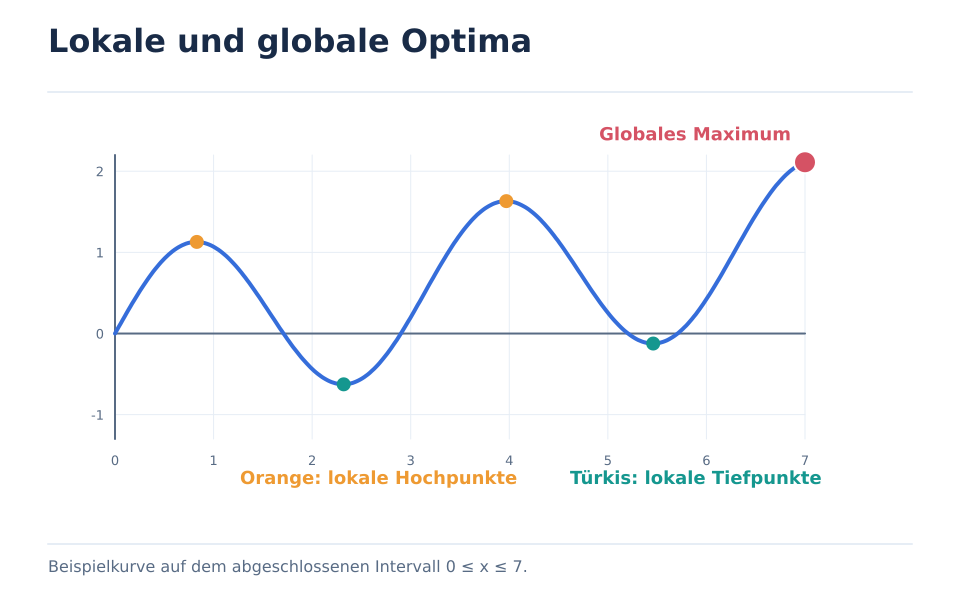

# M2-L6 – Optimierung mit Ableitungen {#L6}

**Kursbereich:** M2 – Oberstufe / Abitur

**Niveau:** Oberstufe / Abitur

**Vorwissen:** Keine festen Voraussetzungen angegeben.

**Einordnung:** Gymnasiale Oberstufe · Analysis und Modellierung

## Worum geht es? {#S1}

Optimierung bedeutet, unter vorgegebenen Bedingungen eine möglichst günstige Lösung zu finden. Je nach Aufgabe wollen wir Fläche, Gewinn oder Durchsatz maximieren oder Zeit, Kosten oder Energieverbrauch minimieren. Eine praktische Herausforderung besteht darin, zuerst eine Situation in eine mathematische Funktion zu übersetzen. Danach können Ableitungen mögliche Bestwerte aufspüren. Das Ergebnis muss aber gegen die **zulässigen Werte und die Randbedingungen** geprüft werden.

## Grundidee und Anschauung {#S2}

Stell dir vor, du hast nur eine bestimmte Menge Material und möchtest daraus eine möglichst große rechteckige Fläche abgrenzen. Die Länge der einen Seite beeinflusst zwangsläufig die andere Seite. Wenn du die eine Seite immer länger machst, wird die andere irgendwann so kurz, dass die Fläche wieder schrumpft. Es gibt also einen besten Kompromiss, der sich mathematisch bestimmen lässt.

Die drei Bausteine heißen **Zielgröße**, **Entscheidungsvariable** und **Nebenbedingung**. Die Zielgröße wird als Funktion der Entscheidungsvariable beschrieben; die Nebenbedingung schränkt die erlaubten Werte ein. Diese Sprache wird später auch in Operations Research und maschinellem Lernen verwendet.

## Neue Zeichen vor der ersten Formel {#S3}

  Zeichen           Aussprache                                       Bedeutung hier                                     Anderer möglicher Gebrauch
  ----------------- ------------------------------------------------ -------------------------------------------------- ----------------------------------------------
  $A(x)$            „a von iks“                                      Rechtecksfläche abhängig von einer Seitenlänge x   $A$ kann Ereignis, Matrix oder Punkt sein
  $x$               „iks“                                            Entscheidungsvariable: erste Seitenlänge           Sonst Koordinate oder Funktionsargument
  $y$               „ypsilon“                                        Zweite Seitenlänge                                 Sonst Funktionswert
  $[0;12]$          „abgeschlossenes Intervall von null bis zwölf“   Zulässige Werte einschließlich beider Grenzen      Eckige Klammern auch für Listen und Matrizen
  $A'(x)$           „a Strich von iks“                               Erste Ableitung der Zielfunktion                   Hochstrich hat weitere Verwendungen
  $A''(x)$          „a zwei Strich von iks“                          Zweite Ableitung; hilft bei der lokalen Prüfung    Kein Quadrat der ersten Ableitung
  `max` und `min`   „Maximum“, „Minimum“                             Größter bzw. kleinster zulässiger Wert             `max` in Programmen auch Funktionsname
  `≤`, `≥`          „kleiner gleich“, „größer gleich“                Ungleichungen für Nebenbedingungen                 Allgemeine Vergleiche

## Vom Problem zur Zielfunktion {#S4}

Eine rechteckige Fläche soll mit insgesamt **24 Metern Begrenzung** umschlossen werden. Alle vier Seiten benötigen Material. Gegenüberliegende Seiten sind gleich lang. Die Längen sollen nicht negativ sein. **Einheitenkonvention für die Rechnung:** $x$ und $y$ bezeichnen im folgenden Beispiel die **Zahlenwerte** der Seitenlängen in Metern, $A(x)$ den Zahlenwert der Fläche in Quadratmetern. So haben die Zahlen 24, 12 und 6 in den Gleichungen stets einen nachvollziehbaren Einheitenbezug.

Als **Nebenbedingung** gilt daher:

$$
2x+2y=24\qquad\text{(}x,y\text{: Zahlenwerte der Längen in Metern)}
$$

**Laut gelesen:** „Zwei mal iks plus zwei mal ypsilon sind vierundzwanzig.“ $x$ und $y$ sind die Zahlenwerte der beiden Seitenlängen in Metern, die jeweils zweimal zum Umfang beitragen. Der Umfang beträgt **24 m**; deshalb steht rechts der Zahlenwert 24.

Wir stellen nach der zweiten Länge um: $y=12-x$. Die Fläche eines Rechtecks ist Länge mal Breite. Nach dem Einsetzen bleibt nur noch die eine unabhängige Variable:

$$
A(x)=x\cdot(12-x)=12x-x^2
$$

**Laut gelesen:** „Die Fläche a von iks ist iks mal zwölf minus iks, also zwölf iks minus iks Quadrat.“ Für ein **nicht entartetes Rechteck** müssen beide Seiten positiv sein: $x>0$ und $y=12-x>0$, also $0<x<12$. Zur systematischen **Randbetrachtung** nehmen wir die Grenzfälle $x=0$ und $x=12$ rechnerisch hinzu; beide haben Fläche null, entsprechen aber keinem echten Rechteck. Außerhalb von $0\le x\le12$ würde eine negative Seitenlänge entstehen.

Die tatsächliche Fläche ist $A(x)$ **Quadratmeter** groß; $A(x)$ bezeichnet hier also ihren Zahlenwert und ist selbst keine physikalische Größe mit angehängter Einheit. Ein rechnerisches Maximum ohne zulässige Seitenlängen wäre keine gültige Lösung.

## Bestwertkandidaten mit einer Ableitung finden {#S5}

Für die Ableitung verwenden wir die bekannte Potenzregel:

$$
A'(x)=12-2x
$$

**Laut gelesen:** „a Strich von iks ist zwölf minus zwei iks.“ Die Ableitung beschreibt, wie stark die berechnete Fläche bei einer kleinen Änderung von $x$ zunimmt oder abnimmt. Da $A(x)$ hier nur den Zahlenwert der Fläche in Quadratmetern und $x$ nur den Zahlenwert der Länge in Metern meint, ist $A'(x)$ selbst eine Zahlenwert-Ableitung. Die **physikalische Änderungsrate der Fläche nach der Länge** hat die Einheit $\frac{\mathrm{m}^2}{\mathrm{m}}=\mathrm{m}$. Die Zahlenwerte stimmen für die gewählte Einheit Meter überein.

Wir suchen zunächst eine **waagerechte Tangente**, bei der die lokale Änderungsrate null ist:

$$
12-2x=0\quad\Longrightarrow\quad x=6
$$

**Laut gelesen:** „Zwölf minus zwei iks ist null; daraus folgt iks gleich sechs.“ Dann ist $y=12-6=6$. Ein Quadrat ist also ein Kandidat für die größte Fläche.

Das reicht allein noch nicht. Wir prüfen mit der zweiten Ableitung und den Randwerten:

$$
\begin{aligned}
A''(x)&=-2\\
A(0)&=0,\quad A(6)=36,\quad A(12)=0
\end{aligned}
$$

**Laut gelesen:** „Die zweite Ableitung ist minus zwei.“ Sie ist überall negativ: Die Funktion ist auf dem Intervall nach unten gekrümmt, und bei $x=6$ liegt ein striktes lokales Maximum vor. Dass der Wert **36 Quadratmeter** zugleich das **globale** Maximum für alle echten Rechtecke mit $0<x<12$ ist, lässt sich sogar exakt statt nur grafisch nachweisen. Wir ergänzen zum Quadrat: $A(x)=12x-x^2=36-{(x-6)}^2$. Ein Quadrat ist nie negativ, also ist dieser Ausdruck **höchstens 36** und genau dann 36, wenn $x=6$. Die Nullflächen an den **nur rechnerisch ergänzten Randpunkten** sind entsprechend kleiner. Die Randwerte sind Vergleichs- und Grenzwerte, keine eigenständigen Rechtecke.

**Ergebnis:** Mit einem Umfang von 24 Metern erhält das Rechteck bei $6\,\mathrm{m}\times6\,\mathrm{m}$ die größte Fläche, nämlich $36\,\mathrm{m}^2$. Das ist ein **Modellergebnis**, keine Anweisung für jede reale Grundstückssituation.

## Der Ablauf einer einfachen Optimierung {#S6}

Auch bei anderen Problemen hilft dieselbe gedankliche Reihenfolge:

1.  **Ziel festlegen:** Was soll möglichst groß oder klein werden – Kosten, Zeit, Ertrag, Fläche?
2.  **Variable bestimmen:** Was dürfen wir tatsächlich verändern?
3.  **Nebenbedingungen formulieren:** Welche Ressourcen, Grenzen, Beziehungen oder Sicherheitsanforderungen sind verbindlich?
4.  **Zielfunktion aufstellen:** Wie hängt die Zielgröße von der veränderlichen Größe ab?
5.  **Kandidaten ermitteln:** Ableitung gleich null setzen; außerdem Stellen ohne Ableitung und zulässige **Randpunkte** berücksichtigen.
6.  **Kandidaten vergleichen:** Nur erlaubte Werte liefern mögliche Lösungen. Bei globalen Optima zählen auch die Grenzen eines unbeschränkten Bereichs, soweit relevant.

Die Reihenfolge entspricht auch der Modellierung von Softwareproblemen: Erst nachdem geklärt ist, **was** verbessert werden soll und **welche Regeln** gelten, lässt sich ein geeigneter Algorithmus auswählen.

## Lokales und globales Optimum {#S7}

Ein **lokales Maximum** ist nur innerhalb einer kleinen Umgebung am größten. Bei einer Randstelle beziehen sich solche Umgebungen auf **zulässige** Werte; auch dort können globale Bestwerte liegen. Beispiel: $f(x)=x$ auf dem abgeschlossenen Intervall $[0;2]$ hat das globale Maximum $f(2)=2$ bei einem Randpunkt, obwohl $f'(x)=1$ im ganzen Inneren und **nirgends null** ist. Ein **globales Maximum** ist im gesamten zulässigen Bereich am größten. Dass eine Ableitung null wird, findet zunächst nur Kandidaten. Eine lokale Spitze kann geringer sein als eine andere Spitze oder sogar ein erlaubter Randwert.

Bei einem **abgeschlossenen und beschränkten Intervall** nimmt jede stetige reellwertige Funktion einen größten und einen kleinsten Wert an. Anders verhält es sich bei offenen Intervallen oder unbeschränkten Bereichen. Die Funktion $f(x)=x$ hat beispielsweise auf der offenen Menge $0<x<1$ keinen größten Funktionswert, obwohl sich ihre Werte eins beliebig nähern.

**Laut gelesen, die Einschränkung $0<x<1$:** „Iks ist größer als null und kleiner als eins.“ Die Endpunkte gehören nicht zum zulässigen Bereich. Ein nur angenäherter Grenzwert muss daher kein tatsächlich erreichbares Optimum sein.

## Technische Anwendung: Eine ideale Lösung ist nicht immer implementierbar {#S8}

Betrachten wir den Betrieb mehrerer paralleler Software-Aufträge. Eine theoretische Zielfunktion könnte mit einer reellen Variable für Rechenkapazität arbeiten. In der Wirklichkeit lässt sich aber beispielsweise die Anzahl gestarteter Prozesse häufig nur ganzzahlig wählen. Eine rechnerische Lösung $x=6{,}4$ Prozesse wäre dann gar nicht zulässig. Man muss stattdessen die erlaubten ganzen Zahlen in der Nähe prüfen – und möglicherweise weitere zulässige Werte, wenn das Modell kompliziert ist.

Bei KI-Systemen kann die zu minimierende **Verlustfunktion** von Millionen Parametern abhängen. Dort ersetzen Verfahren wie der Gradientenabstieg die einfache Kurvendiskussion. Die Grundidee bleibt verwandt: Änderungen berechnen, einen günstigen Schritt suchen und Nebenbedingungen respektieren. Das Studium dieser Verfahren folgt später in der universitären Optimierung.

## Wofür nützlich? {#S9}

Ein Optimierungsmodell hilft, Kosten und Kapazitäten zu vergleichen, etwa bei der Aufteilung von Serverressourcen auf mehrere Aufgaben. In der Planung technischer Systeme kann die bestmögliche Geometrie oder Einstellung innerhalb einer Material- oder Energiegrenze gesucht werden. Bei der KI-Steuerung kommen ähnliche Ziel- und Nebenbedingungsbegriffe zum Einsatz, allerdings oft in sehr viel mehr Dimensionen. Nicht jede reale Aufgabe lässt sich durch eine glatte Funktion einer einzigen Variablen darstellen.

## Annahmen und Grenzen {#S10}

- Die Rechtecksrechnung berücksichtigt nur einen festen Umfang, ebene Geometrie und frei wählbare Seitenlängen; Baurecht, Türen, Wandstärken und Materialverlust fehlen. $x=0$ und $x=12$ sind lediglich Grenzfälle des Rechenmodells, **keine zulässigen echten Rechtecke**.
- $A'(x)=0$ liefert **Kandidaten**, keine Garantie. Nicht differenzierbare Stellen und zulässige Randwerte können Optima tragen.
- Ein lokaler Bestwert muss nicht global optimal sein; in mehreren Variablen wird dieser Unterschied besonders wichtig.
- Kontinuierliche Variablen sind nicht mit diskreten Entscheidungen gleichzusetzen. Programme brauchen außerdem Toleranzen für numerische Rechenfehler.

## Verbindung zur nächsten Lektion {#S11}

Bisher haben wir aus einer Funktion ihre **momentane Änderung** bestimmt. M2-L7 kehrt die Blickrichtung um: Wie lässt sich aus einer bekannten Änderungsrate wieder eine ursprüngliche Funktion rekonstruieren?

## Quellen {#S12}

In dieser Lektion sind keine Einzelquellen gesondert verzeichnet.
