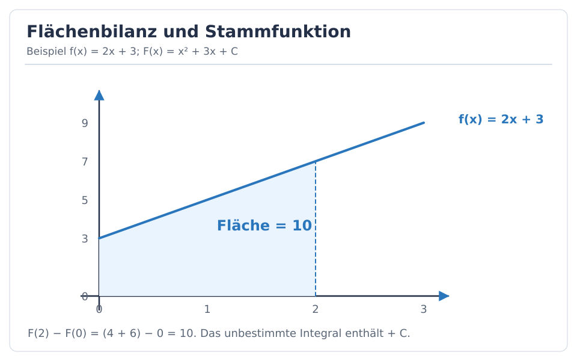

# M2-L7 – Stammfunktionen und Integralzeichen {#L7}

**Kursbereich:** M2 – Oberstufe / Abitur

**Niveau:** Oberstufe / Abitur

**Vorwissen:** Keine festen Voraussetzungen angegeben.

**Einordnung:** Gymnasiale Oberstufe · Einführung Integralrechnung

## Worum geht es? {#S1}

Mit einer Ableitung bestimmen wir, wie sich eine Größe im nächsten Moment verändert. Häufig kennen wir jedoch nur diese Änderung und wollen daraus die ursprüngliche Größe rekonstruieren. Eine solche Rückrechnung führt zum Begriff der **Stammfunktion**. Mit dem Integralzeichen kann man die Gesamtheit aller Stammfunktionen kompakt notieren. Das ist der Einstieg in die Integralrechnung, die in den nächsten Lektionen außerdem aufsummierte Änderungen und Flächenbilanzen beschreibt.

## Grundidee und Anschauung {#S2}

Angenommen, wir kennen die Geschwindigkeit eines bewegten Gegenstands zu jedem Zeitpunkt. Die Ableitung einer **Ortsfunktion auf einer geraden Achse** ergibt die **vorzeichenbehaftete Geschwindigkeit**; umgekehrt lässt sich daraus wieder ein Ort als Funktion der Zeit gewinnen. Diese Geschwindigkeitsangabe sagt aber noch nicht, **wo** der Gegenstand zu Beginn war. Sie unterscheidet sich von der stets nichtnegativen Geschwindigkeit als *Tempo*: Beim Umkehren kann die Ortsänderung negativ sein, auch wenn dabei weitere Strecke zurückgelegt wird. Deshalb enthält das Ergebnis eine zunächst freie additive Konstante, die eine Anfangsbedingung später festlegt.

Der Übergang von **Änderungsrate** zu **Bestandsgröße** ist auch in Softwaremodellen nützlich: Eine **Netto-Änderungsrate** aus Zu- und Abfluss beschreibt beispielsweise die Änderung der Länge einer Warteschlange, aber nicht ihren ursprünglichen Füllstand. Die Größe darf im realen Warteschlangenmodell nicht negativ werden; eine mathematisch zurückgerechnete Lösung muss daher bei Bedarf an die Modellgrenzen angepasst werden. Das bestimmte Integral – also die tatsächlich aufsummierte Veränderung über ein Intervall – kommt erst in M2-L8 ausführlich hinzu.

## Neue Zeichen vor der ersten Formel {#S3}

  Zeichen               Aussprache                          Bedeutung hier                                                              Anderer möglicher Gebrauch
  --------------------- ----------------------------------- --------------------------------------------------------------------------- --------------------------------------------------------------------------
  $F(x)$                „groß eff von iks“                  Stammfunktion zur Funktion $f(x)$                                           Großbuchstaben können Mengen, Matrizen oder andere Funktionen bezeichnen
  $F'(x)$               „groß eff Strich von iks“           Ableitung der Stammfunktion                                                 Ableitung ist aus M2-L3/M2-L4 bekannt
  $f(x)$                „klein eff von iks“                 Vorliegende Funktion, deren Stammfunktion gesucht ist                       Beliebige andere Funktionsvorschrift
  $\int$                „Integralzeichen“, „Integral von“   Kennzeichnet hier eine unbestimmte Integration                              Mit Grenzen steht es später für ein bestimmtes Integral
  $\mathrm{d}x$         „de iks“                            Kennzeichnet die Integrationsvariable x                                     In Differentialnotation eine eigene, kontextabhängige Rolle
  $C$                   „groß ce“                           Frei wählbare **Integrationskonstante**                                     Sonst beliebige Konstante oder Objektbezeichnung
  `∈`                   „ist Element von“                   Zugehörigkeit zu einer Menge                                                Allgemeine Mengenlehre, später vertieft
  $\mathbb R$           „Menge der reellen Zahlen“          Reeller Zahlenbereich                                                       Bereits in M1-L1 eingeführt
  $n$                   „en“                                Fester Exponent in der Potenzregel                                          Häufig auch Schrittzahl oder Index
  $k$                   „ka“                                Beliebiger konstanter Zahlenwert                                            In anderen Aufgaben Laufindex
  Betragsschreibweise   „Betrag von iks“                    Nichtnegativer Abstand von null; hier im Logarithmus für beide Vorzeichen   Auch Normen und andere Betragsnotationen

## Stammfunktion: Ableiten rückwärts denken {#S4}

Eine Funktion $F$ heißt Stammfunktion der Funktion $f$ auf einem Intervall, wenn $F$ dort differenzierbar ist und ihre Ableitung an jeder inneren Stelle des Intervalls gleich $f$ ist (an gegebenen Intervallrändern betrachtet man passende einseitige Ableitungen).

$$
F'(x)=f(x)
$$

**Laut gelesen:** „Die Ableitung von groß eff an der Stelle iks ist klein eff von iks.“ Die Gleichung legt fest, was mit **Stammfunktion** gemeint ist. Anders als beim Ableiten können mehrere unterschiedliche Funktionen dieselbe Ableitung besitzen.

Beispielsweise haben die Funktionen $x^2$, $x^2+5$ und $x^2-100$ alle dieselbe Ableitung $2x$. Durch das Ableiten fällt jede konstante Verschiebung weg. Deshalb wird beim Rückwärtsrechnen ein konstanter Zusatz benötigt.

## Das unbestimmte Integral {#S5}

Für die Familie aller Stammfunktionen verwenden wir eine kompakte Schreibweise:

$$
\int f(x)\,\mathrm{d}x=F(x)+C
$$

**Vollständig gelesen:** „Das unbestimmte Integral von klein eff von iks nach iks ist gleich groß eff von iks plus der Integrationskonstante ce.“

Die Bestandteile im Einzelnen:

- $\int$: ein langgezogenes S, historisch mit der Idee des Summierens verbunden. **Hier** kennzeichnet es das Finden von Stammfunktionen.
- $f(x)$: der **Integrand**, also der Ausdruck, den wir integrieren wollen.
- $\mathrm{d}x$: benennt die Variable, **nach der** integriert wird. In dieser Einführung sollte man $\mathrm{d}x$ nicht einfach als beliebig winzige Zahl behandeln, mit der man multipliziert.
- $F(x)$: eine ausgewählte Stammfunktion, deren Ableitung $f(x)$ ergibt.
- $+C$: die freie additive Konstante. Auf einem zusammenhängenden Intervall unterscheiden sich alle Stammfunktionen derselben Funktion nur um eine Konstante.

**Wichtig:** Das unbestimmte Integral ist in dieser Darstellung eine **Familie von Funktionen**, keine einzelne Flächenzahl. Die Flächen- und Bilanzdeutung mit **Integrationsgrenzen** behandeln wir in M2-L8.

## Ein vollständig erklärtes Mini-Beispiel {#S6}

Wir wollen eine Stammfunktion zur Funktion $f(x)=2x+3$ finden. Dafür erinnern wir uns an zwei Ableitungen: Die Ableitung von $x^2$ ist $2x$, und die Ableitung von $3x$ ist $3$.

{alt="Graph der Funktion f(x) gleich zwei x plus drei, positive Fläche unter dem Graphen von null bis zwei mit Inhalt zehn."}

Zur Stammfunktion $F(x)=x^2+3x+C$: Die Bilanz von 0 bis 2 beträgt 10.

$$
\begin{aligned}
f(x)&=2x+3\\
\int(2x+3)\,\mathrm{d}x&=x^2+3x+C
\end{aligned}
$$

**Laut gelesen:** „Eff von iks ist zwei iks plus drei. Das unbestimmte Integral von zwei iks plus drei nach iks ist gleich iks Quadrat plus drei iks plus ce.“

Warum stimmt das? Ableiten wir die gefundene Funktion $F(x)=x^2+3x+C$, erhalten wir $2x+3+0=2x+3$. Die Konstante $C$ verschwindet beim Ableiten. Damit erfüllt jede dieser Funktionen die Stammfunktionsbedingung.

Nun könnte eine **Anfangsbedingung** dazukommen: Der ursprüngliche Bestand beträgt für die Eingabe $x=0$ genau fünf Einheiten. Wir lesen dies als $F(0)=5$ und setzen ein: $0^2+3\cdot0+C=5$. Folglich ist $C=5$. Die dadurch festgelegte Stammfunktion lautet $F(x)=x^2+3x+5$.

## Einfache Integrationsregeln verstehen {#S7}

Viele Standardfunktionen können wir anhand der bekannten Ableitungsregeln rückwärts erkennen:

$$
\begin{aligned}
\int x^n\,\mathrm{d}x&=\frac{x^{n+1}}{n+1}+C\quad(n\neq-1;\ \text{geeigneter Bereich})\\
\int k\,\mathrm{d}x&=kx+C\quad(k\text{ ist eine Konstante})
\end{aligned}
$$

**Erste Formel gesprochen:** „Das Integral von iks hoch en nach iks ist iks hoch en plus eins geteilt durch en plus eins, plus ce.“ Der Exponent $n$ ist fest und darf für diese Formel nicht minus eins sein. Für **jeden reellen Exponenten $n\ne-1$** ist die Regel auf dem Intervall **$x>0$** gültig. Für ganzzahlige Exponenten gilt sie auch auf größeren passenden Bereichen, beispielsweise für $n=2$ auf ganz $\mathbb R$ oder für $n=-2$ auf jedem Intervall ohne null. Die Division durch $n+1$ setzt voraus, dass dieser Wert nicht null ist.

**Zweite Formel gesprochen:** „Das Integral der konstanten Zahl ka nach iks ist ka mal iks plus ce.“ Wenn die Änderungsrate stets gleich bleibt, verläuft der zurückgewonnene Bestand linear.

**Mini-Beispiel:** Für $\int x^2\,\mathrm{d}x$ erhöht man den Exponenten zwei auf drei und dividiert durch drei: $\frac{x^3}{3}+C$. Die Probe durch Ableiten ergibt wieder $x^2$.

### Die wichtige Ausnahme beim Exponenten minus eins {#abschnitt-8}

Bei $x^{-1}=\frac1x$ würde die eben genannte allgemeine Potenzformel eine Division durch null verlangen. Für $x>0$ gilt stattdessen:

$$
\int\frac1x\,\mathrm{d}x=\ln(x)+C\qquad(x>0)
$$

**Laut gelesen:** „Das Integral von eins durch iks nach iks ist der natürliche Logarithmus von iks plus ce.“ $\ln$ wurde bereits bei den Logarithmen behandelt. Für negative $x$ erhält man auf dem getrennten Intervall entsprechend $\ln(-x)+C$; zusammengefasst kann man auf einem Intervall ohne Null die Formel $\ln|x|+C$ schreiben. Die Betragsstriche bedeuten hier, dass der Wert zwischen ihnen ohne Vorzeichen betrachtet wird. Die Null selbst bleibt ausgeschlossen. Auf den zwei getrennten Intervallen $x<0$ und $x>0$ darf man für $\int\frac1x\,\mathrm{d}x$ **verschiedene additive Konstanten** wählen; nur innerhalb eines zusammenhängenden Intervalls ist der Unterschied zweier Stammfunktionen konstant.

## Die Verbindung zur Aufsummierung {#S8}

Warum heißt der neue Rechenschritt **Integration**? In einem zeitlichen Modell kann eine Änderungsrate für viele kleine Zeitabschnitte betrachtet werden. Addiert man die jeweiligen kleinen Änderungen immer feiner, gelangt man zur Idee eines **bestimmten Integrals**. Die Stammfunktion ermöglicht anschließend eine elegante Berechnung dieses aufsummierten Ergebnisses.

Wir sollten zwei Aussagen sauber auseinanderhalten:

  Frage                                                                            Gesuchtes Objekt                                   Kommt ausführlich in
  -------------------------------------------------------------------------------- -------------------------------------------------- ----------------------
  „Welche Funktion hat diese Ableitung?“                                           Familie von Stammfunktionen $F(x)+C$               M2-L7
  „Wie viel hat sich zwischen zwei Zeitpunkten insgesamt geändert?“                Eine Zahl mit geeigneter Einheit                   M2-L8
  „Warum kann ich eine aufsummierte Änderung über eine Stammfunktion berechnen?“   Hauptsatz der Differential- und Integralrechnung   M2-L9

## Wofür nützlich? {#S9}

Bei physikalischen Simulationen kann man aus einer **vorzeichenbehafteten Geschwindigkeitsfunktion** den Verlauf der Position rekonstruieren, sobald ein Anfangsort bekannt ist. Die **gesamte zurückgelegte Strecke** ist dagegen die aufsummierte Geschwindigkeit im Betrag: Ein Hin- und Rückweg kann eine Netto-Ortsänderung von null haben und trotzdem Weglänge verbrauchen. In der Energie- und Verbrauchsmodellierung führen zeitabhängige Raten zu gesamten Mengen. Bei Software-Metriken kann die Idee erklären, wie aus Durchsatzdaten ein Bestandsverlauf entsteht. In neuronalen Netzen sind Ableitungen alltäglich; das umgekehrte mathematische Denken begegnet eher bei kontinuierlichen Modellen, Wahrscheinlichkeitstheorie und dynamischen Systemen.

## Annahmen und Grenzen {#S10}

- $\int f(x)\,\mathrm{d}x$ bezeichnet **hier** ein unbestimmtes Integral, also eine Stammfunktionsfamilie; ohne Integrationsgrenzen berechnen wir noch keine konkrete Flächenbilanz.
- Eine stetige Funktion auf einem Intervall besitzt eine Stammfunktion. Eine Stammfunktion muss jedoch nicht immer durch eine einfache Kombination bekannter Elementarfunktionen darstellbar sein.
- Die Konstante $C$ ist auf einem **zusammenhängenden Intervall** frei wählbar. Besteht ein Definitionsbereich aus getrennten Intervallen, können die Konstanten auf ihnen unabhängig gewählt werden.
- Anfangsbedingungen müssen zum Funktionsmodell passen. Bei realen Messdaten entstehen zusätzlich Messfehler, Rundungsfehler und Unsicherheit über die Änderungsrate.
- Das Zeichen $\mathrm{d}x$ benennt in dieser Lektion die Integrationsvariable. Seine genauere Bedeutung wird an der Universität differenzierter erklärt.

## Verbindung zur nächsten Lektion {#S11}

In **M2-L8** setzen wir Grenzen an das Integralzeichen und beantworten erstmals direkt die Frage: **Wie groß ist die aufsummierte Veränderung zwischen zwei konkreten Stellen?**

## Quellen (extern) {#S12}

Keine externen Quellen angegeben.
