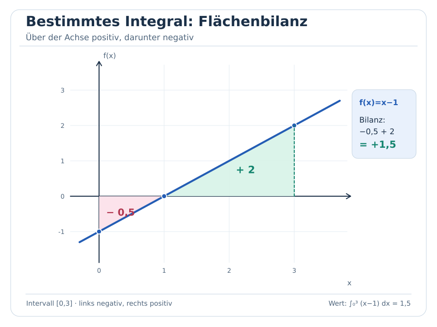

# M2-L8 – Bestimmte Integrale und Flächenbilanz {#L8}

**Kursbereich:** M2 – Oberstufe / Abitur

**Niveau:** Oberstufe / Abitur

**Vorwissen:** Keine festen Voraussetzungen angegeben.

**Einordnung:** Gymnasiale Oberstufe · Integralrechnung

## Worum geht es? {#S1}

Eine Änderungsrate sagt uns, wie rasch sich etwas **in einem bestimmten Moment** verändert. Häufig interessiert aber die **gesamte Veränderung über einen Zeitraum**. Wir könnten beispielsweise wissen, wie viele Pakete eine Maschine pro Stunde abarbeitet, und fragen, wie viele Pakete während einer ganzen Schicht bearbeitet wurden. Das bestimmte Integral fasst sehr viele kleine Beiträge zu einer Gesamtbilanz zusammen. Anders als das unbestimmte Integral aus M2-L7 liefert es für festgelegte Grenzen grundsätzlich **einen Zahlenwert**, nicht eine ganze Familie von Stammfunktionen.

## Grundidee und Anschauung {#S2}

Stell dir eine Kurve vor, die für jeden Zeitpunkt eine Zu- oder Abflussrate zeigt. Zerlegen wir die Zeit in kleine Abschnitte, können wir jeden Abschnitt näherungsweise als Rechteck ansehen: **Rate mal Zeitspanne** ergibt einen Beitrag zum Bestand. Viele solcher Beiträge ergeben eine Annäherung an die Gesamtänderung. Werden die Zeitabschnitte immer feiner, entsteht im geeigneten Fall ein Grenzwert: das bestimmte Integral.

Eigene Flächenbilanz zu $f(x)=x-1$ auf \[0,3\]: $-0{,}5+2=1{,}5$.

Grafisch sieht das nach einer Fläche zwischen Kurve und horizontaler Achse aus. Entscheidend ist jedoch das Vorzeichen: Oberhalb der Achse zählt die Fläche **positiv**, unterhalb **negativ**. Deshalb heißt das Ergebnis *orientierte Flächenbilanz* oder *vorzeichenbehaftete Fläche*.

## Neue Zeichen vor der ersten Formel {#S3}

  Zeichen        Aussprache                               Bedeutung hier                                                 Anderer möglicher Gebrauch
  -------------- ---------------------------------------- -------------------------------------------------------------- -------------------------------------------------------
  $\int$         „Integral von“                           Aufsummieren unendlich fein verteilter Beiträge; bereits M2-L7 Ohne Grenzen: Stammfunktionsfamilie
  $a$            „a“                                      Untere Integrationsgrenze / Anfangspunkt                       Allgemeine Zahl oder Parameter
  $b$            „be“                                     Obere Integrationsgrenze / Endpunkt                            Funktionsparameter oder andere Zahl
  $\int_a^b$     „Integral von a bis b“                   Bestimmtes Integral mit festgelegtem Bereich                   In LaTeX: `int_a^b`
  $f(x)$         „eff von iks“                            Die aufzusummierende Funktion, z. B. eine Rate                 Allgemeine Funktionsvorschrift
  $\mathrm{d}x$  „de iks“                                 Integration erfolgt bezüglich der Variablen x                  Differentialschreibweise, später präzisiert
  $F(b)-F(a)$    „groß eff von be minus groß eff von a“   Wert einer Stammfunktion an den Grenzen im Unterschied         $F$ kann sonst eine andere Funktion sein
  $\sum$         „großes Sigma“, „Summe“                  Zeichen für die Addition vieler Beiträge; hier als Ausblick    Allgemeines Summenzeichen in Statistik und Informatik
  $\Delta x$     „Delta iks“                              Breite eines kleinen Intervalls                                Änderung oder Abstand zweier x-Werte; aus M1-L8 bekannt

## Ein Integral mit oberer und unterer Grenze {#S4}

Die **untere Grenze** steht am Integralzeichen unten, die **obere Grenze** oben. Der Integrand steht zwischen Integralzeichen und dem Differential $\mathrm{d}x$.

$$
\begin{aligned}
&\int_a^b f(x)\,\mathrm{d}x
\end{aligned}
$$

**Vollständig gelesen:** „Das bestimmte Integral von klein eff von iks nach iks, von der unteren Grenze a bis zur oberen Grenze b.“

Hier bedeutet $f(x)$ die Höhe beziehungsweise Änderungsrate an der jeweiligen Stelle; $\mathrm{d}x$ benennt die Variable und erinnert an das Aufsummieren entlang ihrer Achse. $a$ und $b$ begrenzen genau den betrachteten Abschnitt. Für eine **stetige Funktion auf dem abgeschlossenen Intervall** zwischen $a$ und $b$ existiert dieses Integral (Riemann-Integral). Auch viele Funktionen mit einzelnen Sprungstellen sind integrierbar; Stetigkeit ist **hinreichend, aber nicht immer erforderlich**.

**Wichtiger Unterschied zu M2-L7:** $\int f(x)\,\mathrm{d}x$ ohne Grenzen bezeichnet eine Familie von Stammfunktionen mit $+C$. $\int_a^b f(x)\,\mathrm{d}x$ mit Grenzen ist eine Bilanzzahl – für ein korrektes Rechenmodell mit den entsprechenden Einheiten. Eine freie Integrationskonstante taucht im Ergebnis des bestimmten Integrals nicht auf.

## Wie die Rechnung mit einer Stammfunktion funktioniert {#S5}

Wenn $F$ auf dem betrachteten Intervall eine Stammfunktion von $f$ ist, gilt für eine stetige $f$:

$$
\int_a^b f(x)\,\mathrm{d}x=F(b)-F(a)
$$

**Vollständig gelesen:** „Das bestimmte Integral von f von x nach x zwischen a und b ist gleich dem Wert der Stammfunktion groß F an der oberen Grenze b minus ihrem Wert an der unteren Grenze a.“

Die **Zeichenrollen**: $\int$ summiert die Beiträge; $a$, $b$ definieren den Bereich; $f(x)$ ist die Integrandfunktion; $\mathrm{d}x$ gibt die Integrationsvariable an; $F$ ist irgendeine Stammfunktion mit $F'(x)=f(x)$; `−` bildet die Differenz zwischen Ende und Anfang. Die Konstante $C$ verschwindet automatisch, weil sie sowohl am Ende als auch am Anfang vorkäme und sich herauskürzt.

Diese Rechenregel ist ein Teil des **Hauptsatzes der Differential- und Integralrechnung**, den M2-L9 ausführlicher erklärt. Hier verwenden wir sie zunächst praktisch.

## Vollständig erklärtes Mini-Beispiel: positive und negative Beiträge {#S6}

Eine vereinfachte Änderungsrate sei $f(t)=2t-2$. Die Variable $t$ steht für den **Zahlenwert** der Zeit in Stunden, $f(t)$ für den **Zahlenwert** der Nettoänderungsrate in Stück pro Stunde. Die Zahl $2$ vor $t$ gehört dabei zur Steigung mit der Einheit Stück pro Stundenquadrat, die Konstante $-2$ zur Rate mit der Einheit Stück pro Stunde. Die Formel ist eine Zahlenwertgleichung für diese festgelegten Einheiten. Wir betrachten den Abschnitt von 0 bis 3 Stunden.

$$
\begin{aligned}
f(t)&=2t-2\\
F(t)&=t^2-2t\\
\int_0^3(2t-2)\,\mathrm{d}t&=F(3)-F(0)\\
&=(9-6)-(0-0)\\
&=3
\end{aligned}
$$

**Gesprochen:** „Das Integral von zwei mal te minus zwei nach te, von null bis drei, ist drei.“ Wir haben eine Stammfunktion gefunden, die obere Grenze eingesetzt und danach den Wert an der unteren Grenze abgezogen. Das Ergebnis bedeutet eine **Nettozunahme von drei Stück** über drei Stunden.

Warum ist das nicht einfach die geometrische Gesamtfläche? Zu Beginn gilt $f(0)=-2$: Die Rate ist negativ. Bei $t=1$ ist sie null, danach positiv. Der negative Beitrag zwischen 0 und 1 beträgt **−1 Stück**; der positive Beitrag zwischen 1 und 3 beträgt **+4 Stück**. Zusammen ergibt das die Bilanz **$-1+4=3\,\text{Stück}$**. Der über das gesamte Intervall aufaddierte **Betrag der Änderung** ist dagegen $1+4=5\,\mathrm{Stück}$. Im entsprechend skalierten Zeit-Rate-Diagramm entspricht dies der Summe der **nicht vorzeichenbehafteten Teilflächen**. Das Zahlenresultat ist gleich, aber die sachliche Einheit kommt aus „Rate mal Zeit“, also hier Stück.

**Eine wichtige Feinheit:** Eine negative Änderungsrate kann auch eine **Abnahme** des Bestands bedeuten, ohne dass der Bestand selbst negativ wäre.

## Geometrische Fläche und Flächenbilanz sind nicht dasselbe {#S7}

  Frage                                                                 Was wird gezählt?                                              Ergebnis im Beispiel
  --------------------------------------------------------------------- -------------------------------------------------------------- ------------------------------------------
  „Wie groß ist die **Nettoänderung**?“                                 Positive Beiträge minus negative Beiträge                      $3$ Stück
  „Wie groß ist die **Summe der nichtnegativen Teilflächen**?“          Alle Beiträge positiv, nötigenfalls an Nullstellen aufteilen   Zahlenwert $5$; im Ratenmodell $5$ Stück
  „Wie viel wurde **insgesamt bewegt**, unabhängig von der Richtung?“   Im Bewegungsmodell oft Integral des Geschwindigkeitsbetrags    Nicht dasselbe wie die Ortsänderung

Für den geometrischen Flächeninhalt kann man bei einer geeigneten integrierbaren Funktion auf einem **endlichen Intervall** den **Betrag** des Funktionswertes integrieren. Die Schreibweise $|f(x)|$ bedeutet „Betrag von f von x“; die senkrechten Striche machen negative Funktionswerte positiv. Diese Idee ist nur dann die richtige Antwort, wenn tatsächlich **alle Flächenteile positiv gezählt** werden sollen.

## Vertauschte Grenzen und Aufteilung des Intervalls {#S8}

Zwei praktische Regeln sind:

$$
\begin{aligned}
\int_a^b f(x)\,\mathrm{d}x&=-\int_b^a f(x)\,\mathrm{d}x\\
\int_a^c f(x)\,\mathrm{d}x+\int_c^b f(x)\,\mathrm{d}x&=\int_a^b f(x)\,\mathrm{d}x
\end{aligned}
$$

**Erste Regel gesprochen:** „Das Integral von a bis b ist das Negative des Integrals von b bis a.“ Tauscht man die Laufrichtung um, wechselt das Vorzeichen.

**Zweite Regel gesprochen:** „Die Bilanz von a bis c plus die Bilanz von c bis b ergibt die Bilanz von a bis b.“ Die neue Zwischenstelle $c$ (gesprochen „ce“) teilt den Bereich auf. In der linearen Klartextschreibweise `∫_a^c` kennzeichnet der Unterstrich die untere und das Dachzeichen die obere Grenze.

Beim Beispiel können wir so den Wechsel des Vorzeichens an $t=1$ getrennt untersuchen. Eine Zwischenstelle muss nicht zwischen a und b liegen, damit die algebraische Additivität gilt; für eine anschauliche zeitliche Aufteilung wählen wir sie gewöhnlich innerhalb des Intervalls.

## Von Rechtecknäherungen zum Grenzwert {#S9}

Ein grober Rechner nimmt beispielsweise für jeden Zeitabschnitt eine repräsentative Rate, multipliziert diese mit der Abschnittsdauer und addiert alle Beiträge. Für genügend regelmäßige Funktionen wird die Näherung bei immer schmaleren Rechtecken genauer. **Konkrete Kontrolle:** Bei unserem linearen Beispiel liefern drei 1-Stunden-Rechtecke mit dem jeweils **linken** Randwert die Näherung $-2+0+2=0$ Stück; sechs Rechtecke von je einer halben Stunde liefern $1{,}5$ Stück. Der exakte Bilanzwert beträgt $3$ Stück. Eine feinere Einteilung verbessert hier die linksseitige Näherung; sie muss bei anderen Funktionen nicht in jedem einzelnen Zwischenschritt monoton besser werden. Die mathematische Schreibweise verwendet häufig ein großes Sigma, das Summenzeichen $\sum$, und einen Grenzübergang. Die vollständige Konstruktion solcher *Riemann-Summen* behandeln wir später an der Universität.

Das ist die Brücke zwischen einer Formel im Lehrbuch und einem praktischen Numerik-Algorithmus: Rechenprogramme können das Integral näherungsweise durch diskrete Werte auswerten, auch wenn keine einfache Stammfunktion bekannt ist.

## Wofür nützlich? {#S10}

In der Informatik kann man aus einer zeitabhängigen Datenrate die insgesamt übertragenen Daten berechnen. In einer Simulation liefert die Integration einer signierten Geschwindigkeit eine Ortsänderung; für die gesamte zurückgelegte Strecke braucht man gegebenenfalls den Betrag. Bei KI-Systemen und Sensoren helfen Integrale, sich über die Zeit verändernde Signale zusammenzufassen. Bei Kosten- oder Energieprofilen wird aus einer Rate pro Zeiteinheit eine Gesamtmenge.

## Annahmen und Grenzen {#S11}

- Das Ergebnis ist eine **Bilanz**, nicht automatisch ein positiver Flächeninhalt.
- Die Grenzen, Einheiten und das Vorzeichen müssen zum realen Modell passen. Bei „Stück pro Stunde“ mal „Stunden“ erhalten wir Stück.
- $F(b)-F(a)$ erfordert eine passende Stammfunktion auf dem Intervall; existiert keine einfache geschlossene Darstellung, sind numerische Verfahren möglich.
- Bei Messwerten, die nur punktweise vorliegen, benötigt man Annahmen zur Entwicklung **zwischen** den Messpunkten. Die Integralrechnung liefert aus solchen Messpunkten allein keine eindeutige Fläche.
- Wenn die Funktion nicht auf dem ganzen Intervall ordentlich integrierbar ist, muss man den Fall gesondert prüfen; insbesondere unbeschränkte Funktionen oder unendliche Intervalle führen später zu **uneigentlichen Integralen**.

## Verbindung zur nächsten Einheit {#S12}

**M2-L9** erklärt, warum Aufsummierung und Ableitung so eng zusammenhängen: Der Hauptsatz der Differential- und Integralrechnung verbindet beide Ideen präzise miteinander und zeigt, wie aus Änderungsraten Bestände werden.

## Quellen {#S13}

In dieser Lektion sind keine Einzelquellen gesondert verzeichnet.
