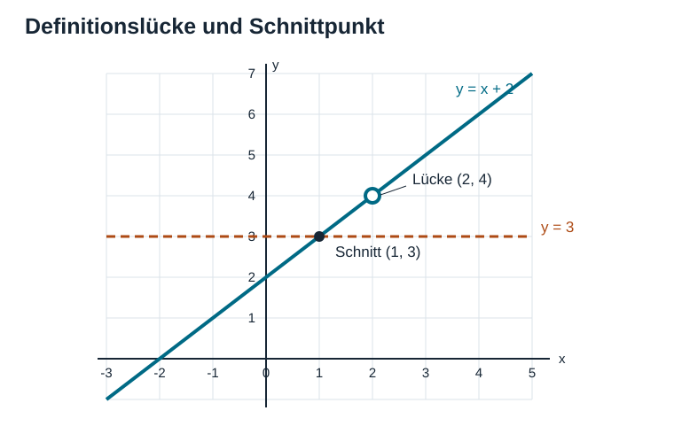

# M3-L1 – Bruchterme und Bruchgleichungen {#L1}

**Kursbereich:** M3 – Terme, Gleichungen und Ungleichungen

**Niveau:** Sekundarstufe I · Grundlagen

**Vorwissen:** [M1-L2](M1-L2.md); [M1-L3](M1-L3.md)

**Einordnung:** Ergänzung zum mathematischen Kern, orientiert an LehrplanPLUS Bayern M8.

## Lernziele {#S1}

Nach dieser Lektion kannst du die Definitionsmenge eines Bruchterms bestimmen, Bruchterme unter Erhalt ihrer Definitionsmenge umformen und Bruchgleichungen mit einer Probe lösen. Du erkennst, wann eine rechnerische Lösung wegen einer Definitionslücke nicht zulässig ist.

## Definitionsmenge vor der Rechnung {#S2}

Ein Bruchterm ist hier ein Quotient zweier Polynome. Der Zähler steht über dem Bruchstrich, der Nenner darunter. Wir rechnen in der Grundmenge $\mathbb R$ (reelle Zahlen). Weil eine Division durch null nicht definiert ist, schließen wir die Nullstellen sämtlicher ursprünglicher Nenner aus. Beispiel:

$$T(x)=\frac{x^2-4}{x-2},\qquad D=\mathbb R\setminus\{2\}.$$

Das Zeichen $\setminus$ bedeutet „ohne“, $D$ ist die Definitionsmenge. Für $x\ne2$ lässt sich der Zähler in $(x-2)(x+2)$ zerlegen. Kürzen ergibt $T(x)=x+2$, aber nur für $x\in D$ (gelesen: x ist Element von D). Der vereinfachte Term hat als eigenständige Funktion eine größere Definitionsmenge als der ursprüngliche. Am Punkt $(2,4)$ fehlt dem ursprünglichen Graphen ein Punkt; diese Lücke bleibt beim Umformen erhalten.

{alt="Koordinatensystem: steigende Gerade mit offenem Kreis bei 2,4; horizontale Gerade bei y gleich 3; ausgefüllter Schnittpunkt bei 1,3."}

## Rechnen mit Bruchtermen {#S3}

| Rechenart | Regel | Bedingung |
| --- | --- | --- |
| Erweitern | $\frac ab=\frac{ac}{bc}$ | $b\ne0,c\ne0$ |
| Kürzen | $\frac{ac}{bc}=\frac ab$ | $b\ne0,c\ne0$ |
| Addition / Subtraktion | $\frac ab\pm\frac cd=\frac{ad\pm bc}{bd}$ | $b\ne0,d\ne0$ |
| Multiplikation | $\frac ab\cdot\frac cd=\frac{ac}{bd}$ | $b\ne0,d\ne0$ |
| Division | $\frac ab:\frac cd=\frac{ad}{bc}$ | $b\ne0,d\ne0,c\ne0$ |

Die Buchstaben stehen für Zahlen oder Terme; bei variablen Ausdrücken gelten die Bedingungen für jede Einsetzung. Nur gemeinsame Faktoren dürfen gekürzt werden, nicht einzelne Summanden. So ist $(x+3)/x$ nicht gleich 3. Ein gemeinsamer Nenner muss für alle zulässigen Eingaben ungleich null sein.

Beispiel: $\frac{2}{x}+\frac1{x+1}=\frac{3x+2}{x(x+1)}$, wobei $x\ne0,-1$. Bei $\frac{x}{x+1}:\frac{x-2}{x}$ sind zusätzlich $x\ne2$ und $x\ne0,-1$ erforderlich. Das Ergebnis $\frac{x^2}{(x+1)(x-2)}$ darf die ursprüngliche Einschränkung $x\ne0$ nicht verlieren.

## Eine Bruchgleichung lösen {#S4}

Gesucht ist die Gleichheit $\frac{x^2-4}{x-2}=3$. Zuerst notieren wir $D=\mathbb R\setminus\{2\}$. Auf dieser Menge ist das Multiplizieren beider Seiten mit $x-2$ umkehrbar:

$$x^2-4=3x-6\quad\Longleftrightarrow\quad(x-1)(x-2)=0.$$

Die Kandidaten sind 1 und 2. Nur 1 liegt in $D$. Probe: $(1-4)/(1-2)=3$. Die Lösungsmenge ist $L=\{1\}$. Die Abbildung in S2 zeigt dieselbe Lösung als Schnittpunkt; bei $x=2$ existiert kein Funktionswert. Beim Lösen über das vereinfachte $x+2=3$ erhältst du direkt denselben Wert, sofern du die Definitionsmenge beibehältst.

## Anwendung: gemeinsamer Durchfluss {#S5}

Eine Pumpe befüllt einen Tank allein in 6 Stunden. Eine zweite benötigt $x$ Stunden. Bei konstanten, additiven Raten und gemeinsamem Start füllen beide den Tank in 4 Stunden. Eine Tankfüllung ist die Einheit; die Füllraten sind $1/6$ und $1/x$ Tankfüllungen pro Stunde. Damit gilt $1/6+1/x=1/4$, also $1/x=1/12$ und $x=12$. Der Sachbereich ist $x>0$, nicht bloß $x\ne0$. Probe: $1/6+1/12=1/4$. Wenn sich Pumpen gegenseitig beeinflussen oder die Rate nicht konstant ist, ist dieses Modell nicht ohne Weiteres gültig.

## Selbstkontrolle {#S6}

### Aufgaben

1. Bestimme die Definitionsmenge von $(x^2-9)/(x-3)$ und vereinfache. Ist der ursprüngliche Term bei $x=3$ definiert?
2. Berechne $2/(x-1)+3/(x+1)$ mit Definitionsmenge.
3. Löse $x/(x-2)=3$ und führe die Probe durch.
4. Begründe, warum $(x^2-9)/(x-3)=6$ keine Lösung hat.
5. Eine Maschine erledigt einen Auftrag in 10 Stunden; zwei zusammen in 4 Stunden. Bestimme die Einzelzeit der zweiten Maschine unter denselben Modellannahmen wie in S5.

::: {.lc-solutions data-lc-section="S6"}
1. $D=\mathbb R\setminus\{3\}$, vereinfacht $x+3$ auf $D$. Der Wert bei 3 bleibt ausgeschlossen.
2. $D=\mathbb R\setminus\{-1,1\}$, Ergebnis $(5x-1)/(x^2-1)$.
3. $x\ne2$; $x=3(x-2)$ ergibt $x=3$. Probe: $3/(3-2)=3$.
4. Auf $D$ gilt $x+3=6$, also nur der Kandidat 3. Dieser ist nicht zulässig; $L=\varnothing$.
5. $1/x=1/4-1/10=3/20$. Damit $x=20/3$ Stunden, also 6 Stunden 40 Minuten. Beide Raten summieren sich zu $1/4$.
:::

## Verbindungen und Grenzen {#S7}

Wiederhole [M1-L2](M1-L2.md) zur Bruchrechnung und [M1-L3](M1-L3.md) zu Umformungen. In [M2-L1](M2-L1.md) werden Funktionsklassen weiter untersucht. Bruchungleichungen benötigen zusätzlich die Vorzeichen des Nenners; die Regeln für lineare Ungleichungen im nächsten Schritt [M3-L2](M3-L2.md) sind dafür eine Voraussetzung. Die vorliegende Lektion bleibt bei Gleichungen und reellen Eingaben.

## Quellen {#S8}

- [Serlo – Rechnen mit Bruchtermen](https://de.serlo.org/mathe/156343/rechnen-mit-bruchtermen) · Abschnitt 4, Definitionsmenge und Erhalt beim Vereinfachen; dort rationale Grundmenge, hier ausdrücklich reelle Grundmenge · Zuletzt abgerufen: 2026-11-24 · Inhaltlich geprüft: 2026-11-24
- [Serlo – Bruchgleichungen lösen](https://de.serlo.org/mathe/1851/bruchgleichungen-loesen) · Vorgehensweise und Ausschluss unzulässiger Kandidaten · Zuletzt abgerufen: 2026-11-24 · Inhaltlich geprüft: 2026-11-24
