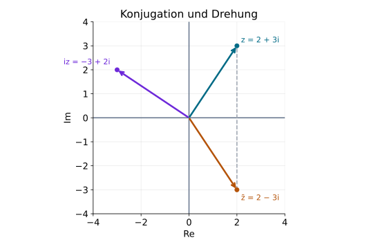

# M4-L1 – Komplexe Zahlen in der Zahlenebene {#L1}

**Kursbereich:** M4 – Komplexe Zahlen

**Niveau:** Gymnasiale Oberstufe · Wahlvertiefung

**Vorwissen:** [M1-L7](M1-L7.md); [M1-L20](M1-L20.md)

**Einordnung:** Wahlvertiefung nach LehrplanPLUS Bayern M12; nicht bundesweit verpflichtend.

## Lernziele {#S1}

Du stellst komplexe Zahlen in algebraischer Form und in der Gaußschen Zahlenebene dar, rechnest mit ihnen und begründest die Division mithilfe der konjugierten Zahl.

## Erweiterung der reellen Zahlen {#S2}

Die Gleichung $x^2=-1$ hat in den reellen Zahlen keine Lösung. Wir erweitern den Zahlenbereich zu $\mathbb C$ und führen eine Zahl $i$ mit $i^2=-1$ ein. Jede komplexe Zahl besitzt genau eine Darstellung $z=a+bi$ mit $a,b\in\mathbb R$. Dabei sind $\operatorname{Re}(z)=a$ und $\operatorname{Im}(z)=b$ reelle Zahlen; der Imaginärteil ist nicht $bi$. Die reellen Zahlen entsprechen den Punkten mit $b=0$. Beispielsweise ist $-3i=0-3i$. Zwei komplexe Zahlen sind genau dann gleich, wenn beide Komponenten übereinstimmen. Die Gleichung $z^2=-9$ besitzt die beiden Lösungen $3i$ und $-3i$.

## Rechnen mit zwei Komponenten {#S3}

Addition und Subtraktion erfolgen komponentenweise. Beim Multiplizieren wird ausmultipliziert und $i^2$ durch $-1$ ersetzt:

$$ (a+bi)(c+di)=(ac-bd)+(ad+bc)i. $$

Beispiel: $(2+3i)(1-2i)=2-4i+3i-6i^2=8-i$. Die Potenzen von $i$ wiederholen sich alle vier Schritte: $1,i,-1,-i,1$. Deshalb gilt $i^{27}=i^3=-i$. Das Distributivgesetz bleibt gültig. Die reelle Ordnung lässt sich dagegen nicht als mit allen Rechenoperationen verträgliche Ordnung auf $\mathbb C$ übertragen: Wäre $i>0$ oder $-i>0$, müsste das Quadrat positiv sein, obwohl es $-1$ ist.

## Geometrie, Betrag und Konjugation {#S4}

Die komplexe Zahl $a+bi$ entspricht dem Punkt $(a,b)$. Addition entspricht der Vektoraddition. Die konjugierte Zahl $\bar z=a-bi$ ist die Spiegelung an der reellen Achse. Der Betrag $|z|=\sqrt{a^2+b^2}$ ist der Abstand zum Ursprung; aus $(a+bi)(a-bi)$ folgt $z\bar z=|z|^2$. Für $z=2+3i$ beträgt er $\sqrt{13}$. Multiplikation mit $i$ liefert $iz=-b+ai$: eine Drehung um 90° gegen den Uhrzeigersinn um den Ursprung. Der Betrag bleibt dabei gleich.

{alt="Zahlenebene mit z bei (2,3), konjugierter Zahl bei (2,−3) und iz bei (−3,2)."}

## Division durch eine komplexe Zahl {#S5}

Für $w=c+di\ne0$ ist $c^2+d^2>0$. Wir erweitern mit $\bar w$, um einen reellen Nenner zu erhalten:

$$\frac{a+bi}{c+di}=\frac{(a+bi)(c-di)}{c^2+d^2}=\frac{ac+bd+(bc-ad)i}{c^2+d^2}.$$

Beispiel: $(4+2i)/(1-i)=(2+6i)/2=1+3i$. Probe: $(1+3i)(1-i)=4+2i$. Eine Division durch null bleibt unzulässig. Der Kehrwert $1/z$ ist $\bar z/|z|^2$ für $z\ne0$; er ist im Allgemeinen nicht einfach die konjugierte Zahl.

## Anwendung: Drehung und Skalierung {#S6}

Ein Punkt $z=3-i$ wird mit $2i$ multipliziert. Das Resultat $2+6i$ hat den doppelten Abstand zum Ursprung und ist um 90° gedreht. Dies verbindet zwei geometrische Operationen in einer einzigen Multiplikation. Für eine Drehung um einen anderen Punkt $p$ muss zunächst $z-p$ gebildet, dann gedreht und schließlich $p$ wieder addiert werden. Die nächste Lektion [M4-L2](M4-L2.md) verallgemeinert diese Darstellung auf beliebige Winkel.

## Selbstkontrolle {#S7}

### Aufgaben

1. Berechne $(3-2i)+(1+5i)$ und $(3-2i)(1+5i)$.
2. Bestimme Betrag und Konjugierte von $-5+12i$.
3. Berechne $(3+i)/(2-i)$ und prüfe durch Multiplikation.
4. Bestimme alle Lösungen von $z^2+16=0$.
5. Drehe den Punkt $2-i$ um 90° gegen den Uhrzeigersinn um den Punkt $1+i$. Verwende die Verschiebungsmethode.

::: {.lc-solutions data-lc-section="S7"}
1. Summe $4+3i$; Produkt $3+15i-2i-10i^2=13+13i$.
2. Betrag $13$; Konjugierte $-5-12i$.
3. Erweitern mit $2+i$: $(5+5i)/5=1+i$. Probe $(1+i)(2-i)=3+i$.
4. $(z-4i)(z+4i)=z^2+16$; beide Lösungen $4i,-4i$.
5. Differenz $1-2i$; nach Drehung $2+i$; nach Rückverschiebung $3+2i$.
:::

## Quellen {#S8}

- [OpenStax – Precalculus 2e, 3.1 Complex Numbers](https://openstax.org/books/precalculus-2e/pages/3-1-complex-numbers) · Algebraische Form, Konjugation, Rechenoperationen · Zuletzt abgerufen: 2026-11-24 · Inhaltlich geprüft: 2026-11-24
- [OpenStax – Precalculus 2e, 8.5 Polar Form of Complex Numbers](https://openstax.org/books/precalculus-2e/pages/8-5-polar-form-of-complex-numbers) · Zahlenebene, Betrag und Winkel · Zuletzt abgerufen: 2026-11-24 · Inhaltlich geprüft: 2026-11-24
