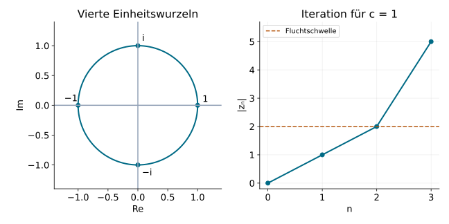

# M4-L2 – Polarform, Einheitswurzeln und Iteration {#L2}

**Kursbereich:** M4 – Komplexe Zahlen

**Niveau:** Gymnasiale Oberstufe · Wahlvertiefung

**Vorwissen:** [M4-L1](M4-L1.md); [M1-L20](M1-L20.md)

**Einordnung:** Wahlvertiefung nach LehrplanPLUS Bayern M12; nicht bundesweit verpflichtend.

## Lernziele {#S1}

Du wechselst zwischen algebraischer und Polarform, bestimmst sämtliche n-ten Wurzeln, löst quadratische Gleichungen und unterscheidest bei komplexer Iteration beweisbare Divergenz von numerischer Vermutung.

## Polarform und Winkel {#S2}

Für $z=a+bi\ne0$ gilt $z=r(\cos\varphi+i\sin\varphi)$ mit $r=|z|>0$. Der Winkel $\varphi$ ist nur bis auf ganzzahlige Vielfache von $2\pi$ eindeutig. Die Abkürzung $\operatorname{cis}\varphi$ bezeichnet $\cos\varphi+i\sin\varphi$. Für $z=-1+i$ ist $r=\sqrt2$, $\varphi=3\pi/4$; ein einfacher Arkustangens des Quotienten $b/a$ würde den falschen Quadranten liefern. Nutze die Lage in der Ebene oder eine zweistellige Winkelfunktion atan2. Für $z=0$ gibt es keinen ausgezeichneten Winkel.

## Multiplikation und Potenzen {#S3}

Die trigonometrischen Additionstheoreme liefern $\operatorname{cis}\alpha\operatorname{cis}\beta=\operatorname{cis}(\alpha+\beta)$. Damit werden bei der Multiplikation die Beträge multipliziert und Winkel addiert. Bei Division durch eine von null verschiedene Zahl werden Beträge dividiert und Winkel subtrahiert. Durch wiederholte Anwendung erhält man die Formel von de Moivre für positive ganze $n$:

$$[r\operatorname{cis}\varphi]^n=r^n\operatorname{cis}(n\varphi).$$

Beispiel: $(1+i)^4=(\sqrt2)^4\operatorname{cis}(\pi)=-4$. Anders als bei der Multiplikation dürfen bei der Addition die Polarparameter nicht komponentenweise addiert werden.

## Wurzeln und quadratische Gleichungen {#S4}

Für $w=R\operatorname{cis}\theta\ne0$ mit $R>0$ sind alle Lösungen von $z^n=w$ bei ganzzahligem $n\ge1$:

$$z_k=R^{1/n}\operatorname{cis}\left(\frac{\theta+2\pi k}{n}\right),\quad k=0,\ldots,n-1.$$

Die Lösungen liegen gleichmäßig verteilt auf einem Kreis; beim Potenzieren entstehen jeweils Winkel, die sich nur um Vielfache von $2\pi$ unterscheiden. Für $w=1,n=4$ erhält man $1,i,-1,-i$. Für $w=0$ ist nur $z=0$ möglich. Die quadratische Gleichung $z^2-2z+5=0$ wird zu $(z-1)^2=-4$ und besitzt die Lösungen $1\pm2i$. Die Ergänzung zum Quadrat funktioniert auch über $\mathbb C$; beide Wurzelwerte müssen berücksichtigt werden.

{alt="Einheitskreis mit vier Wurzeln und Iterationswerte 0, 1, 2, 5 mit Schwelle 2."}

## Iteration: die Mandelbrot-Menge {#S5}

Wir wählen einen festen komplexen Parameter $c$ und starten bei $z_0=0$. Die Rekursion lautet $z_{n+1}=z_n^2+c$. Für $c=-1$ wechselt die Folge zwischen 0 und −1; für $c=1$ beginnt sie mit 0, 1, 2, 5 und wächst danach unbegrenzt. Die Mandelbrot-Menge besteht genau aus den Parametern $c$, deren gesamte Bahn beschränkt bleibt. Für $|c|\le2$ gilt nach Überschreiten von 2: $|z_{n+1}|\ge |z_n|^2-2>|z_n|$. Ist $r=|z_n|>2$, bleibt der Zuwachs mindestens $r^2-r-2>0$. Damit wächst der Betrag unbegrenzt. Für $|c|>2$ beginnt die Bahn bereits bei $|z_1|=|c|$; für $r\ge|c|$ gilt $|z_{n+1}|\ge r^2-|c|\ge r(r-1)>r$, sodass auch dann Divergenz folgt. Das Überschreiten von 2 ist also ein hinreichendes Abbruchkriterium.

## Ein numerisches Experiment {#S6}

Wähle ein Gitter von Parametern und berechne für jeden die Bahn höchstens $N=50$ Schritte. Markiere einen Parameter als entkommen, sobald $|z|^2>4$ ist; sonst als noch nicht entschieden. Durch höhere Schrittzahl können weitere entkommende Punkte sichtbar werden. Ein endlicher Lauf beweist ohne zusätzlichen analytischen Nachweis keine Zugehörigkeit. Auch Gleitkommafehler können Grenzfälle beeinflussen. Als Kontrollwerte dienen $c=0$ (konstant), $c=-2$ (Bahn 0, −2, 2, 2, …) und $c=1$ (entkommen im dritten Schritt). Das strikte Größerzeichen ist wesentlich.

## Selbstkontrolle {#S7}

### Aufgaben

1. Wandle $-\sqrt3+i$ in Polarform um.
2. Berechne $(2\operatorname{cis}(\pi/6))^3$.
3. Bestimme die drei Lösungen von $z^3=8$.
4. Löse $z^2+4z+13=0$.
5. Berechne für $c=i$ die ersten vier Iterationswerte nach $z_0=0$. Beweist das Ergebnis die Zugehörigkeit?

::: {.lc-solutions data-lc-section="S7"}
1. $r=2$, $\varphi=5\pi/6$ (modulo $2\pi$).
2. $8\operatorname{cis}(\pi/2)=8i$.
3. $2,-1+i\sqrt3,-1-i\sqrt3$.
4. $(z+2)^2=-9$, also $-2\pm3i$.
5. $z_1=i$, $z_2=-1+i$, $z_3=-i$, $z_4=-1+i=z_2$. Da die Rekursion deterministisch ist, wiederholt sich die Bahn periodisch; hier ist die Beschränktheit bewiesen, nicht bloß vermutet.
:::

## Quellen {#S8}

- [OpenStax – Precalculus 2e, 8.5 Polar Form of Complex Numbers](https://openstax.org/books/precalculus-2e/pages/8-5-polar-form-of-complex-numbers) · Polarform, de Moivre, n-te Wurzeln · Zuletzt abgerufen: 2026-11-24 · Inhaltlich geprüft: 2026-11-24
- [University of Massachusetts Boston – The Mandelbrot Set](https://www.math.umb.edu/~lbnguyen/blog/mandelbrot.html) · Definition und Fluchtkriterium, Theoreme 1 und 2 · Zuletzt abgerufen: 2026-11-24 · Inhaltlich geprüft: 2026-11-24
