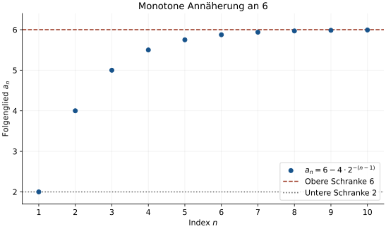

# M5-L1 – Folgen, Rekursion und vollständige Induktion {#L1}

**Kursbereich:** M5 – Folgen und Reihen

**Niveau:** Gymnasiale Oberstufe · Wahlvertiefung

**Vorwissen:** [M1-L17](M1-L17.md); [M1-L19](M1-L19.md)

**Einordnung:** Wahlvertiefung nach LehrplanPLUS Bayern M12; nicht bundesweit verpflichtend.

## Lernziele {#S1}

Du beschreibst Folgen explizit und rekursiv, führst vollständige Induktionsbeweise und untersuchst Monotonie, Schranken und Grenzwerte. Du unterscheidest eine Vermutung anhand weniger Folgenglieder von einer Aussage über alle natürlichen Zahlen.

## Folgen als Funktionen {#S2}

Eine reelle Folge ordnet jeder natürlichen Zahl ab einem Startindex genau eine reelle Zahl zu. Hier beginnen wir mit $n=1$. Die Reihenfolge ist wesentlich: Eine Folge ist keine ungeordnete Menge. Eine explizite Vorschrift liefert $a_n$ direkt aus $n$, eine rekursive Vorschrift aus früheren Gliedern und einem Startwert. Beispiel: $a_n=3n+2$ ergibt $5,8,11,14,\ldots$; gleichwertig sind $a_1=5$ und $a_{n+1}=a_n+3$. Eine arithmetische Folge hat konstante Differenz $d$, also $a_n=a_1+(n-1)d$. Eine geometrische Folge erfüllt $a_{n+1}=qa_n$ und $a_n=a_1q^{n-1}$. Für $q=0$ gilt die letzte Formel für $n\ge2$, mit separat gegebenem Startwert. Das erste Glied und der Startindex dürfen nicht verwechselt werden.

## Rekursion und Induktion {#S3}

Betrachte $a_1=2$, $a_{n+1}=(a_n+6)/2$. Die ersten Werte sind $2,4,5,5{,}5$. Eine mögliche explizite Formel lautet $a_n=6-4\cdot2^{-(n-1)}$. Um sie zu beweisen, zeigen wir zunächst den Induktionsanfang: Für $n=1$ ergibt die Formel $6-4=2$. Im Induktionsschritt nehmen wir die Behauptung für ein beliebiges $k\ge1$ an. Dann folgt

$$a_{k+1}=\frac{6-4\cdot2^{-(k-1)}+6}{2}=6-4\cdot2^{-k}.$$

Das ist genau die Behauptung für $k+1$. Beide Schritte zusammen beweisen die Formel für alle $n\ge1$. Die Annahme für $k$ allein ist kein Beweis; die Herleitung des nächsten Falls ist entscheidend.

## Monotonie und Beschränktheit {#S4}

Eine Folge ist monoton wachsend, wenn $a_{n+1}\ge a_n$, und monoton fallend, wenn $a_{n+1}\le a_n$ für alle betrachteten Indizes. Bei strenger Monotonie gelten die strikten Ungleichungen. Eine obere Schranke $B$ erfüllt $a_n\le B$ für alle $n$, eine untere Schranke $b$ erfüllt $b\le a_n$. Für unsere rekursive Folge ist $a_{n+1}-a_n=2\cdot2^{-(n-1)}>0$. Außerdem gilt $2\le a_n<6$. Ein Graph zeigt nur endlich viele Punkte; der Nachweis folgt aus der Formel. Die Folge $(-1)^n$ ist beschränkt, aber nicht monoton und besitzt keinen Grenzwert.

{alt="Diskrete Folgenglieder von n gleich 1 bis 10 zwischen 2 und 6; gestrichelte obere Schranke bei 6."}

## Grenzwerte {#S5}

Ein Grenzwert $L$ bedeutet: Zu jeder positiven Fehlertoleranz $\varepsilon$ gibt es einen Index $N$, sodass für alle $n\ge N$ gilt $|a_n-L|<\varepsilon$. Einzelne Werte müssen $L$ nicht erreichen. Der Monotoniesatz besagt, dass eine monoton wachsende, nach oben beschränkte reelle Folge konvergiert; analog gilt dies für fallende, nach unten beschränkte Folgen. Für unsere Folge gilt sogar $|a_n-6|=4\cdot2^{-(n-1)}$. Diese Abweichung halbiert sich bei jedem Schritt und geht gegen null. Für eine Toleranz von $0{,}1$ genügt $N=7$, denn $4/64=0{,}0625<0{,}1$. Alle späteren Abweichungen sind kleiner.

## Vom Modell zum Beweis {#S6}

In einem vereinfachten Temperaturmodell wird jede Minute die Hälfte der Differenz zur Umgebungstemperatur von 20 °C ausgeglichen. Bei $T_1=12$ gilt $T_{n+1}=(T_n+20)/2$. Die Abweichung $20-T_n$ wird halbiert, also $T_n=20-8\cdot2^{-(n-1)}$. Die Folge wächst und nähert sich 20 °C. Eine Grenzwertgleichung $L=(L+20)/2$ liefert zwar den möglichen Grenzwert, setzt aber die Konvergenz bereits voraus. Zum Vergleich erfüllt $b_1=1$, $b_{n+1}=-b_n$ die mögliche Grenzwertgleichung $L=-L$, konvergiert jedoch nicht. Das Temperaturmodell setzt eine konstante Umgebung und eine konstante Ausgleichsrate voraus; reale Messungen können abweichen.

## Selbstkontrolle {#S7}

### Aufgaben

1. Gib die explizite Formel und das sechste Glied für $a_1=7$, $a_{n+1}=a_n-2$ an.
2. Beweise durch Induktion $1+3+\cdots+(2n-1)=n^2$ für $n\ge1$.
3. Untersuche $b_n=3+1/n$ auf Monotonie, Schranken und Grenzwert.
4. Zeige für die Folge aus S3, ab welchem kleinsten Index $|a_n-6|<1/100$ gilt.
5. Untersuche $c_n=(-1)^n/n$ auf Monotonie und Konvergenz.

::: {.lc-solutions data-lc-section="S7"}
1. $a_n=7-2(n-1)$, $a_6=-3$.
2. Anfang: $1=1^2$. Annahme: Die Summe bis zum $k$-ten Glied ist $k^2$. Schritt: $k^2+(2(k+1)-1)=k^2+2k+1=(k+1)^2$. Damit gilt die Aussage für alle $n\ge1$.
3. $b_{n+1}-b_n=-1/[n(n+1)]<0$. Es gilt $3<b_n\le4$, und $1/n\to0$, also $b_n\to3$.
4. $n=9$ ergibt $4/256=1/64>1/100$, $n=10$ ergibt $4/512=1/128<1/100$. Wegen der Halbierung ist $N=10$ minimal.
5. Nicht monoton: Vorzeichenwechsel mit kleiner werdendem Betrag; $|c_n|=1/n\to0$, also $c_n\to0$.
:::

## Quellen {#S8}

- [OpenStax – Calculus Volume 2, 5.1 Sequences](https://openstax.org/books/calculus-volume-2/pages/5-1-sequences) · Folgen, Monotonie und Konvergenz · Zuletzt abgerufen: 2026-11-24 · Inhaltlich geprüft: 2026-11-24
- [Oscar Levin – Discrete Mathematics: An Open Introduction, Proof by Induction](https://discrete.openmathbooks.org/dmoi4/sec_seq-induction.html) · Induktionsprinzip und Beweisstruktur · Zuletzt abgerufen: 2026-11-24 · Inhaltlich geprüft: 2026-11-24
