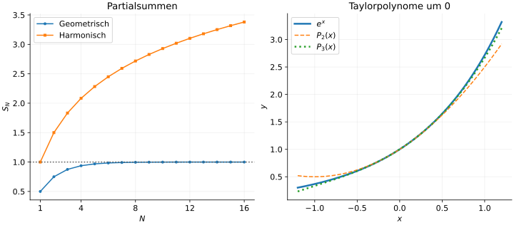

# M5-L2 – Reihen und Taylorpolynome {#L2}

**Kursbereich:** M5 – Folgen und Reihen

**Niveau:** Gymnasiale Oberstufe · Wahlvertiefung

**Vorwissen:** [M5-L1](M5-L1.md); [M2-L4](M2-L4.md)

**Einordnung:** Wahlvertiefung nach LehrplanPLUS Bayern M12; nicht bundesweit verpflichtend.

## Lernziele {#S1}

Du berechnest Partialsummen geometrischer Reihen, begründest Konvergenz oder Divergenz und approximierst die Exponentialfunktion durch Taylorpolynome mit einer Fehlerschranke.

## Folge, Partialsumme und Reihe {#S2}

Zu einer Folge $(a_n)$ gehört die Partialsummenfolge $S_N=\sum_{n=1}^N a_n$. Eine unendliche Reihe $\sum_{n=1}^\infty a_n$ konvergiert genau dann, wenn $S_N$ einen endlichen Grenzwert hat. Nur dann nennen wir diesen Grenzwert die Summe der Reihe. Beispiel: $a_n=2^{-n}$ hat die ersten Glieder $1/2,1/4,1/8$; die Partialsummen sind $1/2,3/4,7/8$. Folge und Reihe haben verschiedene Grenzwerte. Weil $a_N=S_N-S_{N-1}$ gilt, müssen die Glieder jeder konvergenten Reihe gegen null gehen. Die Umkehrung ist falsch.

## Geometrische Reihen {#S3}

Für $N\ge1$ und $q\ne1$ setzen wir $G_N=a\sum_{k=0}^{N-1}q^k$. Subtrahiert man $qG_N$ von $G_N$, bleiben nur Anfangs- und Endterm:

$$G_N-qG_N=a(1-q^N),\qquad G_N=\frac{a(1-q^N)}{1-q}.$$

Für $q=1$ ist $G_N=Na$. Falls $|q|<1$, geht $q^N$ gegen null und die unendliche Reihe besitzt den Wert $a/(1-q)$. Für $a\ne0$ und $|q|\ge1$ können die Glieder nicht gegen null gehen, daher divergiert die Reihe. Bei $a=0$ ist jede Partialsumme null. Beispiel: $4+2+1+\cdots=8$. Nach fünf Gliedern ist die Partialsumme $31/4$; der fehlende Rest beträgt $1/4$. Allgemein ist der Rest bei $|q|<1$ gleich $aq^N/(1-q)$.

## Die harmonische Reihe {#S4}

Die Glieder $1/n$ gehen gegen null, aber ihre Reihe divergiert. Betrachte die Partialsummen $H_N=\sum_{n=1}^N1/n$. Nach dem ersten Glied gruppieren wir die Summanden bis zu den Indizes $2,4,8,16,\ldots$. Der Block von $2^{j-1}+1$ bis $2^j$ enthält $2^{j-1}$ Terme, jeder mindestens $1/2^j$. Jeder Block trägt daher mindestens $1/2$ bei. Folglich gilt $H_{2^m}\ge1+m/2$ für $m\ge1$. Die Partialsummen sind unbeschränkt, also gibt es keinen endlichen Grenzwert. Auch sehr langsames Wachstum ist Divergenz.

## Taylorpolynome {#S5}

Ein Taylorpolynom stimmt mit einer hinreichend oft differenzierbaren Funktion am Entwicklungspunkt $a$ in ihrem Wert und den Ableitungen bis zur Ordnung $m$ überein:

$$P_m(x)=\sum_{k=0}^m\frac{f^{(k)}(a)}{k!}(x-a)^k.$$

Dabei sind $f^{(0)}=f$ und $0!=1$. Für $f(x)=e^x$ und $a=0$ haben alle Ableitungen dort den Wert 1. Damit ergibt sich $P_2(x)=1+x+x^2/2$ und $P_3(x)=P_2(x)+x^3/6$. Bei $x=0{,}5$ liefert $P_3=79/48\approx1{,}645833$, während $e^{0{,}5}\approx1{,}648721$. Die Annäherung ist lokal; weiter vom Entwicklungspunkt entfernt kann der Fehler größer werden.

{alt="Links geometrische Partialsummen mit Grenze 1 und wachsende harmonische Partialsummen; rechts Exponentialfunktion und Taylorpolynome zweiten und dritten Grades."}

## Fehlerschranke und Taylorreihe {#S6}

Als weiterführenden Satz verwenden wir Taylors Restglied in Lagrange-Form: Wenn $f$ auf dem Intervall zwischen $a$ und $x$ hinreichend glatt ist und $|f^{(m+1)}(t)|\le M$ dort gilt, dann

$$|f(x)-P_m(x)|\le\frac{M|x-a|^{m+1}}{(m+1)!}.$$

Für die Exponentialfunktion auf $[0,0{,}5]$ ist $M=e^{0{,}5}<2$. Bei $m=3$ und $x=0{,}5$ ist der Fehler kleiner als $2(1/2)^4/24=1/192\approx0{,}00521$. Für jedes feste reelle $x$ kann man $M=e^{|x|}$ wählen. Der Ausdruck $|x|^{m+1}/(m+1)!$ geht gegen null, denn für $x\ne0$ ist das Verhältnis aufeinanderfolgender Terme $|x|/(m+2)$ und schließlich höchstens $1/2$; für $x=0$ sind die Terme null. Damit ist für diese Funktion die Gleichheit $e^x=\sum_{k=0}^\infty x^k/k!$ begründet. Für andere Funktionen muss die Konvergenz zur Funktion separat geprüft werden; die Existenz aller Ableitungen allein genügt nicht.

## Selbstkontrolle {#S7}

### Aufgaben

1. Berechne die Summe der ersten vier Glieder und die unendliche Summe von $3\sum_{k=0}^\infty(1/3)^k$.
2. Konvergiert $\sum_{k=0}^\infty(-1)^k$? Begründe über die Partialsummen.
3. Begründe ohne Dezimalrechnung $H_{32}\ge 7/2$.
4. Berechne $P_2(-1/2)$ für $e^x$ um null und gib eine Fehlerschranke mit $M=1$ an.
5. Finde für $x=1/2$ den kleinsten Grad $m\ge0$, für den die Schranke $2(1/2)^{m+1}/(m+1)!$ kleiner als $0{,}001$ ist.

::: {.lc-solutions data-lc-section="S7"}
1. $G_4=(9/2)(1-1/81)=40/9$; unendliche Summe $9/2$.
2. Nein. Die Partialsummen wechseln zwischen 1 und 0, besitzen also keinen Grenzwert.
3. $32=2^5$. Fünf Blöcke tragen je mindestens $1/2$ zusätzlich zum Anfangsterm 1 bei: $H_{32}\ge1+5/2=7/2$.
4. $P_2(-1/2)=1-1/2+1/8=5/8$. Auf $[-1/2,0]$ ist $e^t\le1$, daher $|R_2|\le (1/2)^3/6=1/48$.
5. Bei $m=3$ beträgt die Schranke $1/192>0{,}001$; bei $m=4$ ist sie $1/1920<0{,}001$. Die Schranke fällt mit wachsendem Grad, daher ist $m=4$ minimal.
:::

## Quellen {#S8}

- [OpenStax – Calculus Volume 2, 5.2 Infinite Series](https://openstax.org/books/calculus-volume-2/pages/5-2-infinite-series) · Geometrische und harmonische Reihe · Zuletzt abgerufen: 2026-11-24 · Inhaltlich geprüft: 2026-11-24
- [OpenStax – Calculus Volume 2, 6.3 Taylor and Maclaurin Series](https://openstax.org/books/calculus-volume-2/pages/6-3-taylor-and-maclaurin-series) · Taylorpolynome und Restglied · Zuletzt abgerufen: 2026-11-24 · Inhaltlich geprüft: 2026-11-24
