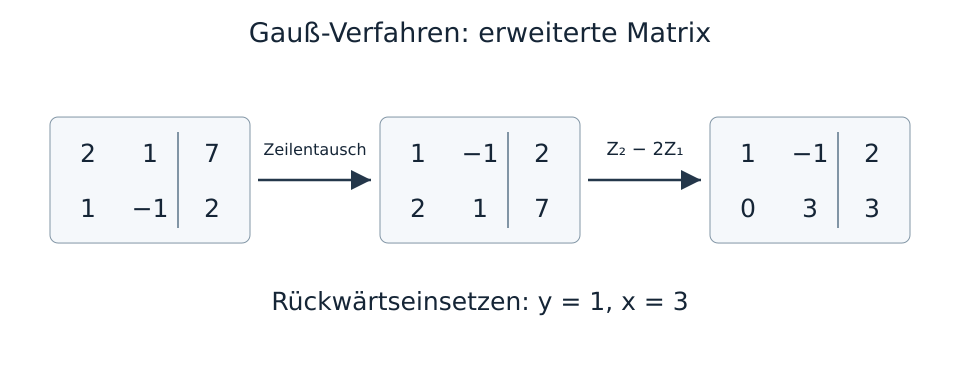

# M6-L1 – Matrizenrechnung und Gauß-Verfahren {#L1}

**Kursbereich:** M6 – Matrizen und Übergangsmodelle

**Niveau:** Gymnasiale Oberstufe · Wahlvertiefung

**Vorwissen:** [M1-L9](M1-L9.md); [M2-L13](M2-L13.md)

**Einordnung:** Wahlvertiefung nach LehrplanPLUS Bayern M12; nicht bundesweit verpflichtend.

## Lernziele {#S1}

Du liest Matrizen mit korrekten Dimensionen, addierst und multiplizierst sie, löst lineare Gleichungssysteme durch reversible Zeilenoperationen und unterscheidest eindeutige, unendlich viele und fehlende Lösungen. Du prüfst eine inverse Matrix durch Multiplikation.

## Matrizen als geordnete Daten {#S2}

Eine Matrix $A=(a_{ij})$ mit $m$ Zeilen und $n$ Spalten hat das Format $m\times n$. Der erste Index bezeichnet die Zeile, der zweite die Spalte. In einem Schulkiosk könnten zwei Zeilen zwei Verkaufstage und drei Spalten drei Produkte darstellen. In

$$A=\begin{pmatrix}4&2&1\\3&0&5\end{pmatrix}$$

steht $a_{23}=5$ für fünf Einheiten des dritten Produkts am zweiten Tag. Matrizen gleicher Form werden eintragsweise addiert; bei der Multiplikation mit einer Zahl wird jeder Eintrag skaliert. So ist $2A$ die Matrix der verdoppelten Mengen, während $A+A$ dieselbe Form behält. Matrizen verschiedener Form lassen sich nicht addieren.

## Matrixprodukt und Reihenfolge {#S3}

Für $A$ vom Format $m\times n$ und $B$ vom Format $n\times p$ gilt $(AB)_{ij}=\sum_{k=1}^n a_{ik}b_{kj}$. Die inneren Dimensionen stimmen überein; das Produkt hat das Format $m\times p$. Mit dem Preisvektor $v=(2,3,4)^T$ in Euro erhält der Kiosk $Av=(18,26)^T$ Euro. Ein Eintrag entsteht aus einer Zeile und einer Spalte, nicht durch Multiplikation gleich positionierter Einträge.

Selbst bei quadratischen Matrizen ist die Reihenfolge entscheidend. Für

$$C=\begin{pmatrix}1&1\\0&1\end{pmatrix},\qquad D=\begin{pmatrix}2&0\\0&3\end{pmatrix}$$

ist $CD=\begin{pmatrix}2&3\\0&3\end{pmatrix}$, aber $DC=\begin{pmatrix}2&2\\0&3\end{pmatrix}$. Matrixmultiplikation ist assoziativ, im Allgemeinen jedoch nicht kommutativ. Bei Spaltenvektoren bedeutet $CDx$: zuerst $D$, dann $C$.

## Gauß-Verfahren {#S4}

Ein Gleichungssystem wird als erweiterte Matrix $[A\mid b]$ notiert. Erlaubt sind Zeilentausch, Multiplikation einer Zeile mit einer von null verschiedenen Zahl und Addition eines Vielfachen einer anderen Zeile. Jede Operation lässt sich umkehren und bewahrt deshalb die Lösungsmenge. Das Pivot-Element ist der führende Eintrag, mit dem darunterliegende Einträge eliminiert werden. Ist ein vorgesehener Pivot null, suche darunter einen geeigneten Eintrag und tausche die Zeilen; existiert keiner, gehe zur nächsten Spalte.

Beispiel: $2x+y=7$, $x-y=2$. Tausche zunächst die Zeilen und subtrahiere dann das Doppelte der ersten Zeile von der zweiten:

$$\left(\begin{array}{cc|c}2&1&7\\1&-1&2\end{array}\right)\to\left(\begin{array}{cc|c}1&-1&2\\2&1&7\end{array}\right)\to\left(\begin{array}{cc|c}1&-1&2\\0&3&3\end{array}\right).$$

Rückwärtseinsetzen ergibt $y=1$ und $x=3$. Die Probe liefert $6+1=7$ und $3-1=2$. Eine Zeile $[0\;0\mid 1]$ bedeutet einen Widerspruch. Eine Nullzeile bedeutet dagegen nur eine redundante Gleichung. Bleibt in einem widerspruchsfreien System eine Variable ohne Pivot, darf sie frei gewählt werden; es existieren dann unendlich viele reelle Lösungen.

{alt="Drei erweiterte Matrizen: Zeilentausch, Elimination von 2 unter dem Pivot, danach Rückwärtseinsetzen."}

## Einheitsmatrix und Inverse {#S5}

Die Einheitsmatrix $I_n$ hat Einsen auf der Hauptdiagonalen und sonst Nullen. Eine quadratische Matrix $A$ ist invertierbar, wenn eine Matrix $A^{-1}$ mit $AA^{-1}=A^{-1}A=I_n$ existiert. Für eine $2\times2$-Matrix gilt

$$\begin{pmatrix}a&b\\c&d\end{pmatrix}^{-1}=\frac1{ad-bc}\begin{pmatrix}d&-b\\-c&a\end{pmatrix}$$

sofern $ad-bc\ne0$. Für $E=\begin{pmatrix}2&1\\1&1\end{pmatrix}$ ist $E^{-1}=\begin{pmatrix}1&-1\\-1&2\end{pmatrix}$. Das Produkt ergibt $I_2$. Für größere quadratische Matrizen kann man $[A\mid I]$ durch Zeilenoperationen in $[I\mid A^{-1}]$ überführen, sofern links tatsächlich die Einheitsmatrix erreichbar ist. Ist $A$ invertierbar, hat $Ax=b$ genau die Lösung $x=A^{-1}b$. Bei nicht invertierbarem $A$ muss die Lösbarkeit separat geprüft werden.

## Modellieren und kontrollieren {#S6}

Ein Theater verkauft insgesamt 30 Karten zu 8 oder 12 Euro und nimmt 300 Euro ein. Mit $x$ günstigen und $y$ teuren Karten gilt $x+y=30$ und $8x+12y=300$. Subtrahiert man das Achtfache der ersten Gleichung von der zweiten, erhält man $4y=60$, also $y=15$ und $x=15$. Die Modellprüfung verlangt hier außerdem nichtnegative ganze Zahlen. Eine mathematische Lösung wie $y=15{,}25$ wäre in diesem Kontext keine gültige Kartenanzahl. Bei gerundeten Messdaten können kleine Pivots Rundungsfehler verstärken; deshalb sind exakte Brüche in Handrechnungen und eine Probe im Originalsystem sinnvoll.

## Selbstkontrolle {#S7}

### Aufgaben

1. Bestimme das Format von $A$ aus S2 sowie $a_{12}$ und berechne $Av$ für $v=(1,2,3)^T$.
2. Berechne $CD$ und $DC$ aus S3 und begründe die unterschiedliche Reihenfolge der Abbildungen.
3. Löse $x+2y=8$, $3x-y=3$ mit Gauß und Probe.
4. Untersuche die Systeme $x+y=4$, $2x+2y=8$ bzw. $2x+2y=9$ (jeweils mit derselben ersten Gleichung).
5. Berechne die Inverse von $F=\begin{pmatrix}3&2\\1&1\end{pmatrix}$ und löse $Fz=(7,3)^T$.

::: {.lc-solutions data-lc-section="S7"}
1. $2\times3$, $a_{12}=2$ und $Av=(11,18)^T$.
2. $CD=\begin{pmatrix}2&3\\0&3\end{pmatrix}$; $DC=\begin{pmatrix}2&2\\0&3\end{pmatrix}$. Bei Spaltenvektoren wirkt der rechte Faktor zuerst.
3. Zweite Zeile minus dreimal erste Zeile ergibt $-7y=-21$, also $y=3$, $x=2$. Probe: $2+6=8$, $6-3=3$.
4. Im ersten Fall entsteht $0=0$; alle $(x,y)=(4-t,t)$ mit $t\in\mathbb R$ lösen das System. Im zweiten Fall entsteht $0=1$, also keine Lösung.
5. $\det F=1$, $F^{-1}=\begin{pmatrix}1&-2\\-1&3\end{pmatrix}$. Daraus $z=(1,2)^T$; Probe: $3+4=7$, $1+2=3$.
:::

## Quellen {#S8}

- [OpenStax – College Algebra 2e, 7.5 Matrices and Matrix Operations](https://openstax.org/books/college-algebra-2e/pages/7-5-matrices-and-matrix-operations) · Matrizenoperationen · Zuletzt abgerufen: 2026-11-24 · Inhaltlich geprüft: 2026-11-24
- [OpenStax – College Algebra 2e, 7.6 Solving Systems with Gaussian Elimination](https://openstax.org/books/college-algebra-2e/pages/7-6-solving-systems-with-gaussian-elimination) · Zeilenoperationen · Zuletzt abgerufen: 2026-11-24 · Inhaltlich geprüft: 2026-11-24
- [OpenStax – College Algebra, 7.7 Solving Systems with Inverses](https://openstax.org/books/college-algebra/pages/7-7-solving-systems-with-inverses) · Inverse und Lösbarkeit · Zuletzt abgerufen: 2026-11-24 · Inhaltlich geprüft: 2026-11-24
