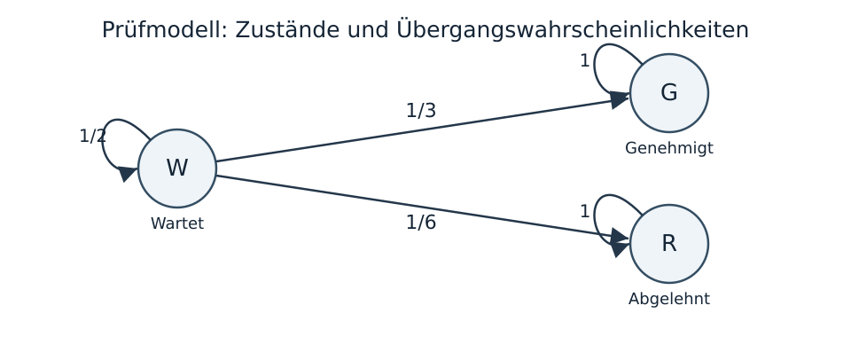

# M6-L2 – Übergangsmatrizen und absorbierende Zustände {#L2}

**Kursbereich:** M6 – Matrizen und Übergangsmodelle

**Niveau:** Gymnasiale Oberstufe · Wahlvertiefung

**Vorwissen:** [M6-L1](M6-L1.md); [M2-L15](M2-L15.md)

**Einordnung:** Wahlvertiefung nach LehrplanPLUS Bayern M12; nicht bundesweit verpflichtend.

## Lernziele {#S1}

Du übersetzt ein Zustandsdiagramm in eine Übergangsmatrix, berechnest Verteilungen nach mehreren Schritten und prüfst Fixverteilungen. Für ein Modell mit absorbierenden Zuständen bestimmst du die Wahrscheinlichkeit eines endgültigen Ergebnisses und unterscheidest Modellannahmen von Messdaten.

## Zustände und Übergangsmatrix {#S2}

Ein zeitdiskreter Prozess wird zu den Zeitpunkten $n=0,1,2,\ldots$ beobachtet. Eine homogene Markow-Kette setzt voraus, dass die bedingte Verteilung des nächsten Zustands nur vom aktuellen Zustand abhängt und die Übergangswahrscheinlichkeiten zeitlich konstant sind. Wir verwenden Zeilenvektoren: $p_{ij}$ ist die Wahrscheinlichkeit für den Übergang von Zustand $i$ nach Zustand $j$. Jede Zeile von $P$ summiert sich zu eins; alle Einträge sind nichtnegativ. Bei der alternativen Spaltenvektorkonvention wäre die Matrix transponiert.

Ein vereinfachtes Modell für einen Fahrradverleih unterscheidet $A$ (Rad an Station A) und $B$ (Rad an Station B). Die hypothetischen Übergänge pro Tag seien

$$P=\begin{pmatrix}3/4&1/4\\1/2&1/2\end{pmatrix}.$$

Ein Rad an A bleibt mit Wahrscheinlichkeit $3/4$ dort, während ein Rad an B mit Wahrscheinlichkeit $1/2$ zu A wechselt. Die Zahlen sind erfunden; sie beschreiben keinen gemessenen Verleihbetrieb.

## Verteilungen und mehrere Schritte {#S3}

Eine Verteilung $v_n=(a_n,b_n)$ enthält die Wahrscheinlichkeiten der beiden Zustände; $a_n+b_n=1$. Für den nächsten Schritt gilt nach dem Satz der totalen Wahrscheinlichkeit $v_{n+1}=v_nP$. Beispielsweise startet ein Rad sicher an A, also $v_0=(1,0)$. Dann $v_1=(3/4,1/4)$ und

$$v_2=v_1P=(9/16+1/8,3/16+1/8)=(11/16,5/16).$$

Allgemein gilt $v_n=v_0P^n$, wobei $P^0=I$. Die Einträge von $P^2$ sind Zweischrittwahrscheinlichkeiten. So ergibt sich die Wahrscheinlichkeit A nach zwei Tagen aus zwei disjunkten Wegen A–A–A und A–B–A. Die Summe der Wahrscheinlichkeiten bleibt eins, da jede Zeile von $P$ die Summe eins hat.

## Fixverteilung und Grenzverhalten {#S4}

Eine Fixverteilung $\pi$ erfüllt $\pi P=\pi$, hat nichtnegative Einträge und Summe eins. Für $\pi=(a,1-a)$ liefert die erste Komponente $a=3a/4+(1-a)/2$, also $a=2/3$. Damit ist $\pi=(2/3,1/3)$. Im Fahrradmodell gilt sogar $a_{n+1}=1/2+a_n/4$ und somit $a_{n+1}-2/3=(a_n-2/3)/4$. Daraus folgt $a_n=2/3+(a_0-2/3)4^{-n}$: Die Verteilung nähert sich unabhängig vom Start der Fixverteilung.

Die Existenz einer Fixverteilung allein garantiert jedoch keine Konvergenz. Für $P=\begin{pmatrix}0&1\\1&0\end{pmatrix}$ ist $(1/2,1/2)$ stationär, während der Start $(1,0)$ zwischen $(1,0)$ und $(0,1)$ wechselt. Ebenso kann es mehrere Fixverteilungen geben, beispielsweise für die Einheitsmatrix.

## Absorbierende Zustände {#S5}

Ein Zustand ist absorbierend, wenn er nach dem Eintritt mit Wahrscheinlichkeit eins beibehalten wird. Ein vereinfachtes Prüfverfahren für einen Gegenstand hat die Zustände $W$ (wartet auf Entscheidung), $G$ (genehmigt) und $R$ (abgelehnt). Pro Prüfrunde bleibt der Gegenstand mit Wahrscheinlichkeit $1/2$ in W, wird mit $1/3$ genehmigt und mit $1/6$ abgelehnt. G und R sind endgültig. In der Reihenfolge W, G, R lautet die Matrix

$$Q=\begin{pmatrix}1/2&1/3&1/6\\0&1&0\\0&0&1\end{pmatrix}.$$

{alt="W führt mit 1/3 nach G, mit 1/6 nach R und mit 1/2 zurück nach W. G und R haben Selbstschleifen mit Wahrscheinlichkeit 1."}

Die Wahrscheinlichkeit, nach $n$ Schritten noch zu warten, ist $2^{-n}$. Sie geht gegen null; irgendwann wird also mit Wahrscheinlichkeit eins eine Entscheidung erreicht. Ist $h$ die Wahrscheinlichkeit einer späteren Genehmigung bei Start W, liefert die Zerlegung nach dem ersten Schritt $h=1/3+h/2$. Die Ablehnung trägt null bei, die Genehmigung eins. Also $h=2/3$ und die endgültige Ablehnungswahrscheinlichkeit ist $1/3$. Nach genau $n$ Runden ist die Genehmigungswahrscheinlichkeit $(2/3)(1-2^{-n})$, denn jede weitere Runde überträgt ein Drittel der verbliebenen Wartemasse nach G.

## Anwendung und Grenzen {#S6}

Um Übergänge aus Beobachtungen zu schätzen, teilt man für jede Ausgangszeile die Anzahl der Übergänge zu einem Ziel durch die Gesamtzahl beobachteter Übergänge aus dem Ausgangszustand. Bei fehlenden Beobachtungen ist diese Zeile nicht schätzbar. Prüfe anhand getrennter Beobachtungszeiträume, ob die Wahrscheinlichkeiten stabil sind. Wenn beispielsweise Wetter oder Wochentag die Fahrradbewegungen beeinflussen, kann ein Modell mit zwei konstanten Zuständen unzureichend sein. Eine größere Zustandsmenge oder zeitabhängige Matrizen können dann sinnvoll sein. Absorption ist außerdem nicht schon durch die Existenz eines absorbierenden Zustands garantiert: Von anderen Zuständen muss dieser auch erreichbar sein; sonst kann Masse dauerhaft außerhalb verbleiben.

## Selbstkontrolle {#S7}

### Aufgaben

1. Prüfe, ob $\begin{pmatrix}1/3&2/3\\1/4&3/4\end{pmatrix}$ eine Übergangsmatrix in Zeilenkonvention ist. Berechne die Verteilung nach einem Schritt ab Zustand 2.
2. Berechne $P^2$ für das Fahrradmodell aus S2 und die Verteilung nach zwei Tagen ab B.
3. Löse die Fixverteilungsgleichung für die Matrix aus Aufgabe 1.
4. Berechne für das Prüfmodell die Verteilung nach zwei Runden ab W.
5. Ändere die erste Zeile des Prüfmodells zu $(1/4,1/4,1/2)$. Bestimme die endgültige Genehmigungswahrscheinlichkeit und begründe, dass die Entscheidung mit Wahrscheinlichkeit eins erfolgt.

::: {.lc-solutions data-lc-section="S7"}
1. Ja, die Zeilensummen sind eins und alle Einträge sind nichtnegativ. Die Verteilung ist $(1/4,3/4)$.
2. $P^2=\begin{pmatrix}11/16&5/16\\5/8&3/8\end{pmatrix}$; ab B ergibt sich $(5/8,3/8)$.
3. $a=a/3+(1-a)/4$, daher $a=3/11$ und $\pi=(3/11,8/11)$; Einsetzen bestätigt $\pi P=\pi$ für die Matrix der Aufgabe.
4. $(1/4,1/2,1/4)$, da nach Runde 1 die Verteilung $(1/2,1/3,1/6)$ ist.
5. $h=1/4+h/4$, also $h=1/3$. Die Wartemasse $(1/4)^n$ geht gegen null; endgültige Ablehnung mit Wahrscheinlichkeit $2/3$.
:::

## Quellen {#S8}

- [Aditya Mahajan – Probability and Random Signals II, 11 Markov chains](https://adityam.github.io/probability-and-random-signals/markov-chains.html) · Abschnitte 11.1, 11.2 und 11.5 (Übergänge, Verteilungen, Fixverteilungen) · Zuletzt abgerufen: 2026-11-24 · Inhaltlich geprüft: 2026-11-24
