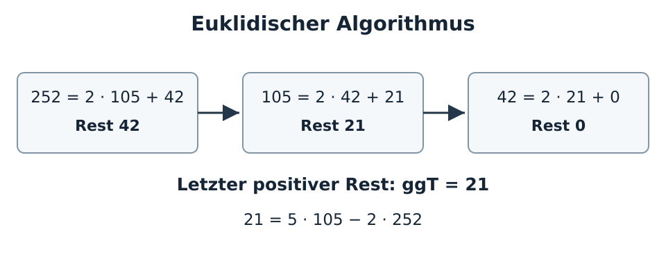

# M7-L1 – Teilbarkeit, Kongruenzen und euklidischer Algorithmus {#L1}

**Kursbereich:** M7 – Elementare Zahlentheorie

**Niveau:** Gymnasiale Oberstufe · Wahlvertiefung

**Vorwissen:** [M1-L1](M1-L1.md); [M1-L7](M1-L7.md)

**Einordnung:** Wahlvertiefung nach LehrplanPLUS Bayern M12; nicht bundesweit verpflichtend.

## Lernziele {#S1}

Du entscheidest Teilbarkeit, berechnest den größten gemeinsamen Teiler (ggT) ohne Primfaktorzerlegung und begründest die Korrektheit des euklidischen Algorithmus. Du bestimmst Bézout-Koeffizienten, rechnest mit Restklassen und löst einfache lineare Kongruenzen. Dabei prüfst du, wann eine Division modulo einer Zahl zulässig ist.

## Teilbarkeit und Division mit Rest {#S2}

Für ganze Zahlen $a\ne0$ und $b$ bedeutet $a\mid b$, dass $b=ak$ für eine ganze Zahl $k$ gilt. Beispielsweise ist $7\mid 35$, aber $7\nmid 36$. Für $m>0$ lässt sich jede ganze Zahl $a$ eindeutig als $a=qm+r$ mit $0\le r<m$ schreiben. Der Quotient $q$ darf negativ sein: $-17=(-4)\cdot5+3$. Der nichtnegative Rest ist also 3. Teilbarkeit durch $m$ entspricht dem Rest null.

Der ggT zweier nicht gleichzeitig nuller ganzer Zahlen ist ihr größter positiver gemeinsamer Teiler. Bei $84$ und $30$ ergibt die Primfaktorzerlegung $84=2^2\cdot3\cdot7$, $30=2\cdot3\cdot5$ den ggT 6. Für große Zahlen ist die Zerlegung jedoch nicht erforderlich. Zwei Zahlen mit ggT 1 heißen teilerfremd; beide müssen dafür nicht prim sein.

## Euklidischer Algorithmus {#S3}

Sind $a,b>0$ und $a=qb+r$, so haben $(a,b)$ und $(b,r)$ dieselben gemeinsamen Teiler: Jeder Teiler von $a$ und $b$ teilt auch $r=a-qb$; umgekehrt teilt jeder gemeinsame Teiler von $b$ und $r$ auch $a=qb+r$. Deshalb gilt $\gcd(a,b)=\gcd(b,r)$. Die Reste werden streng kleiner, bis null erreicht ist. Der letzte von null verschiedene Rest ist der ggT.

Beispiel für $252$ und $105$:

$$252=2\cdot105+42,\qquad105=2\cdot42+21,\qquad42=2\cdot21+0.$$

Damit ist $\gcd(252,105)=21$. Bei einer Eingabe null gilt $\gcd(a,0)=|a|$ für $a\ne0$; bei negativen Eingaben kann man zunächst die Beträge bilden.

{alt="Drei Restdivisionen mit den Resten 42, 21 und 0; letzter positiver Rest 21 ist der ggT."}

## Bézout und Rückwärtseinsetzen {#S4}

Der ggT lässt sich als ganzzahlige Linearkombination $sa+tb$ darstellen. Denn jeder berechnete Rest ist eine ganzzahlige Kombination seiner beiden Vorgänger; diese Eigenschaft reicht bis zu den Eingabezahlen zurück. Das Verfahren zum Finden von $s,t$ heißt erweiterter euklidischer Algorithmus.

Für das Beispiel folgt rückwärts

$$21=105-2\cdot42=105-2(252-2\cdot105)=5\cdot105-2\cdot252.$$

Die Probe liefert $525-504=21$. Die Koeffizienten sind nicht eindeutig. Addiert man zu $s$ ein Vielfaches von $b/d$ und subtrahiert von $t$ dasselbe Vielfache von $a/d$, bleibt $sa+tb=d$ unverändert, wobei $d=\gcd(a,b)$.

## Kongruenzen und Rechenregeln {#S5}

Für einen Modul $m\ge2$ bedeutet $a\equiv b\pmod m$, dass $m\mid(a-b)$ gilt. Das ist gleichbedeutend mit demselben nichtnegativen Rest. Modulo 7 sind etwa $-2$, $5$ und $12$ kongruent. Die sieben Restklassen lassen sich durch $0,1,\ldots,6$ vertreten. Ist $a\equiv b$ und $c\equiv d$ modulo $m$, dann gilt auch $a+c\equiv b+d$ und $ac\equiv bd$ modulo $m$. Beispielsweise ergibt $(19\cdot23)\bmod7=(5\cdot2)\bmod7=3$. Für nichtnegative ganzzahlige Exponenten darf man auch Potenzen kongruenter Zahlen bilden.

Kürzen ist dagegen nicht immer erlaubt: $2\cdot1\equiv2\cdot4\pmod6$, aber $1\not\equiv4\pmod6$. Eine gewöhnliche Division durch 2 hätte hier eine Lösung verloren.

## Modulares Inverses und lineare Kongruenzen {#S6}

Ein Inverses zu $a$ modulo $m$ ist eine Zahl $u$ mit $au\equiv1\pmod m$. Es existiert genau dann, wenn $\gcd(a,m)=1$: Aus Bézout folgt dann $sa+tm=1$, also $sa\equiv1\pmod m$. Umgekehrt muss jeder gemeinsame Teiler von $a,m$ auch 1 teilen, falls $au-1$ ein Vielfaches von $m$ ist. Das Inverse ist als Restklasse eindeutig, denn Multiplikation mit einem vorhandenen Inversen hebt den Faktor $a$ auf.

Beispiel: $26=3\cdot7+5$, $7=5+2$, $5=2\cdot2+1$. Rückwärts ergibt sich $1=3\cdot26-11\cdot7$. Damit ist $7^{-1}\equiv-11\equiv15\pmod{26}$ und die Probe ist $7\cdot15=105=4\cdot26+1$. Die Kongruenz $7x\equiv9\pmod{26}$ hat also $x\equiv15\cdot9\equiv5\pmod{26}$.

Allgemein hat $ax\equiv b\pmod m$ genau dann eine Lösung, wenn $d=\gcd(a,m)$ den Wert $b$ teilt: Notwendig wegen $ax-my=b$, hinreichend durch Multiplikation einer Bézout-Darstellung von $d$ mit $b/d$. Im lösbaren Fall erhält man durch Teilen der ganzen Gleichung durch $d$ eine Kongruenz modulo $m/d$; für $m/d>1$ ist der verbleibende Koeffizient invertierbar. Es gibt genau $d$ Lösungen unter den ursprünglichen $m$ Restklassen. Ist $m/d=1$, sind alle Klassen Lösungen. Beispiel: $4x\equiv6\pmod{10}$ wird zu $2x\equiv3\pmod5$, also $x\equiv4\pmod5$. Modulo 10 ergeben sich 4 und 9.

## Selbstkontrolle {#S7}

### Aufgaben

1. Bestimme Quotient und Rest von $-29$ bei Division durch 8. Ist $8\mid-29$?
2. Berechne $\gcd(198,72)$ mit dem euklidischen Algorithmus.
3. Stelle den ggT aus Aufgabe 2 als ganzzahlige Kombination von 198 und 72 dar.
4. Bestimme das Inverse von 9 modulo 28 und löse $9x\equiv4\pmod{28}$.
5. Löse $6x\equiv9\pmod{15}$ und erkläre, warum $6x\equiv8\pmod{15}$ unlösbar ist.

::: {.lc-solutions data-lc-section="S7"}
1. $-29=(-4)\cdot8+3$. Quotient $-4$, Rest 3; keine Teilbarkeit.
2. $198=2\cdot72+54$, $72=54+18$, $54=3\cdot18$; ggT 18.
3. $18=72-54=3\cdot72-198$. Probe: $216-198=18$.
4. $28-3\cdot9=1$, also Inverses $-3\equiv25$. $x\equiv25\cdot4\equiv16\pmod{28}$; $9\cdot16=144\equiv4$.
5. $d=3$. Die erste Kongruenz wird zu $2x\equiv3\pmod5$, also $x\equiv4\pmod5$; Restklassen 4, 9, 14 modulo 15. Die zweite hat keine Lösung, weil 3 kein Teiler von 8 ist.
:::

## Quellen {#S8}

- [MIT 18.310 – Michel Goemans, Modular Arithmetic and Elementary Algebra (2015)](https://math.mit.edu/~goemans/18310S15/modarithm-algebra-notes.pdf) · §§ 1–2, pp. 1–4 · Zuletzt abgerufen: 2026-11-24 · Inhaltlich geprüft: 2026-11-24
