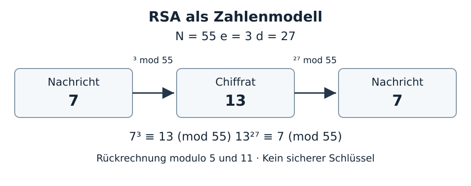

# M7-L2 – Chinesischer Restsatz, Fermat und RSA als Rechenmodell {#L2}

**Kursbereich:** M7 – Elementare Zahlentheorie

**Niveau:** Gymnasiale Oberstufe · Wahlvertiefung

**Vorwissen:** [M7-L1](M7-L1.md)

**Einordnung:** Wahlvertiefung nach LehrplanPLUS Bayern M12; nicht bundesweit verpflichtend.

## Lernziele {#S1}

Du kombinierst Restbedingungen mit dem chinesischen Restsatz, berechnest große Potenzen mit wiederholtem Quadrieren und beweist den kleinen Satz von Fermat. Du unterscheidest einen sicheren Nachweis der Primzahleigenschaft durch Probedivision von einem Fermat-Test und erklärst am Zahlenmodell RSA, warum Verschlüsselung und Entschlüsselung mathematisch zusammenpassen.

## Chinesischer Restsatz {#S2}

Sind $m,n\ge2$ teilerfremd, so haben die Bedingungen $x\equiv a\pmod m$ und $x\equiv b\pmod n$ genau eine gemeinsame Restklasse modulo $mn$. Setze $x=a+mk$. Die zweite Bedingung wird zu $mk\equiv b-a\pmod n$. Wegen der Teilerfremdheit existiert das Inverse von $m$ modulo $n$; damit findet man eine eindeutige Klasse für $k$ modulo $n$. Änderungen von $k$ um $n$ verändern $x$ um $mn$. Das beweist Existenz und Eindeutigkeit zugleich.

Beispiel: $x\equiv2\pmod5$, $x\equiv3\pmod7$. Setze $x=2+5k$; es folgt $5k\equiv1\pmod7$. Das Inverse von 5 ist 3, daher $k\equiv3\pmod7$ und $x\equiv17\pmod{35}$. Probe: $17\bmod5=2$, $17\bmod7=3$. Weitere Lösungen sind $17+35t$ mit ganzzahligem $t$. Für mehrere paarweise teilerfremde Moduln kann man die Bedingungen nacheinander zusammenführen. Ohne Teilerfremdheit können Bedingungen unvereinbar sein, etwa $x\equiv0\pmod4$ und $x\equiv1\pmod6$ (gerade gegen ungerade).

## Modulares Potenzieren {#S3}

Bei $a^k\bmod m$ ist es unnötig, zuerst die ganze Potenz auszurechnen. Quadriere den jeweils letzten Rest, sodass die Exponenten $1,2,4,8,\ldots$ entstehen. Zerlege $k$ in eine Summe verschiedener Zweierpotenzen und multipliziere die passenden Reste. Nach jeder Multiplikation darfst du wieder den Rest bilden.

Beispiel: $3^{13}\bmod17$. Es gilt $3^2\equiv9$, $3^4\equiv13$, $3^8\equiv16\pmod{17}$. Weil $13=8+4+1$, ist $3^{13}\equiv16\cdot13\cdot3\equiv12\pmod{17}$. Für $k=0$ erhält man den Rest 1. Die Anzahl der notwendigen Quadrierungen und zusätzlichen Multiplikationen wächst nur logarithmisch mit einem positiven Exponenten $k$.

## Kleiner Satz von Fermat {#S4}

Ist $p$ eine Primzahl und $p\nmid a$, dann gilt $a^{p-1}\equiv1\pmod p$. Zum Beweis betrachte die $p-1$ Zahlen $a,2a,\ldots,(p-1)a$ modulo $p$. Keine hat Rest null, und zwei verschiedene Faktoren können nicht denselben Rest ergeben: Aus $ai\equiv aj\pmod p$ folgt wegen des Inversen von $a$ bereits $i\equiv j\pmod p$. Die Liste enthält daher jeden Rest von 1 bis $p-1$ genau einmal. Das Produkt liefert

$$a^{p-1}(p-1)!\equiv(p-1)!\pmod p.$$

Da keine Zahl von 1 bis $p-1$ durch $p$ teilbar ist, ist auch ihr Produkt nicht durch $p$ teilbar. Sein Inverses erlaubt das Kürzen. Damit folgt die Behauptung. Für alle ganzen $a$ gilt außerdem $a^p\equiv a\pmod p$: Bei $p\mid a$ sind beide Seiten null, sonst multipliziert man die erste Formel mit $a$.

## Primzahlen prüfen {#S5}

Eine ganze Zahl $n\ge2$ ist prim, wenn sie keinen Teiler zwischen 2 und $\lfloor\sqrt n\rfloor$ besitzt. Denn bei einer Zerlegung $n=uv$ mit $u,v>1$ muss mindestens ein Faktor höchstens $\sqrt n$ sein. Für 97 genügt die Prüfung der Primteiler 2, 3, 5 und 7; keiner teilt 97. Bei 91 findet man den Teiler 7. Die Probedivision ist eindeutig, für große Zahlen jedoch teuer.

Der Fermat-Test kann viele zusammengesetzte Zahlen schneller erkennen: Für $1<a<n$ widerlegt $a^{n-1}\not\equiv1\pmod n$ die Primzahleigenschaft. Ein bestandener Test für eine einzelne Basis beweist sie dagegen nicht. Beispiel: $341=11\cdot31$, aber $2^{10}=1024\equiv1\pmod{341}$ und somit $2^{340}\equiv1\pmod{341}$. Ein Test mit Basis 2 würde die zusammengesetzte Zahl nicht erkennen.

## RSA als mathematisches Rechenmodell {#S6}

Wähle zwei verschiedene Primzahlen $p=5$, $q=11$. Dann $N=pq=55$ und $\varphi(N)=(p-1)(q-1)=40$. Wähle $e=3$ mit $\gcd(e,40)=1$; das Inverse von 3 modulo 40 ist $d=27$, denn $3\cdot27=81=1+2\cdot40$. Das öffentliche Zahlenpaar ist $(N,e)$, das private Exponentpaar $(N,d)$. Für eine Nachricht $0\le M<N$ definiert das Rechenmodell $C=M^e\bmod N$ und $M'=C^d\bmod N$. Mit $M=7$ erhält man $C=343\bmod55=13$; die Rückrechnung liefert $13^{27}\bmod55=7$.

Warum funktioniert es auch für Nachrichten, die nicht teilerfremd zu $N$ sind? Es gilt $ed=1+2(p-1)(q-1)$. Ist $p\nmid M$, folgt aus Fermat $M^{ed}\equiv M\pmod p$; ist $p\mid M$, sind beide Seiten null. Entsprechend gilt die Kongruenz modulo $q$. Der chinesische Restsatz liefert $M^{ed}\equiv M\pmod N$. Da $M$ und $M'$ im Bereich 0 bis $N-1$ liegen, sind sie gleich. Das beweist die mathematische Rückrechenbarkeit, nicht die Sicherheit.

{alt="Nachricht 7 wird durch Potenzieren mit 3 modulo 55 zu 13; mit Exponent 27 ergibt sich wieder 7. Beide Kongruenzen modulo 5 und 11 sichern die Rückrechnung."}

Dieses absichtlich winzige Beispiel ist nicht sicher und darf nicht zum Schutz von Daten eingesetzt werden. Reales RSA benötigt unter anderem geeignete Schlüsselgrößen, geprüfte Implementierungen und standardisierte Verfahren zur Nachrichtenkodierung; aus der mathematischen Identität allein folgt keine kryptografische Sicherheit.

## Selbstkontrolle {#S7}

### Aufgaben

1. Löse $x\equiv1\pmod4$ und $x\equiv2\pmod9$.
2. Berechne $5^{11}\bmod13$ mit wiederholtem Quadrieren.
3. Vereinfache $7^{100}\bmod11$ mit Fermat und begründe die Voraussetzungen.
4. Prüfe 143 durch Probedivision. Erkläre, warum ein bestandener Fermat-Test mit einer einzigen Basis kein Primzahlbeweis ist.
5. Verschlüssele im RSA-Modell mit $N=55,e=3,d=27$ die Nachricht 10 und rechne zurück. Warum ist die Nachricht trotz ihres gemeinsamen Teilers 5 zulässig?

::: {.lc-solutions data-lc-section="S7"}
1. $x=1+4k$, $4k\equiv1\pmod9$. Das Inverse von 4 modulo 9 ist 7. Also $x\equiv29\pmod{36}$. Probe: 29 hat die Reste 1 und 2.
2. $5^2\equiv12$, $5^4\equiv1$, $5^8\equiv1\pmod{13}$. $11=8+2+1$; Ergebnis $1\cdot12\cdot5\equiv8$.
3. 11 ist prim und teilt 7 nicht. $7^{10}\equiv1\pmod{11}$, folglich $7^{100}\equiv1$.
4. $143=11\cdot13$; 11 liegt unter $\sqrt{143}$ und ist ein Teiler. Zusammengesetzte Zahlen können für einzelne Basen die Fermat-Kongruenz erfüllen, wie 341 aus S5.
5. $10^3\bmod55=10$; $10^{27}\bmod55=10$. Modulo 5 ist die Nachricht null, modulo 11 ist sie $-1$ und der Exponent 27 ungerade. Die Rückrechnung stimmt in beiden Restklassen, also auch modulo 55.
:::

## Quellen {#S8}

- [MIT 18.310 – Michel Goemans, Modular Arithmetic and Elementary Algebra (2015)](https://math.mit.edu/~goemans/18310S15/modarithm-algebra-notes.pdf) · §§ 4–5, pp. 6–8 · Zuletzt abgerufen: 2026-11-24 · Inhaltlich geprüft: 2026-11-24
- [Veerman – Fermat’s Little Theorem and Primality Testing](https://math.libretexts.org/Bookshelves/Combinatorics_and_Discrete_Mathematics/An_Introduction_to_Number_Theory_%28Veerman%29/05%3A_Modular_Arithmetic_and_Primes/5.03%3A_New_Page) · § 5.3 · Zuletzt abgerufen: 2026-11-24 · Inhaltlich geprüft: 2026-11-24
- [Dumas and McCarthy – Fermat’s Little Theorem](https://math.libretexts.org/Bookshelves/Mathematical_Logic_and_Proof/Transition_to_Higher_Mathematics_%28Dumas_and_McCarthy%29/07%3A_New_Page/7.04%3A_New_Page) · § 7.4 · Zuletzt abgerufen: 2026-11-24 · Inhaltlich geprüft: 2026-11-24
