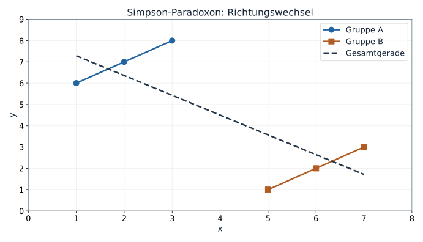

# M8-L1 – Skalenniveaus, Regression und Korrelation {#L1}

**Kursbereich:** M8 – Vertiefte Datenanalyse

**Niveau:** Gymnasiale Oberstufe · Wahlvertiefung

**Vorwissen:** [M1-L6](M1-L6.md); [M1-L8](M1-L8.md)

**Einordnung:** Wahlvertiefung nach LehrplanPLUS Bayern M12; nicht bundesweit verpflichtend.

## Lernziele {#S1}

Du unterscheidest Skalenniveaus, berechnest eine Ausgleichsgerade und den Pearson-Korrelationskoeffizienten, interpretierst Residuen und erkennst Grenzen statistischer Modelle. Du vergleichst gruppierte mit zusammengefassten Daten und erklärst einen Richtungswechsel beim Simpson-Paradoxon.

## Skalenniveaus und sinnvolle Auswertungen {#S2}

Die Bedeutung einer Zahl hängt von ihrer Messung ab. Eine nominale Variable unterscheidet Kategorien ohne Rangfolge (z. B. Bus oder Fahrrad); auch eine numerische Codierung erzeugt keine messbaren Abstände. Häufigkeiten und Modalwert sind sinnvoll. Ordinale Merkmale besitzen eine Rangfolge (z. B. niedrig, mittel, hoch), aber nicht zwingend gleiche Abstände; Median und Rangvergleiche sind möglich. Auf einer Intervallskala sind Differenzen interpretierbar, etwa bei Celsius-Temperaturen, nicht jedoch Quotienten der Messwerte. Eine Verhältnisskala besitzt zusätzlich einen sachlich begründeten Nullpunkt, etwa bei Dauer oder Länge. Zwei Stunden sind doppelt so lang wie eine Stunde; 20 °C sind nicht doppelt so warm wie 10 °C.

Auch diskrete Zählwerte können quantitativ sein. Entscheidend ist, ob eine Rechnung eine fachliche Bedeutung besitzt. Für die folgende lineare Regression verwenden wir zwei quantitative Merkmale mit interpretierbaren Differenzen.

## Streudiagramm und kleinste Quadrate {#S3}

Jeder Datenpunkt $(x_i,y_i)$ ist ein Paar von Messwerten derselben Beobachtung. Wir wählen $x$ als erklärende Variable und $y$ als Zielvariable. Eine Gerade $\hat y=a+bx$ liefert Schätzwerte; die Residuen $e_i=y_i-\hat y_i$ sind die vertikalen Abweichungen. Die Methode der kleinsten Quadrate minimiert $Q(a,b)=\sum_i e_i^2$, nicht die geometrischen Abstände zur Geraden.

Setze $S_{xx}=\sum_i(x_i-\bar x)^2$, $S_{yy}=\sum_i(y_i-\bar y)^2$ und $S_{xy}=\sum_i(x_i-\bar x)(y_i-\bar y)$. Falls $S_{xx}>0$, erhält man

$$b=\frac{S_{xy}}{S_{xx}},\qquad a=\bar y-b\bar x.$$

Warum? Für festes $b$ ist $Q$ als quadratische Funktion von $a$ minimal bei $a=\bar y-b\bar x$. Nach Einsetzen bleibt $Q=S_{yy}-2bS_{xy}+b^2 S_{xx}$. Quadratische Ergänzung liefert das angegebene Minimum. Die Gerade geht daher durch $(\bar x,\bar y)$. Sind alle $x_i$ gleich, lässt sich keine eindeutige Steigung bestimmen.

## Rechenbeispiel und Korrelation {#S4}

Ein künstlicher Datensatz enthält die Paare $(1,2),(2,4),(3,3)$. Die Mittelwerte sind $\bar x=2$, $\bar y=3$. Es gilt $S_{xx}=2$, $S_{yy}=2$, $S_{xy}=1$. Damit ist $\hat y=2+0{,}5x$. Die Schätzwerte 2,5; 3; 3,5 führen zu Residuen −0,5; 1; −0,5. Ihre Summe ist null, ihre Quadratsumme 1,5.

Für zwei nicht konstante quantitative Variablen gilt

$$r=\frac{S_{xy}}{\sqrt{S_{xx}S_{yy}}},\qquad -1\le r\le1.$$

Hier ergibt sich $r=0{,}5$. Das Vorzeichen stimmt mit dem der Steigung überein. Der Betrag beschreibt die Stärke des linearen Zusammenhangs, nicht die Größe der Steigung. Bei der einfachen Regression mit Achsenabschnitt ist $R^2=r^2=0{,}25$: Die Quadratsumme der Residuen ist gegenüber dem Modell mit konstantem Mittelwert um 25 % kleiner. Das bedeutet nicht, dass 25 % der Beobachtungen richtig vorhergesagt wurden. Bei konstantem $y$ ist $r$ nicht definiert. Einheitenwechsel mit positiven Faktoren ändern $r$ nicht, die Steigung aber im Allgemeinen schon.

## Simpson-Paradoxon: Gruppen beachten {#S5}

Betrachte zwei künstliche Gruppen A mit $(1,6),(2,7),(3,8)$ und B mit $(5,1),(6,2),(7,3)$. Innerhalb jeder Gruppe gilt $b=1$ und $r=1$. Zusammengefasst sind die Mittelwerte $\bar x=4$, $\bar y=4{,}5$, und $S_{xx}=28$, $S_{xy}=-26$. Die gemeinsame Steigung ist $-13/14\approx-0{,}929$. Der Richtungswechsel entsteht, weil die Gruppen sich zugleich in ihrem typischen $x$- und $y$-Niveau unterscheiden.

{alt="Gruppe A liegt links oben, Gruppe B rechts unten. Innerhalb beider Gruppen steigt die Gerade, die gemeinsame Regressionsgerade fällt."}

Das ist ein Beispiel des Simpson-Paradoxons. Die Zusammenfassung ist nicht rechnerisch falsch; sie beantwortet eine andere Frage als der Vergleich innerhalb der Gruppen. Welche Gruppierung relevant ist, muss anhand der Datenerhebung und Fragestellung entschieden werden. Eine statistische Gruppierung allein beweist keine Ursache.

## Grenzen und Überprüfung {#S6}

Korrelation kann aus einer gemeinsamen Einflussgröße entstehen. Selbst $r=1$ beweist keine Kausalität. Umgekehrt kann eine starke nichtlineare Beziehung $r=0$ liefern: Für $x=-1,0,1$ und $y=x^2$ verschwindet $S_{xy}$ trotz vollständiger funktionaler Abhängigkeit. Ausreißer können eine Gerade und $r$ stark verändern; sie dürfen nicht ohne sachliche Begründung entfernt werden.

Zeichne zunächst ein Streudiagramm, berechne die Gerade, zeichne die Residuen gegen $x$ und suche Muster. Prüfe die Einheiten, fehlende Werte, Gruppierung und Herkunft. Vorhersagen außerhalb des beobachteten Bereichs sind Extrapolationen und benötigen zusätzliche Annahmen. Auch innerhalb des Bereichs ist die Gerade keine Garantie für einzelne Beobachtungen.

## Selbstkontrolle {#S7}

### Aufgaben

1. Ordne Verkehrsmittel, Rangplatz, Celsius-Temperatur und Fahrtdauer den vier Skalenniveaus zu.
2. Bestimme für $(1,1),(2,3),(3,5)$ Gerade und Korrelation.
3. Berechne für das Beispiel aus S4 den vorhergesagten Wert bei $x=2{,}5$ und erkläre, warum dies eine Interpolation ist.
4. Bestimme für die Gruppen aus S5 die beiden Einzelgeraden und den Achsenabschnitt der Gesamtgeraden.
5. Begründe mit dem Beispiel $y=x^2$ aus S6, warum $r=0$ nicht Unabhängigkeit bedeutet.

::: {.lc-solutions data-lc-section="S7"}
1. Nominal, ordinal, Intervall, Verhältnis.
2. $\hat y=-1+2x$, $r=1$, alle Residuen null.
3. $\hat y=3{,}25$. Der Wert 2,5 liegt zwischen 1 und 3, dem beobachteten Bereich.
4. A: $\hat y=x+5$; B: $\hat y=x-4$. Gesamt: $a=4{,}5+52/14=115/14\approx8{,}214$.
5. Für die drei symmetrischen Werte sind die positiven und negativen Produkte in $S_{xy}$ entgegengesetzt gleich, also $r=0$. Trotzdem ist $y$ durch $x$ eindeutig festgelegt.
:::

## Quellen {#S8}

- [OpenStax – Introductory Business Statistics 2e, 1.3 Levels of Measurement](https://openstax.org/books/introductory-business-statistics-2e/pages/1-3-levels-of-measurement) · 1.3 · Zuletzt abgerufen: 2026-11-24 · Inhaltlich geprüft: 2026-11-24
- [Monash University – Correlation and least squares regression line](https://www.monash.edu/student-academic-success/mathematics/linear-regression-and-linear-relations/correlation-and-least-squares-regression-line) · Pearson coefficient, least squares, interpolation · Zuletzt abgerufen: 2026-11-24 · Inhaltlich geprüft: 2026-11-24
- [Rafael A. Irizarry – Introduction to Data Science, 19.5 Simpson’s paradox](https://rafalab.dfci.harvard.edu/dsbook/association-is-not-causation.html) · 19.5 · Zuletzt abgerufen: 2026-11-24 · Inhaltlich geprüft: 2026-11-24
