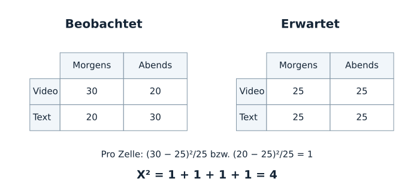

# M8-L2 – Unabhängigkeitstest und kritische Datenanalyse {#L2}

**Kursbereich:** M8 – Vertiefte Datenanalyse

**Niveau:** Gymnasiale Oberstufe · Wahlvertiefung

**Vorwissen:** [M8-L1](M8-L1.md); [M2-L16](M2-L16.md)

**Einordnung:** Wahlvertiefung nach LehrplanPLUS Bayern M12; nicht bundesweit verpflichtend.

## Lernziele {#S1}

Du erstellst Kontingenztafeln, berechnest erwartete Häufigkeiten unter Unabhängigkeit und führst einen Pearson-Chi-Quadrat-Test durch. Du unterscheidest statistische Signifikanz von Effektgröße und Ursache und prüfst Medienaussagen auf verzerrte Bezugsgrößen oder unzulässige Schlussfolgerungen.

## Kontingenztafel und Hypothesen {#S2}

Wir betrachten zwei kategoriale Merkmale. Ein fiktives Stichprobenexperiment erfasst bei 100 unabhängig ausgewählten Personen die bevorzugte Lernform (Video oder Text) und die bevorzugte Arbeitszeit (morgens oder abends). Jede Person gehört genau einer Zelle an. Die beobachteten Häufigkeiten $O_{ij}$ lauten:

| Lernform | Morgens | Abends | Summe |
|---|---:|---:|---:|
| Video | 30 | 20 | 50 |
| Text | 20 | 30 | 50 |
| Summe | 50 | 50 | 100 |

Die Nullhypothese $H_0$ besagt, dass Lernform und Arbeitszeit in der zugrunde liegenden Population unabhängig sind. Dann gilt $P(A\cap B)=P(A)P(B)$ für jede Kategorienkombination. Die Alternative $H_1$ besagt, dass dies für mindestens eine Kombination nicht gilt. Die Auswahl eines Signifikanzniveaus, beispielsweise $\alpha=0{,}05$, erfolgt vor der Auswertung.

## Erwartete Häufigkeiten und Teststatistik {#S3}

Unter $H_0$ schätzen wir die Randwahrscheinlichkeiten mit den beobachteten Randanteilen. Bei $n$ Beobachtungen ergibt sich

$$E_{ij}=n\cdot\frac{R_i}{n}\cdot\frac{C_j}{n}=\frac{R_iC_j}{n},$$

wobei $R_i$ die Zeilensumme und $C_j$ die Spaltensumme ist. Die erwartete Häufigkeit darf eine nicht ganzzahlige Zahl sein. Im Beispiel sind alle vier Erwartungswerte 25. Die erwarteten Randhäufigkeiten stimmen mit den beobachteten Randhäufigkeiten überein.

{alt="Beobachtete Tafel 30, 20, 20, 30; unter Unabhängigkeit viermal 25. Jede Zelle trägt 1 zur Teststatistik 4 bei."}

Die Pearson-Teststatistik lautet

$$X^2=\sum_{i=1}^{k}\sum_{j=1}^{m}\frac{(O_{ij}-E_{ij})^2}{E_{ij}}.$$

Bei vier Zellen mit Abweichungen von jeweils ±5 ergibt sich $X^2=4\cdot25/25=4$. Größere Werte zeigen stärkere Abweichungen im Verhältnis zu den erwarteten Häufigkeiten, sind allein aber noch keine Entscheidung.

## Freiheitsgrade und p-Wert {#S4}

Bei $k$ Zeilen und $m$ Spalten gibt es $(k-1)(m-1)$ Freiheitsgrade: Sind Randhäufigkeiten festgelegt, können die Werte im oberen linken $(k-1)\times(m-1)$-Block innerhalb der Häufigkeitsgrenzen frei gewählt werden; die übrigen werden dadurch bestimmt. Unter geeigneten Bedingungen ist $X^2$ unter $H_0$ näherungsweise chi-quadrat-verteilt mit diesen Freiheitsgraden. Wir verwenden die unkorrigierte Pearson-Statistik.

Im Beispiel gilt $df=1$. Der p-Wert ist die Wahrscheinlichkeit, unter $H_0$ eine mindestens so große Teststatistik zu erhalten: $p=P(\chi^2_1\ge4)\approx0{,}0455$. Bei $\alpha=0{,}05$ verwerfen wir $H_0$; bei $\alpha=0{,}01$ nicht. Ein p-Wert ist weder die Wahrscheinlichkeit, dass $H_0$ wahr ist, noch die Wahrscheinlichkeit, dass das Ergebnis bloß Zufall ist. Nichtverwerfen bedeutet nicht Nachweis der Unabhängigkeit.

Der Test setzt unabhängige Beobachtungen und disjunkte Kategorien voraus. Für die schulische Anwendung verwenden wir als konservative Faustregel alle $E_{ij}\ge5$. Leere Randkategorien sind vorab auszuschließen; bei kleinen erwarteten Häufigkeiten kann die Approximation ungeeignet sein (bei einer 2×2-Tafel kommt etwa Fishers exakter Test in Betracht). Wiederholte Befragungen derselben Person sind keine unabhängigen Beobachtungen.

## Reproduzierbare Softwareauswertung und Effektgröße {#S5}

Mit Python und SciPy lässt sich die Rechnung nachvollziehen (Installation vorausgesetzt):

```python
from scipy.stats import chi2_contingency
observed = [[30, 20], [20, 30]]
x2, p, df, expected = chi2_contingency(observed, correction=False)
print(x2, p, df, expected)
```

Erwartet werden 4, etwa 0,0455, 1 und eine 2×2-Matrix mit vier 25ern. Die Option `correction=False` ist wichtig, weil Software bei einem Freiheitsgrad sonst eine Kontinuitätskorrektur verwenden kann. Alternativ kann man $E$ und $X^2$ in einer Tabellenkalkulation berechnen und die rechte Verteilungswahrscheinlichkeit mit der Chi-Quadrat-Funktion bestimmen. Dokumentiere Software, Daten, Einstellung und Rundung.

Als beschreibende Effektgröße für 2×2-Tafeln dient $|\phi|=\sqrt{X^2/n}$; hier 0,2. Die beobachteten Morgenanteile liegen bei 60 % (Video) und 40 % (Text), also 20 Prozentpunkten Unterschied. Verdoppelt man jede Zelle, bleibt dieser Unterschied und $|\phi|$ gleich, aber $X^2$ verdoppelt sich auf 8; der p-Wert fällt auf etwa 0,00468. Das ist ein Vergleich zweier hypothetischer Stichproben, keine Rechtfertigung, die Daten einfach zu duplizieren.

## Kritische Datenanalyse in Medien {#S6}

Die Aussage „Videolernen verursacht eine Vorliebe für morgens“ folgt nicht aus der Tafel. Ein unbekannter Stundenplan könnte beide Merkmale beeinflussen. Prüfe vor der Interpretation die Auswahl der Stichprobe, fehlende Antworten, die genaue Definition der Gruppen und den Erhebungszeitraum. Vergleiche Anteile mit ihren jeweils korrekten Bezugsgrößen und unterscheide absolute Zahlen, Prozente und Prozentpunkte. Ein Balkendiagramm mit abgeschnittener Achse kann kleine Unterschiede groß erscheinen lassen. Prüfe Achsen und Einheiten; zeige Unsicherheit, wenn sie bekannt ist.

Viele nachträglich getestete Zusammenhänge erhöhen die Chance auf mindestens einen scheinbar auffälligen Befund. Berichte daher auch nichtsignifikante Ergebnisse, kennzeichne explorative Analysen und trenne sie von vorab festgelegten Hypothesen. Signifikanz allein bestimmt weder Relevanz noch Ursache.

## Selbstkontrolle {#S7}

### Aufgaben

1. Berechne alle erwarteten Häufigkeiten für die Tafel $\begin{pmatrix}20&10\\10&20\end{pmatrix}$.
2. Berechne $X^2$, $df$ und entscheide bei $\alpha=0{,}05$ für Aufgabe 1. Nutze den kritischen Wert 3,841.
3. Eine 3×4-Tafel hat nur positive Randsummen und ausreichend große Erwartungswerte. Wie viele Freiheitsgrade hat der Test?
4. Für eine Tafel mit $n=80$ ist $X^2=3{,}2$. Berechne $|\phi|$, falls es eine 2×2-Tafel ist. Darf man eine Ursache behaupten?
5. Ein Artikel nennt 20 von 50 gegenüber 30 von 100 als „50 % mehr Erfolg“ der zweiten Gruppe. Überprüfe die Aussage und benenne eine weitere nötige Information.

::: {.lc-solutions data-lc-section="S7"}
1. Zeilen- und Spaltensummen sind jeweils 30; $n=60$. Alle $E_{ij}=15$.
2. $X^2=4\cdot25/15=20/3\approx6{,}667$, $df=1$. Weil $6{,}667>3{,}841$, wird $H_0$ verworfen (unter den Testvoraussetzungen).
3. $(3-1)(4-1)=6$.
4. $|\phi|=\sqrt{3{,}2/80}=0{,}2$. Nein, ein Zusammenhang beweist keine Ursache.
5. Die absoluten Zahlen steigen von 20 auf 30, aber die Anteile sinken von 40 % auf 30 % (−10 Prozentpunkte). Relevant sind beispielsweise Stichprobenauswahl, Zeitraum oder Erfolgsdefinition.
:::

## Quellen {#S8}

- [OpenStax – Introductory Statistics 2e, 11.3 Test of Independence](https://openstax.org/books/introductory-statistics-2e/pages/11-3-test-of-independence) · 11.3 · Zuletzt abgerufen: 2026-11-24 · Inhaltlich geprüft: 2026-11-24
